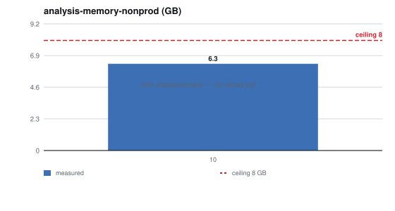
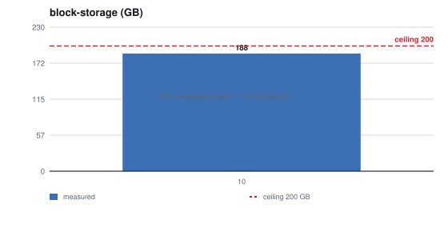
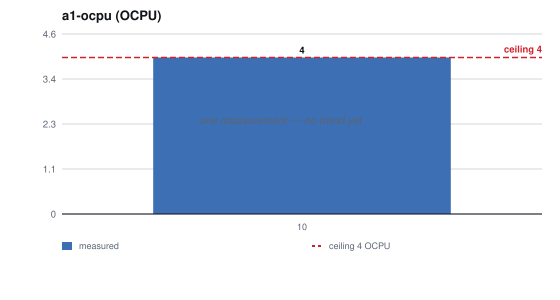

# Capacity plan, October 2026

`DP_CP_2026_10`

**Measured on the non-production VM in a sizing test; Dark Portal is not yet
live.** This first plan comes from the large-volume sizing test of
delphside/dark-portal#12. That test ran on the non-production VM (3 OCPU,
18 GB, DuckDB 2.0.0) on 2026-10-27, over a synthetic year built from four real
hourly snapshots; an OCPU is Oracle's unit of CPU, one physical core. The
test's report is
[`sizing/results/2026-10-27-report.md`](https://github.com/delphside/dark-portal/blob/main/sizing/results/2026-10-27-report.md).

- **Disk figures are the test's multiplied by 0.905.** The synthetic year was
  10.6% larger on disk than the real data: outside the test's 10% check, but on
  the safe side.
- **Timings, memory and spill are as measured.**
- **The hourly job's figures are estimates** for the design agreed on
  2026-10-28 (delphside/dark-portal#5), built from the measured collection and
  comparison steps.

Each row says whether it is measured or estimated. Memory figures are the
process's peak. DuckDB's `memory_limit` bounds its buffer, not the whole
process, so a process can use a little more than its limit; past the limit,
DuckDB spills to disk.

## What is consumed, against what ceiling

| | consumed | ceiling | headroom |
| --- | --- | --- | --- |
| **the hourly job's memory** | about 0.5 GB, estimated; collection alone 0.30 to 0.36 GB, measured | `memory_limit` 1 GB (set from this test) | about 50% |
| **the hourly job's CPU** | collection 1.4 s and comparison 0.4 s of CPU, measured | 1 OCPU through the hour | over 99% |
| **the hourly job's time** | 5 to 10 s, estimated; collection 1.7 s and comparison 1 s, measured | 60 min to the next collection | over 99% |
| **ad-hoc analysis memory** (DuckDB, production) | a year's price profile: 4.3 GB for the process at a 4 GB limit, spilling 1.7 GB, 220 s, 148 s of CPU, measured | `memory_limit` 4 GB (set from this test) | spills, by design |
| **ad-hoc analysis memory** (DuckDB, non-production) | a year's price profile: 6.3 GB for the process, no spill, 180 s, 145 s of CPU, measured | `memory_limit` 8 GB (set from this test) | 21% |
| **analysis spill** (production) | a year's price profile at 4 GB: 1.7 GB, measured | 5 GB of the host's disk kept free for spill (proposed on delphside/dark-portal#12, C5) | about 66% |
| **stored data on the host** | silver: about 3.3 GB a year for the events table, measured and scaled; 3 to 5 GB a year more for the listing records, estimated; gold a few hundred MB a year, estimated | a few days of bronze (delphside/dark-portal#5); none set for silver and gold | not measured: not live |
| **stored data in the bucket** | bronze: 0.276 GB a week, 14.4 GB a year, measured and scaled | one year of bronze once delphside/dark-portal#5's lifecycle rule exists; 20 GB Always Free | about 5.6 GB (28%) at a full year |
| **Blizzard API quota** | about 2 snapshot requests an hour, with token requests and occasional game data, estimated from the job's design | 36,000 requests an hour, 100 a second (Blizzard's published client limit) | over 99% |

Held until Infrastructure plans them:

| | consumed | ceiling | headroom |
| --- | --- | --- | --- |
| **host memory** | not measured: not live | 6 GB (the VM's shape) | |
| **host CPU** | not measured: not live | 1 OCPU (Oracle CPU), burstable off (the VM's shape) | |
| **host disk** | not measured: not live | 47 GB (the boot volume) | |
| — Docker images | not measured: not live | | |
| **Oracle Always Free, account-wide** | | | |
| — Ampere A1 cores and memory | 4 OCPU, 24 GB: production 1 OCPU, 6 GB, and non-production 3 OCPU, 18 GB | 4 OCPU, 24 GB across all A1 instances (Oracle's Always Free terms) | none |
| — block storage | about 188 GB: the three boot volumes on the owner's console on 2026-10-24, 141 GB, and the non-production VM's 47 GB since | 200 GB across all volumes (Oracle's Always Free terms) | about 12 GB |
| — Object Storage | nothing stored yet, measured | 20 GB across all tiers (Oracle's Always Free terms) | all 20 GB, until bronze is uploaded |

**Nothing Dark Portal runs is near a ceiling; the account's A1 allowance is
full.** Production takes 1 OCPU and 6 GB and non-production 3 OCPU and 18 GB,
until the non-production VM is shrunk to 2 OCPU and 12 GB (agreed 2026-10-28).
The shrink will leave 1 OCPU and 6 GB for another application, or to grow either VM
later. Block storage is close to its limit, at about 12 GB free. Both constrain
the next application, not this one.

## Which number moves first

**The host's disk, because nothing removes silver and gold.** The host keeps a
few days of bronze, but silver and gold have no retention yet, so they grow at
about 6.5 to 8.5 GB a year: silver's events 3.3 GB, the listing records 3 to
5 GB, gold a few hundred MB. Only the 47 GB boot volume bounds them, less the
operating system, the Docker images and the 5 GB kept for spill. At 8.5 GB a
year, about 37 GB left after those gives about four years; production has not
been measured.

**Block storage moves when a VM is added, not with use.** Each VM takes a boot
volume of about 47 GB, and four leave about 12 GB of the 200 GB.

**The bucket fills at 14.4 GB a year, and is to be bounded by the lifecycle
rule.** A year of bronze fits inside the 20 GB allowance. Until the rule that
removes bronze older than a year exists, the bucket has no enforced ceiling;
delphside/dark-portal#5 owns the rule.

## What would have to change before a ceiling is reached

| ceiling | reached by | what would have to change |
| --- | --- | --- |
| host disk, 47 GB | silver and gold kept for several years | a retention for silver and gold (delphside/dark-portal#5), or older gold moved to Object Storage |
| A1, 4 OCPU and 24 GB | full now | the agreed shrink of the non-production VM, to 2 OCPU and 12 GB |
| block storage, 200 GB | a fifth VM with a 47 GB boot volume | a smaller boot volume for the new VM, or a paid block volume |
| Object Storage, 20 GB | bronze kept beyond about 17 months, or another application's data | older bronze to the Archive tier (paid, restores take about an hour), or a shorter retention |
| production analysis memory, 4 GB | a scan of more than a year; or a year-long query that joins silver to itself, such as rebuilding each listing's lifetime, which failed at 4 GB when its spill reached the test's 20 GB cap | for a scan of more than a year, run it on non-production; for a year-long self-join, read gold, or the lifetimes the hourly job carries forward, since it failed on non-production's 8 GB too |
| the hourly job's 1 GB | a snapshot several times today's 286,000 listings | raise `memory_limit`, keeping the job's and the analysis's limits, with the operating system, inside the VM's 6 GB |

## What is not known, and is the next thing worth measuring

- **Every production figure.** Nothing has run there yet. The first plan after
  delphside/dark-portal#7 goes live measures the real hourly job, its memory
  and time, and the disk it adds each week.
- **The hourly job in the agreed design.** Only collection and comparison were
  timed. The join to silver's live listings, the history append, the gold
  updates and DuckLake's own commit and compaction overhead are estimates.
- **The listing record's size.** Estimated at 3 to 5 GB a year from the events
  table's 7.5 bytes a row. Not measured.
- **Silver and gold's retention on the host.** delphside/dark-portal#5 keeps
  them for as long as the analysis reads them, to be confirmed, so they have no
  ceiling yet.
- **Object Storage throughput.** Copying a year of bronze to the non-production
  VM for a rebuild is estimated at 5 to 12 minutes: 14.4 GB at the boot volume's
  measured 50 MB/s, or at an assumed 20 MB/s from the bucket. Not measured.
- **Why the query rebuilding listing lifetimes failed where it did.** Over 26
  weeks it failed at 8 GB but finished at 4 and 12 GB; over a year it failed
  at 4 and 8 GB, and at 12 GB finished with 1 thread only. Each failure reached
  the test's 20 GB spill cap. No planned job runs this query.
- **The real data's rates.** The synthetic year was calibrated from three
  pairs of consecutive real snapshots. The weekly and daily cycles are not in
  it.

## History, and where it is heading

The first plan, so there is one point and no trend. `measurements.csv` starts
the series with measured figures only: the account's console, whose block
storage counts the non-production VM's 47 GB boot volume added since the
reading, and the non-production analysis's year-long price profile. That one is
the sizing test's, over a synthetic year, so the next reading repeats the same
query over a real year. The hourly job's figures are estimates and are not in
the series; production's first measurements join it once
delphside/dark-portal#7 is live.

| | 2026-10 |
| --- | --- |
| **analysis-memory-nonprod** | 6.3 GB |
| **a1-ocpu** | 4 OCPU |
| **a1-memory** | 24 GB |
| **block-storage** | 188 GB |

### What the forecast says, and how much to believe it

None yet: `capacity-chart.py --summary` reports *not enough data* for every
metric. The forecast needs three points, the fewest that give it an interval.

### Each metric, against its ceiling

| | |
| --- | --- |
|  |  |
|  |  |

One measurement each, so no trend. A1 is at its ceiling until the shrink.

## Transaction thresholds and throttle limits

None, because Dark Portal serves no transactions: its one user reads results,
and its only external calls are the hourly job's, counted in the Blizzard row.

## How this was measured

The owner ran the sizing scripts on the non-production VM, each step after the
one before had finished:

1. Set up and fetch four real snapshots:

   ```bash
   cd ~/dark-portal/sizing
   ./setup.sh
   nohup ./fetch.sh >~/fetch.out 2>&1 &
   ```

2. Calibrate the generator from them: `./calibrate.sh`.
3. Generate the synthetic year, validate it and time the cases:
   `nohup ./all.sh >~/sizing.out 2>&1 &`. It stopped at the validation's size
   check, before any timing.
4. With the check set aside (delphside/dark-portal#12), time the cases and
   write the report:

   ```bash
   nohup sh -c './time.sh && ./report.sh' >~/time.out 2>&1 &
   ```

   Every sizing figure here comes from this step's run on 2026-10-27, against the
   synthetic year from step 3.

The Always Free figures are the owner's readings of the Oracle Cloud console on
2026-10-24, with the non-production VM added since (delphside/dark-portal#12).
The charts and the history table are `capacity-chart.py`'s, run from the Dark
Portal checkout: `programme/scripts/reports/capacity-chart.py --table`, then
`--summary` and `--write`.
