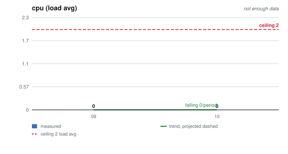
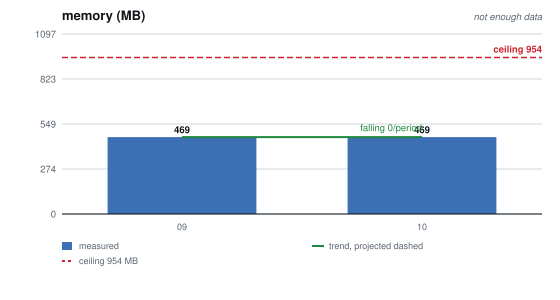
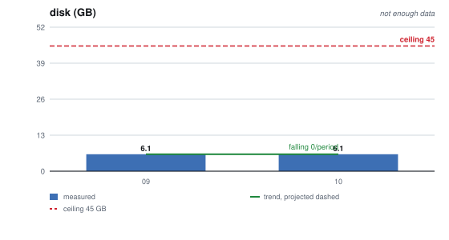
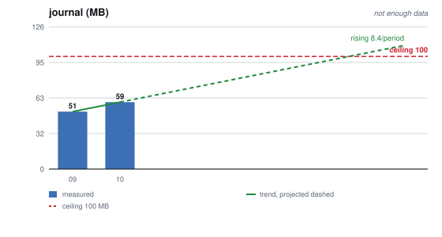
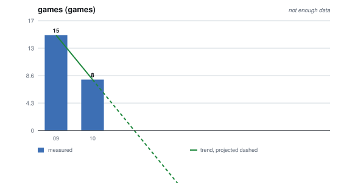
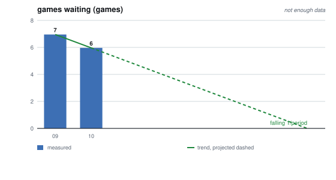
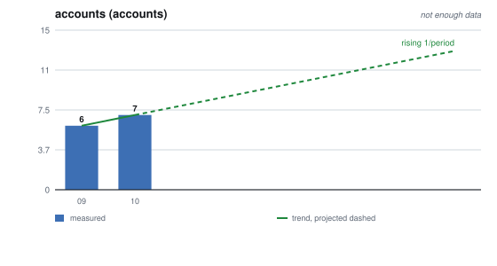

# Capacity plan, October 2026

`TLE_CP_2026_10`

**Measured on production, 2026-10-19 21:22 UTC**, by the owner, with the
commands under *How this was measured*. The host figures are again a single
sample of a service nobody was using at the time. The games and accounts rows
now also have a daily series, from the server's own size record, so those two
carry the month's range as well as the day's figure.

**The Resend figures are the owner's reading of its Metrics page for
2026-09-20 to 2026-10-19.** GitHub Actions minutes were not read for this
report, and its row says so rather than carry a guess.

## What is consumed, against what ceiling

| | consumed | ceiling | headroom |
| --- | --- | --- | --- |
| **memory** | 469 MB used, 484 MB available | 954 MB | 51% |
| — server container | 64 MB | | |
| — web container | 28 MB | | |
| — swap | 248 MB | 2,047 MB | 88% |
| **disk** | 6.1 GB | 45 GB | 86% |
| — the database volume | 1.7 MB | | |
| — pre-deploy snapshots | 1.4 MB, 5 files | `SNAPSHOT_KEEP` (5) | at its count, by design |
| — Docker images | 583 MB, of which 278 MB reclaimable | | |
| — `/var/log/syslog*` | 1.5 MB | logrotate: 4 weekly, gzipped | bounded |
| **journal** | 59.4 MB | 100 MB / 7 days | 41% |
| **CPU** | load 0.00 | 2 vCPU | effectively all of it |
| **games in the database** | 8: 6 `waiting`, 2 `finished` | *unbounded while `waiting` is unswept* | not knowable |
| **accounts** | 7 | none set | not knowable |
| **Resend email quota**: sent and received | 17 in 30 days; busiest day 4, on 2026-10-18 | 100 a day, 3,000 a month (free plan) | 99% of the month, 96% of the busiest day |
| **GitHub Actions minutes**: the service desk's workflows | not read this month | the organisation plan's included minutes | not known |

**Nothing is close to a ceiling, and nothing moved that matters.** Memory and
disk read the same as September to the megabyte. The two rows that changed are
the journal, up 8 MB, and the games table, down from 15 to 8.

## Which number moves first

**Still the `waiting` games, and nothing has changed about why.** A game that
never starts is swept by nothing: the move-timeout sweep needs a current seat
and the terminal sweep needs a finished or aborted game. RET-3 is the rule that
would remove it and is still unbuilt (delphside/tile-lite-elite#270), and the
general case, an idle game held in memory, is delphside/tile-lite-elite#408's.

**The six `waiting` games are all one batch.** Each is Greedy 1 against Greedy
2, both seats bots, and all six were created on 2026-07-21 at 17:13, so they
look like leftovers of a test run rather than games a player abandoned. They
are 90 days idle. Last month's seventh `waiting` game is gone. Deleting the six
is a production change and the owner's to make; RET-3 is what stops the next
batch from staying.

**The terminal sweep is working.** The size record shows games held in memory
peaking at 39 in August and falling as finished games pass their seven days.
In the month to this reading the figure ranged from 7 to 19, averaging 14, and
today's sits just above the floor of six that the `waiting` games set.

**The journal is the only host row that rose**, from 51 MB to 59.4 MB. A
straight line through two points puts it at its 100 MB cap in five months, and
that line is not worth planning against, for two reasons. The cap is enforced:
journald deletes the oldest files to stay under it, so reaching it shortens
how far back the journal reaches, and nothing fails. And the figure is the
whole host's journal in whole files, not this service's lines, which TLE's
4.3.4 puts at about 100 KB a week; why the journal holds this much more than
seven days of the service's logging was not checked this month.

## What would have to change before a ceiling is reached

| ceiling | reached by | what would have to change |
| --- | --- | --- |
| memory, 954 MB | the games map growing without RET-3 or eviction | build RET-3 (#270), or load games on demand (#408) |
| journal, 100 MB / 7 days | host logging, plus anything that logs per request | nothing fails at the cap; if the seven days is wanted for investigation, find what besides the service fills the journal |
| disk, 45 GB | nothing on a slope | — |
| CPU, 2 vCPU | engine search under concurrent games | unmeasured; delphside/tile-lite-elite#422 runs the load test that would say |
| Resend, 100 a day | a burst of inbound mail, which counts against the quota as sent mail does | nothing until a reading shows a need |
| GitHub Actions minutes | the service desk's intake schedule, up to 48 runs a day, plus a run per reply and per dispatch | nothing until a reading shows a need |

## What is new this month

**The support mail poller ships in 0.9.2** (delphside/tile-lite-elite#518). It
is not running yet: the scheduler's health list shows three jobs, and the
poller is not one of them. Once it runs, it costs this host one small request
to Resend a minute, about 1,440 a day. Those are API calls, which the email
quota does not count. What it does add is GitHub Actions runs: each time new
mail arrives it starts one intake run in the private service-desk repository.

**That is why the GitHub Actions row is new.** Workflows in a private
repository spend the organisation's included Actions minutes, and the desk's
intake runs on a 30-minute schedule. At its full rate that is about 1,440 runs
a month, and GitHub bills each run as at least a minute. GitHub skips many
scheduled runs, so the real figure is lower, and it is a reading, not an
estimate, that should go in this row.

## What is not known, and is the next thing worth measuring

**Where the service breaks.** Every host figure here is a resting one.
delphside/tile-lite-elite#422 is the load test run that would say what happens
under load.

**A peak for the host rows.** Memory, CPU and the journal are read once a
month, so none of them has a peak. The size record now gives one for games and
accounts; nothing samples the host often enough to give one for the rest.

**Why 248 MB is in swap with 484 MB available.** The host has been up 30 days,
and something was paged out at some point and never paged back. It is not
pressure today. September's report did not record swap, so this is its first
reading.

**Account growth still has no ceiling.** Seven accounts, one more than
September. delphside/tile-lite-elite#291 R3 still owes the rate.

**The GitHub Actions minutes.** Not read for this report.

**Whether Resend's Metrics page counts received mail.** Its 17 are emails on
the sending domain; the quota counts received mail too, and the page does not
say whether its count includes it. Once the poller runs, the service desk's
inbound mail is the part of this row that can move without anyone playing.

## History, and where it is heading

| | 2026-09 | 2026-10 |
| --- | --- | --- |
| **cpu** | 0 load avg | 0 load avg |
| **memory** | 469 MB | 469 MB |
| **disk** | 6.1 GB | 6.1 GB |
| **journal** | 51 MB | 59 MB |
| **games** | 15 games | 8 games |
| **games waiting** | 7 games | 6 games |
| **accounts** | 6 accounts | 7 accounts |

### What the forecast says, and how much to believe it

| metric | forecast | value at +6 | peak | RRMSE | meets ceiling |
| --- | --- | --- | --- | --- | --- |
| **cpu** | not enough data | 0 load avg | 0 load avg | — | not within the horizon |
| **memory** | not enough data | 469 MB | 469 MB | — | not within the horizon |
| **disk** | not enough data | 6.1 GB | 6.1 GB | — | not within the horizon |
| **journal** | not enough data | 110 MB | 110 MB | — | 5 period(s) |
| **games** | not enough data | -34 games | 15 games | — | no ceiling set |
| **games waiting** | not enough data | 0 games | 7 games | — | no ceiling set |
| **accounts** | not enough data | 13 accounts | 13 accounts | — | no ceiling set |

**Two points give a line and no reliability**, so every row reads *not enough
data*, and December's report is the first with an RRMSE. Two rows show why:
the games line runs to minus 34, which a count cannot reach, and the journal
line runs through a cap that journald enforces. The games series has a floor,
the `waiting` games, and the journal has a ceiling it cannot pass.

### Each metric, against its ceiling

Generated by `scripts/reports/capacity-chart.py --write` from
`measurements.csv`. The bars are measurements and the dashed red line is the
ceiling.

| | |
| --- | --- |
|  |  |
|  |  |
|  |  |
|  | |

- **Moving with use:** accounts, up one. Games fell because the terminal sweep
  removed finished games, which is the sweep working, not a trend.
- **Moving by accumulation:** the journal, inside a cap it cannot pass.
- **Not moving:** memory, disk and CPU, to the reading.
- **Nothing reaches a ceiling within the horizon** that would fail when it got
  there.

## Transaction thresholds and throttle limits

*Empty until delphside/tile-lite-elite#405 lands.* It is at Scope, waiting on
delphside/tile-lite-elite#422's load test run.

| step | this month |
| --- | --- |
| utilisation threshold (normal / degraded) | |
| workload threshold (transactions/s) | |
| peak, at the service level | |
| spike allowance | |

| limit | derived | configured | agree? |
| --- | --- | --- | --- |
| | | | |

## How this was measured

On the production host, by the owner: `uptime`, `free -m`,
`docker stats --no-stream`, `df -h /`, `docker system df`, `du` on the
database volume, the snapshots and `/var/log/syslog*`, and
`journalctl --disk-usage`. Through the admin CLI over loopback, by the owner:
`sa --json games list --status <status>` for each status,
`sa games list --status waiting`, `sa --json users list`, `sa size` and
`sa scheduler-health`.

**`sa size` is new to this report.** It reads the server's daily size record,
written the first time anyone lists their games each day. A day nobody used
the service has no row, so a gap means a quiet day, not a fault. Its database
bytes have read 1,761,280 every day since 2026-08-14: SQLite reuses freed pages
rather than shrinking the file, so that figure is the file's high-water mark,
not what the data takes.
