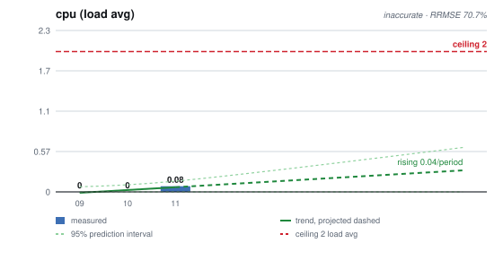
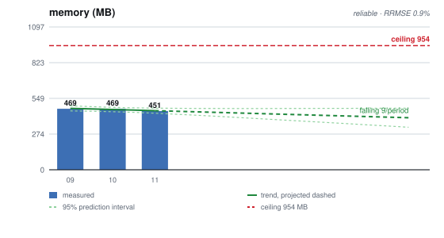
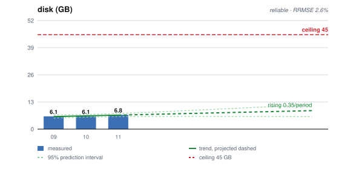
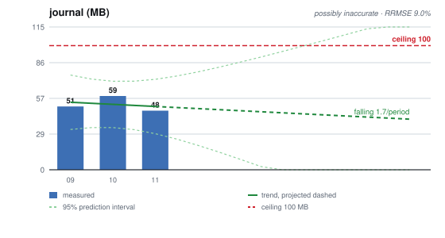
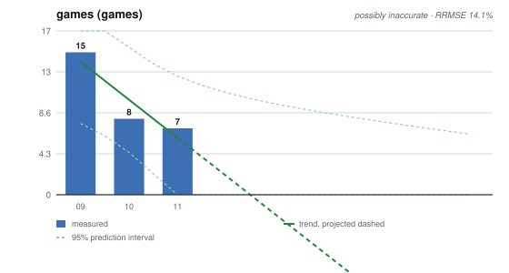
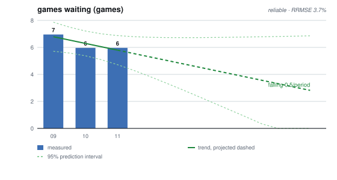
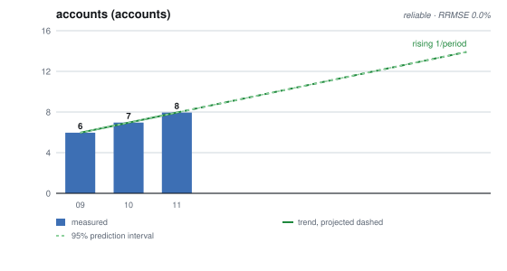

# Capacity plan, November 2026

`TLE_CP_2026_11`

**Measured on production, 2026-11-23 08:52 UTC**, by Claude through the local
session, with the commands under *How this was measured*. It is the first plan
whose production reads are Claude's, under the programme's rule of 2026-11-18.
The host figures are again a single sample of a service nobody was using at the
time. The games and accounts rows also have the daily series from the server's
size record.

**Two rows were measured on rehearsal**, on 2026-11-18 under
delphside/tile-lite-elite#555 *#545 WP B Del 3 of 4: deploy tooling builds once
and promotes*: the registry login's memory and the image pull's time. Production
still runs 0.10.1, which predates the registry, so it has no reading of its own
yet. Rehearsal is the same shape (AMD EPYC 7551, 2 cores, 954 MB).

**The third-party rows are the owner's readings of the providers' own pages**:
PENDING Resend, the GitHub organisation's billing overview, and the Oracle Cloud
console.

## What is consumed, against what ceiling

| | consumed | ceiling | headroom |
| --- | --- | --- | --- |
| **memory** | 451 MB used, 502 MB available | 954 MB | 53% |
| — server container | 21 MB resident; 115 MB of the server process is in swap | | |
| — web container | 28 MB | | |
| — swap | 235 MB | 2,047 MB | 89% |
| — a deploy's registry login (rehearsal) | 75 MB peak for about 4 s, at least 417 MB left available | | transient |
| **disk** | 6.8 GB | 45 GB | 85% |
| — the database volume | 1.7 MB | | |
| — pre-deploy snapshots | 1.4 MB, 5 files | `SNAPSHOT_KEEP` (5) | at its count, by design |
| — Docker images | 587 MB, of which 278 MB reclaimable | | |
| — `/var/log/syslog*` | 1.4 MB | logrotate: 4 weekly, gzipped | bounded |
| **journal** | 47.6 MB, reaching back exactly 7 days | 100 MB / 7 days | 52% of the size; at the time limit, by design |
| **CPU** | load 0.08 | 2 vCPU | effectively all of it |
| **image pull at deploy** (rehearsal) | 16 to 18 s, both images by digest, login included | `pull_timeout` 60 s | 70% |
| **games in the database** | 7: 6 `waiting`, 1 `active` | *unbounded while `waiting` is unswept* | not knowable |
| **accounts** | 8 | none set | not knowable |
| **Resend email quota**: sent and received | PENDING | 100 a day, 3,000 a month (free plan) | PENDING |
| **GitHub Actions minutes**: private repositories, today only the service desk | PENDING | 2,000 min a month (GitHub Free) | PENDING |
| **Oracle registry and Object Storage** | PENDING | 20 GB Object Storage (Always Free) | PENDING |

**Nothing is close to a ceiling.** The one host row that moved is disk, up 0.7
GB with no change in the images, the database or the logs.

## Which number moves first

**Still the `waiting` games, and nothing has changed about why.** The same six
Greedy-against-Greedy games from 2026-07-21, now 125 days idle, are the floor of
the games row. RET-3, which would remove a game that never starts, is
delphside/tile-lite-elite#270 *#71 WP C: Additional Game Lifecycle*'s and
unbuilt; an idle game held in memory in general is delphside/tile-lite-elite#408
*#291 WP D Del 5 of 6: Game storage in memory and database*'s. Deleting the six
is a production change and the owner's.

**The terminal sweep is still working.** In the month to this reading, games
held in memory ranged from 6 to 10, and sit one above the floor today with the
one active game.

## What would have to change before a ceiling is reached

| ceiling | reached by | what would have to change |
| --- | --- | --- |
| memory, 954 MB | the games map growing without RET-3 or eviction | build RET-3 (delphside/tile-lite-elite#270), or load games on demand (delphside/tile-lite-elite#408) |
| journal, 100 MB / 7 days | nothing: the seven days bind first | — |
| disk, 45 GB | an unexplained 0.7 GB this month | find what grew, next month, before it is a trend |
| CPU, 2 vCPU | engine search under concurrent games | unmeasured; delphside/tile-lite-elite#422 *#291 WP F Del 3 of 6: Load test run and report* runs the load test that would say |
| `pull_timeout`, 60 s | a slower registry, or a larger image | nothing until a production pull reads near it |
| Resend, 100 a day | a burst of inbound mail, which counts against the quota as sent mail does | nothing until a reading shows a need |
| GitHub Actions minutes | the service desk's intake schedule, plus a run per arrival now the poller runs | nothing until a reading shows a need |

## What is new this month

**The support mail poller is running.** The scheduler's health list now shows
`poll_support_mail` among its four jobs, every one current with no errors. This
is the first month in which each arriving support mail starts an intake run in
the private service-desk repository, so the GitHub Actions row is the one to
watch.

**Deploys will log in to Oracle's registry.** Once Tile Lite Elite moves to
Turpin (delphside/tile-lite-elite#622 *Tile Lite Elite on Turpin: build once,
promote*), every deploy and token refresh runs the OCI command-line tool on the
host. Its 75 MB for about four seconds fits in today's 502 MB available with
room to spare, and the pull's 16 to 18 seconds is under a third of its timeout.

## What is not known, and is the next thing worth measuring

**Where the service breaks.** Every host figure here is a resting one.
delphside/tile-lite-elite#422 *#291 WP F Del 3 of 6: Load test run and report*
is the load test run that would say what happens under load.

**What added 0.7 GB to the disk.** Images, database, snapshots and logs read the
same as October. Package updates waiting on a reboot are the likely cause, and
were not checked: next month's reading adds `du` on `/var` and `/usr`.

**A peak for the host rows.** Memory, CPU and the journal are read once a month,
so none of them has a peak.

**Account growth still has no ceiling.** Eight accounts, one more than October.
R3 of delphside/tile-lite-elite#291 *MAIN PROJECT: Capacity planning* still owes
the rate.

## Answered since October

**What sits in swap.** 115 MB of the 235 MB is the server process's own pages,
paged out while it was idle; the server's resident memory fell from 64 MB to 21
MB with it. It is an idle process's pages, not memory pressure: 502 MB is
available.

**Why the journal holds more than the service logs.** It does not hold more than
seven days: its oldest entry is exactly seven days old, so the retention time
binds before the 100 MB size. Most of its lines are the host's own, led by the
SSH daemon's and cron's; the containers' logging is a small share.

## History, and where it is heading

| | 2026-09 | 2026-10 | 2026-11 |
| --- | --- | --- | --- |
| **cpu** | 0 load avg | 0 load avg | 0.08 load avg |
| **memory** | 469 MB | 469 MB | 451 MB |
| **disk** | 6.1 GB | 6.1 GB | 6.8 GB |
| **journal** | 51 MB | 59 MB | 48 MB |
| **games** | 15 games | 8 games | 7 games |
| **games waiting** | 7 games | 6 games | 6 games |
| **accounts** | 6 accounts | 7 accounts | 8 accounts |

### What the forecast says, and how much to believe it

| metric | forecast | value at +6 | peak | RRMSE | meets ceiling |
| --- | --- | --- | --- | --- | --- |
| **cpu** | inaccurate | 0.31 load avg | 0.31 load avg | 70.7% | 49 period(s) |
| **memory** | reliable | 400 MB | 472 MB | 0.9% | not within the horizon |
| **disk** | reliable | 8.8 GB | 8.8 GB | 2.6% | 110 period(s) |
| **journal** | possibly inaccurate | 41 MB | 54 MB | 9.0% | not within the horizon |
| **games** | possibly inaccurate | -18 games | 14 games | 14.1% | no ceiling set |
| **games waiting** | reliable | 2.8 games | 6.8 games | 3.7% | no ceiling set |
| **accounts** | reliable | 14 accounts | 14 accounts | 0.0% | no ceiling set |

**Three points are the first with an RRMSE, and none of the fits is worth
planning against.** CPU is *inaccurate*: two zeros and a 0.08 are noise around
idle, and a line through them is not a trend. *Reliable* here means only that
three points sit near a line. Disk's line reaches its ceiling in 110 months. The
games line runs below zero, which a count cannot reach, because its floor is the
six `waiting` games. The journal is *possibly inaccurate*, and its retention
time bounds it anyway.

### Each metric, against its ceiling

Generated by `scripts/reports/capacity-chart.py --write` from
`measurements.csv`. The bars are measurements and the dashed red line is the
ceiling.

| | |
| --- | --- |
|  |  |
|  |  |
|  |  |
|  | |

- **Moving with use:** accounts, up one a month.
- **Moving by accumulation:** disk, up 0.7 GB for a reason not yet found.
- **Not moving:** memory and CPU, to the reading; the journal is held by its
  seven days.
- **Nothing reaches a ceiling within the horizon.**

## Transaction thresholds and throttle limits

Empty until delphside/tile-lite-elite#405 *#291 WP C Del 4 of 6: Thresholds and
limits* lands. It is at Scope, waiting on the load test run of
delphside/tile-lite-elite#422 *#291 WP F Del 3 of 6: Load test run and report*.

| step | this month |
| --- | --- |
| utilisation threshold (normal / degraded) | |
| workload threshold (transactions/s) | |
| peak, at the service level | |
| spike allowance | |

| limit | derived | configured | agree? |
| --- | --- | --- | --- |
| | | | |

## How this was measured

On the production host, by Claude through the local session: `uptime`, `free
-m`, `docker stats --no-stream`, `df -h /`, `docker system df`, `docker images`,
`du` on the database volume, the snapshots and `/var/log/syslog*`, `journalctl
--disk-usage`, the journal's oldest entry and its last seven days' lines counted
by unit, and each process's `VmSwap` from `/proc`. Through the admin CLI over
loopback: `sa --json games list --status <status>` for each status, `sa games
list --status waiting`, `sa --json users list`, `sa size` and `sa
scheduler-health`.

On rehearsal, by the build thread under delphside/tile-lite-elite#555 *#545 WP B
Del 3 of 4: deploy tooling builds once and promotes*: the registry login's peak
resident memory and the cold pull's time.
