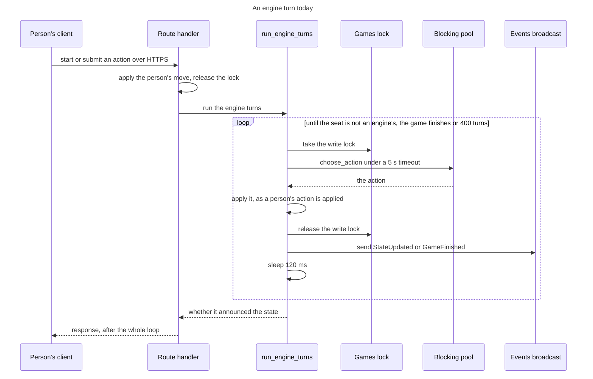

# 71 The engine

This file holds the engine as a client: how an engine turn runs today, why that
changes, and the technologies the change rests on: watch channels, the blocking
pool with a semaphore, and a generic type over a trait. It follows
[`71-05-wire.md`](71-05-wire.md) and is followed by
[`71-06b-engine-bots.md`](71-06b-engine-bots.md), which holds what the engine
gains, who calls it and what makes lifting it possible;
[`71-07-client.md`](71-07-client.md) comes after that.

## As-is

An engine seat is played by a loop inside the request that triggered it. Three
handlers in `crates/server-game/src/app/games.rs` end by calling
`run_engine_turns`: `start_game`, `submit_action` and `suggest_move`. The loop
runs until the seat on turn is not an engine's, the game finishes or
`MAX_ENGINE_TURNS_PER_TRIGGER` (400) turns have run, and the request does not
return until it ends.

What the code does, and where:

- **The games map is one lock.** `AppState.games` is an
  `Arc<RwLock<HashMap<String, GameSession>>>` (`app.rs`). `run_engine_turns`
  takes its write lock afresh for each turn, not once for the loop, so a
  WebSocket's read lock in `game_events` can get in between turns.
- **The search holds that lock.** `GameSession::maybe_run_engine_turn`
  (`game_state.rs`) runs `choose_action` through `tokio::task::spawn_blocking`,
  inside `tokio::time::timeout`, with the write lock held across the wait.
  `ENGINE_TURN_TIMEOUT` is 5 seconds and is also passed to the engine as
  `time_budget_ms`. Searches therefore run one at a time, and every other
  request needing the games lock waits for each.
- **Nothing bounds how many run.** `AppState.engine_limit` is a `Semaphore`
  sized from `TILE_LITE_ELITE_ENGINE_CONCURRENCY` (default 2, `app.rs`) and
  nothing acquires it. Password hashing does acquire its twin, `hash_limit`, in
  `with_hash_permit` (`app/auth.rs`).
- **Each turn is announced as it happens.** After a turn the loop attaches the
  current ratings to the state, saves the game first if it finished, sends the
  state on `AppState.events`, a `broadcast::Sender<GameEventDto>` of capacity
  64, and sleeps `ENGINE_TURN_BROADCAST_DELAY` (120 ms) so that a watching
  client sees each move. The handler broadcasts again afterwards unless the
  loop's `EngineTurnsOutcome.announced` says it already did.
- **Failures come back to the caller.** A search past 5 seconds makes the seat
  pass, with a warning logged. A panic in the engine, an unknown engine or an
  engine that does not support the game's variant returns an error from
  `maybe_run_engine_turn`, which the handler answers with 400 to the person
  whose request triggered it.
- **The engine contract is small.** `engine-core/src/lib.rs` has
  `GameEngine::choose_action(EngineRequest) -> EngineResponse`.
  `EngineRequest` borrows `&GameState`, `&Rack` and `&VariantRules` and carries
  `seat_number` and `time_budget_ms`. There is no level and no stop signal.
  `EngineAction` is `Place`, `Pass`, `Exchange` or `Resign`.

The loop is what is wrong. A person's request lasts as long as every bot turn
that follows it, the games lock is held for the whole of each search, and the
bot can be reached only from inside the server, so an external bot would be a
second way to play.

## The engine is a client

An engine seat is told it is its turn and returns a move when ready. It is not
driven by a loop inside somebody else's request. The engine becomes a client of
the Game service as a person's browser is: it hears of each change from its
game's channel, decides, and submits a move for the server to accept or refuse.

The reason is the goal that engine code cannot tell whether it is running in the
server or in a client ([the goal](71-02-overview.md#the-goal)). While the loop
stays in place, the in-process engine and an external one are two ways to play,
and they drift apart, which is the real cost of leaving it. As a client the two
differ only by transport, which makes the external harness a plug-in. The lock
stops being held through a search and the request returns as soon as the
person's move is applied. The two properties the lock gave by accident, one
search at a time and a request that cannot hang on a bot, are replaced on
purpose by a permit and the move time limit. Three technologies carry that,
each described below before how the engine uses it.

**Every bot is a client, and none runs inside a request** (owner,
2026-10-14). External bots run outside the server, in #10's harness or their own
client. The server's own bots are the
[in-process bot](71-06b-engine-bots.md#the-engine), reached through the glue.
What follows from that:

- The request that triggers a bot's turn returns as soon as the human's move
  is applied. `MAX_ENGINE_TURNS_PER_TRIGGER` stops being needed: it bounds a
  loop that no longer exists, and a bot that never answers is already handled
  by the move time limit, exactly as a silent human is.
- The search runs without holding anything. The engine takes the per-game lock
  only to submit its chosen move.
- **Every change can put a bot on turn**, not only a move: a timeout, a
  force-resign or a seat leaving each hand the turn on, and each is published,
  so the bot hears of it from its game's channel whichever it was.
- **The submitted move is re-validated on arrival**, because the game may have
  moved while the engine was thinking — aborted, or its seat retired. A human
  gets that check today; a bot searching off the lock needs the same one. That
  is what makes it a client rather than a special case: it proposes a move and
  may be told no. A rejection is normal, not an error.

## Watch channels

### The watch technology

`tokio::sync::watch` is a channel that keeps only the last value sent
([docs.rs](https://docs.rs/tokio/latest/tokio/sync/watch/index.html)):

- `watch::channel(initial)` makes a `Sender` and a `Receiver`. The channel
  always holds a value, and `Sender::subscribe` makes another receiver at any
  time.
- `Sender::send` replaces the value and fails if no receiver is left;
  `Sender::send_replace` replaces it regardless.
- A receiver reads the latest value with `borrow()`, which holds a read lock
  until the guard drops, so it is not held across an `.await`.
  `changed().await` waits until the value has changed since this receiver last
  looked.
- A receiver that falls behind neither errors nor queues. Sends between two of
  its reads overwrite one another, so it sees the latest value and does not
  know how many it missed.
- When every sender is dropped, `changed()` returns an error, which is a
  receiver's signal that the channel has closed.

`tokio::sync::broadcast`, which the server uses today for `AppState.events`,
differs in each of these: it queues every message up to its capacity (64 here),
and a receiver too slow to keep up gets a `Lagged` error and loses the oldest.

### How the engine uses watch

**`on_event` hears through `updates_for(scope, &ViewerAccess)`**, the one
function that redacts for a recipient, below both transports. The Event stream
is a registry from game id to that game's `watch` channel (`app/events.rs`),
which holds only the latest state. `updates_for` creates a game's channel on its
first subscriber and drops it with its last. `publish` writes the full,
unredacted state to its game's channel only, so an event reaches the sockets of
its game and no others, and the cost of a change grows with that game's
receivers only. **Each account also has a `watch` of its full list of seats**, a
`Vec<SeatRef>` ([the interface layer](71-05-wire.md#the-interface-layer)), which
`publish` and the deletion of a game write. A seat leaves the list when it is
removed or its game is deleted; finishing a game keeps its seats, and a bot
object takes a turn only in an active game. The scope decides what a subscriber
receives:

| scope | who subscribes | receives |
| --- | --- | --- |
| one game | the WebSocket handler, as today | that game's channel |
| every seated game | the glue, once per listed bot; an external harness over its socket | the channel of each game it holds a seat in, and the account's seat list; `updates_for` joins the channel of a game when the list gains its first seat, so a seat added later brings that game into scope |

A scope of one game first yields that game's current `GameView`. A scope of
every seated game first yields the account's current `Seats`, then the current
view of each game in it. Each scope's first views carry no `because`. After
that, each change follows, built with `view_for` for this recipient. The first
yields cover start-up and, for a WebSocket, reconnection, so a game already on
the bot's turn is played: the glue makes its objects from the first `Seats`,
then gives each its game's view. `updates_for` joins a game's channel before it
reads the game, so no change falls between. The socket converts each `GameView`
to a frame with `game_to_dto`; the glue gives each view, as it is, to the bot
object of each seat the bot holds in that game.

**The state supersedes; the `because` of a skipped state is dropped by design.**
A `watch` value is the state with its `because`
([the envelope](71-05-wire.md#the-envelope)). A receiver that keeps up sees every
value and always reads the latest state, so it never lags. A slow one skips
states: it sees the version jump by more than one and treats `because` as
absent, which rebuilds everything
([the *nothing* case](71-03-version.md#three-categories-of-change)). The move list
is part of the state, so nothing is lost. Push notifications come from
Notifications, which the Game service reports each event to, so a skipped watch
value loses none. Today a lagging server receiver ends the socket; here it skips
states and carries on, and the client already ignores a version it has passed
(`should_apply_update`, `crates/ui/src/app.rs`).[^watch]

**`updates_for` leaves a game's channel when the game is removed or the account
holds no seat in it.** Deleting a game, in the capacity sweep and in
`admin_delete_game`, goes through the Event stream: it drops the game's sender
and writes the new seat list of every account seated in that game. The drop
closes every receiver, so `updates_for` yields `GameRemoved` on every receiver of
that game, and an object's link ends with it. The seat list losing the `SeatRef`
makes [the glue's loop](71-06b-engine-bots.md#what-changes-who-calls-it) drop
the object. Dropping an object that has already ended is harmless, so
`GameRemoved` on the object's link and `Seats` losing the `SeatRef` arrive in
either order. A seat removed from a game that stays shrinks the seat list, and
`updates_for` leaves that game's channel only when the list holds no seat in it.

**The server never iterates over its clients, and nothing dispatches on the kind
of subscriber.** `publish` writes the new state to the game's `watch` once.
Every subscriber is its own task compiled for one concrete type: a WebSocket
task converts the state to a frame and writes its socket; a bot's task gives the
state to its objects, and each object to its engine. Each WebSocket task runs
`updates_for` for its socket. The glue runs one task per listed bot, which runs
`updates_for` once over every seated game and holds one `Bot` object per seat
that bot holds, made and dropped by
[the glue's loop](71-06b-engine-bots.md#what-changes-who-calls-it).[^watch]

## The blocking pool and the semaphore

### The blocking pool technology

Tokio runs async tasks on a few worker threads, one per CPU by default, and
switches a task only at an `.await`. Code that computes without awaiting, as a
move search does, holds its worker until it returns. Tokio gives such code two
tools and the standard library a third
([docs.rs](https://docs.rs/tokio/latest/tokio/task/fn.spawn_blocking.html)):

- `tokio::task::spawn_blocking(f)` runs a synchronous closure on a separate
  blocking pool, capped at 512 threads by default, and returns a `JoinHandle`
  to await. A panic in the closure comes back as a `JoinError`. **The closure
  cannot be cancelled once it has started**: aborting the handle, or dropping
  it when `tokio::time::timeout` elapses, stops the waiting and leaves the
  thread running to the end.
- `tokio::sync::Semaphore` holds a number of permits. `acquire_owned` on an
  `Arc<Semaphore>` waits its turn, first come first served, and returns an
  `OwnedSemaphorePermit` that owns its share of the semaphore, so it can be moved
  into a `'static` closure, and that returns the permit when dropped.
- A `std::sync::atomic::AtomicBool` is a flag a running thread can check
  cheaply. Rust has no way to kill a thread, so asking it to stop is
  cooperative: the code that runs checks the flag.

### How the engine uses the blocking pool

The search is CPU-bound, so it runs through `spawn_blocking`, as today
([as-is](#as-is)); the change is what bounds it.

- **How many searches run at once is bounded.** Today they are serialised by
  accident, because each holds the games write lock, and `engine_limit`
  (`TILE_LITE_ELITE_ENGINE_CONCURRENCY`, default 2, the VM's core count) is read
  but never acquired. Once a search holds nothing, N bot games on turn are N
  parallel searches, so `engine_limit` replaces that accident [^d62]. Every
  search and every hint takes a permit before it starts, for as long as the hint
  is computed in the server. This is the pattern `with_hash_permit` in
  `app/auth.rs` already follows for password hashing.
- **The permit lives as long as the thread does.** It moves into the blocking
  thread and is released only when the engine returns, not when the time runs
  out, so a search that overran its time and cannot be cancelled still counts.
  `ENGINE_TURN_TIMEOUT` starts once the permit is held, so a queued bot loses
  none of its time; the queue itself is bounded by the move time limit. The
  limit bounds the in-process bot's searches and the hint.
- **An engine is asked to stop, and a broken one keeps its permit.**
  `EngineRequest` gains a `stop: &AtomicBool`, set when the time runs out, and an
  engine checks it as it searches. One that ignores it, or has hung, holds its
  permit until it returns: the bound stays true at the cost of capacity, and a
  permit held well past its time is logged as an alert. Only a restart frees it:
  Rust cannot kill a thread, and an async task is cancelled only where it
  yields. Forcing a stop needs a separate process or a sandbox such as a
  WebAssembly runtime with deadline interruption, which is the reason to adopt
  either, for an engine not trusted to honour the signal.
- **A search that fails stays the bot's problem.** An engine error, a panic
  (the `JoinError`) or a search past its budget leaves the seat on turn, as a
  silent human's would, and the move time limit deals with it. It is logged, and
  never returned to the human whose move set it off.

## A generic type over a trait

### The generic type technology

A Rust trait names behaviour, and a type generic over it, `Bot<L: GameLink>`, is
compiled once for each concrete type used for `L` (monomorphisation). The choice
is made when the program is built, costs nothing at run time and cannot differ
between two bots in one build. The alternative, `Box<dyn Trait>`, is chosen at
run time through a vtable, and the engine's own `Box<dyn EnginePlayer>` uses
it.

### How the engine uses a generic type

**A bot behaves like the existing client**, and is four layers, top-down
(owner, 2026-10-20). The layers, `GameLink` and the glue are in
[The interface layer](71-05-wire.md#the-interface-layer) and
[The engine](71-06b-engine-bots.md#the-engine); in short:

1. **Bot**: the engine and `take_turn`, identical wherever it runs.
2. **Client core**: what every client shares, from `game-wire`.
3. **Transport**, one of two adapters behind it, chosen when the build is
   compiled: `ExternalLink` or `InProcessLink`. The bot is generic over the
   trait (`Bot<L: GameLink>`).
4. **Server**: Transport API, Game service, `apply`, and the Event stream with
   `updates_for`, which serves both transports.

An in-process engine and an external one therefore differ only by transport.
That is what makes the external harness a plug-in rather than a second way to
play — and stops the two drifting, which is the real cost of leaving the loop
in place.

[^d62]: Decision #462 (D62): `engine_limit` bounds parallel searches and hints;
    the default stays 2, the VM's core count. The search's time starts once
    the permit is held, and the engine is sent a stop signal (owner, 2026-10-14).

[^watch]: Owner, 2026-10-20: the per-game channel is a `watch`, the account's
    seats are a `watch`, and one task per subscriber.
