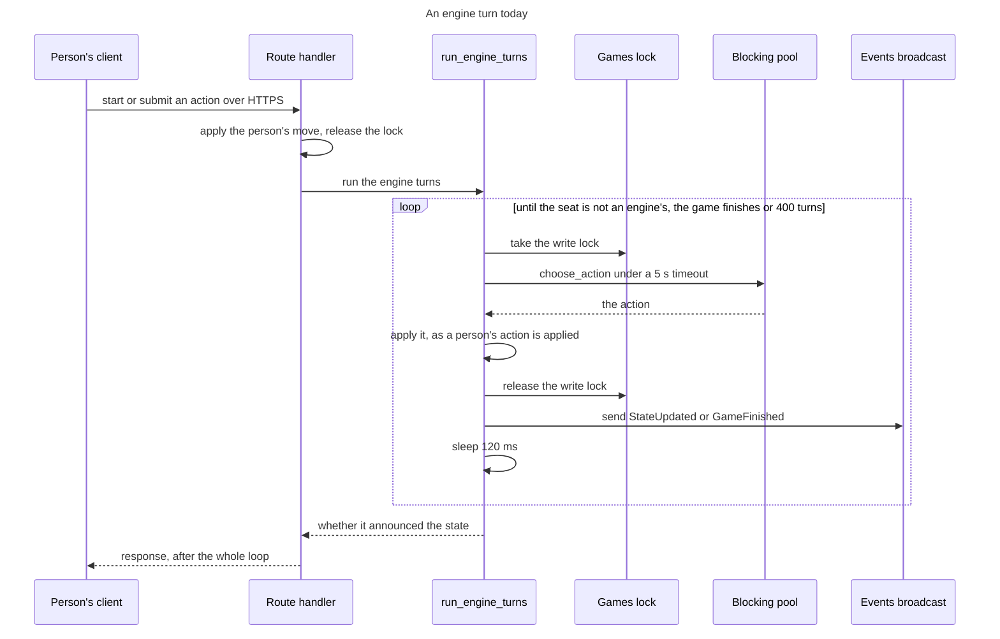
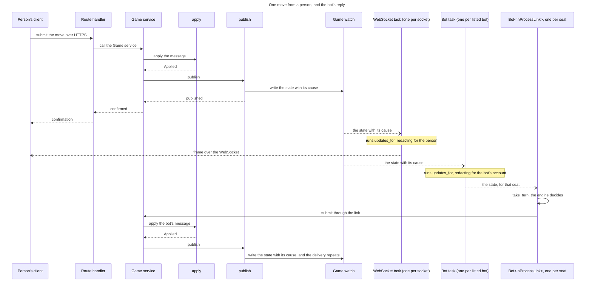
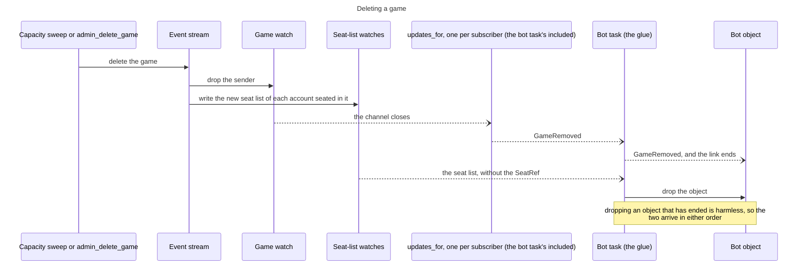
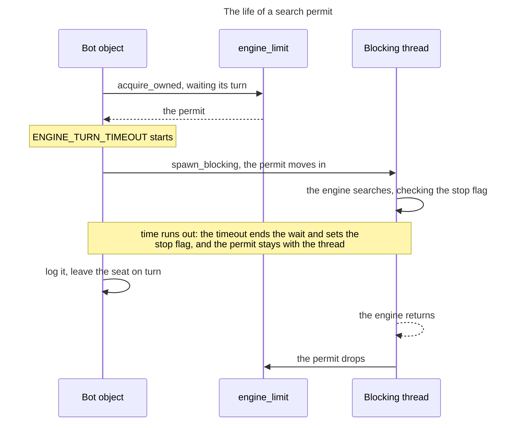

# 71 The engine

This is the first of two files on the engine, and it is read first. It holds how
an engine turn runs today, the model the design replaces it with, and the
technologies the model rests on: Tokio, watch channels, the blocking pool with a
semaphore and a generic type over a trait.
[`71-06b-engine-bots.md`](71-06b-engine-bots.md) holds what only the engine
needs on top of that: levels, the bots the server runs, what makes lifting the
engine out possible and where it runs. This file follows
[`71-05-wire.md`](71-05-wire.md); the second is followed by
[`71-07-client.md`](71-07-client.md).

## As-is

An engine seat is played by a loop inside the request that triggered it. Three
handlers in `crates/server-game/src/app/games.rs` end by calling
`run_engine_turns`: `start_game`, `submit_action` and `suggest_move`. The loop
runs until the seat on turn is not an engine's, the game finishes or
`MAX_ENGINE_TURNS_PER_TRIGGER` (400) turns have run, and the request does not
return until it ends. The diagram shows `start_game` and `submit_action`.



What the code does, and where:

- **The games map is one lock.** `AppState.games` is an
  `Arc<RwLock<HashMap<String, GameSession>>>` (`app.rs`). `run_engine_turns`
  takes its write lock afresh for each turn, not once for the loop, so a
  WebSocket's read lock in `game_events` can get in between turns.
- **The search holds that lock.** `GameSession::maybe_run_engine_turn`
  (`game_state.rs`) runs `choose_action` through `tokio::task::spawn_blocking`,
  inside `tokio::time::timeout`, with the write lock held across the wait.
  `ENGINE_TURN_TIMEOUT` is 5 seconds and is also passed to the engine as
  `time_budget_ms`. The lock makes searches run one at a time, by accident. The
  wait itself is bounded on purpose, by that timeout and by
  `MAX_ENGINE_TURNS_PER_TRIGGER` (`games.rs`). Every other request needing the
  games lock waits for each search.
- **Nothing bounds how many run.** `AppState.engine_limit` is a `Semaphore`
  sized from `TILE_LITE_ELITE_ENGINE_CONCURRENCY` (default 2, `app.rs`) and
  nothing acquires it. Password hashing acquires its twin, `hash_limit`, in
  `with_hash_permit` (`app/auth.rs`).
- **Each turn is announced as it happens.** After a turn the loop attaches the
  current ratings to the state, saves the game first if it finished, sends the
  state on `AppState.events`, a `broadcast::Sender<GameEventDto>` of capacity
  64, and sleeps `ENGINE_TURN_BROADCAST_DELAY` (120 ms) so that a watching
  client sees each move
  ([what paces it after](71-09-open-questions.md#open-questions-about-the-shapes)).
  The handler broadcasts again afterwards unless the loop's
  `EngineTurnsOutcome.announced` says it already did.
- **A search past 5 seconds makes the seat pass**, with a warning logged. Every
  other failure returns an error from `maybe_run_engine_turn` that the handler
  answers with 400 to the person whose request triggered it: a panic in the
  engine, an engine action that `apply_*` refuses, an unknown engine, a missing
  engine ID, a missing seat and an engine that does not support the game's
  variant (`game_state.rs`).
- **`suggest_move` does not use the engine crate.** It searches inline in the
  async handler, under the write lock, with no `spawn_blocking`: it enumerates
  and validates every legal move, applies the best for the seat on turn and
  then calls `run_engine_turns` (`games.rs`).
- **The engine contract is small.** `crates/engine-core/src/lib.rs` has
  `GameEngine::choose_action(EngineRequest) -> EngineResponse`.
  `EngineRequest` borrows `&GameState`, `&Rack` and `&VariantRules` and carries
  `seat_number` and `time_budget_ms`. There is no level and no stop signal.
  `EngineAction` is `Place`, `Pass`, `Exchange` or `Resign`.

The loop is what is wrong. A person's request lasts as long as every bot turn
that follows it, the games lock is held for the whole of each search, and the
bot can be reached only from inside the server.

## The engine is a client

An engine seat is told it is its turn and returns a move when ready, driven by
its game's channel. The engine becomes a client of
the Game service as a person's browser is: it hears of each change from its
game's channel, decides, and submits a move for the server to accept or refuse.

The reason is the goal that engine code cannot tell whether it is running in the
server or in a client ([the goal](71-02-overview.md#the-goal)). While the loop
stays in place, the in-process engine and an external one are two ways to play,
and they drift apart, which is the real cost of leaving it. As a client the two
differ only by transport, which makes the external harness (#10) a plug-in. The
lock stops being held through a search and the request returns as soon as the
person's move is applied. The lock gave one search at a time, by accident, which
a permit now gives on purpose. The timeout and the turn ceiling kept a request
from hanging on a bot, which
[the move time limit](https://github.com/delphside/tile-lite-elite/blob/main/docs/4.1.0-rules.md#move-time-limits)
now does for a bot that never answers.

**Every bot is a client, and none runs inside a request** (owner,
2026-10-14). External bots run outside the server, in #10's harness or their own
client. The server's own bots are in-process, reached through the glue, defined
next.

### The model

A bot behaves like the existing client, in four layers, top-down.[^layers]

1. **Bot**: `Bot<L: GameLink>`, the engine and `take_turn`, which asks the
   seat's engine for a move. The same wherever it runs.
2. **Client core**: `GameLink`, from `game-wire`
   ([the interface layer](71-05-wire.md#the-interface-layer)). It yields a
   `GameUpdate` and submits a `GameMessage`, the two enums `game-wire` defines.
3. **Transport**, an adapter behind `GameLink` that moves those enums, one for
   each build:
   - `ExternalLink` turns them into JSON and back over HTTPS and the WebSocket.
   - `InProcessLink` hands them over as Rust values, through `updates_for` and
     the Game service's submit function.
4. **Server**: Transport API, Game service, `apply` and the Event stream.
   `publish` sends each change to its game's channel, and `updates_for`
   subscribes to the channels in its scope and redacts for one viewer, under
   both transports.

*The glue* is the in-process code that joins layer 3 to layer 4: one task for
each bot the server's settings list (a *listed bot*), which holds one
`Bot<InProcessLink>` for each seat that bot holds (a *bot object*). Every
subscriber, a WebSocket or a bot, is its own task. The two loops are:

```text
Bot object, on each update from its link:   // the link holds the identity,
                                            // the object none
    GameUpdate::Game { view, .. }:
        if view.status == Active
           && view.current_seat == seat:    // seat is the object's own
            if let Some(msg) = take_turn(player, &view, seat, budget) {
                link.submit(view.game_id, msg)
            }
    GameUpdate::GameRemoved(_):
        the link ends, and so does the object

Bot task (the glue), on each update from updates_for over every seated game:
    GameUpdate::Seats(list):
        make a Bot object for each SeatRef the list gains
        drop the object of each SeatRef the list loses
    GameUpdate::Game { .. } and GameUpdate::GameRemoved(_):
        give it to the objects of that game
```

A person's move reaches both kinds of task and the bot replies (the arrows are
those of
[the move sequence](71-10-documents-changed.md#12--the-move-sequence): `->>` a
call, `-->>` a return, `--)` an asynchronous delivery):



### What changes

| Aspect | Today | After | Section |
| --- | --- | --- | --- |
| a person's request | waits for every bot turn that follows | returns once its move is applied; the bot is a client | the bullets after this table |
| the lock | the one games lock, held across each search | [a per-game lock](71-03-version.md#one-version-moved-in-one-place), which replaces it, taken only to submit a move | the bullets after this table |
| searches at once | one at a time, by the lock | bounded by the `engine_limit` permit | [The blocking pool](#how-the-engine-uses-the-blocking-pool) |
| a search past its time | the seat passes after 5 s | the seat is left on turn, and the move time limit retires it | [The blocking pool](#how-the-engine-uses-the-blocking-pool) |
| an engine failure | 400 to the person whose request triggered it | logged | [The blocking pool](#how-the-engine-uses-the-blocking-pool) |
| a slow receiver | the global broadcast lags and ends the socket | the game's watch skips states and the receiver carries on | [Watch channels](#how-the-event-stream-uses-watch) |
| the engine contract | no level and no stop signal | `Level`, `start` and a `stop` flag | [Levels](71-06b-engine-bots.md#what-the-engine-gains-levels) |
| pacing | `ENGINE_TURN_BROADCAST_DELAY` sleeps 120 ms between engine turns | open | [Open questions](71-09-open-questions.md#open-questions-about-the-shapes) |

What follows from the engine being a client:

- The request that triggers a bot's turn returns as soon as the human's move
  is applied. `MAX_ENGINE_TURNS_PER_TRIGGER` stops being needed: it bounds a
  loop that no longer exists, and a bot that never answers is already handled
  by the move time limit, exactly as a silent human is.
- The search runs without holding anything. The engine takes the per-game lock
  only to submit its chosen move.
- **Every change can put a bot on turn**, not only a move: a timeout, a
  force-resign or a seat leaving each hand the turn on, and each is published,
  so the bot hears of it from its game's channel whichever it was. No caller of
  `apply` spawns a bot task.
- **The submitted move is re-validated on arrival**, because the game may have
  moved while the engine was thinking: aborted, or its seat retired. A human
  gets that check today; a bot searching off the lock needs the same one. That
  is what makes it a client rather than a special case: it proposes a move and
  may be told no. A rejection is normal, not an error.

## Tokio

### The Tokio technology

Tokio is the Rust async runtime the server runs on (`#[tokio::main]`,
`main.rs`;
[docs.rs](https://docs.rs/tokio/latest/tokio/runtime/index.html)):

- A *task* is a unit of async work, such as one request or one WebSocket. The
  multi-thread runtime runs many tasks on a few *worker threads*, one for each
  CPU by default.
- A *future* is a value that stands for async work not yet done, which a task
  polls. A task gives up its worker only at an `.await`. Code that computes
  without awaiting, as a move search does, keeps its worker until it returns.
- `Send` marks a type that may move between threads, which a task's future
  must be. A guard from `std::sync` held across an `.await` can deadlock and
  makes the future not `Send`. Tokio's own `RwLock` allows it, and then every
  other task that wants the lock waits for the whole `.await`, which is today's
  search.

### How the engine uses Tokio

Each WebSocket and each listed bot's glue is its own task. A search leaves the
worker through [the blocking pool](#the-blocking-pool-and-the-semaphore), and
the per-game lock, which replaces the one games lock, is held only to read the
game or to submit a move, never across a search.

## Watch channels

### The watch technology

`tokio::sync::watch` is a channel that keeps only the last value sent
([docs.rs](https://docs.rs/tokio/latest/tokio/sync/watch/index.html)):

- `watch::channel(initial)` makes a `Sender` and a `Receiver`. The channel
  always holds a value, and `Sender::subscribe` makes another receiver at any
  time.
- `Sender::send` replaces the value and fails if no receiver is left;
  `Sender::send_replace` replaces it regardless.
- A receiver reads the latest value with `borrow()`, which holds a read lock
  until the guard drops, so it is not held across an `.await`.
  `changed().await` waits until the value is newer than the one this receiver
  last marked seen, by `changed` or by `borrow_and_update`; `borrow` does not
  mark it.
- A receiver that falls behind neither errors nor queues. Sends between two of
  its reads overwrite one another, so it sees the latest value and does not
  know how many it missed.
- When every sender is dropped, `changed()` returns an error once the receiver
  has seen the current value, which is its signal that the channel has closed.

`tokio::sync::broadcast`, which the server uses today for `AppState.events`,
differs in each of these: it queues every message up to its capacity, and a
receiver too slow to keep up gets a `Lagged` error and loses the oldest.

### How the Event stream uses watch

**`on_event` hears through `updates_for(scope, &ViewerAccess)`**, the one
function that redacts for a recipient, under both transports. The Event stream
is a registry from game ID to that game's `watch` channel (`app/events.rs`),
which holds only the latest state. `updates_for` creates a game's channel on its
first subscriber and drops it with its last. `publish` writes the full,
unredacted state to its game's channel only, so an event reaches the sockets of
its game and no others, and the cost of a change grows with that game's
receivers only. **Each account also has a `watch` of its full list of seats**, a
`Vec<SeatRef>` ([the interface layer](71-05-wire.md#the-interface-layer)), which
`publish` and the deletion of a game write. The scope decides what a subscriber
receives:

| Scope | Who subscribes | Receives |
| --- | --- | --- |
| one game | the WebSocket handler, as today | that game's channel |
| every seated game | the glue, once for each listed bot; an external harness over its socket | the channel of each game it holds a seat in, and the account's seat list |

**A subscription starts with the current state.** The first yields cover
start-up and, for a WebSocket, reconnection, so a game already on the bot's turn
is played:

- A scope of one game yields that game's current `GameView`.
- A scope of every seated game yields the account's current `Seats`, then the
  current view of each game in it. The glue makes its bot objects from the
  `Seats`, then gives each its game's view.
- These first views carry no `because`. Each change after them follows, built
  with `view_for` for this recipient.
- `updates_for` joins a game's channel before it reads the game, so no change
  falls between, and it joins the channel of a game when the list gains its
  first seat, so a seat added later brings that game into scope.
- The socket converts each `GameView` to a frame with `game_to_dto`; the glue
  gives each view, as it is, to the bot object of each seat the bot holds in
  that game.

**The state supersedes; the `because` of a skipped state is dropped by design.**
A `watch` value is the state with its `because`
([the envelope](71-05-wire.md#the-envelope)). A receiver that keeps up sees every
value and always reads the latest state, so it never lags. A slow one skips
states: it sees the version jump by more than one and treats `because` as
absent, which rebuilds everything
([the *nothing* case](71-03-version.md#three-categories-of-change)).
The move list is part of the state, so nothing is lost. Push notifications
come from Notifications, which the Game service reports each event to, so a
skipped watch value loses none.
Today a lagging server receiver ends the socket; here it skips states and
carries on, and the client already ignores a version it has passed
(`should_apply_update`, `crates/ui/src/app.rs`).[^watch]

**What leaves the seat list, and a game's channel:**

- A seat removed from a game that stays shrinks the list, and `updates_for`
  leaves that game's channel only when the list holds no seat in it.
- A game deleted, in the capacity sweep or in `admin_delete_game`, takes its
  seats from every list, and its channel closes (the diagram).
- A game finished keeps its seats, and a bot object takes a turn only in an
  active game.

Deleting a game goes through the Event stream:



**`publish` writes once, and each subscriber is its own task.** `publish` writes
the new state to the game's `watch`. Every subscriber is its own task compiled
for one concrete type, so the server treats a WebSocket and a bot alike: a
WebSocket task converts the state to a frame and writes its socket, and a bot's
task gives the state to its objects, each of which gives it to its engine. Each
WebSocket task runs `updates_for` for its socket. The glue runs one task for
each listed bot, which runs `updates_for` once over every seated game.[^watch]

## The blocking pool and the semaphore

### The blocking pool technology

Three tools turn a computation that never awaits into bounded work
([docs.rs](https://docs.rs/tokio/latest/tokio/task/fn.spawn_blocking.html)):

- `tokio::task::spawn_blocking(f)` runs a synchronous closure on a separate
  blocking pool, capped at 512 threads by default, and returns a `JoinHandle`
  to await. A panic in the closure comes back as a `JoinError`. **The closure
  cannot be cancelled once it has started**: aborting the handle, or dropping
  it when `tokio::time::timeout` elapses, stops the waiting and leaves the
  thread running to the end.
- `tokio::sync::Semaphore` holds a number of permits. `acquire_owned` on an
  `Arc<Semaphore>` waits its turn, first come first served, and returns an
  `OwnedSemaphorePermit`, which owns its share of the semaphore, so it can be
  moved into a `'static` closure, and which returns the permit when dropped.
- A `std::sync::atomic::AtomicBool` is a flag a running thread can check
  cheaply. Rust has no way to kill a thread, so asking it to stop is
  cooperative: the code that runs checks the flag.

### How the engine uses the blocking pool

The search is CPU-bound, so it runs through `spawn_blocking`, as today; the
change is what bounds it, and what happens when it fails.

- **How many searches run at once is bounded.** Once a search holds no lock, N
  bot games on turn are N parallel searches, so every search and every hint
  takes an `engine_limit` permit before it starts, for as long as the hint is
  computed in the server
  ([what the hint is](71-09-open-questions.md#open-questions-about-the-shapes)).
  `engine_limit` is `TILE_LITE_ELITE_ENGINE_CONCURRENCY`, default 2, the VM's
  core count, and it replaces the lock's accident [^d62]. This is the pattern
  `with_hash_permit` in `app/auth.rs` already follows for password hashing.
- **The permit lives as long as the thread does.** It moves into the blocking
  thread and is released only when the engine returns, not when the time runs
  out, so a search that overran its time and cannot be cancelled still counts.
  `ENGINE_TURN_TIMEOUT` starts once the permit is held, so a queued bot loses
  none of its time; the queue itself is bounded by the move time limit.
- **An engine is asked to stop, and a broken one keeps its permit.**
  `EngineRequest` gains a `stop: &AtomicBool`, set when the time runs out, and
  an engine checks it as it searches. One that ignores it, or has hung, holds
  its permit until it returns: the bound stays true at the cost of capacity, and
  a permit held well past its time is logged as an alert. Only a restart frees
  it. Forcing a stop needs a separate process or a sandbox such as a WebAssembly
  runtime with deadline interruption, which is the reason to adopt either, for
  an engine not trusted to honour the signal.
- **A search that fails stays the bot's problem.** An engine error, a panic
  (the `JoinError`) or a search past its budget leaves the seat on turn, as a
  silent human's would, and the move time limit retires it. It is logged, and
  never returned to the human whose move set it off.



## A generic type over a trait

### The generic type technology

A Rust trait names behaviour. A type generic over it, `Bot<L: GameLink>`, is
compiled once for each concrete type used for `L`, which is *monomorphisation*:
the choice costs nothing at run time, and one build can hold `Bot<ExternalLink>`
and `Bot<InProcessLink>` side by side. The alternative, `Box<dyn Trait>`, is
chosen at run time through a vtable, a table of function pointers looked up on
each call. A trait whose method is `async` cannot be used that way without
boxing the future it returns.

### How the engine uses a generic type

`GameLink::on_event` is async, which is why `Bot` is generic over its link and
not given a `Box<dyn GameLink>`. Which link to compile is the design's choice,
not a limit of the generic: the server builds `Bot<InProcessLink>` and a harness
builds `Bot<ExternalLink>`, one for each build
([the interface layer](71-05-wire.md#the-interface-layer)). The engine itself is
chosen at run time, so it stays dynamic: `start` returns a
`Box<dyn EnginePlayer>`, a trait the design adds. Today's dynamic dispatch is
`Arc<dyn GameEngine>` in `EngineRegistry` (`game_state.rs`).

[^layers]: Owner, 2026-10-20: `game-wire` converts `GameView` both ways and
    never sees `GameSession`; the server builds the view. A bot harness
    behaves like the existing client, over the internet or in-process.

[^watch]: Owner, 2026-10-20: the per-game channel is a `watch`, the account's
    seats are a `watch`, and one task per subscriber.

[^d62]: Decision #462 (D62): `engine_limit` bounds parallel searches and hints;
    the default stays 2, the VM's core count. The search's time starts once
    the permit is held, and the engine is sent a stop signal (owner, 2026-10-14).
