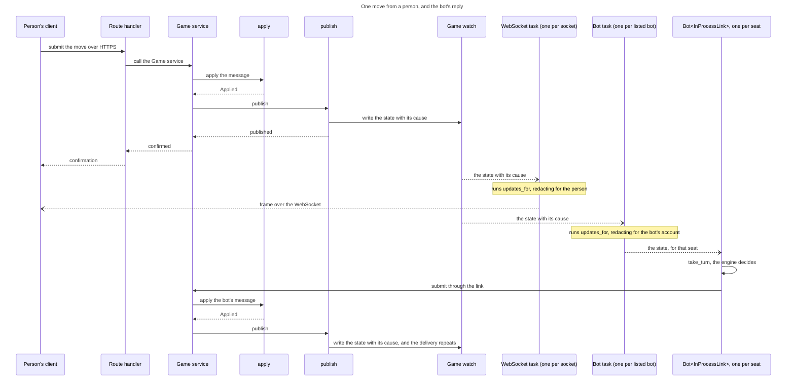
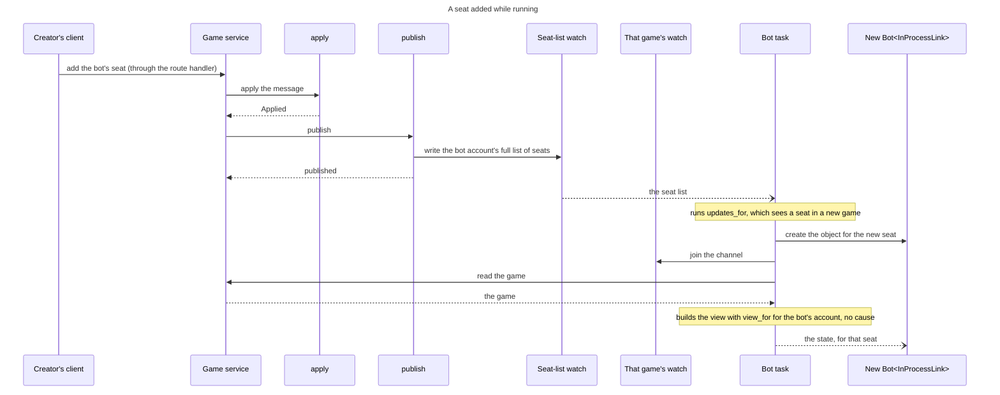

# 71 The engine

This file holds the engine as a client: the argument, then what the engine
gains, who calls it and what makes lifting it possible. It follows
[`71-05-wire.md`](71-05-wire.md) and is followed by
[`71-07-client.md`](71-07-client.md).

## The engine is a client

An engine seat is told it is its turn and returns a move when ready. It is not
driven by a loop inside somebody else's request.

- The request that triggers a bot's turn returns as soon as the human's move
  is applied. `MAX_ENGINE_TURNS_PER_TRIGGER` stops being needed: it bounds a
  loop that no longer exists, and a bot that never answers is already handled
  by the move time limit, exactly as a silent human is.
- The search runs without holding anything. The engine takes the per-game lock
  only to submit its chosen move.
- **How many searches run at once is bounded.** Today they are serialised by
  accident, because each holds the games write lock; once they hold nothing,
  that accident goes, and the existing `engine_limit` replaces it [^d62].
  Every search and every hint takes a permit before it starts. The permit
  moves into the blocking thread and is released only when the engine
  returns, so a search that overran its time and cannot be cancelled still
  counts. The search's time starts once the permit is held, so a queued bot
  loses none of it; the queue itself is bounded by the move time limit.
- **An engine is asked to stop, and a broken one keeps its permit.** The
  request carries a stop signal, set when the time runs out, and an engine
  checks it as it searches. One that ignores it, or has hung, holds its permit
  until it returns: the bound stays true at the cost of capacity, and a permit
  held well past its time is logged as an alert. Only a restart frees it:
  Rust cannot kill a thread, and an async task is cancelled only where it
  yields. Forcing a stop needs a separate process or a sandbox such as a
  WebAssembly runtime with deadline interruption, which is the reason to
  adopt either, for an engine not trusted to honour the signal.
- **Every bot is a client, and none runs inside a request** (owner,
  2026-10-14). External bots run outside the server, in #10's harness or
  their own client. The server's own bots are the
  [in-process bot](#the-engine), reached through the glue.
  `engine_limit` bounds the in-process bot's searches and the hint, for as
  long as the hint is computed in the server.
- **A search that fails stays the bot's problem.** An engine error, a panic or
  a search past its budget leaves the seat on turn, as a silent human's would,
  and the move time limit deals with it. It is logged, and never returned to
  the human whose move set it off.
- **Every change can put a bot on turn**, not only a move: a timeout, a
  force-resign or a seat leaving each hand the turn on, and each is published,
  so the bot hears of it from its game's channel whichever it was.
- **The submitted move is re-validated on arrival**, because the game may have
  moved while the engine was thinking — aborted, or its seat retired. A human
  gets that check today; a bot searching off the lock needs the same one. That
  is what makes it a client rather than a special case: it proposes a move and
  may be told no.

**A bot behaves like the existing client**, and is four layers, top-down
(owner, 2026-10-20). The layering, `GameLink` and the glue are in
[The interface layer](71-05-wire.md#the-interface-layer) and
[The engine](#the-engine); in short:

1. **Bot**: the engine and `take_turn`, identical wherever it runs.
2. **Client core**: what every client shares, from `game-wire`.
3. **Transport**, one of two adapters behind it, chosen when the build is
   compiled: external or in-process. The bot is generic over the trait
   (`Bot<L: GameLink>`).
4. **Server**: Transport API, Game service, `apply`, and the Event stream with
   `updates_for`, which serves both transports.

An in-process engine and an external one therefore differ only by transport.
That is what makes the external harness a plug-in rather than a second way to
play — and stops the two drifting, which is the real cost of leaving the loop
in place.

## The engine

### What the engine gains: levels

**An engine plays at a level, given when a seat's game starts.**[^levels]
Levels count from 1, the weakest; an engine whose `max_level` is 1 has one
level. `start` refuses a level outside 1 to `max_level` and returns the player
for that seat's game, which may keep what it learns between turns:

```rust
#[derive(Clone, Copy, PartialEq, Eq, PartialOrd, Ord)]
pub struct Level(pub u8);

pub trait GameEngine: Send + Sync {
    fn metadata(&self) -> &EngineMetadata;
    fn max_level(&self) -> Level;
    fn default_level(&self) -> Level;
    fn start(&self, level: Level) -> Result<Box<dyn EnginePlayer>, LevelError>;
}

pub trait EnginePlayer: Send {
    fn choose_action(&mut self, request: EngineRequest<'_>) -> EngineResponse;
}
```

`EngineRequest` is unchanged: it borrows `&GameState`, `&Rack` and
`&VariantRules`, all `rules-shared` types, none of them server types. **That is
why the engine can be lifted out at all**, and it is already true today.

### What changes: who calls it

A bot behaves like the existing client.[^layers] It is four layers, top-down,
and only the third differs by where the bot runs:

1. **Bot**: `Bot<L: GameLink>`, the engine and `take_turn`. The same wherever
   it runs.
2. **Client core**: `GameLink`, [the interface layer](71-05-wire.md#the-interface-layer). It yields a `GameUpdate` and submits a
   `GameMessage`, the two enums `game-wire` defines.
3. **Transport**, an adapter behind `GameLink` that moves those enums.
*External*: `ExternalLink` turns them into JSON and back over HTTPS and the
WebSocket. *In-process glue*: `InProcessLink` hands them over as Rust values,
over `updates_for` and the Game service's submit function. Each build compiles
one ([the interface layer](71-05-wire.md#the-interface-layer)): the server's
bots are `Bot<InProcessLink>`.
4. **Server**: Transport API, Game service, `apply`; `publish` sends each
   change to its game's channel in the Event stream, and `updates_for`
   subscribes to the channels in its scope and redacts for one viewer, under
   both transports. Every subscriber is its own task.

```rust
/// Same code in the server and in a client. Given a view of a game and the
/// seat's engine player, decide whether it is this seat's turn and what to do about it.
pub fn take_turn(
    player: &mut dyn EnginePlayer,
    view:   &GameView,          // from GameLink::on_event
    seat:   u8,
    budget: Option<Duration>,
) -> Option<GameMessage>;
```

**Two loops, two actors.** The first is a `Bot<L>` object's, through either
transport:

```text
on each update from the link:               // one object per seat held; the
                                            // link holds the identity, the
                                            // object none
    GameUpdate::Game { view, .. }:
        if view.status == Active
           && view.current_seat == seat:    // seat is the object's own
            if let Some(msg) = take_turn(player, &view, seat, budget) {
                link.submit(view.game_id, msg)
            }
    GameUpdate::GameRemoved(_):
        the link ends, and so does the object
```

The second is the glue's task, in-process, one per listed bot. It runs
`updates_for` over every seated game and feeds each object's `InProcessLink`, so
an object's link is scoped to its own seat's game:

```text
on each update from updates_for:
    GameUpdate::Seats(list):
        make a Bot object for each SeatRef the list gains
        drop the object of each SeatRef the list loses
    GameUpdate::Game { .. } and GameUpdate::GameRemoved(_):
        give it to the objects of that game
```

Over the external transport an object's link is one game, one WebSocket per
game. The subscription to every seated game carries the seat list, and what a
harness does with `Seats` is #10's.

**The bot hears it is on turn from the channel of its game**, the stream
every client of that game subscribes to, and never from the caller of `apply`:
no caller spawns a bot task. The request that applies a move returns at once.

**The in-process glue joins under the Transport API at two calls**:
`updates_for` to hear, and the Game service's submit function to act.

**`on_event` hears through `updates_for(scope, &ViewerAccess)`**, the one
function that redacts for a recipient, below both transports. The Event stream
is a registry from game id to that game's `watch` channel (`app/events.rs`,
tokio), which holds only the latest state. `updates_for` creates a game's
channel on its first subscriber and drops it with its last. `publish` writes the
full, unredacted state to its game's channel only, so an event reaches the
sockets of its game and no others, and the cost of a change grows with that
game's receivers only. **Each account also has a `watch` of its full list of
seats**, a `Vec<SeatRef>`
([the interface layer](71-05-wire.md#the-interface-layer)), which `publish` and the deletion of
a game write. A seat leaves the list when it is removed or its game is deleted;
finishing a game keeps its seats, and a bot object takes a turn only in an
active game. The scope decides what a subscriber receives:

| scope | who subscribes | receives |
| --- | --- | --- |
| one game | the WebSocket handler, as today | that game's channel |
| every seated game | the glue, once per listed bot; an external harness over its socket | the channel of each game it holds a seat in, and the account's seat list; `updates_for` joins the channel of a game when the list gains its first seat, so a seat added later brings that game into scope |

A scope of one game first yields that game's current `GameView`. A scope of
every seated game first yields the account's current `Seats`, then the current
view of each game in it. Each scope's first views carry no `because`. After
that, each change follows, built with `view_for` for this recipient. The first
yields cover start-up and, for a WebSocket, reconnection, so a game already on
the bot's turn is played: the glue makes its objects from the first `Seats`,
then gives each its game's view. `updates_for` joins a game's channel before it
reads the game, so no change falls between. The socket converts each `GameView`
to a frame with `game_to_dto`; the glue gives each view, as it is, to the bot
object of each seat the bot holds in that game.

**The state supersedes; the `because` of a skipped state is dropped by design.**
A `watch` value is the state with its `because`
([the envelope](71-05-wire.md#the-envelope)). A receiver that keeps up sees every
value and always reads the latest state, so it never lags. A slow one skips
states: it sees the version jump by more than one and treats `because` as
absent, which rebuilds everything
([the *nothing* case](71-03-version.md#three-categories-of-change)). The move list is part of
the state, so nothing is lost. Push notifications come from Notifications, which
the Game service reports each event to, so a skipped watch value loses none.
Today a lagging server receiver ends the socket; here it skips states and
carries on, and the client already ignores a version it has passed
(`should_apply_update`, `crates/ui/src/app.rs`).[^watch]

**`updates_for` leaves a game's channel when the game is removed or the account
holds no seat in it.** Deleting a game, in the capacity sweep and in
`admin_delete_game`, goes through the Event stream: it drops the game's sender
and writes the new seat list of every account seated in that game. The drop
closes every receiver, so `updates_for` yields `GameRemoved` on every receiver
of that game, and an object's link ends with it. The seat list losing the
`SeatRef` makes [the glue's loop](#what-changes-who-calls-it) drop the object.
Dropping an object that has already ended is harmless, so `GameRemoved` on the
object's link and `Seats` losing the `SeatRef` arrive in either order. A seat
removed from a game that stays shrinks the seat list, and `updates_for` leaves
that game's channel only when the list holds no seat in it.

**The server never iterates over its clients, and nothing dispatches on the kind
of subscriber.** `publish` writes the new state to the game's `watch` once.
Every subscriber is its own task compiled for one concrete type: a WebSocket
task converts the state to a frame and writes its socket; a bot's task gives the
state to its objects, and each object to its engine. Each WebSocket task runs
`updates_for` for its socket. The glue runs one task per listed bot, which runs
`updates_for` once over every seated game and holds one `Bot` object per seat
that bot holds, made and dropped by
[the glue's loop](#what-changes-who-calls-it).[^watch]

A person's move reaches both tasks and the bot replies (the arrows are those of
[the move sequence in
71-10-documents-changed.md](71-10-documents-changed.md#12--the-move-sequence):
`->>` a call, `-->>` a return, `--)` an asynchronous delivery):



A seat added while the server runs starts from its own trigger, a creator adding
the bot's seat:



**`submit` calls the same Game service function a route handler calls** after
its sign-in check, passing the bot's account id as the caller. The service
still checks that the caller holds the seat and that it is on turn, and calls
`apply`.

**Over the external transport, `GameLink` opens one WebSocket per game**, as
today, for the games the account's game list names. A harness that subscribes
to every seated game over its socket learns of a new seat from the seat list;
the socket's shape is #10's.

**The server runs the bots its settings list.**

- `TILE_LITE_ELITE_BOTS` (proposed) lists the bots run in-process, each with
  one identity, which is one account. Its ratings are its account's, one per
  edition, however many games it plays.
- Each listed bot is an engine at one level, or at the engine's default, with
  its own account and its own rating per edition, so a rating always means one
  strength.[^watch][^levels] A game's creator picks the level by picking the
  bot; a UI may show one engine's bots as one choice with a level field.
- Each `Bot` object starts its engine at the listed level when it is made, so
  a level the engine refuses is caught before the bot plays.
- An `InProcessLink` is built with the listed identity and passes it on every
  message, so no session record exists.
- Each listed bot's task runs `updates_for` once, over every seated game. It
  makes and drops `Bot` objects by
  [the glue's loop](#what-changes-who-calls-it), each with a link scoped to its
  seat's game, including for a seat added while the server runs. One bot may
  hold several seats in one game, as a bot showdown (a game between bots)
  requires.
- All of a bot's objects share its identity and run under `engine_limit`.
- The list is the programme owner's, who is accountable for the bots on it.
- In-process bots are compiled into the server from reviewed code. A
  third-party bot runs as an external client, which can run on the server's
  host.

**The submitted move is re-validated on arrival**, because the game may have
moved — aborted, or the seat retired. A rejection is normal, not an error.

**The number of searches running at once is bounded.** Today a search holds the
games write lock, so searches run one at a time by accident and `engine_limit`
(`TILE_LITE_ELITE_ENGINE_CONCURRENCY`, default 2, the VM's core count) is read
but never acquired. Once a search holds nothing, N bot games on turn are N
parallel searches, so the bot acquires `engine_limit` before searching, and the
hint does the same [^d62]. The permit moves into the blocking thread and
drops when the engine returns, not when the time runs out.
`ENGINE_TURN_TIMEOUT` starts when the permit is held. `EngineRequest` gains a
`stop: &AtomicBool`, set when the time runs out, which the engine checks as it
searches; one that ignores it keeps its permit.

**A search that fails, panics or runs out of time** leaves the seat on turn,
exactly as a silent human is, and the move time limit retires it. It is logged
and never answered to the human whose move triggered it.

**A harness meets the throttle; the in-process bot does not.** An external
harness posts like any client and can be answered 429 with `Retry-After`; its
retry policy is #10's. The rate limiter protects the service from callers
outside the server, and counts only them; the in-process glue joins below it.

**Nothing mediates.** There is no proxy and no bot-specific route: an external
bot posts the action a person posts, over the session of the bot's own
account, and the in-process bot calls the function that route calls, as the
bot's own account. Either way its rating moves because the account is the
bot's.

### What makes lifting it possible

Three things, and two of them are this design's other sections:

| | |
| --- | --- |
| the engine takes domain types, not server types | already true |
| a client can rebuild those types from an event | `GameLink::on_event`, which yields a `GameView` — [the interface layer](71-05-wire.md#the-interface-layer) |
| a hidden rack is distinguishable from an empty one | `SeatRack::Hidden(u8)` — otherwise an engine off the server reads an opponent's empty rack as fact and plays the endgame wrongly |

**The third is the one that would have been missed.** An engine running in the
server sees the whole game; the same engine in a client sees a redacted one, and
today redaction is indistinguishable from an empty rack. Lifting the engine out
without fixing that would give it a confident wrong answer rather than an
absent one.

### Where the engine runs is not in the schema

A bot seat carries an account id whichever side runs the search. The in-process
glue passes that account id to the Game service; a harness signs in as the same
account. Nothing downstream (ratings, stats, DEL-2) can tell the difference, and
that is [the goal](71-02-overview.md#the-goal) stated as a property of the
schema.

[^d62]: Decision #462 (D62): `engine_limit` bounds parallel searches and hints;
    the default stays 2, the VM's core count. The search's time starts once
    the permit is held, and the engine is sent a stop signal (owner, 2026-10-14).

[^levels]: Owner, 2026-10-25: an engine takes a level at the start of a game
    and exposes its maximum and default; a maximum of 1 means one level; how
    the creator picks a level is the UI's.

[^layers]: Owner, 2026-10-20: `game-wire` converts `GameView` both ways and
    never sees `GameSession`; the server builds the view. A bot harness
    behaves like the existing client, over the internet or in-process.

[^watch]: Owner, 2026-10-20: the per-game channel is a `watch`, the account's
    seats are a `watch`, one bot holds several seats, one bot per strength,
    sign-in belongs to the link, one task per subscriber, and `game-wire`
    defines `GameMessage` and `GameUpdate`.
