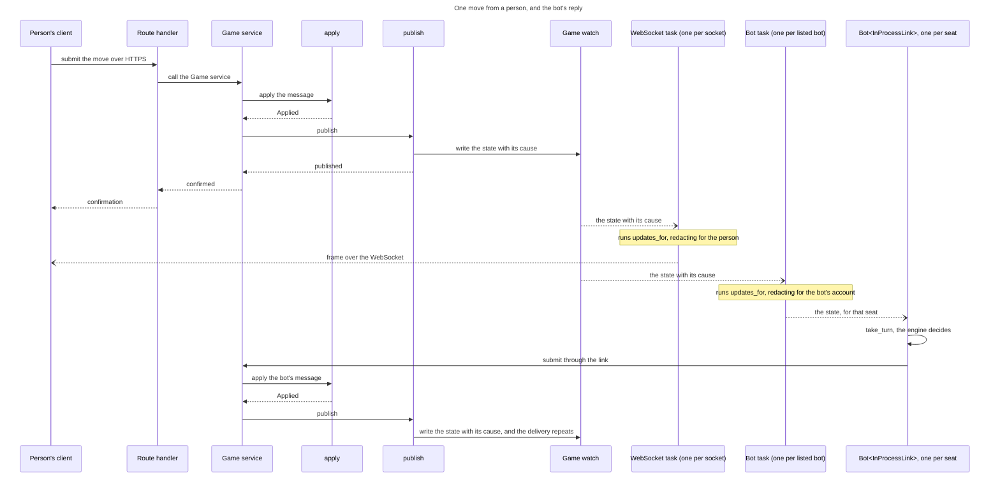
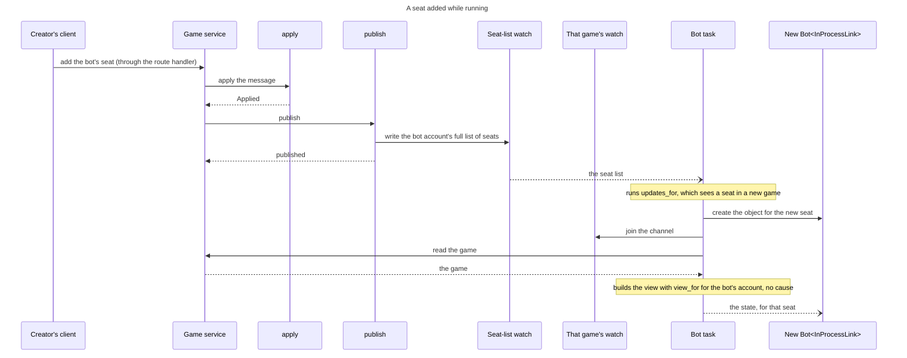

# 71 The engine: levels, callers and the glue

This file holds what the engine gains, who calls it and what makes lifting it
possible: levels, the bot as a client of the game, the in-process glue and the
bots the server runs. It follows [`71-06-engine.md`](71-06-engine.md), which has
the engine's as-is, the argument that it is a client and the technologies it
uses, and is followed by [`71-07-client.md`](71-07-client.md).

## The engine

### What the engine gains: levels

**An engine plays at a level, given when a seat's game starts.**[^levels]
Levels count from 1, the weakest; an engine whose `max_level` is 1 has one
level. `start` refuses a level outside 1 to `max_level` and returns the player
for that seat's game, which may keep what it learns between turns:

```rust
#[derive(Clone, Copy, PartialEq, Eq, PartialOrd, Ord)]
pub struct Level(pub u8);

pub trait GameEngine: Send + Sync {
    fn metadata(&self) -> &EngineMetadata;
    fn max_level(&self) -> Level;
    fn default_level(&self) -> Level;
    fn start(&self, level: Level) -> Result<Box<dyn EnginePlayer>, LevelError>;
}

pub trait EnginePlayer: Send {
    fn choose_action(&mut self, request: EngineRequest<'_>) -> EngineResponse;
}
```

`EngineRequest` is unchanged: it borrows `&GameState`, `&Rack` and
`&VariantRules`, all `rules-shared` types, none of them server types. **That is
why the engine can be lifted out at all**, and it is already true today.

### What changes: who calls it

A bot behaves like the existing client.[^layers] It is four layers, top-down,
and only the third differs by where the bot runs:

1. **Bot**: `Bot<L: GameLink>`, the engine and `take_turn`. The same wherever
   it runs.
2. **Client core**: `GameLink`, [the interface layer](71-05-wire.md#the-interface-layer). It yields a `GameUpdate` and submits a
   `GameMessage`, the two enums `game-wire` defines.
3. **Transport**, an adapter behind `GameLink` that moves those enums.
*External*: `ExternalLink` turns them into JSON and back over HTTPS and the
WebSocket. *In-process glue*: `InProcessLink` hands them over as Rust values,
over `updates_for` and the Game service's submit function. Each build compiles
one ([the interface layer](71-05-wire.md#the-interface-layer)): the server's
bots are `Bot<InProcessLink>`.
4. **Server**: Transport API, Game service, `apply`; `publish` sends each
   change to its game's channel in the Event stream, and `updates_for`
   subscribes to the channels in its scope and redacts for one viewer, under
   both transports. Every subscriber is its own task.

```rust
/// Same code in the server and in a client. Given a view of a game and the
/// seat's engine player, decide whether it is this seat's turn and what to do about it.
pub fn take_turn(
    player: &mut dyn EnginePlayer,
    view:   &GameView,          // from GameLink::on_event
    seat:   u8,
    budget: Option<Duration>,
) -> Option<GameMessage>;
```

**Two loops, two actors.** The first is a `Bot<L>` object's, through either
transport:

```text
on each update from the link:               // one object per seat held; the
                                            // link holds the identity, the
                                            // object none
    GameUpdate::Game { view, .. }:
        if view.status == Active
           && view.current_seat == seat:    // seat is the object's own
            if let Some(msg) = take_turn(player, &view, seat, budget) {
                link.submit(view.game_id, msg)
            }
    GameUpdate::GameRemoved(_):
        the link ends, and so does the object
```

The second is the glue's task, in-process, one per listed bot. It runs
`updates_for` over every seated game and feeds each object's `InProcessLink`, so
an object's link is scoped to its own seat's game:

```text
on each update from updates_for:
    GameUpdate::Seats(list):
        make a Bot object for each SeatRef the list gains
        drop the object of each SeatRef the list loses
    GameUpdate::Game { .. } and GameUpdate::GameRemoved(_):
        give it to the objects of that game
```

Over the external transport an object's link is one game, one WebSocket per
game. The subscription to every seated game carries the seat list, and what a
harness does with `Seats` is #10's.

**The bot hears it is on turn from the channel of its game**, the stream
every client of that game subscribes to, and never from the caller of `apply`:
no caller spawns a bot task. The request that applies a move returns at once.

**The in-process glue joins under the Transport API at two calls**:
`updates_for` to hear, and the Game service's submit function to act.

**The bot hears through `updates_for`**, the one redacting subscription under both
transports. Its channels, the two scopes it serves and what it does when a
game is removed are in
[How the engine uses watch](71-06-engine.md#how-the-engine-uses-watch).

A person's move reaches both tasks and the bot replies (the arrows are those of
[the move sequence in
71-10-documents-changed.md](71-10-documents-changed.md#12--the-move-sequence):
`->>` a call, `-->>` a return, `--)` an asynchronous delivery):



A seat added while the server runs starts from its own trigger, a creator adding
the bot's seat:



**`submit` calls the same Game service function a route handler calls** after
its sign-in check, passing the bot's account id as the caller. The service
still checks that the caller holds the seat and that it is on turn, and calls
`apply`.

**Over the external transport, `GameLink` opens one WebSocket per game**, as
today, for the games the account's game list names. A harness that subscribes
to every seated game over its socket learns of a new seat from the seat list;
the socket's shape is #10's.

**The server runs the bots its settings list.**

- `TILE_LITE_ELITE_BOTS` (proposed) lists the bots run in-process, each with
  one identity, which is one account. Its ratings are its account's, one per
  edition, however many games it plays.
- Each listed bot is an engine at one level, or at the engine's default, with
  its own account and its own rating per edition, so a rating always means one
  strength.[^bots][^levels] A game's creator picks the level by picking the
  bot; a UI may show one engine's bots as one choice with a level field.
- Each `Bot` object starts its engine at the listed level when it is made, so
  a level the engine refuses is caught before the bot plays.
- An `InProcessLink` is built with the listed identity and passes it on every
  message, so no session record exists.
- Each listed bot's task runs `updates_for` once, over every seated game. It
  makes and drops `Bot` objects by
  [the glue's loop](#what-changes-who-calls-it), each with a link scoped to its
  seat's game, including for a seat added while the server runs. One bot may
  hold several seats in one game, as a bot showdown (a game between bots)
  requires.
- All of a bot's objects share its identity and run under `engine_limit` ([the blocking pool](71-06-engine.md#how-the-engine-uses-the-blocking-pool)).
- The list is the programme owner's, who is accountable for the bots on it.
- In-process bots are compiled into the server from reviewed code. A
  third-party bot runs as an external client, which can run on the server's
  host.

**A harness meets the throttle; the in-process bot does not.** An external
harness posts like any client and can be answered 429 with `Retry-After`; its
retry policy is #10's. The rate limiter protects the service from callers
outside the server, and counts only them; the in-process glue joins below it.

**Nothing mediates.** There is no proxy and no bot-specific route: an external
bot posts the action a person posts, over the session of the bot's own
account, and the in-process bot calls the function that route calls, as the
bot's own account. Either way its rating moves because the account is the
bot's.

### What makes lifting it possible

Three things, and two of them are this design's other sections:

| | |
| --- | --- |
| the engine takes domain types, not server types | already true |
| a client can rebuild those types from an event | `GameLink::on_event`, which yields a `GameView` — [the interface layer](71-05-wire.md#the-interface-layer) |
| a hidden rack is distinguishable from an empty one | `SeatRack::Hidden(u8)` — otherwise an engine off the server reads an opponent's empty rack as fact and plays the endgame wrongly |

**The third is the one that would have been missed.** An engine running in the
server sees the whole game; the same engine in a client sees a redacted one, and
today redaction is indistinguishable from an empty rack. Lifting the engine out
without fixing that would give it a confident wrong answer rather than an
absent one.

### Where the engine runs is not in the schema

A bot seat carries an account id whichever side runs the search. The in-process
glue passes that account id to the Game service; a harness signs in as the same
account. Nothing downstream (ratings, stats, DEL-2) can tell the difference, and
that is [the goal](71-02-overview.md#the-goal) stated as a property of the
schema.

[^levels]: Owner, 2026-10-25: an engine takes a level at the start of a game
    and exposes its maximum and default; a maximum of 1 means one level; how
    the creator picks a level is the UI's.

[^layers]: Owner, 2026-10-20: `game-wire` converts `GameView` both ways and
    never sees `GameSession`; the server builds the view. A bot harness
    behaves like the existing client, over the internet or in-process.

[^bots]: Owner, 2026-10-20: one bot holds several seats, one bot per strength,
    sign-in belongs to the link, and `game-wire` defines `GameMessage` and
    `GameUpdate`.
