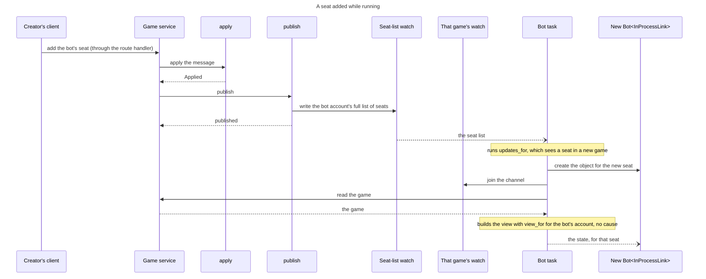

# 71 The engine: levels, the server's bots and lifting it out

This is the second of two files on the engine, and it is read second. The first,
[`71-06-engine.md`](71-06-engine.md), holds the as-is, the model of a bot as a
client and the technologies, and defines the terms this file uses: the glue, a
listed bot, a bot object and the layers. This file holds what only the engine
needs on top of that: levels, the glue's calls, the bots the server runs, what
makes lifting the engine out possible and where it runs. It is followed by
[`71-07-client.md`](71-07-client.md).

## The engine

### What the engine gains: levels

**An engine plays at a level, given when a seat's game starts.**[^levels]
Levels count from 1, the weakest; an engine whose `max_level` is 1 has one
level. `start` refuses a level outside 1 to `max_level` and returns the player
for that seat's game, which may keep what it learns between turns:

```rust
#[derive(Clone, Copy, PartialEq, Eq, PartialOrd, Ord)]
pub struct Level(pub u8);

pub trait GameEngine: Send + Sync {
    fn metadata(&self) -> &EngineMetadata;
    fn max_level(&self) -> Level;
    fn default_level(&self) -> Level;
    fn start(&self, level: Level) -> Result<Box<dyn EnginePlayer>, LevelError>;
}

pub trait EnginePlayer: Send {
    fn choose_action(&mut self, request: EngineRequest<'_>) -> EngineResponse;
}
```

`EngineRequest` is unchanged apart from the `stop` flag
([the blocking pool](71-06-engine.md#how-the-engine-uses-the-blocking-pool)): it
borrows `&GameState`, `&Rack` and `&VariantRules`, all `rules-shared` types,
none of them server types. **That is why the engine can be lifted out at all**,
and it is already true today.

### What changes: who calls it

Of the four layers in [the model](71-06-engine.md#the-model), only the third
differs by where the bot runs. The decision is one function, the same in the
server and in a client:

```rust
/// Same code in the server and in a client. Given a view of a game and the
/// seat's engine player, decide whether it is this seat's turn and what to do about it.
pub fn take_turn(
    player: &mut dyn EnginePlayer,
    view:   &GameView,          // from GameLink::on_event
    seat:   u8,
    budget: Option<Duration>,
) -> Option<GameMessage>;
```

Over the external transport an object's link is one game, one WebSocket per
game. The two subscription scopes are in
[How the Event stream uses watch](71-06-engine.md#how-the-event-stream-uses-watch),
and what a harness does with `Seats` is #10's. A bot hears it is on turn from
its game's channel, as [*What changes*](71-06-engine.md#what-follows-from-the-engine-being-a-client)
says.

**The in-process glue joins under the Transport API at two calls**:
`updates_for` to hear
([the Event stream](71-06-engine.md#how-the-event-stream-uses-watch)), and the Game
service's submit function to act. `submit` calls the same Game service function
a route handler calls after its sign-in check, passing the bot's account ID as
the caller. The service still checks that the caller holds the seat and that it
is on turn, and calls `apply`.

A seat added while the server runs starts from its own trigger, a creator adding
the bot's seat:



### The bots the server runs

The server runs the bots its settings list.

- `TILE_LITE_ELITE_BOTS` (proposed) lists the bots run in-process, each with
  one identity, which is one account. Its ratings are its account's, one for
  each edition, however many games it plays.
- Each listed bot is an engine at one level, or at the engine's default, with
  its own account and its own rating for each edition, so a rating always means
  one strength.[^bots][^levels] A game's creator picks the level by picking the
  bot; a UI may show one engine's bots as one choice with a level field.
- Each `Bot` object starts its engine at the listed level when it is made, so
  a level the engine refuses is caught before the bot plays.
- An `InProcessLink` is built with the listed identity and passes it on every
  message, so no session record exists.
- Each listed bot's task runs `updates_for` once, over every seated game. It
  makes and drops `Bot` objects by the loops in
  [the model](71-06-engine.md#the-model), each with a link scoped to its seat's
  game, including for a seat added while the server runs. One bot may hold
  several seats in one game, as a bot showdown (a game between bots) requires.
- All of a bot's objects share its identity and run under `engine_limit`
  ([the blocking pool](71-06-engine.md#how-the-engine-uses-the-blocking-pool)).
- The list is the programme owner's, who is accountable for the bots on it.
- In-process bots are compiled into the server from reviewed code. A
  third-party bot runs as an external client, which can run on the server's
  host.

### A bot posts what a person posts

An external bot posts the action a person posts, over the session of the bot's
own account, and the in-process bot calls the function that route calls, as the
bot's own account. Either way its rating moves because the account is the
bot's. A bot uses only the routes a person uses.

An external harness posts like any client and can be answered 429 with
`Retry-After`; its retry policy is #10's. The rate limiter protects the service
from callers outside the server, and counts only them; the in-process glue is
reached without passing it.

### What makes lifting it possible

*Lifting* the engine is running its code in a client rather than in the server.
It needs three things, and two of them are this design's other sections:

| What it needs | Where it comes from |
| --- | --- |
| the engine takes domain types, not server types | already true |
| a client can rebuild those types from an event | `GameLink::on_event`, which yields a `GameView`: [the interface layer](71-05-wire.md#the-interface-layer) |
| a hidden rack is distinguishable from an empty one | `SeatRack::Hidden(u8)` |

**A hidden rack must be distinguishable from an empty one.** An engine running
in the server sees the whole game; the same engine in a client sees a redacted
one, and today redaction is indistinguishable from an empty rack. Without
`SeatRack::Hidden(u8)` the engine would read an opponent's empty rack as fact
and play the endgame wrongly, with a confident wrong answer rather than an
absent one.

### A bot seat is an account, wherever its engine runs

A bot seat carries an account ID whichever side runs the search. The in-process
glue passes that account ID to the Game service; a harness signs in as the same
account. Nothing downstream (ratings, stats, DEL-2) can tell the difference, and
that is [the goal](71-02-overview.md#the-goal) stated as a property of the
schema.

[^levels]: Owner, 2026-10-25: an engine takes a level at the start of a game
    and exposes its maximum and default; a maximum of 1 means one level; how
    the creator picks a level is the UI's.

[^bots]: Owner, 2026-10-20: one bot holds several seats, one bot per strength,
    sign-in belongs to the link, and `game-wire` defines `GameMessage` and
    `GameUpdate`.
