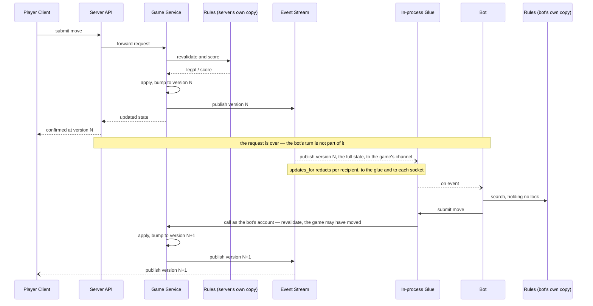
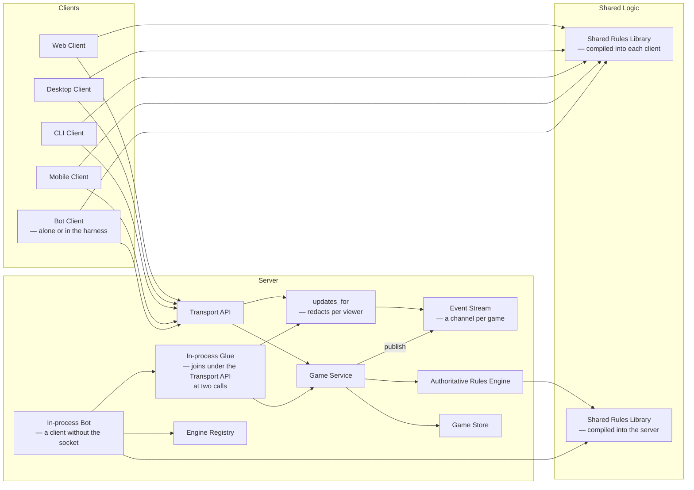

# 71 Documents this changes

This file holds the documents the change edits, and the two diagrams that move
into 1.2 as it lands. It follows
[`71-09-open-questions.md`](71-09-open-questions.md), and is the last file of
the technical design; the test approach,
[`71-test-approach.md`](71-test-approach.md), follows.

Each of these is edited on this branch, in the commit that makes it true, so
no commit describes a system that does not exist. The two diagrams in this
file are the exception the change-note convention allows: they are the agreed
design before there is code, and they move into 1.2 as it lands.

## 1.2 — the move sequence

Today's diagram has the engine's turn happening *inside* the human's request,
which is the arrangement this change exists to undo. The bot's move is no
longer part of anybody else's request:

The confirmation to `P` matters as much as the published state: a client that
has submitted a move waits for its own answer before submitting another, which
is what makes concurrent submissions from one client a non-question.

## 1.2 — the component diagram

`Engine Proxy` goes. An engine reaches the game as a client does. In the
harness or on somebody's laptop it comes through the API. In the server it
comes through the [glue](71-06-engine.md#the-model), which joins under
the Transport API at
[two calls](71-06b-engine-bots.md#what-changes-who-calls-it),
`updates_for` to hear and the Game service's submit function to act, so it
sits below the rate limiter:

The registry stays, resolving which engine an account runs, but it is reached
from the in-process bot rather than sitting between the game and the engines.
The Game service publishes each change to the Event stream.

## The reference documents

| Document | What changes |
| --- | --- |
| [4.4.1 Configuration](https://github.com/delphside/tile-lite-elite/blob/main/docs/4.4.1-configuration.md) | `TILE_LITE_ELITE_BOTS` (proposed), the list of bots the server runs in-process |
| [4.4.2 Database Schema](https://github.com/delphside/tile-lite-elite/blob/main/docs/4.4.2-database-schema.md) | seat state columns; `game_invitations` reduced to the record of who was asked; `player_ratings.subject_kind` removed; `game_moves`; foreign keys and the delete behaviour they enforce, with `rating_history.game_id` set null when its game goes |
| [4.4.3 API Schema](https://github.com/delphside/tile-lite-elite/blob/main/docs/4.4.3-api-schema.md) | the seat and rack DTOs, `ViewerAccess`, structured events, `RatingPointDto.game_id` optional, the api major version |
| [4.4.4 snapshot_json](https://github.com/delphside/tile-lite-elite/blob/main/docs/4.4.4-snapshot-json-schema.md) | the schema version field, seat shape, the event log |
| [4.4.5 Data Dictionary](https://github.com/delphside/tile-lite-elite/blob/main/docs/4.4.5-data-dictionary.md) | every game field that moves between snapshot, DB and DTO |

Each carries a freshness stamp, so each needs re-verifying against the code
rather than editing from this design — the design says what was agreed, and the
stamp claims what was checked.

Four documents describe the current arrangement and will contradict this one
until they are revised:
[4.1.1 Architecture](https://github.com/delphside/tile-lite-elite/blob/main/docs/4.1.1-architecture.md)'s
*Engines*, which says engines run only on the server, in-process;
[4.2.3 Engine Interface](https://github.com/delphside/tile-lite-elite/blob/main/docs/4.2.3-engine-interface.md),
which already points to this change for taking the engine out of the server;
[4.2.4
Persistence](https://github.com/delphside/tile-lite-elite/blob/main/docs/4.2.4-persistence.md)
on how game state is written, and foreign keys and the snapshot's schema
version; and
[4.2.7 Seats And Invitations](https://github.com/delphside/tile-lite-elite/blob/main/docs/4.2.7-authentication-and-invitations.md)
on invitations as their own lifecycle.

And
[4.1.0 Rules](https://github.com/delphside/tile-lite-elite/blob/main/docs/4.1.0-rules.md)
gains what this settles:

- user details — name, email, rating — are always a lookup, never copied into
  game data, and changing them bumps and republishes every game that player is
  in
- a seat invited by name must name a registered account, checked when the seat
  is added, which is also when its invitation is sent
- declining and withdrawing are final for that seat, and starting the game
  clears them
- bots hold accounts, and an external client authenticates as a person before
  assuming a bot
- how many tiles each opponent holds is public
- aborting cancels every pending invitation, and nothing about a seat can be
  invited, accepted or claimed once the game has started

Undo's rules wait for the undo work itself.
