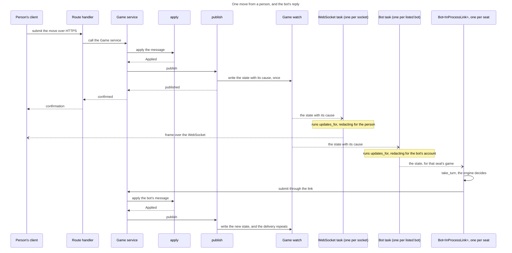
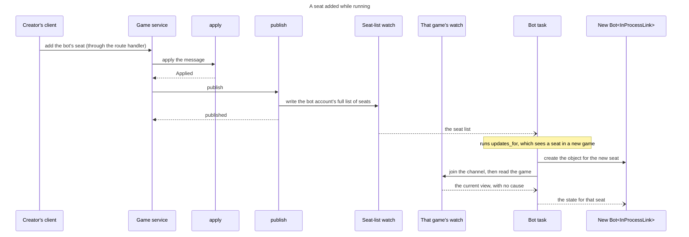

# 71 Data model, modules and message flows

**The shapes behind [`71-design.md`](71-design.md).** That note argues what
must be true; this says what is written. Nothing here overrides it — where they
differ the note wins and this is wrong.

**Everything below is proposed, not built.** Types are given as they would be
written, so that reviewing them is reviewing the design rather than a summary
of it.

## What exists today, for comparison

| | today | after |
| --- | --- | --- |
| the domain seat | `ParticipantState` — 11 flat fields, `resigned: bool`, `rack: Rack` always present | `Seat` — a state enum carrying what that state has |
| a seat's invitation | folded on every read from `game_invitations` rows | a field on the seat |
| freshness | `version: i64` on `GameSession`, moved by whoever remembers | moved by one handler, which is the only writer |
| the turn | `turn_number: i64`, doubling as a version | `turn` and `version` are separate counters |
| the client's rack | `racks: Vec<RackDto>`, a hidden rack sent as an empty one | `SeatRack::Hidden(u8)` on the seat |
| a display name | copied into `ParticipantState` and `snapshot_json` | resolved when the DTO is built |
| who may see what | `ViewerAccess::{Rejected, Creator, Participant{seat}}` — one seat | the set of seats an account holds |
| engine turns | `run_engine_turns` loops to `MAX_ENGINE_TURNS_PER_TRIGGER` holding the write lock | a bot client, told by the game's channel, holding nothing while it thinks |
| the games map | `HashMap<String, GameSession>` under one `RwLock` | `HashMap<String, Arc<RwLock<GameSession>>>` |

## 1 · Domain types

### The seat

`ParticipantState` is replaced. The fields that survive do so because they are
true of every seat in every state; the rest move into the state that owns them.

```rust
pub struct Seat {
    pub number: u8,
    pub player: Option<PlayerId>,         // resolved when the seat is created; a bot is a player
    pub invitation: Option<Invitation>,   // fixed at creation; None for own seat and bots
    pub state: SeatState,
    pub hidden_by_player: bool,           // "removed from my list" — per seat, not per game
    pub reminder_sent_turn: Option<i64>,
}
```

`display_name` is gone — that is the lookup rule. `resigned: bool` is gone:
`SeatState::Departed { how: Departure::Resigned, .. }` says it, and says which
of the three ways it happened. `score` and `rack` move inside the states that
have them, which is what stops a `Claimed` seat carrying a rack it cannot have.
`kind` and `engine` are gone: a bot is a user account, and the account says
which engine it runs (*Bots are users* in the note).

`SeatState`, `Invitation`, `Departure` and `SeatRack` are as
[`71-design.md`](71-design.md) gives them, and are not repeated here.

### The session

```rust
pub struct GameSession {
    pub id: GameId,
    pub status: GameStatus,
    // …variant, language, board_layout, rules, state, bag, moves, messages,
    //   move_time_limit_seconds, turn_started_at are unchanged…
    pub seats: Vec<Seat>,                 // was `participants: Vec<ParticipantState>`
    pub current_seat: u8,
    pub turn: i64,                        // was `turn_number`; game state, walks back under undo
    pub version: i64,                     // every change, of any kind. Never decreases
    pub last_scoring_turn: i64,           // replaces `consecutive_scoreless_turns`; see below
}
```

**Two counters, and only one of them is monotonic.**

| | what it counts | monotonic? |
| --- | --- | --- |
| `version` | every change a client can see, including chat and a rename | **yes, always** |
| `turn` | turns taken since the game started — **game state** | **no**: undo takes it back, redo returns it |

`turn` is game state: it is what undo walks, what the scoreless rule reads and
what a player is shown (owner, 2026-08-29). Because it can return to a value it
already held, it keys nothing — the same reason the note gives for `version`
being a counter rather than a description.

### Which changes move which counter

| change | `version` | `turn` |
| --- | --- | --- |
| a word placed | ✓ | ✓ |
| a pass | ✓ | ✓ |
| an exchange | ✓ | ✓ |
| a chat message | ✓ | — |
| an invitation sent, accepted, declined | ✓ | — |
| a rename (`UpdateUserDetails`) | ✓ | — |
| a resignation, force-resign, timeout | ✓ | — |
| undo, redo | ✓ | ✓ back / ✓ forward |
| a seat added, removed, reordered, hidden | ✓ | — |

### Three categories of change

| category | what is in it | changed by |
| --- | --- | --- |
| **board** | the tiles played on the board, and nothing else | a placement; undo or redo of one |
| **the game** | the board, plus racks, scores, the turn, resignations and timeouts | everything above, plus pass, exchange, resign, force-resign, timeout, start, abort |
| **periphery** | chat messages | posting a message |

**The categories are not counters.** `version` moves for all three and answers
*is what I hold stale*. What a category decides is what to do, and that is a
property of the **event**: the envelope carries it —
`State { game, because: Option<GameEventDto> }` — so a client classifies the
event rather than comparing numbers:

| the client is told | it does |
| --- | --- |
| a **board** event | redraw the board; a staged word whose cells are now taken is discarded by the occupancy check below |
| a **game** event | redraw the panes — racks, scores, whose turn. Notify if it is now this player's turn |
| a **periphery** event | a chat badge. Nothing else moves |
| **nothing** — a refetch or a reconnect | rebuild everything, because there is no event to classify |

**Exchange is the case that shows why.** It changes the game and not the
board: a staged word survives it, but the exchanging seat's rack does not,
which is why the rack is checked on its own below.

### The composition is keyed by game and seat

A staged word is displaced only when a tile is played in one of its own cells
(owner, 2026-08-29). An opponent playing elsewhere takes nothing away, so no
counter is part of the key:

```rust
pub struct CompositionKey {
    pub game: GameId,
    pub seat: u8,
}

fn live_composition(&self) -> Option<Composition> {
    let game = self.cache.peek().as_ref()?;
    let c    = self.composition.peek().clone()?;
    (c.key.game == game.id
        && c.staged.iter().all(|s| game.board[s.index].letter.is_none())
        && staged_tiles_still_held(&c, game))
        .then_some(c)
}
```

**Both conditions compare against the state the DTO already carries** — the
cells are empty, the tiles are still in the rack. The rack check covers what
the board check cannot: a rack changes without the board changing, after an
exchange or a timeout returning tiles to the bag, and a composition names tiles
by rack position. Nothing is stored, nothing is bumped, and nothing can be
forgotten in a handler.

**Composing does not need the turn; submitting does.** A composition survives
an opponent's turn, so a player can arrange a word while waiting (#88, carried
by this project). The client offers Submit only when `current_seat` is the
key's seat, and the server refuses anything else with `ApplyError::NotYourTurn`.

**Validity is a separate question from survival**, and conflating them would
throw work away. An opponent playing *adjacent* to a staged word leaves its
cells free but may make the word illegal — a cross-word that no longer exists,
or a connection that has become something else.

| | |
| --- | --- |
| the cells are taken | the tiles come back to the rack. There is nowhere for them to be |
| the cells are free but the word is now illegal | **the tiles stay**, and the client says so |

The client already runs the rules engine — `client_rules.rs` validates and
scores before sending — so it can re-validate on every board change and mark the
word rather than silently dismantling it.

### Three tile states, and all three already exist

Owner, 2026-08-29: *"we will need to make sure that staged, just played, and
previously played tiles are easily distinguished"*, and *"we currently
distinguish tile played in the last move."*

Both are true, and this is a **requirement to preserve rather than to build**.
An earlier revision of this section said the board could draw only two states,
from reading the tile-face classes alone. The third is on the **cell**:

| state | drawn as | driven by |
| --- | --- | --- |
| **staged** | `tile-face tile-face-staged` | the composition |
| **just played** | `board-cell-last-move` on the cell | `last_move_cells: HashSet<usize>` |
| **previously played** | `tile-face` | the board |

So what this change owes is that all three survive it. Two things put that at
risk, and neither is obvious from the type definitions:

**`last_move_cells` is computed from the DTO's move list.** Once
`MoveRecordDto.description` becomes structured and the seat model changes, the
computation has to be checked rather than assumed — it is exactly the kind of
derived value that keeps working until it quietly does not, and nothing
currently asserts it.

**The staged state must survive board changes that do not touch its cells.**
That is the section above, and it interacts here: under the current *clear on
any change* behaviour the staged class simply disappears, which no test would
notice because disappearing is what it is supposed to do eventually.

### An enhancement this makes cheap, not part of the change

*"Just played"* means the **last move**. A player returning after several moves
sees only the most recent one highlighted, and what they actually want is
everything that happened while they were away.

The client knows the version it held before the update — `should_apply_update`
compares against it — so *"since the version I last held"* is derivable, **if
move records carry the version they happened at**:

```rust
pub struct MoveRecordDto {
    pub version: i64,      // new — which version this move produced
    // …the rest as today; `description` becomes structured…
}
```

One field, no server state, and the log wants it anyway. Worth listing
separately rather than folding in: it is a change to what a player sees, and it
should be somebody's decision rather than something that arrives with a
refactor.

### Deriving beats accumulating, and the scoreless rule is the case

Owner, 2026-08-29: *"is turn useful for the terminating condition where there
are multiple non-scoring turns?"* Yes, and it is the better shape.

Today the game carries an accumulator:

```rust
pub consecutive_scoreless_turns: u8,     // SCORELESS_TURN_LIMIT = 6
```

Replaced by a mark:

```rust
pub last_scoring_turn: i64,
// the rule, at the point of use:
let scoreless = self.turn - self.last_scoring_turn;
```

**Three things get better, and the third is the one that matters under undo.**

**It is checkable.** `turn - last_scoring_turn` can be verified against the move
log; `consecutive_scoreless_turns` is a number that can only be trusted. A
count that nothing can contradict is a count that can be wrong for a long time.

**The rule stops being baked into the stored value.** Changing the limit from
six to eight is a comparison changing, not stored counters meaning something
new.

**And it survives undo without unwinding.** Undo produces a new higher version
whose content is an earlier state — so every field is restored together, and a
derived quantity is right the moment its inputs are. An accumulator restored the
same way is also right; the difference appears if undo is ever implemented as
*applying an inverse* rather than restoring, where every accumulator needs its
own decrement and one that is forgotten is silently wrong. Deriving means there
is nothing to forget.

**The honest caveat**: as the note has undo — restore, not inverse — the
accumulator would also survive, so this is not a fix for a bug that exists. It
is choosing the shape that stays correct under a change of undo strategy, at a
cost of nothing.

**One thing it does not change.** *Scoreless* still means what it means today —
a pass, an exchange, or a placement scoring zero — and each is a turn, so
`turn` advances for all three. If any of those ever stops advancing the turn,
this derivation breaks silently, which is worth a test rather than a comment.

### The message

`GameMessage` is in the note and is defined in `game-wire` (§3). What it needs
alongside it is the result:

```rust
pub struct Applied {
    pub version: i64,          // the version this change produced
    pub event: GameEvent,      // what happened, structured — for the log and the client
    pub finished: bool,        // the caller settles ratings and stats on the edge
}

pub enum ApplyError {
    NotYourTurn { seat: u8 },
    SeatNotPlaying { seat: u8 },
    GameNotActive,
    GameNotWaiting,            // a seat message (invite, accept, claim) after the start
    IllegalMove(rules_shared::MoveError),
    Unknown(String),
}
```

**A bot's turn is noticed from the game's channel, not from `Applied`.** Every
change publishes the new state, which names the seat on turn, so a bot comes on
turn after a timeout, a force-resign or a seat leaving just as it does after a
move, and no caller of `apply` hands it anything (§8).

### The one handler

```rust
impl GameSession {
    /// The only method that mutates a game. Validates, applies, advances the
    /// version, records the event — in that order.
    pub fn apply(&mut self, message: GameMessage, now: i64)
        -> Result<Applied, ApplyError>;
}
```

Everything else on `GameSession` becomes a reader. The methods that mutate
today — `maybe_run_engine_turn`, the action handlers, the invitation writers —
either disappear into `apply` or become callers of it.

**Enforced by visibility, not by discipline.** `seats`, `state`, `bag`,
`version` and `turn` become private to the module holding `apply`, with readers
for what the outside needs. A second writer then does not compile, which is the
difference between this and `announce_invitation_change`.

Two other ways in are named so that they are not mistaken for writers.
`GameSession::from_snapshot` builds a game from its stored row, which is how
persistence loads one; it validates the snapshot and changes nothing. Tests
build games through `GameSession::new` and `apply`, the public path, so a test
cannot reach a state the handler could not produce.

**What a failed save leaves** is nothing [^d69]. `GameSession` carries an
`unsaved: bool`, which `apply` sets. `events::publish`, under the game's write lock, saves the
change `apply` made and clears the flag, then publishes. A save error that
`ApiProblem::from_sqlx` classes as transient is retried in place, within #402's
bounds. One that still fails answers 503 with `Retry-After`, replaces the
session with `GameSession::from_snapshot` of the stored row, and publishes
nothing; a reader that finds `unsaved` set does the same reload before it
reads, and a game whose reload fails answers 503 to every message. The database is
the source of truth for #408.

## 2 · The wire

### The seat, on the wire

```rust
pub struct SeatDto {
    pub number: u8,
    pub player_id: Option<String>,
    pub state: SeatStateDto,          // mirrors SeatState, tagged
    pub rack: Option<SeatRackDto>,    // present only for Playing
    pub score: Option<i32>,
}

#[serde(tag = "kind", rename_all = "snake_case")]
pub enum SeatRackDto {
    Visible { tiles: RackDto },
    Hidden  { count: u8 },
}
```

`ParticipantDto` loses `display_name`, `invitation_status`, `invited_email`,
`resigned`, `rating_before`, `rating_after` and `current_rating`. The first four
are now the seat's state; the last three are facts about an event or a
projection, per the note.

### The game, on the wire

```rust
pub struct GameStateDto {
    pub id: String,
    pub version: i64,
    pub turn: i64,                    // new — game state, shown to the player
    pub status: GameStatus,
    // …variant, language, board_layout, current_seat, winner_seat,
    //   final_bonus_*, bag_count, move_time_limit_seconds, turn_started_at,
    //   board, moves, messages unchanged in shape…
    pub seats: Vec<SeatDto>,          // was `participants`
    pub players: Vec<PlayerRefDto>,   // new — the lookup, resolved at build
}

/// Everything about a person that a game refers to but does not own.
pub struct PlayerRefDto {
    pub id: String,
    pub display_name: String,
    pub current_rating: Option<f64>,
}
```

**`players` is what makes the lookup rule renderable.** The game holds ids; the
client needs names; resolving at DTO-build time is what makes a rename arrive
without anything being copied into game data. It carries every player the game
mentions — seats, chat authors, event subjects — so a client never has a
dangling id.

`racks: Vec<RackDto>` disappears from the top level: a rack belongs to a seat,
and hiding one is `SeatRackDto::Hidden`, not an empty rack.

### Structured descriptions

`MoveRecordDto.description` and the prose in events are replaced:

```rust
#[serde(tag = "kind", rename_all = "snake_case")]
pub enum GameEventDto {
    Placed        { seat: u8, main_word: String, score: i32 },
    Passed        { seat: u8 },
    Exchanged     { seat: u8, count: u8 },
    Resigned      { seat: u8 },
    ForceResigned { seat: u8 },
    TimedOut      { seat: u8 },
    SeatInvited   { seat: u8 },
    InvitationPassed   { seat: u8 },
    InvitationAccepted { seat: u8 },
    InvitationDeclined { seat: u8 },
    SeatWithdrawn { seat: u8 },
    SeatAdded     { seat: u8 },
    SeatsSwapped  { a: u8, b: u8 },
    SeatHidden    { seat: u8 },
    ReminderSent  { seat: u8 },
    Started, Aborted, Finished { winner: Option<u8> },
    UserDetailsUpdated { player: String },
    ChatPosted    { seat: Option<u8>, player: String },
}

impl GameEventDto {
    /// Which of the three categories this change belongs to. The client reads
    /// it to decide what to redraw; nothing on the server branches on it.
    pub fn category(&self) -> ChangeCategory {
        use GameEventDto::*;
        match self {
            Placed { .. }                          => ChangeCategory::Board,
            ChatPosted { .. }                      => ChangeCategory::Periphery,
            _                                      => ChangeCategory::Game,
        }
    }
}

pub enum ChangeCategory { Board, Game, Periphery }
```

**`ForceResigned` does not say who did it.** Every client of the game receives
the event, and which administrator acted is not theirs to know; the server's own
log records it.

**Undo and redo are classified by what they undo**, not by being undo — undoing
a placement is a board change, undoing a pass is a game change. That falls out
if the event carries what it reversed, which it must anyway for the log to be
readable.

Seat numbers and player ids, not sentences. The client renders them, which is
the only way any of it is readable in a language other than the one the server
was written in — and this service already ships Spanish dictionaries.

### The envelope

```rust
pub enum ServerMessageDto {
    /// The whole state, redacted for this recipient. Sent on connect, on
    /// reconnect, and after every change.
    State { game: GameStateDto, because: Option<GameEventDto> },
    /// The account's full list of seats, sent when a change to it is made.
    Seats { seats: Vec<SeatRefDto> },
    /// The game no longer exists; nothing more follows for it.
    GameRemoved { game_id: String },
    Rejected { message: String },
}

pub struct SeatRefDto { pub game_id: String, pub seat: u8 }
```

`ExternalLink` maps each `GameUpdate` (§3) to a `ServerMessageDto` one to one:
`Game` to `State`, `Seats` to `Seats`, `GameRemoved` to `GameRemoved`.
`Rejected` answers a submission and is not an update. Which socket carries
`Seats` for an external harness, one per account or a separate route, is #10's.

**Whole state, never a diff.** A diff needs the client to hold the prior
version and needs the server to know which one it holds; the state is small,
and `should_apply_update`'s version comparison already discards what a client
has. `because` is what the log records and what a client shows in the move
list — it is not applied.

### The error body, shared by every endpoint

One shape for every error any endpoint returns, designed here in Core because
Core rewrites the contract anyway, so it changes once (#380 R8).[^d65] Today's
`ApiError` body, `{ message, blocking_games }`, becomes one case of it.

```rust
pub struct ErrorDto {
    pub code: ErrorCode,                 // stable and machine-readable; the message may change
    pub message: String,                 // for a person, never parsed
    pub correlation_id: Option<String>,  // #402 fills it; Core only reserves the field
    pub detail: Option<ErrorDetail>,     // e.g. the games blocking a deletion
}
```

`ApplyError` maps onto `code`, so a client tells a stale submission from an
illegal move without reading prose. Every response carries the same headers,
the API version among them, and #402 adds the correlation id to them.

## 3 · The interface layer

A new crate. `api` keeps depending on `serde` alone; `rules-shared` keeps
knowing nothing about the wire.

```text
crates/api            DTOs and serde. No rules, no engine.
crates/rules-shared   the domain: GameState, Rack, Tile, MoveCandidate.
crates/game-wire      NEW. depends on both. GameView, GameMessage,
                      GameUpdate, GameLink, Bot and take_turn, and
                      GameView's conversion to and from the DTOs. Never
                      sees GameSession.
crates/server-game    depends on game-wire. Builds each GameView.
crates/ui             depends on game-wire.
crates/test-client    NEW. depends on game-wire.  (see 71-test-approach.md)
```

```rust
// crates/game-wire
pub fn game_to_dto(view: &GameView) -> GameStateDto;
pub fn game_from_dto(dto: &GameStateDto) -> Result<GameView, WireError>;

pub fn board_from_dto(cells: &[BoardCellDto], alphabet: &Alphabet)
    -> Result<BoardState, WireError>;
pub fn tile_from_dto(tile: TileDto, alphabet: &Alphabet)
    -> Result<Tile, WireError>;
pub fn rack_from_dto(rack: &RackDto) -> Rack;
pub fn move_candidate_from_dto(candidate: MoveCandidateDto,
    rules: &VariantRules) -> Result<MoveCandidate, WireError>;
```

The board, tile, rack and move-candidate conversions replace two sets of copies:
`board_from_dto`, `tile_from_dto` and `move_candidate_from_dto` in `server-game`
(`game_state.rs`), which return a `String` error, and `to_rules_tile`,
`to_rules_candidate`, `to_rules_board_state` and `to_rules_rack` in the UI
(`crates/ui/src/client_rules.rs`). The `game-wire` functions return `WireError`.

**`GameView` is what a client can rebuild** — the game as this viewer is
entitled to see it, with `SeatRack::Hidden` where a rack was withheld. It is
not `GameSession`: a client has no bag and no other player's tiles, and a type
that pretended otherwise would be lying in the type system. The type is
defined in `game-wire`, because the server builds it and every client reads it.
It carries its game's id, so a client holding several games reads which one a
view is of from the view.

**The server builds the `GameView`; `game-wire` only converts it.**
`GameSession::view_for` lives in `server-game` (`game_state.rs`), where the
bag and every rack are:

```rust
// crates/server-game
impl GameSession {
    pub fn view_for(&self, viewer: &ViewerAccess, players: &PlayerLookup) -> GameView;
}
```

`PlayerLookup` holds the display name and rating of each player in the game.
The caller passes it in, because user details are always a lookup and never
copied into game data ([*Open questions*](71-design.md#open-questions)): the
handlers, the Roster, the Invitations, the admin routes and the Event stream
each read the names from Accounts and the ratings from Ratings, then call
`view_for`, then `game_to_dto`.
`GameView` is one type, so the server's code and a client's, `take_turn`
included, read the same thing.[^layers]

**The identity is a property test in `game-wire`**, stated over `GameView`:

```rust
// for any view:
game_from_dto(&game_to_dto(&view))  ==  Ok(view)
```

What a viewer may see is proved where `view_for` is, in `server-game`: a viewer
holding two seats sees both racks, and every other rack is `Hidden`.

**The client core** is the one interface every client sits on, and it is in
`game-wire` too. `game-wire` defines what crosses it as two enums, one for each
direction:

```rust
// crates/game-wire
/// To the server: a move, pass, exchange, resign and the rest. The variants
/// are in 71-design.md, "One version, moved in one place".
pub enum GameMessage { /* ... */ }

/// From the server: what a subscriber is told.
pub enum GameUpdate {
    /// A game's new state, and the event that produced it. `because` is
    /// absent on the first yield (the current view on join) and when the
    /// receiver has skipped states (§8).
    Game { view: GameView, because: Option<GameEventDto> },
    /// The account's new list of seats, one entry for each seat it holds.
    Seats(Vec<SeatRef>),
    /// A game no longer exists; nothing more follows for it.
    GameRemoved(GameId),
}

/// One seat of one game. A list of these, not of games, lets one bot hold
/// several seats in a game.
pub struct SeatRef { pub game_id: GameId, pub seat: u8 }
```

`GameUpdate` is a proposed name. `GameEventDto` (§2, *Structured descriptions*)
holds only seat numbers and player names, so it is safe for any recipient; the
server keeps its own `GameEvent` and converts it to `GameEventDto` once, when
it publishes. A link moves these two enums and nothing else. The client core
has two calls, and no server type in either:

```rust
pub trait GameLink {
    /// The next update in this subscription's scope. A GameView carries its
    /// game's id. Scope is what the transport subscribed to: the seat's game
    /// for the link of each in-process bot object, one game for each link of
    /// the web client or an external harness.
    async fn on_event(&mut self) -> Result<GameUpdate, LinkError>;
    /// Send a message for a game; the answer is the server's, accepted or
    /// refused.
    async fn submit(&self, game_id: GameId, message: GameMessage)
        -> Result<(), SubmitError>;
}
```

The web client, the test client, an external harness and the in-process bot each
call these two, and see only the two enums. A transport is an adapter behind
them (§8).

**`GameLink` is a trait with two implementations, chosen at compile time.**
`Bot<L: GameLink>`, with `take_turn`, is in `game-wire`, where the server and
the harness of #10 share it. The implementations are `InProcessLink`, which
stays in `server-game` with the glue and hands the enums over as Rust values,
and `ExternalLink` (the name is proposed), which turns them into JSON and back
over HTTPS and the WebSocket, through the DTOs and `game_to_dto` and
`game_from_dto`. The server builds `Bot<InProcessLink>` and a
harness builds `Bot<ExternalLink>`. The web client uses `ExternalLink` with a
one-game scope and builds no `Bot`.

**Sign-in belongs to the link.** An `ExternalLink` is built by signing in and
keeps the token; an `InProcessLink` is built with the listed bot's identity.
`Bot<L>` never signs in, so it is the same code on a client and in the
server.[^watch]

## 4 · Access

```rust
pub struct ViewerAccess {
    pub player: Option<PlayerId>,
    pub seats: Vec<u8>,        // every seat this account holds — not one
    pub is_creator: bool,
}
```

`Creator` stops being a rank below participant: an account can be the creator
*and* hold two seats. What a viewer may see is the union over `seats`, which is
the live defect the note names — today `.find(...)` returns one seat, so a
player holding two has one of their own racks hidden from them.

## 5 · Database

| table | change |
| --- | --- |
| `games` | add `version`, `turn` and `last_scoring_turn`, all `integer not null default 0`, `last_activity_at integer not null`, which RET-3's countdown reads, and `rated integer not null default 1`, which a suggestion clears (RATE-4) (see *Open questions* in `71-design.md`). `snapshot_json` changes shape and gains `schema_version` (#302, below) |
| `game_participants` | drop `display_name`. Add `state text not null`, `invitation_id text`, `hidden_by_player integer not null default 0`. Keep `outcome`, `bingo_count`, `score` — stats read them without loading a snapshot |
| `game_invitations` | gains `addressee_id text`: the player who may accept, set at send when the address is one an account has verified, or later when a link is claimed or the address is verified; null while the link is still the credential, so a set addressee also means the link is spent (see *Who may accept* in `71-design.md`).[^d72] An index on the invited address over open rows with no addressee serves the pass on verification. It stays the record of who was asked and what they said, which DEL-2 reads |
| `player_ratings`, `rating_history` | the key becomes `(player_id, edition)` and `subject_kind` goes, in one migration with the rest of Core.[^d58] An edition is the game's `variant` (`games.variant`, 4.2), so a game is rated in the edition it was played in, bot against bot included. The rating step sums an account's per-seat changes into one update, and a seat's change against another of its own seats cancels, so a bot that holds several seats in one game needs no special case and a game it plays only against itself nets zero (`settle_ratings`, `stats.rs`). A bot's rows move to the id of its account, and every existing row becomes English (International)'s; other editions start at 1500 |
| `game_events` | new: `game_id`, `version`, `event` (the serialised `GameEventDto`), `created_at`; primary key (`game_id`, `version`). Appended once per `Applied`, never updated or deleted except with its game (RET-1).[^d61] |
| `players` | gains `stats_private integer not null default 0`: whether the player's stats and rating history are hidden from others (RATE-5) |
| `push_subscriptions` | new, for Web Push (WP C): `id`, `player_id`, `endpoint text not null unique`, `p256dh text not null`, `auth text not null`, `created_at`. One row per device a player has allowed; a send answered 404 or 410 deletes it |
| `notification_preferences` | new: `player_id`, `event_kind text not null`, `enabled integer not null`; primary key (`player_id`, `event_kind`). A missing row means the event kind's default, so a new kind needs no migration |
| `game_moves`, `game_messages` | drop `display_name` from messages; descriptions become structured. `game_moves` is no longer rewritten on every save: it is read from `game_events`, or dropped where nothing needs it as a table |

**Foreign keys arrive with this migration (#253).** Every table is rewritten
anyway, so the constraints 4.2 says are missing are declared now, matching the
deletes `persistence.rs` does by hand today, and `PRAGMA foreign_keys = ON` is
set on every connection:

| reference | on delete |
| --- | --- |
| `game_moves`, `game_messages`, `game_participants`, `game_invitations` → `games` | cascade |
| `sessions`, `password_reset_tokens`, `game_invitations`, `player_ratings`, `rating_history`, `push_subscriptions`, `notification_preferences` → `players` | cascade |
| `game_participants.player_id`, and any other reference from game history to a player → `players` | set null — the seat is unclaimed, not deleted |
| `rating_history.game_id` → `games` | set null — the point outlives its game (RET-2, DEL-10) |

The last row is #66's fix: `RatingPointDto.game_id` becomes `Option<String>`, so
a client is told plainly that the game has gone rather than handed an id that
names nothing.

**`schema_version` is a field of `snapshot_json`** (#302), an integer whose
first value is 1, read before anything else in the blob. A reader matches on it
and has one deserialiser per version it still accepts; a version it does not
know is an error naming the version, not a missing-field error. Why it is
separate from `version` is in the note's *So that this is the last deletion*.

**`version` and `turn` become columns** rather than living only inside
`snapshot_json`, because a sweep needs to find games by state without
deserialising every snapshot, and because a column can be indexed.

**Migration is a deletion.** The note settles this: existing games are deleted,
users and ratings kept. So the migration is a schema rewrite plus
`delete from games`, and the risk is entirely in what it must *not* delete —
`players`, `player_ratings`, `rating_history`, `sessions`. The rating tables are
rekeyed rather than kept as they are, so the migration checks that every row
survives the move to `(player_id, edition)`.

## 6 · Modules

| module | what happens to it |
| --- | --- |
| `game_state.rs` | `ParticipantState` → `Seat`; gains `apply` and `view_for`; loses every other mutator. Its private fields are what enforce the single writer |
| `app/games.rs` (1,030 lines) | the action handlers become thin: parse, build a `GameMessage`, call `apply`, publish. `run_engine_turns` and `MAX_ENGINE_TURNS_PER_TRIGGER` go |
| `app/roster.rs` (391) | seat add/remove/swap become `GameMessage`s |
| `app/invitations.rs` (442) | send/accept/decline become `GameMessage`s; the table write stays, the seat write moves into `apply` |
| `app/events.rs` (105) | gains `publish(Applied)` — persist, publish, one place — and `updates_for`, the one redacted subscription, over a `watch` channel per game and a seat list per account, that a socket and the in-process glue both use |
| `app/sweeps_game.rs` (301), `app/scheduler_jobs.rs` (297) | timeouts and reminders go through `apply` rather than writing rows, which is what makes them visible to clients. A scheduler job is a caller like any other |
| `app/sweeps_capacity.rs` (81) | expiring a finished game deletes it rather than changing it, so it does not call `apply`; the Event stream drops the game's sender, which closes every receiver, and `updates_for` yields `GameRemoved` (§8) |
| `app/admin.rs` (430) | force-resign and force-end become `GameMessage`s; deleting a game also drops its sender, as in the `app/sweeps_capacity.rs` row |
| `stats.rs`, `app/ratings.rs` | unchanged in substance; read `Applied.finished` instead of inspecting status transitions |
| `crates/ui/src/app.rs` (5,522) | section 7 |
| `crates/engine-core` | **unchanged.** The trait already takes a request and returns an action; what changes is who calls it |

## 7 · The client

### Where the state lives

```rust
selected_game: Signal<Option<GameId>>,        // intent
cache:         Signal<Option<GameStateDto>>,  // what the server last said
composition:   Signal<Option<Composition>>,   // keyed, see below

pub struct Composition {
    pub key: CompositionKey,
    pub staged: Vec<StagedPlacementView>,
    pub cursor: Option<usize>,
    pub direction: Option<DirectionDto>,
    pub blank_letter: Option<String>,
    pub exchange: Option<HashSet<usize>>,
}

pub struct CompositionKey {
    pub game: GameId,
    pub seat: u8,             // no counter: see §1, *The composition is keyed by game and seat*
}
```

The seven composer signals become one optional struct with a key. `selected_id`
stops being read back out of the loaded DTO, which is what currently makes
*deselect* and *clear the panes* the same action.

### How updates are centralised

**One entry point for anything the server says.** `apply_game_update` is called
from **23 sites** in `app.rs` today; each is a place that could forget
something. It becomes one:

```rust
/// The only function that writes `cache`. Every response and every socket
/// frame arrives here.
fn on_server_state(&mut self, incoming: GameStateDto, because: Option<GameEventDto>) {
    if !should_apply(self.cache.peek().as_ref(), &incoming) { return; }  // as today
    self.cache.set(Some(incoming));
    // nothing else. No clearing, no cascade.
}
```

**And nothing clears the composition.** It is filtered on read:

```rust
fn live_composition(&self) -> Option<Composition> {
    let key = self.current_key()?;              // from selected_game + cache
    self.composition.peek().clone().filter(|c| c.key == key)
}
```

That is the note's *stop clearing, start matching*, made concrete: a writer that
forgets cannot cause the failure, because no writer participates.

**Two side effects stay explicit**, because they are not state: storing the
session token, and tearing down the socket. Everything else is derived on
render, which is what Dioxus does for free.

### What this does not become

Not a reducer over an event enum. Dioxus already propagates; a reducer would
sit on top of that and duplicate it, at the cost of rewriting a 5,500-line
component. The centralisation that is worth having is **one writer of the
server cache**, not one writer of everything.

## 8 · The engine

### What does not change

```rust
pub trait GameEngine: Send + Sync {
    fn metadata(&self) -> &EngineMetadata;
    fn choose_action(&self, request: EngineRequest<'_>) -> EngineResponse;
}
```

`EngineRequest` borrows `&GameState`, `&Rack`, `&VariantRules` — all
`rules-shared` types, none of them server types. **That is why the engine can
be lifted out at all**, and it is already true today.

### What changes: who calls it

A bot behaves like the existing client.[^layers] It is four layers, top-down,
and only the third differs by where the bot runs:

1. **Bot**: `Bot<L: GameLink>`, the engine and `take_turn`. The same wherever
   it runs.
2. **Client core**: `GameLink`, §3. It yields a `GameUpdate` and submits a
   `GameMessage`, the two enums `game-wire` defines.
3. **Transport**, an adapter behind `GameLink` that moves those enums.
   *External*: `ExternalLink` turns them into JSON and back over
   HTTPS and the WebSocket. *In-process glue*: `InProcessLink` hands them over
   as Rust values, over `updates_for` and the Game service's submit function.
   Each build compiles one (§3): the server's bots are `Bot<InProcessLink>`.
4. **Server**: Transport API, Game service, `apply`; `publish` sends each
   change to its game's channel in the Event stream, and `updates_for`
   subscribes to the channels in its scope and redacts for one viewer, under
   both transports. Every subscriber is its own task.

```rust
/// Same code in the server and in a client. Given a view of a game and an
/// engine, decide whether it is this seat's turn and what to do about it.
pub fn take_turn(
    engine: &dyn GameEngine,
    view:   &GameView,          // from GameLink::on_event
    seat:   u8,
    budget: Option<Duration>,
) -> Option<GameMessage>;
```

**The loop is the client's, through either transport:**

```text
on each update from the link:      // a Bot<L: GameLink>, one per seat held;
                                   // the link holds the identity, the bot none
    GameUpdate::Game { view, .. }:     // in-process: this seat's game;
                                   // external: one of the games its links
                                   // were opened for
        // seat is the object's own seat
        if view.current_seat == seat:
            if let Some(msg) = take_turn(engine, &view, seat, budget) {
                link.submit(view.game_id, msg)
            }
    GameUpdate::Seats(list):       // the glue's task, for a listed bot
        make a Bot object for each SeatRef the list gains,
        drop the object of each SeatRef it loses
    GameUpdate::GameRemoved(_):     // an object's own link
        the link ends, and so does the object
```

**The bot hears it is on turn from the channel of its game**, the stream
every client of that game subscribes to, and never from the caller of `apply`:
no caller spawns a bot task. The request that applies a move returns at once.

**The in-process glue joins under the Transport API at two calls**:
`updates_for` to hear, and the Game service's submit function to act.

**`on_event` hears through `updates_for(scope, &ViewerAccess)`**, the one
function that redacts for a recipient, below both transports. The Event
stream is a registry from game id to that game's `watch` channel
(`app/events.rs`, tokio), which holds only the latest state. `updates_for`
creates a game's channel on its first subscriber and drops it with its last.
`publish` writes the full, unredacted state to its game's channel only, so an
event reaches the sockets of its game and no others, and the cost of a change
grows with that game's receivers only. **Each account also has a `watch` of its
full list of seats**, a `Vec<SeatRef>` (§3), which `publish` updates when a
change seats or unseats the account. The scope decides what a subscriber
receives:

| scope | who subscribes | receives |
| --- | --- | --- |
| one game | the WebSocket handler, as today | that game's channel |
| every seated game | the glue, once per listed bot; an external harness over its socket | the channel of each game it holds a seat in, and the account's seat list; `updates_for` joins the channel of a game when the list gains its first seat, so a seat added later brings that game into scope |

Both scopes first yield the current `GameView` of each game in scope, as a
`GameUpdate::Game` with no `because`, then each change, built with `view_for`
for this recipient. The first yield covers start-up and, for a WebSocket,
reconnection, so a game already on the bot's turn is played. `updates_for`
joins a game's channel before it reads the game, so no change falls between.
The socket converts each `GameView` to a frame with `game_to_dto`; the glue
gives each view, as it is, to the bot object of each seat the bot holds in that
game.

**The state supersedes; the `because` of a skipped state is dropped by
design.** A `watch` value is the state with its `because` (§2's envelope). A
receiver that keeps up sees every value and always reads the latest state, so it
never lags. A slow one skips states: it sees the version jump by more than one
and treats `because` as absent, which rebuilds everything (§1's *nothing*
case). The move list is part of the state, so nothing is lost. `publish`, which
runs in the server, sends the push notifications, not the watch, so a skipped
value loses none. Today a lagging server receiver ends the socket; here it
skips states and carries on, and the client already ignores a version it has
passed (`should_apply_update`, `crates/ui/src/app.rs`).[^watch]

**`updates_for` leaves the channel of a removed game or seat.** When a game is
removed, the Event stream drops the game's sender, which closes every receiver;
`updates_for` yields `GameUpdate::GameRemoved` for it and stops following it. A
seat removed shrinks the seat list, and `updates_for` leaves a game's channel
only when the list holds no seat in that game.

**The server never iterates over its clients, and nothing dispatches on the
kind of subscriber.** `publish` writes the new state to the game's `watch` once.
Every subscriber is its own task compiled for one concrete type: a WebSocket
task converts the state to a frame and writes its socket; a task of
`Bot<InProcessLink>` gives the state to its engine. Each task runs
`updates_for` for itself. The glue runs one task per listed bot, which holds one
`Bot` object per seat that bot holds, and makes or drops an object as the seat
list gains or loses a `SeatRef`.[^watch]

A person's move reaches both tasks and the bot replies (the arrows are those of
[the move sequence in 71-design.md](71-design.md#12--the-move-sequence): `->>` a
call, `-->>` a return, `--)` an asynchronous delivery):



A seat added while the server runs starts from its own trigger, a creator adding
the bot's seat:



**`submit` calls the same Game service function a route handler calls** after
its sign-in check, passing the bot's account id as the caller. The service
still checks that the caller holds the seat and that it is on turn, and calls
`apply`.

**Over the external transport, `GameLink` opens one WebSocket per game**, as
today, for the games the account's game list names. A harness that subscribes
to every seated game over its socket learns of a new seat from the seat list;
the socket's shape is #10's.

**The server runs the bots its settings list.**

- `TILE_LITE_ELITE_BOTS` (proposed) lists the bots run in-process, each with
  one identity, which is one account. Its ratings are its account's, one per
  edition, however many games it plays.
- Each engine strength is its own listed bot, with its own account and its own
  rating per edition.[^watch]
- An `InProcessLink` is built with the listed identity and passes it on every
  message, so no session record exists.
- The glue subscribes once per listed bot, for every game it holds a seat in.
  Its task makes a `Bot` object, with a link scoped to its seat, for each
  `SeatRef` the list gains, including a seat added while the server runs, and
  drops the object of each `SeatRef` the list loses. One bot may hold several
  seats in one game, as in a bot showdown (a game between bots, one bot holding
  several seats), and the showdown requires that.
- All of a bot's objects share its identity and run under `engine_limit`.
- The list is the programme owner's, who is accountable for the bots on it.
- In-process bots are compiled into the server from reviewed code. A
  third-party bot runs as an external client, which can run on the server's
  host.

**The submitted move is re-validated on arrival**, because the game may have
moved — aborted, or the seat retired. A rejection is normal, not an error.

**The number of searches running at once is bounded.** Today a search holds the
games write lock, so searches run one at a time by accident and `engine_limit`
(`TILE_LITE_ELITE_ENGINE_CONCURRENCY`, default 2, the VM's core count) is read
but never acquired. Once a search holds nothing, N bot games on turn are N
parallel searches, so the bot acquires `engine_limit` before searching, and the
hint does the same [^d62]. The permit moves into the blocking thread and
drops when the engine returns, not when the time runs out.
`ENGINE_TURN_TIMEOUT` starts when the permit is held. `EngineRequest` gains a
`stop: &AtomicBool`, set when the time runs out, which the engine checks as it
searches; one that ignores it keeps its permit.

**A search that fails, panics or runs out of time** leaves the seat on turn,
exactly as a silent human is, and the move time limit retires it. It is logged
and never answered to the human whose move triggered it.

**A harness meets the throttle; the in-process bot does not.** An external
harness posts like any client and can be answered 429 with `Retry-After`; its
retry policy is #10's. The rate limiter protects the service from callers
outside the server, and counts only them; the in-process glue joins below it.

**Nothing mediates.** There is no proxy and no bot-specific route: an external
bot posts the action a person posts, over the session of the bot's own
account, and the in-process bot calls the function that route calls, as the
bot's own account. Either way its rating moves because the account is the
bot's.

### What makes lifting it possible

Three things, and two of them are this note's other sections:

| | |
| --- | --- |
| the engine takes domain types, not server types | already true |
| a client can rebuild those types from an event | `GameLink::on_event`, which yields a `GameView` — §3 |
| a hidden rack is distinguishable from an empty one | `SeatRack::Hidden(u8)` — otherwise an engine off the server reads an opponent's empty rack as fact and plays the endgame wrongly |

**The third is the one that would have been missed.** An engine running in the
server sees the whole game; the same engine in a client sees a redacted one, and
today redaction is indistinguishable from an empty rack. Lifting the engine out
without fixing that would give it a confident wrong answer rather than an
absent one.

### Where the engine runs is not in the data model

A bot seat carries an account id whichever side runs the search. The in-process
glue passes that account id to the Game service; a harness signs in as the same
account. Nothing downstream (ratings, stats, DEL-2) can tell the difference, and
that is the goal at the top of the design note stated as a property of the
schema.

## Open questions this raises

**Does `apply` persist, or does its caller?** Written above as: `apply` mutates
in memory and returns `Applied`; `events::publish` persists and publishes.
That keeps `GameSession` free of the database, and makes `apply` a pure
function of state and message — which is what makes it testable without a
pool. The cost is that a caller can forget to publish. Enforceable by making
`Applied` `#[must_use]`, which is weaker than the type-level guarantee the
server side otherwise gets.

**How does the server act as the bot accounts it runs in-process, and do they
need an owner?** Settled by owner, 2026-10-20: see [§8](#8--the-engine).

**How does an external harness learn of a game it is newly seated in?**
Settled by owner, 2026-10-20: see [§8](#8--the-engine).

**Third-party bots in-process?** Settled by owner, 2026-10-20: no; see
[§8](#8--the-engine).

**Does `turn` need to be persisted separately from `moves.len()`?** Settled by
undo, 2026-08-29: yes. Under undo `turn` walks backwards while `moves` does not
necessarily — an undone move stays in the log, since the log is the record of
what happened and undo is itself an event. So they diverge the first time undo
is used, and `moves.len()` was only ever a coincidence.

[^d58]: Decision #444 (D58): editions and bots as accounts change the rating key
    once, in Core.
[^d72]: Decision #479 (D72): how an emailed invitation behaves once an address
    identifies one account. It supersedes D59 (#445).
[^d61]: Decision #461 (D61): Core lays down the append-only log and writes it.
[^d65]: Decision #465 (D65): #71 Core designs the shared error body and response header.
[^d69]: Decision #469 (D69): a change exists once saved; a failed save reloads the game.
[^d62]: Decision #462 (D62): `engine_limit` bounds parallel searches and hints.
[^watch]: Owner, 2026-10-20: the per-game channel is a `watch`, the account's
    seats are a `watch`, one bot holds several seats, one bot per strength,
    sign-in belongs to the link, one task per subscriber, and `game-wire`
    defines `GameMessage` and `GameUpdate`.
[^layers]: Owner, 2026-10-20: `game-wire` converts `GameView` both ways and
    never sees `GameSession`; the server builds the view. A bot harness
    behaves like the existing client, over the internet or in-process.
