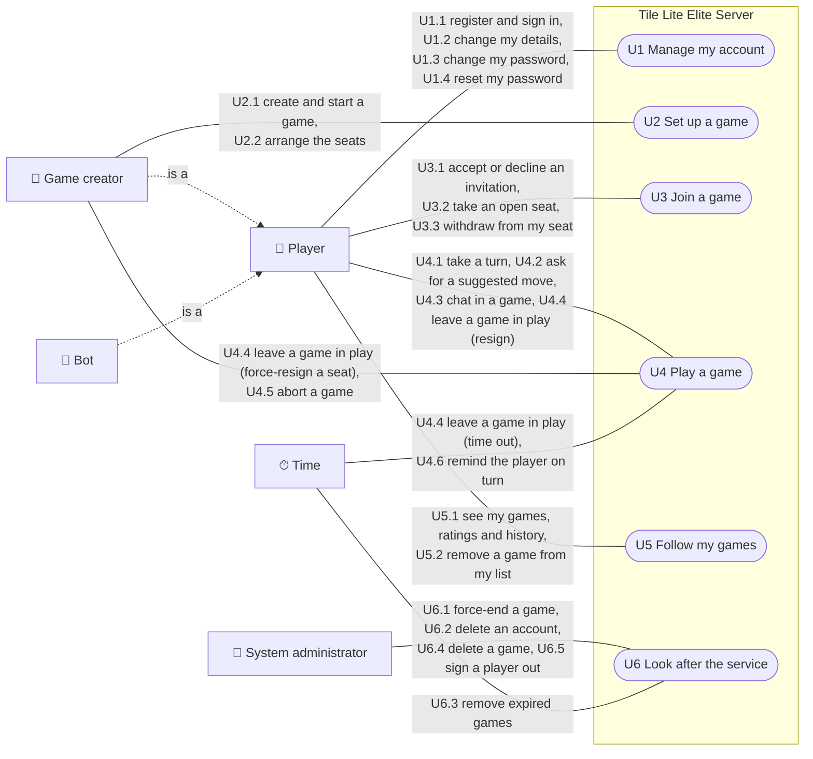
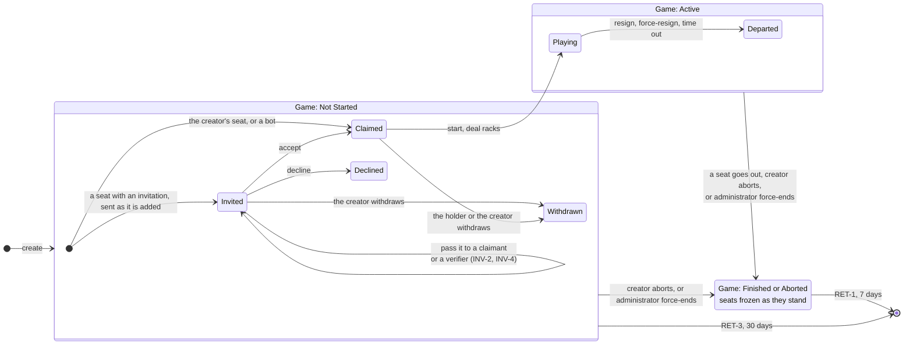
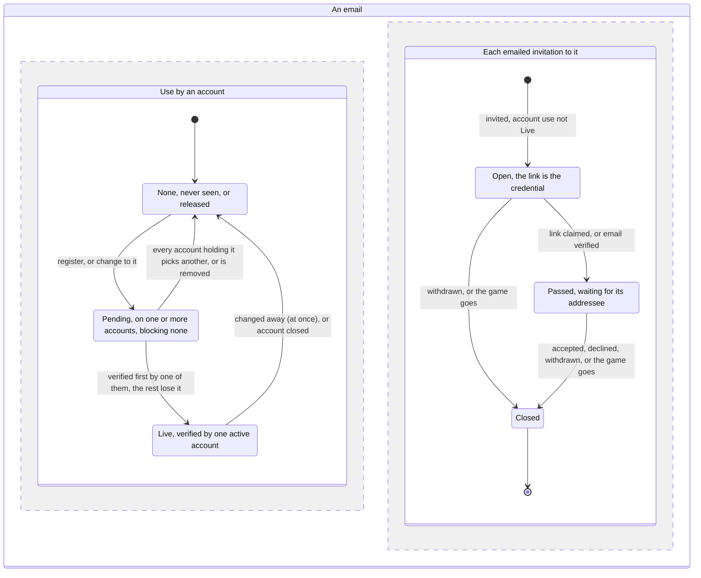

# 71 Functional views

**The first stage of #71's design**, as
[Decision #472](https://github.com/delphside/tile-lite-elite/issues/472) (D71)
settled it on 2026-10-02: one file per stage, functional views before the
technical design. This file is the functional set for #71: who uses the
service, what each may do, and the journeys and lifecycles that follow from
that. It is the first file of the design and is followed by
[`71-journeys-u1-u3.md`](71-journeys-u1-u3.md). The requirements it surfaces
are raised on #71 before any technical decision they touch.

It is the **to-be**: the service as #71 leaves it. The views follow
[docs/diagrams/README.md](https://github.com/delphside/tile-lite-elite/blob/main/docs/diagrams/README.md).
Rule ids are
[docs/1.0](https://github.com/delphside/tile-lite-elite/blob/main/docs/4.1.0-rules.md)'s.

## Use case

One diagram for the service. Each oval is a use case, a goal an actor comes to
the service for; each labelled line names the journeys, listed after the
diagram, by which the actor pursues it, and is a permission: auth (2.5) and
seats and invitations (2.7) enforce it. A game's creator is a role one player
holds in one game, separate from any seat they hold (GAME-8), so it is drawn as
a kind of player. A bot is an account, and plays through the same use cases a
player does. Time stands for what nobody asks for.

- [U1 Manage my account](71-journeys-u1-u3.md#u1-manage-my-account): [U1.1](71-journeys-u1-u3.md#u11-register-and-sign-in) Register and sign in, [U1.2](71-journeys-u1-u3.md#u12-change-my-details) Change my details, [U1.3](71-journeys-u1-u3.md#u13-change-my-password) Change my password, [U1.4](71-journeys-u1-u3.md#u14-reset-my-password) Reset my password
- [U2 Set up a game](71-journeys-u1-u3.md#u2-set-up-a-game): [U2.1](71-journeys-u1-u3.md#u21-create-and-start-a-game) Create and start a game, [U2.2](71-journeys-u1-u3.md#u22-arrange-the-seats) Arrange the seats
- [U3 Join a game](71-journeys-u1-u3.md#u3-join-a-game): [U3.1](71-journeys-u1-u3.md#u31-accept-or-decline-an-invitation) Accept or decline an invitation, [U3.2](71-journeys-u1-u3.md#u32-take-an-open-seat) Take an open seat, [U3.3](71-journeys-u1-u3.md#u33-withdraw-from-my-seat) Withdraw from my seat
- [U4 Play a game](71-journeys-u4-u6.md#u4-play-a-game): [U4.1](71-journeys-u4-u6.md#u41-take-a-turn) Take a turn, [U4.2](71-journeys-u4-u6.md#u42-ask-for-a-suggested-move) Ask for a suggested move, [U4.3](71-journeys-u4-u6.md#u43-chat-in-a-game) Chat in a game, [U4.4](71-journeys-u4-u6.md#u44-leave-a-game-in-play) Leave a game in play, [U4.5](71-journeys-u4-u6.md#u45-abort-a-game) Abort a game, [U4.6](71-journeys-u4-u6.md#u46-remind-the-player-on-turn) Remind the player on turn
- [U5 Follow my games](71-journeys-u4-u6.md#u5-follow-my-games): [U5.1](71-journeys-u4-u6.md#u51-see-my-games-ratings-and-history) See my games, ratings and history, [U5.2](71-journeys-u4-u6.md#u52-remove-a-game-from-my-list) Remove a game from my list
- [U6 Look after the service](71-journeys-u4-u6.md#u6-look-after-the-service): [U6.1](71-journeys-u4-u6.md#u61-force-end-a-game) Force-end a game, [U6.2](71-journeys-u4-u6.md#u62-delete-an-account) Delete an account, [U6.3](71-journeys-u4-u6.md#u63-remove-expired-games) Remove expired games, [U6.4](71-journeys-u4-u6.md#u64-delete-a-game) Delete a game, [U6.5](71-journeys-u4-u6.md#u65-sign-a-player-out) Sign a player out

## Reading the journeys

The journeys are in [`71-journeys-u1-u3.md`](71-journeys-u1-u3.md) and
[`71-journeys-u4-u6.md`](71-journeys-u4-u6.md). Each use case above expands
into an activity diagram showing how its actions fit together, and each
action, or a few that share a path, expands again into its own journey beneath
it. In a journey each step either causes a transition in a lifecycle
([*Lifecycles*](#lifecycles)) or only reads state, and cites the rules it
exercises, so the end-to-end scenarios come from the journeys and coverage is
read against them. A step's swimlane is its actor; *Server* is the server
acting on a request. Every action is drawn. Steps cite the rules in docs/1.0,
the living documents these diagrams will move into; a design document that
covers a whole journey is named at the head of that journey, and a question
still open is cited as Q and its number, which is a heading in
[`71-journey-questions.md`](71-journey-questions.md). Technical refusals, such
as rate limits, are left out. A step that changes something no lifecycle
covers, such as a session or a version, is marked *(no transition)*.

## Lifecycles

The state machines for the game and its seats, and for an email and its
invitations. Each step of every journey, in the two journey files, is checked
against them: a step that changes something with no matching transition is a
missing transition, and a transition no step reaches is internal, like a sweep,
or not needed. The types behind the states are in
[`71-04-seats.md`](71-04-seats.md), *Seat state belongs to the seat*, and in
[*The seat*](71-04-seats.md#the-seat) and
[*The session*](71-03-version.md#the-session).

### The game and its seats

Seat states are not free of the game's. Each one belongs inside a particular
game state, which is why they are drawn nested rather than side by side.

Two simplifications, both deliberate. **Finished and Aborted share a box**
because they do not differ in seat terms — either way the seats stop where they
are, and this diagram is about seats. Where they differ is rating, which
[Q1](71-journey-questions.md#q1-aborting-changes-nobodys-rating) covers. And
**seats leaving the roster are not drawn** — removed by the creator, or dropped
as spent when the game starts. They cease to exist rather than reaching a state.

Aborting gives up every seat (GAME-1) by making the game `Aborted`, not by
moving any seat: every seat freezes as it stands, whether `Playing`,
`Departed`, `Claimed` or `Invited`, and no seat can act in an aborted
game.[^d68] An aborted game settles nothing, so nothing is lost by leaving its
seats where they were. Aborting also cancels every invitation still pending, so
nobody can accept a seat in a game that is over. A game also finishes when only
one seat is left `Playing`.

Three things are worth reading off it.

**One arrow crosses the boundary.** Starting refuses while any seat is still
pending and drops the spent ones, so at the moment a game begins every seat
left is `Claimed` and there is nothing else to carry across. Starting deals
the racks, which is the same event as `Claimed → Playing`, and that is why the
two are one arrow rather than two facts that have to agree.

**The invitation states exist only before the start**, and `Playing` and
`Departed` only after it. A seat cannot be invited into a game in progress:
adding a player mid-game is not a small extension of this model but a
different one, and the diagram is where that shows up. So the handler refuses
any seat message — inviting, accepting, claiming — once the game has left
`Waiting`, with `ApplyError::GameNotWaiting`, and `Start` refuses a game that
has already started rather than doing nothing.

**Finished and Aborted freeze the seats** rather than giving them states of
their own. Which seats are `Playing` and which are `Departed` when the game
ends is exactly what RATE-2 and RATE-3 turn on — who played to the end, and
who left early — so the final seat states are the game's result, not
bookkeeping to be cleared away.

### An email and its invitations

An email has two uses that change independently, so they are drawn as two
parallel regions.[^d72f] **Its use by an account** has one state at a time; the
states and their rules are #439's (R3), with
[Q5](71-journey-questions.md#q5-the-email-rules-are-not-in-docs10). **Its use by
emailed invitations** has one state per invitation, and there may be several. A
`Passed` invitation is the seat's `Invited` with an addressee
([`71-04-seats.md`](71-04-seats.md), *Who may accept*).

An invitation to a Live email never enters the second region: it is made
in-game for the holder with an addressee from the start (INV-1).

**What each invitation event does, by the email's account use.** No
invitation event ever changes the account use.

| invitation event | account use None | account use Pending | account use Live |
| --- | --- | --- | --- |
| creator invites the email | an Open invitation, sent to the email address with a link (INV-2) | the same: a pending email passes nothing (INV-4) | an in-game invitation to the holder, notified with no link (INV-1) |
| link claimed | Passed to the account that signs in or activates (INV-2, INV-3) | the same, even when that account is not the pending one (INV-4) | cannot happen: no invitation is Open once the email is Live |
| withdrawn, or the game goes | Closed, seat spent, link dead (INV-7, GAME-9) | the same | the same |
| a Passed invitation accepted or declined | nothing for the email; the seat moves on | the same | the same |

**What each account event does, by the invitation's state.** Verification is
the only account event that reaches an invitation.

| account event | invitation Open | invitation Passed | invitation Closed |
| --- | --- | --- | --- |
| registered, or changed to (None to Pending, or another account joins Pending) | stays Open | unchanged | nothing |
| registering or changing to a Live email | refused ([Q5](71-journey-questions.md#q5-the-email-rules-are-not-in-docs10)), so no event | | |
| verified first (Pending to Live), by its link or a reset link | Passed to the verifier, link dead (INV-4) | unchanged: a claimed link won | nothing |
| every account holding it picks another, or is removed unverified (Pending to None) | stays Open | unchanged | nothing |
| changed away, or account closed (Live to None) | cannot exist while Live | unchanged: the addressee keeps it | nothing |

Two consequences. Open invitations and a Live email never coexist, because
going Live passes every Open one. And an email lapsing or being released
never touches an invitation: only a claimed link, a verification, a withdrawal
or the game going does.

[^d72f]: Decision #479 (D72), the owner's design of 2026-10-04 and 2026-10-11.

### Do the arrows match the messages?

No, and it is worth being precise about how they fail to, because two of the
four mismatches are the reason this design exists.

**One command, several arrows.** Creating a game sets up every seat at once,
and each may land in a different state depending on its invitation. Starting
moves every `Claimed` seat to `Playing`. A
command is not an arrow; it is a set of them.

**Several commands, one arrow.** Resigning through `/actions`, being
force-resigned through its own route, and timing out through no command at all
are one arrow, `Playing → Departed`. They differ only in `how`, which is
exactly why `Departure` is a field rather than three states.

**Commands with no arrow at all.** Placing, passing, exchanging, reordering
seats, chatting. These change the game — the board, the racks, the scores —
without moving any seat between states. **This is the class of change that was
invisible to clients**, because change was tied to writing a seat or
invitation row. It is the defect the whole design is about, and the diagram is
where it becomes obvious: most of what happens in a game is not on it.

**Arrows with no command.** Timing out and being swept away are the clock, not
a caller. Any design built on "state changes because somebody asked" gets
these wrong — which is why the sweeps and the scheduler's jobs have to bump the
version and publish through the same path a request does, rather than quietly
writing a row.

So the alignment worth having is not arrow-to-message. It is one level up, and
it is the only invariant that covers all four cases:

> Everything that changes a game — command, sweep, scheduled job or clock —
> bumps the one version and publishes the result.

**One arrow does align exactly, and it is the one to watch.** `Invited →
Claimed` is a single command changing a single seat, and it is the case that
has been wrong in production twice: the seat changed, the game's version did
not, and nobody heard.

**State is derived from what is there, never from the history.** The log
exists for undo and audit; behaviour reads the current state. This is the rule
that keeps the seat enum honest: a seat's state is a field, not a fold over
rows.

It also disposes of a habit worth naming, because two documents currently
encode it. Both this design's predecessor in 2.4 and the user-deletion test plan
classify an unstarted game into one of four roster situations, ordered so that
exactly one applies. That was a convenience for arguing about retention and
for making a test partition clean. It is not a description of the system, and
nothing should be written against it.
[^d68]: Decision #468 (D68): aborting freezes the seats as they stand.
