# 71 Journeys U1 to U3

This file holds the journeys of U1 Manage my account, U2 Set up a game, and U3
Join a game. It follows [`71-functional.md`](71-functional.md) and is followed
by [`71-journeys-u4-u6.md`](71-journeys-u4-u6.md).

How to read a journey, and the key to its swimlanes, questions and rule ids, is
in [*Reading the journeys*](71-functional.md#reading-the-journeys).

## U1 Manage my account

A player comes to the service to have an account and keep it theirs. Every
action here is one sitting; none depends on a game.

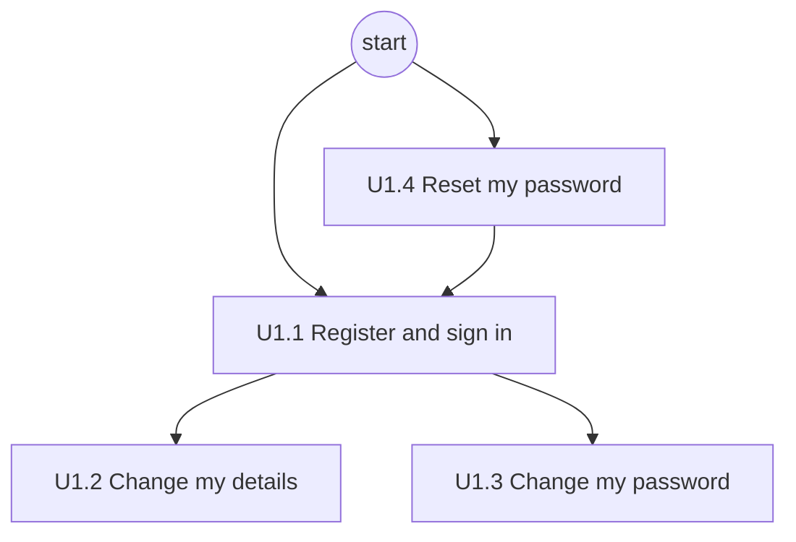

Journeys: [U1.1 Register and sign in](#u11-register-and-sign-in), [U1.2 Change
my details](#u12-change-my-details), [U1.3 Change my
password](#u13-change-my-password), [U1.4 Reset my
password](#u14-reset-my-password).

### U1.1 Register and sign in

A new account is active once its email is verified, and every email is
unique. Registering and signing in share the end of the journey.

References: User IDs,
[docs/2.5](https://github.com/delphside/tile-lite-elite/blob/main/docs/4.2.5-authentication.md).
Emails: their rules are not yet in docs/1.0,
[Q5](71-journey-questions.md#q5-the-email-rules-are-not-in-docs10).

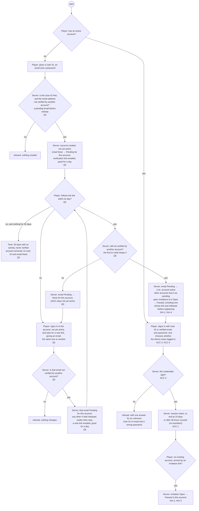

### U1.2 Change my details

References: User IDs,
[docs/2.5](https://github.com/delphside/tile-lite-elite/blob/main/docs/4.2.5-authentication.md).
A game holds no copy of a player's details,
[71-09-open-questions.md](71-09-open-questions.md#open-questions) *User details
are always a lookup*. Emails,
[Q5](71-journey-questions.md#q5-the-email-rules-are-not-in-docs10).

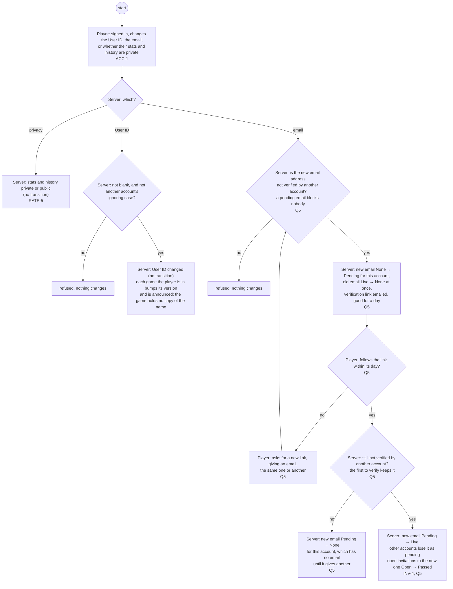

### U1.3 Change my password

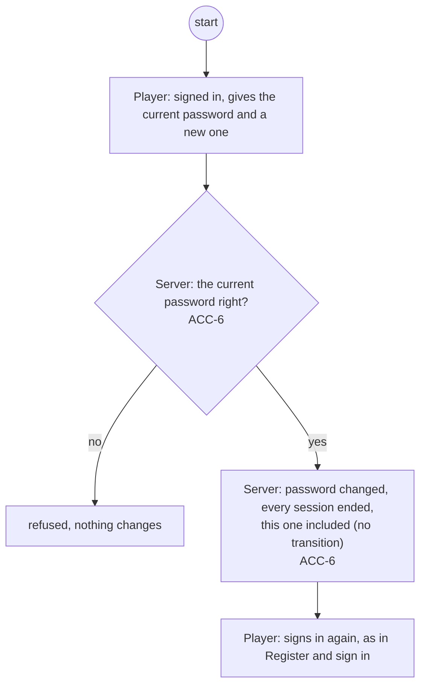

### U1.4 Reset my password

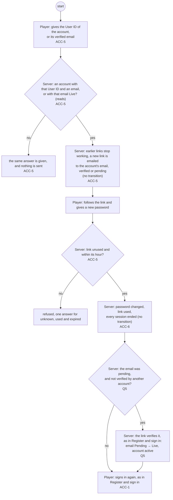

## U2 Set up a game

The creator comes to the service to get a game under way with the people they
want. Seats fill independently until the creator starts with the claimed ones
(GAME-9); the invitees' side of it is [U3 Join a game](#u3-join-a-game), and
aborting is in [U4 Play a game](71-journeys-u4-u6.md#u4-play-a-game), since it
can happen before or after the start.

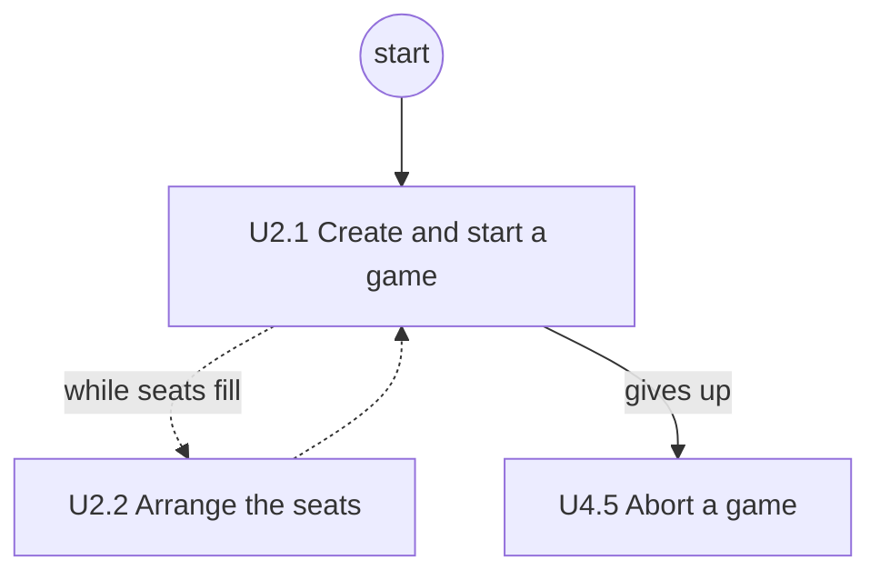

Journeys: [U2.1 Create and start a game](#u21-create-and-start-a-game), [U2.2
Arrange the seats](#u22-arrange-the-seats), and [U4.5 Abort a
game](71-journeys-u4-u6.md#u45-abort-a-game) under Play a game.

### U2.1 Create and start a game

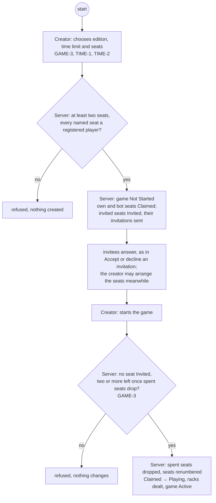

### U2.2 Arrange the seats

An invited seat's invitation is sent as the seat is added, as in [U2.1 Create
and start a game](#u21-create-and-start-a-game). The creator can also hide
`Declined` and `Withdrawn` seats so the list shows only the seats still in play.
Hiding is the client's alone: the service keeps those seats until the start
drops them.

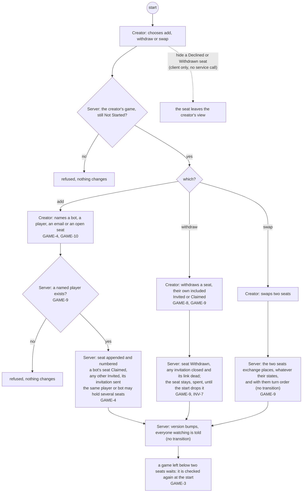

## U3 Join a game

A player comes to the service to take part in somebody else's game. They
answer an invitation, or take a seat open to anyone, and may leave a claimed
seat before the start.

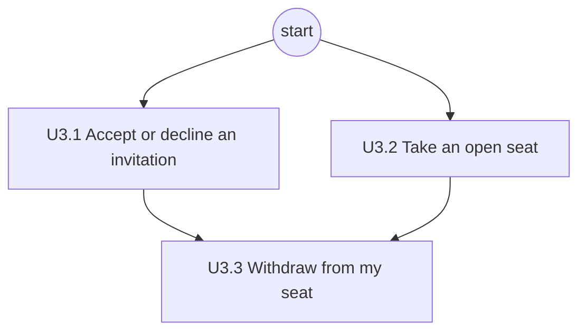

Journeys: [U3.1 Accept or decline an
invitation](#u31-accept-or-decline-an-invitation), [U3.2 Take an open
seat](#u32-take-an-open-seat), [U3.3 Withdraw from my
seat](#u33-withdraw-from-my-seat).

### U3.1 Accept or decline an invitation

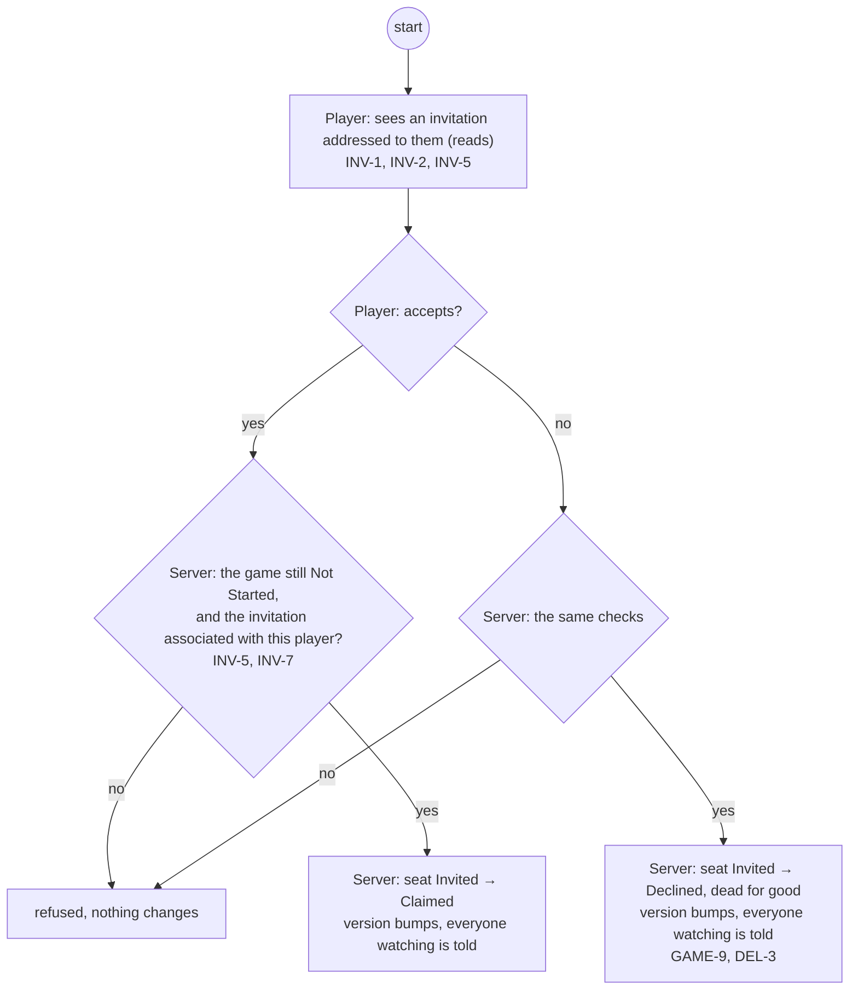

### U3.2 Take an open seat

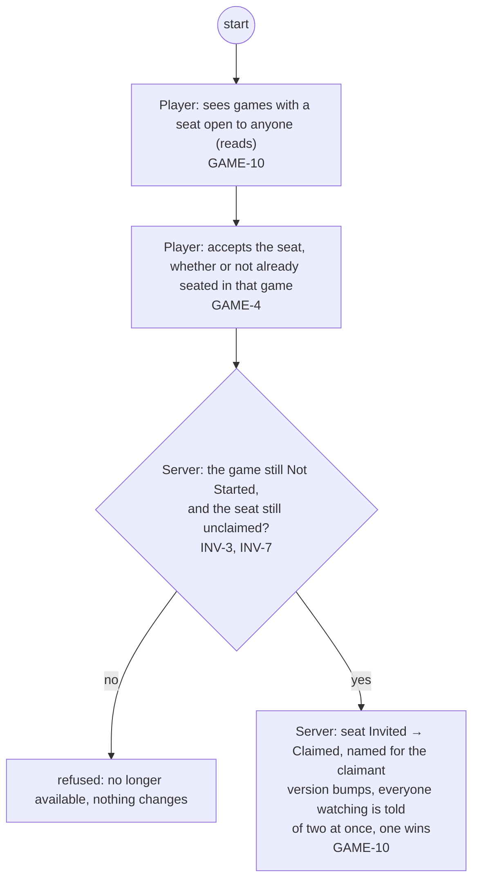

### U3.3 Withdraw from my seat

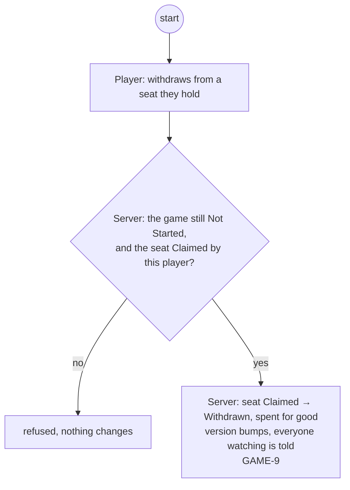
