# 71 Journeys U4 to U6

This file holds the journeys of U4 Play a game, U5 Follow my games and U6 Look after the service. The functional views are introduced in [`71-functional.md`](71-functional.md), and the design in [`71-02-overview.md`](71-02-overview.md).

## U4 Play a game

Every seated player comes to the service to play the game through. Turns go
round until at most one seat is still playing (GAME-2); the creator and the
clock can each end a seat's part early.

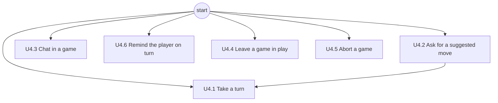

Journeys: [U4.1 Take a turn](#u41-take-a-turn), [U4.2 Ask for a suggested move](#u42-ask-for-a-suggested-move), [U4.3 Chat in a game](#u43-chat-in-a-game), [U4.4 Leave a game in play](#u44-leave-a-game-in-play), [U4.5 Abort a game](#u45-abort-a-game), [U4.6 Remind the player on turn](#u46-remind-the-player-on-turn).

### U4.1 Take a turn

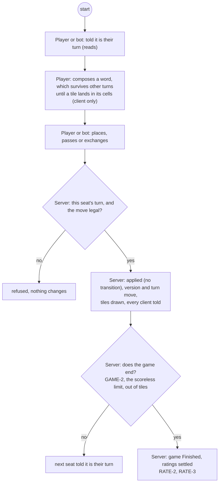

### U4.2 Ask for a suggested move

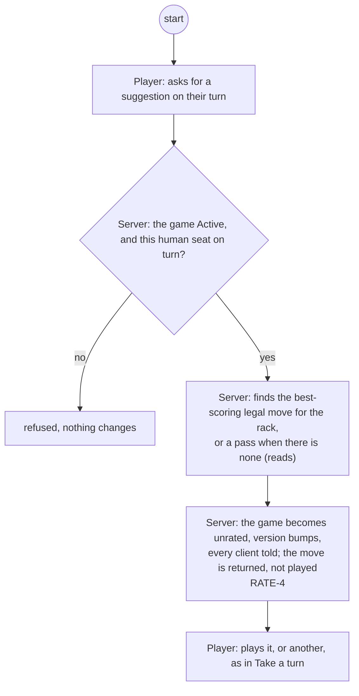

### U4.3 Chat in a game

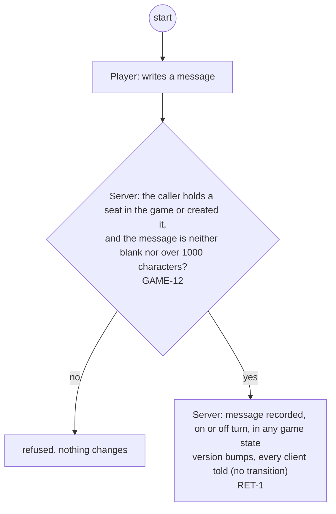

### U4.4 Leave a game in play

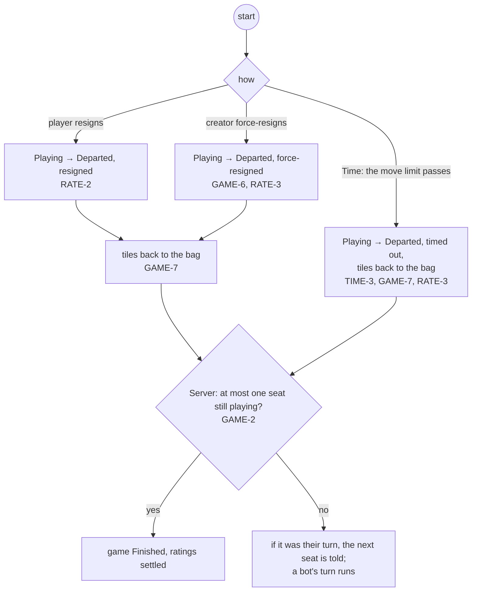

### U4.5 Abort a game

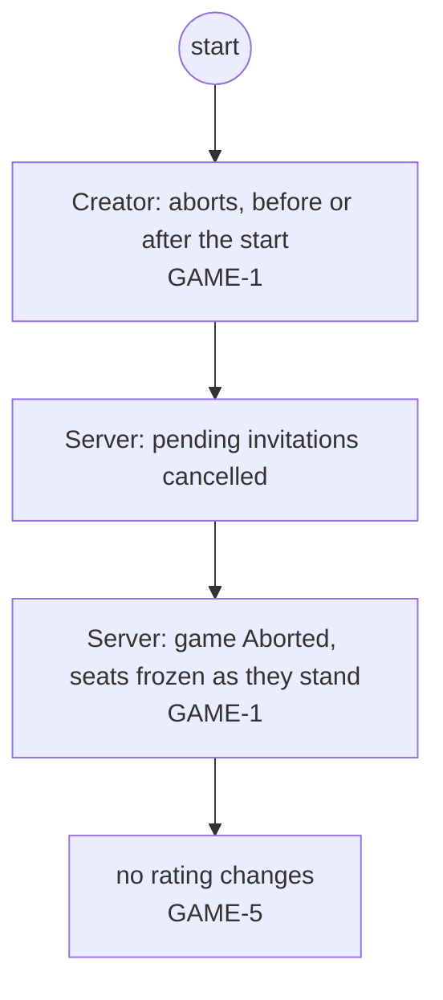

### U4.6 Remind the player on turn

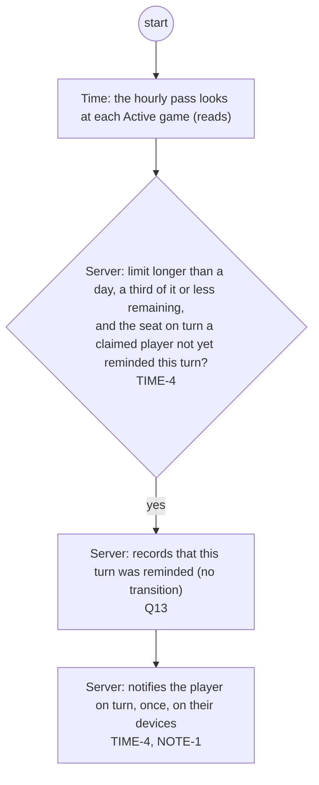

## U5 Follow my games

A player comes to the service to see where they stand: their games, their
ratings and their history, and to clear what they no longer want listed.

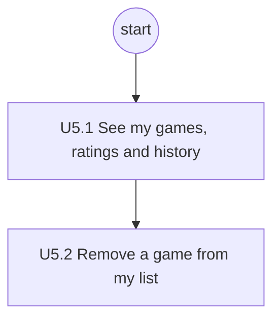

Journeys: [U5.1 See my games, ratings and history](#u51-see-my-games-ratings-and-history), [U5.2 Remove a game from my list](#u52-remove-a-game-from-my-list).

### U5.1 See my games, ratings and history

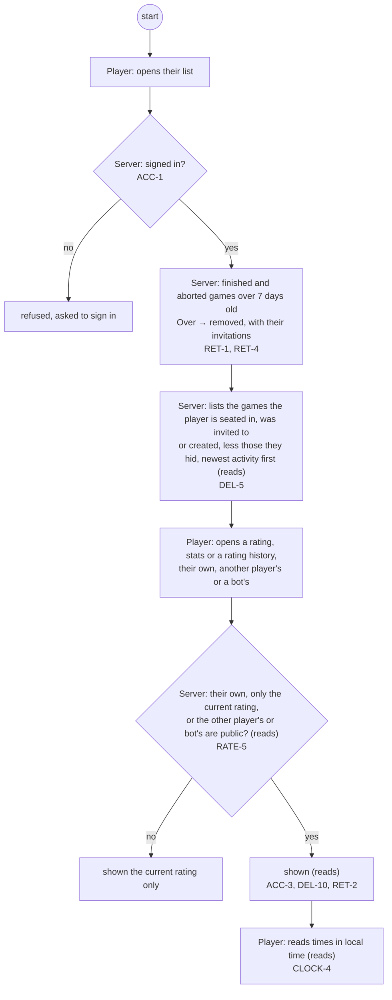

### U5.2 Remove a game from my list

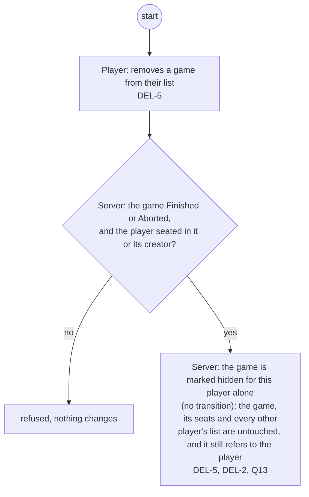

## U6 Look after the service

The administrator and the clock keep the service in order: ending games
that cannot end, removing old games and accounts, and signing a player out.
The admin CLI tidies old data (ADM-2); closing your own account and
suspending one are #296's.

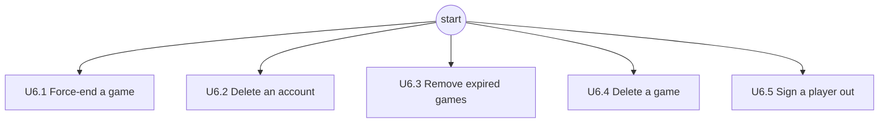

Journeys: [U6.1 Force-end a game](#u61-force-end-a-game), [U6.2 Delete an account](#u62-delete-an-account), [U6.3 Remove expired games](#u63-remove-expired-games), [U6.4 Delete a game](#u64-delete-a-game), [U6.5 Sign a player out](#u65-sign-a-player-out).

### U6.1 Force-end a game

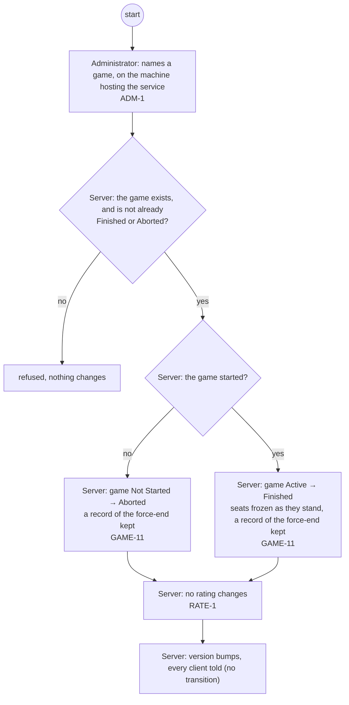

### U6.2 Delete an account

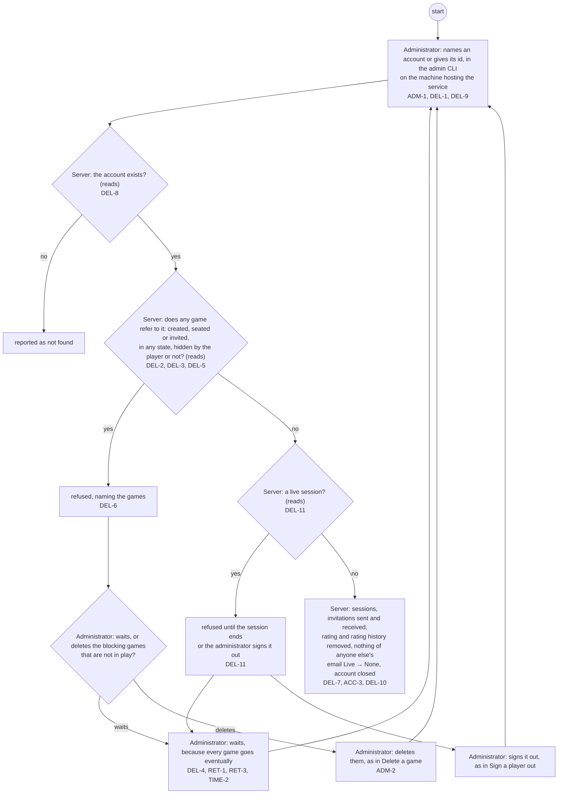

### U6.3 Remove expired games

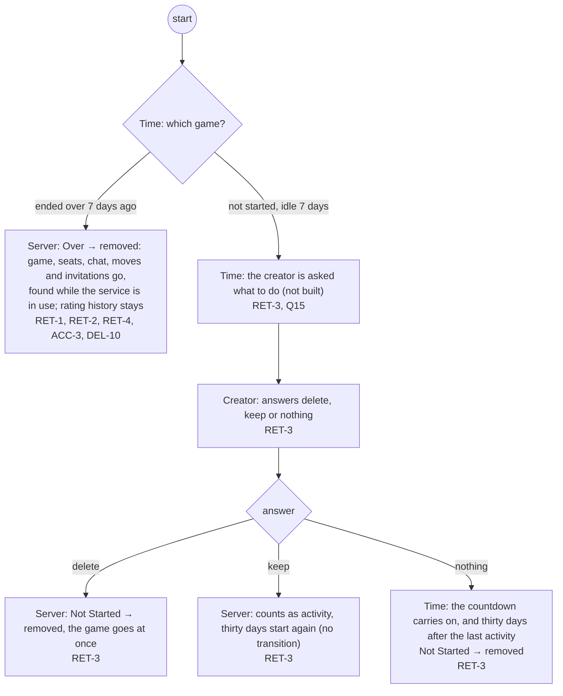

### U6.4 Delete a game

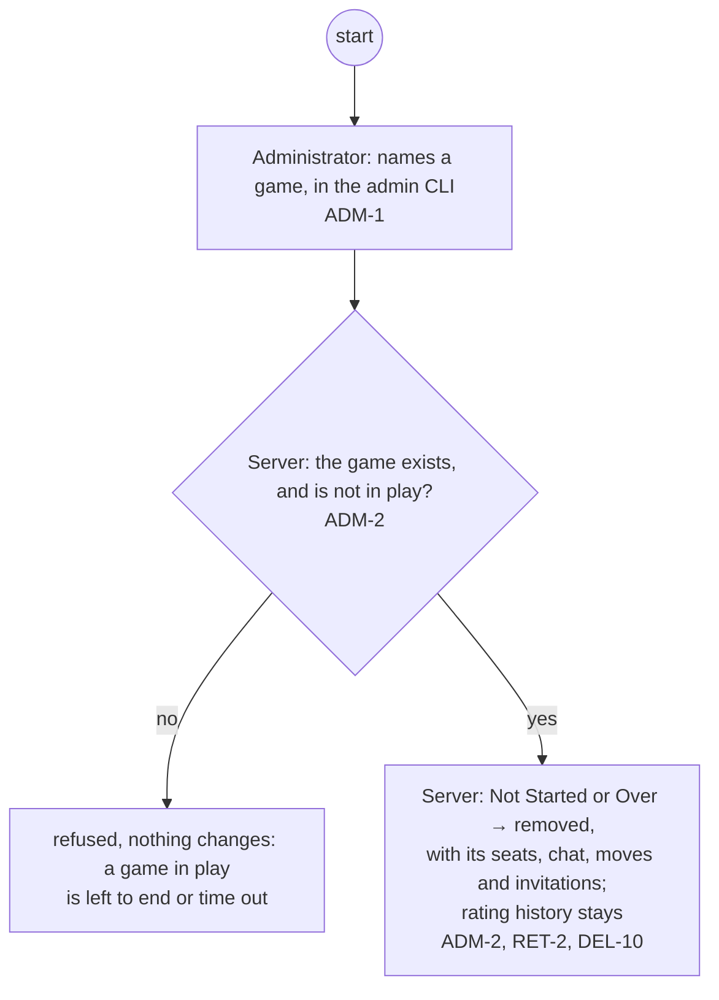

### U6.5 Sign a player out

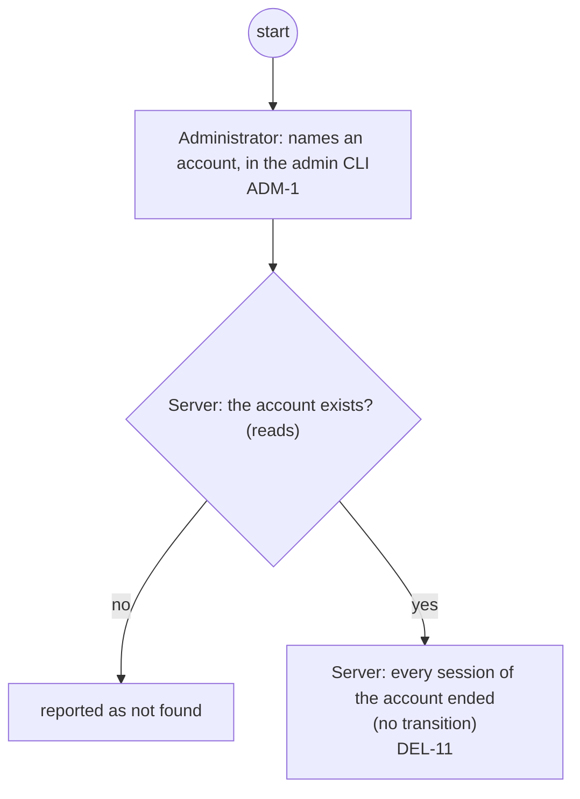
