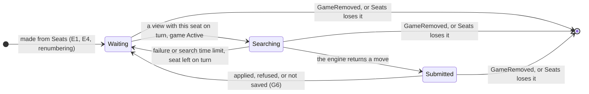
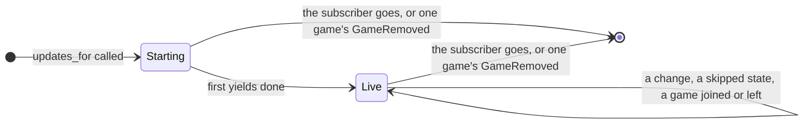
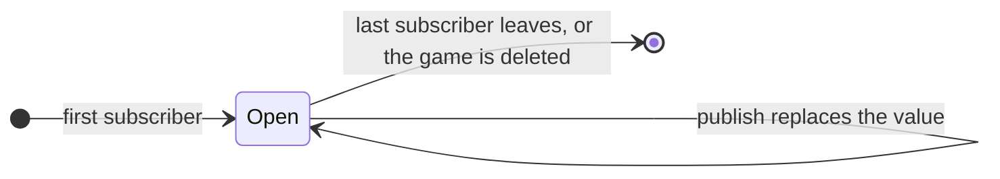

# 71 Entity life histories: WP A

**What every event does to every entity WP A adds or changes**, so a case
nobody walked through shows as a marked cell rather than a review finding. It
is the first use of
[#542](https://github.com/delphside/tile-lite-elite/issues/542), SSADM's
entity/event matrix and entity life history, tried here before the rule is
written into docs/1.2.

The entities and events come from [`71-design.md`](71-design.md),
[`71-data-model.md`](71-data-model.md) §1, §3, §5 and §8, and the journeys
and lifecycles in [`71-functional.md`](71-functional.md). This file adds no design
of its own except where the design gave no answer: each of those is a numbered
gap under [*Gaps the matrix found*](#gaps-the-matrix-found), with its proposed
answer, and the design documents change once it is agreed.

Issue numbers are Tile Lite Elite's unless written otherwise. WP A's one-off
migration, which deletes every game and rekeys the ratings, is not an event in
the life of any entity here and is left out.

## The entities

| entity | kind | one per | where it is defined |
| --- | --- | --- | --- |
| Game | stored | game | `GameSession`, data model §1 |
| Seat | stored | seat of a game | `Seat`, data model §1 |
| Invitation | stored | invited seat | `Invitation`; `game_invitations`, data model §5 |
| Log row | stored | applied change | `game_events`, design *Open questions* (D61) |
| Rating | stored | account and edition | D58; `rating_history`, data model §5 |
| Game entry | runtime | game in memory | the games map, its per-game lock and the `unsaved` flag, design *One version, moved in one place* and data model §1 (D69, D70) |
| Game watch | runtime | game with a subscriber | Event stream registry, data model §8 |
| Seat-list watch | runtime | account | data model §8 |
| Subscription | runtime | call of `updates_for` | data model §8 |
| WebSocket task | runtime | open socket | data model §8 |
| Bot task | runtime | listed bot | data model §8 |
| Bot object | runtime | seat a listed bot holds | `Bot<InProcessLink>`, with its `EnginePlayer`, data model §8 |
| Search permit | runtime | search or hint running | `engine_limit`, data model §8 (D62) |

## The events

| id | event | from |
| --- | --- | --- |
| E1 | the server starts | data model §8 |
| E2 | the server stops | — |
| E3 | a game is created, with its seats | U2.1 |
| E4 | a seat is added: a bot's `Claimed`, any other `Invited` | U2.2 |
| E5 | an invitation is passed to a claimant or a verifier | INV-2, INV-4 |
| E6 | an invitation is accepted, or an open seat taken | U3.1, U3.2 |
| E7 | an invitation is declined | U3.1 |
| E8 | a seat is withdrawn | U2.2, U3.3 |
| E9 | two seats are swapped | U2.2 |
| E10 | the game starts: spent seats dropped, the rest renumbered, racks dealt | U2.1 |
| E11 | a word placed, a pass or an exchange | U4.1 |
| E12 | a suggestion is asked for | U4.2 |
| E13 | a chat message is posted | U4.3 |
| E14 | a player's details change, sent once per game they are in | U1.2 |
| E15 | a seat resigns, is force-resigned or times out, and the game goes on | U4.4 |
| E16 | the game finishes | U4.1, U4.4 |
| E17 | the creator aborts, or an administrator force-ends | U4.5, U6.1 |
| E18 | a keep is asked for | RET-3 |
| E19 | a player hides the game from their list | U5.2 |
| E20 | a reminder is sent | U4.6 |
| E21 | the game is deleted: RET-1, RET-3 or `admin_delete_game` | U6.3, U6.4 |
| E22 | a game message is refused | data model §1 |
| E23 | a save fails and the game is reloaded | D69 |
| E24 | a WebSocket opens on a game | data model §8 |
| E25 | a WebSocket closes | data model §8 |
| E26 | a receiver falls behind | data model §8 |
| E27 | a bot's search ends: a move, a failure or the search time limit | data model §8 |
| E28 | an account is deleted | U6.2 |

## The matrix

C creates, U updates, D deletes, R reads, and — leaves the entity alone. A
bold code, **G1** to **G7**, marks a cell the design gives no answer for.

### Stored entities

| | Game | Seat | Invitation | Log row | Rating |
| --- | --- | --- | --- | --- | --- |
| E1 | R, as each is first used (#408) | — | — | — | — |
| E2 | — | — | — | — | — |
| E3 | C, version 1 | C, each | C, each invited seat | C | — |
| E4 | U | C | C, an invited seat | C | — |
| E5 | U | U `Invited` addressee | U addressee | C | — |
| E6 | U | U `Invited → Claimed` | U answered | C | — |
| E7 | U | U `Invited → Declined` | U answered | C | — |
| E8 | U | U `→ Withdrawn` | U closed, link dead | C | — |
| E9 | U | U `number`, both | — | C | — |
| E10 | U `Active` | D spent; U renumbered; U `Claimed → Playing` | — (the record stays for DEL-2) | C | — |
| E11 | U | U rack, score | — | C | — |
| E12 | U unrated | — | — | **G7** | — |
| E13 | U | — | — | C | — |
| E14 | U, version only | — | — | C | — |
| E15 | U | U `Playing → Departed` | — | C | — |
| E16 | U `Finished` | — (frozen) | — | C | U, settled; a bot playing only against itself nets zero |
| E17 | U: an abort, or a force-end before the start, `Aborted`; a force-end after it `Finished`, no rating change | — (frozen) | U, pending ones cancelled | C | — |
| E18 | U, version and `last_activity_at` | — | — | C | — |
| E19 | U, saved, version unchanged | U `hidden_by_player` | — | **G5** | — |
| E20 | U, saved, version unchanged | U `reminder_sent_turn` | — | **G5** | — |
| E21 | D | D | D | D | U, `game_id` set null; the history stays |
| E22 | — | — | — | — | — |
| E23 | U, from the stored row | U, from the stored row | — | — | — |
| E24 | R | R | — | — | — |
| E25 | — | — | — | — | — |
| E26 | — | — | — | — | — |
| E27 | as E11, E22 or E23 | as E11, E22 or E23 | — | as E11, E22 or E23 | — |
| E28 | R, refused if any game names it | — | D, sent and received | — | D, with its history |

### Runtime entities

| | Game entry | Game watch | Seat-list watch | Subscription | WebSocket task | Bot task | Bot object | Search permit |
| --- | --- | --- | --- | --- | --- | --- | --- | --- |
| E1 | C, as each game is first used (#408) | C, as each bot subscription joins | C, per listed bot, **G3** | C, per listed bot: `Seats`, then each game's view | — | C, per listed bot; **G4** | C, per seat in the first `Seats` | — |
| E2 | D | D | D | D | D | D | D | D, the search lost; E1 replays the turn |
| E3 | C | — (no subscriber yet) | U, each seated account's, **G3** | — | — | — | C, per bot seat, as in E4 | — |
| E4 | U | U, if it exists | U, the seat's account, **G3** | U, joins the game if it is new to the account | U, sends a frame | U, routes the list | C, for a bot's seat | — |
| E5 | U | U | **G3** | U | U | — | — | — |
| E6 | U | U | **G3** | U | U | — | — | — |
| E7 | U | U | — (the seat stays until E10) | U | U | — | — | — |
| E8 | U | U | — (the seat stays until E10) | U | U | — | — (idles until E10) | — |
| E9 | U | U | U, **G3** | U | U | — | D and C, **G1** | — |
| E10 | U | U | U, dropped and renumbered seats' accounts, **G3** | U, leaves a game the account no longer sits in | U | — | D dropped; D and C renumbered, **G1** | — |
| E11 | U | U | — | U | U | — | U; acts if on turn | — |
| E12 | U | U | — | U | U | — | — | C, then D when the hint returns |
| E13 | U | U | — | U | U | — | — | — |
| E14 | U | U | — | U | U | — | — | — |
| E15 | U | U | — | U | U | — | — (never on turn again), **G2** | — |
| E16 | U | U | — (finishing keeps the seats) | U | U | — | **G2** | — |
| E17 | U | U | — | U | U | — | **G2** | — |
| E18 | U | U | — | U | U | — | — | — |
| E19 | U | — (nothing published) | — | — | — | — | — | — |
| E20 | U | — (nothing published) | — | — | — | — | — | — |
| E21 | D | D, its receivers closed | U, each seated account's | U, yields `GameRemoved`, leaves | U, sends `GameRemoved`, then D | — | D | — |
| E22 | — | — | — | — | — | — | — (re-validated on arrival, §8) | — |
| E23 | U, `unsaved` cleared by the reload | — (nothing published) | — | — | — | — | **G6**, when the bot sent it | — |
| E24 | R | C, if it is the first | — | C, one game: its view, then each change | C | — | — | — |
| E25 | — | D, if it was the last | — | D | D | — | — | — |
| E26 | — | — | — | U, skips to the newest state, `because` dropped | U, sends the newest | — | U, from its subscription | — |
| E27 | — | — | — | — | — | — | U, submits or stays on turn | C before the search, D when the engine returns |
| E28 | — | — | D | — | — | **G4** | — | — |

The Seat-list watch column shows G3's proposed answer, which differs from §8
in when a watch exists.

Every change that moves the version also sets and clears the Game entry's
`unsaved` flag under its lock; that is the Game entry's U in E3 to E18. E19
and E20 save under the same lock without moving the version.

## State tables

The stored Game and Seat have state machines in
[`71-functional.md`](71-functional.md#the-game-and-its-seats), and the
Invitation's email states are in
[`71-functional.md`](71-functional.md#an-email-and-its-invitations). The
runtime entities had none, so they are here. In each table a dash leaves the
state as it is, and *impossible* is a pair the design rules out.

### Bot object

| state | on turn, Active | not on turn | engine returns a move | failure or search time limit | applied or refused | not saved (503) | game over | `Seats` loses it, or `GameRemoved` |
| --- | --- | --- | --- | --- | --- | --- | --- | --- |
| Waiting | → Searching | — | impossible | impossible | impossible | impossible | **G2** | → ended |
| Searching | — (the search goes on) | — (the search goes on) | → Submitted | → Waiting | impossible | impossible | **G2** | → ended, the search abandoned |
| Submitted | — | — | impossible | impossible | → Waiting | → Waiting, **G6** | **G2** | → ended |

A move from a search the game has overtaken is refused on arrival (§8), so a
newer view does not stop a search.

### Subscription

A subscription is **Starting** until its first yields are done, and **Live**
after. The two scopes differ only in what they start with and whether the
account's seat list can bring games in.

| scope and state | first yields | a change | falls behind | the account gains a game | loses its last seat in a game | `GameRemoved` | the subscriber goes |
| --- | --- | --- | --- | --- | --- | --- | --- |
| one game, Starting | the game's view → Live | impossible: the channel is joined before the game is read | impossible | not in scope | not in scope | → ended | → ended |
| one game, Live | impossible | — | — (skips) | not in scope | not in scope | → ended | → ended |
| every seated game, Starting | `Seats`, then each game's view → Live | impossible, as above | impossible | impossible: the first `Seats` comes first | impossible | — (that game left) | → ended |
| every seated game, Live | impossible | — | — (skips) | — (joins, reads, yields) | — (leaves) | — (that game left) | → ended |

### Game watch

| state | first subscriber | publish | last subscriber leaves | game deleted |
| --- | --- | --- | --- | --- |
| absent | → open | — (nothing to write) | impossible | — |
| open | — | — (the value replaced) | → absent | → absent, receivers closed |

## Gaps the matrix found

Seven questions had no answer in the design. G1 and G4 are the owner's, as
cards in the #71 thread; the rest are technical and Claude's as the design
authority, recorded here for review.

| | gap | cells | whose |
| --- | --- | --- | --- |
| G1 | A seat is named by its number, and the start renumbers | E9, E10 × Bot object | owner |
| G2 | A bot object outlives its game's end | E15 to E17 × Bot object; Bot object *game over* | Claude |
| G3 | Which seats are in an account's list, and which changes write it | E3 to E6, E9, E10 × Seat-list watch | Claude |
| G4 | A listed bot with no account, or an unknown engine | E1, E28 × Bot task | owner |
| G5 | Log rows are keyed by a version two messages leave alone | E19, E20 × Log row | Claude |
| G6 | A bot whose move is not saved is never woken again | E23 × Bot object | Claude |
| G7 | A suggestion changes the game with no `GameMessage` | E12 × Log row | Claude |

**G1.** `SeatRef` is a game and a seat number. A swap (E9) happens only before
the start, when no object acts, so there the drop and remake does no harm. The
start (E10) renumbers and makes the game active at once, and nothing orders the
game's view against the seat list. An object can then read a view in which its
old number belongs to another player who is on turn. The Game service refuses
that move, but the bot's real seat waits for the next `Seats`. Options:

1. **A stable seat id**, assigned when the seat is added and never reused in
   its game; `SeatRef` carries it, and the object finds its number in each
   view. It adds a field to `Seat`, `SeatRef` and `SeatRefDto`, and removes the
   drop and remake. Recommended.
2. **Keep numbers**, and `take_turn` acts only when the seat in the view
   belongs to the link's account. No new field; the object is still dropped
   and remade at the start, and the bot's seat still waits for its turn
   until the new `Seats` arrives.

**G2.** Finishing keeps a seat in the list, so its object and its engine player
live until the game is deleted, up to seven days later (RET-1). Proposed: the
glue drops a seat's object when a view shows its game `Finished` or `Aborted`,
and makes none for such a game's seats in `Seats`.

**G3.** §8 gives every account a seat-list watch, written by `publish` and by
deleting a game, and drops a seat when it is removed or its game deleted. It
does not say whether an `Invited` seat is in its addressee's list, nor which
accounts a change writes. Proposed: a seat is in an account's list while that
account is its player, or for an `Invited` seat its addressee, in any state, so
E5 adds the seat to the addressee's list; `publish` writes the list of each
account whose set of `SeatRef`s the change altered. This also changes §8 on one
point: a watch exists while it has a subscriber and is built from the stored
seats when the first subscribes, rather than for every account.

**G4.** Two questions:

1. **The bot list names an account that does not exist, or an engine not
   compiled in.** Proposed: the server refuses to start, naming the setting,
   as for any invalid setting.
2. **An administrator deletes a listed bot's account while the server runs.**
   Options: (a) refused while the account is on the bot list, as DEL-2
   refuses one a game names, which adds a DEL rule; recommended. (b) Allowed,
   and the bot task ends at once, so the bot plays nothing more until the list
   is fixed.

**G5.** The design logs every applied message, chat and hide included, in
`game_events (game_id, version, …)`, but `Hide` and `ReminderSent` save without
moving the version, so their rows would repeat a key. (Data model §1's counter
table also has a hidden seat moving the version, against the design; that row is
corrected with this gap.) Proposed: the log gains its own sequence, `(game_id,
seq)`, with `version` as a column.

**G6.** A bot hears it is on turn only from a publish. A refused move is either
overtaken, and that move's publish follows, or illegal, and the design already
leaves the seat on turn for the move time limit (TIME-3). A failed save answers
503 with `Retry-After` and publishes nothing (D69), so the seat waits for the
move time limit although nothing was wrong with the move. Proposed: on a 503 the
object retries once after `Retry-After`, then waits.

**G7.** U4.2 makes the game unrated and moves the version, which the design
says only a `GameMessage` may do, but no variant exists for it. Proposed:
`SuggestionTaken { seat }`, applied before the hint is returned, logged like
any other change.

Two answers are worth reading once:

- **E8, a withdrawn bot seat** keeps its object until the start drops it. The
  object never acts, because a `Withdrawn` seat is never on turn.
- **E2 then E1** loses a search in progress, and nothing else: the game is
  stored, and the first yields of E1's subscriptions give each bot the view of
  every game it sits in, so a game on its turn is played.

## What follows from it

Once G1 to G7 are answered, the answers go into `71-data-model.md` §1, §3 and
§8, `71-design.md`'s *Open questions*, and acceptance boxes in
[`71-test-wp-a.md`](71-test-wp-a.md), one per gap. #542's rule then takes this
file's shape as its template.
