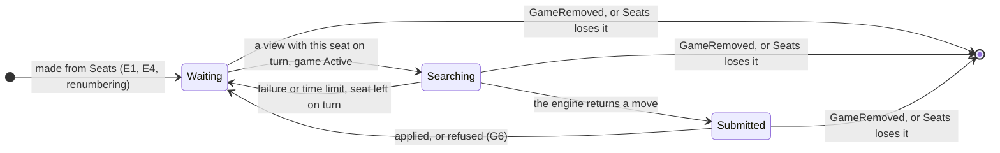

# 71 Entity life histories: WP A

**What every event does to every entity WP A adds or changes**, so a case
nobody walked through shows as a blank cell rather than a review finding. It is
the first use of [#542](https://github.com/delphside/tile-lite-elite/issues/542),
SSADM's entity/event matrix and entity life history, tried here before the rule
is written into docs/1.2.

The entities and events come from [`71-design.md`](71-design.md),
[`71-data-model.md`](71-data-model.md) §1 and §8, and the journeys and
lifecycles in [`71-functional.md`](71-functional.md). This file adds no design
of its own except where a cell had no answer: each of those is a numbered gap
under [*Gaps the matrix found*](#gaps-the-matrix-found), with the answer
proposed, and the design documents change once it is agreed.

Issue numbers are Tile Lite Elite's unless written otherwise.

## The entities

| entity | kind | one per | where it is defined |
| --- | --- | --- | --- |
| Game | stored | game | `GameSession`, data model §1 |
| Seat | stored | seat of a game | `Seat`, data model §1 |
| Invitation | stored | invited seat | `Invitation`; `game_invitations`, data model §5 |
| Log row | stored | applied change | `game_events`, design *Open questions* (D61) |
| Rating | stored | account and edition | D58 |
| Game watch | runtime | game with a subscriber | Event stream registry, data model §8 |
| Seat-list watch | runtime | account | data model §8 |
| Subscription | runtime | call of `updates_for` | data model §8 |
| WebSocket task | runtime | open socket | data model §8 |
| Bot task | runtime | listed bot | data model §8 |
| Bot object | runtime | seat a listed bot holds | `Bot<InProcessLink>`, with its `EnginePlayer`, data model §8 |
| Search permit | runtime | search running | `engine_limit`, data model §8 (D62) |

## The events

| | event | from |
| --- | --- | --- |
| E1 | the server starts | |
| E2 | the server stops | |
| E3 | a game is created, with its seats | U2.1 |
| E4 | a seat is added: a bot's `Claimed`, any other `Invited` | U2.2 |
| E5 | an invitation is passed to a claimant or a verifier | INV-2, INV-4 |
| E6 | an invitation is accepted | U3.1 |
| E7 | an invitation is declined | U3.1 |
| E8 | a seat is withdrawn | U2.2, U3.3 |
| E9 | two seats are swapped | U2.2 |
| E10 | the game starts: spent seats dropped, the rest renumbered, racks dealt | U2.1 |
| E11 | a word placed, a pass or an exchange | U4.1 |
| E12 | a chat message is posted | U4.3 |
| E13 | a player's details change, sent once per game they are in | U1.2 |
| E14 | a seat resigns, is force-resigned or times out, and the game goes on | U4.4 |
| E15 | the game finishes | U4.1, U4.4 |
| E16 | the creator aborts, or an administrator force-ends | U4.5, U6.1 |
| E17 | a keep is asked for | RET-3 |
| E18 | a player hides the game from their list | U5.2 |
| E19 | a reminder is sent | U4.6 |
| E20 | the game is deleted: RET-1, RET-3 or `admin_delete_game` | U6.3, U6.4 |
| E21 | a message is refused | |
| E22 | a save fails and the game is reloaded | D69 |
| E23 | a WebSocket opens on a game | |
| E24 | a WebSocket closes | |
| E25 | a receiver falls behind | |
| E26 | a bot's search ends: a move, a failure or the time limit | |
| E27 | an account is deleted | U6.2 |

## The matrix

C creates, U updates, D deletes, R reads, and — means the event leaves the
entity alone. A cell that names a gap, **G1** to **G6**, had no answer in the
design.

### Stored entities

| | Game | Seat | Invitation | Log row | Rating |
| --- | --- | --- | --- | --- | --- |
| E1 | R, each as it is first used | — | — | — | — |
| E2 | — | — | — | — | — |
| E3 | C, version 1 | C, each | C, each invited seat | C | — |
| E4 | U | C | C, an invited seat | C | — |
| E5 | U | U `player` | U addressee | C | — |
| E6 | U | U `Invited → Claimed` | U answered | C | — |
| E7 | U | U `Invited → Declined` | U answered | C | — |
| E8 | U | U `→ Withdrawn` | U closed, link dead | C | — |
| E9 | U | U `number`, both | — | C | — |
| E10 | U `Active` | D spent; U renumbered; U `Claimed → Playing` | — (the record stays for DEL-2) | C | — |
| E11 | U | U rack, score | — | C | — |
| E12 | U | — | — | C | — |
| E13 | U, version only | — | — | C | — |
| E14 | U | U `Playing → Departed` | — | C | — |
| E15 | U `Finished` | — (frozen) | — | C | U, settled; a bot showdown nets zero |
| E16 | U `Aborted` | — (frozen) | U pending ones cancelled | C | — |
| E17 | U `last_activity_at`; version **G5** | — | — | **G5** | — |
| E18 | U, saved, version unchanged | U `hidden_by_player` | — | **G5** | — |
| E19 | U, saved, version unchanged | U `reminder_sent_turn` | — | **G5** | — |
| E20 | D | D | D | D | — (history stays) |
| E21 | — | — | — | — | — |
| E22 | U, from the stored row | U, from the stored row | — | — | — |
| E23 | R | R | — | — | — |
| E24 | — | — | — | — | — |
| E25 | — | — | — | — | — |
| E26 | as E11 or E21 | as E11 or E21 | — | as E11 or E21 | — |
| E27 | R, refused if any game names it | — | D, those of no game | — | D, with its history |

### Runtime entities

| | Game watch | Seat-list watch | Subscription | WebSocket task | Bot task | Bot object | Search permit |
| --- | --- | --- | --- | --- | --- | --- | --- |
| E1 | C, as each bot subscription joins | C, per listed bot, from the stored seats | C, per listed bot: `Seats`, then each game's view | — | C, per listed bot; **G4** | C, per seat in the first `Seats` | — |
| E2 | D | D | D | D | D | D | D, the search is lost; E1 replays the turn |
| E3 | — (no subscriber yet) | U, each seated account's | — | — | — | C, per bot seat, through E4's path | — |
| E4 | U, if it exists | U, the seat's account | U, joins the game if it is new to the account | U, sends a frame | U, routes the list | C, a bot's seat | — |
| E5 | U | U, both accounts | U | U | — | — | — |
| E6 | U | — (the `SeatRef` is unchanged) | U | U | — | — | — |
| E7 | U | — (the seat stays until E10) | U | U | — | — | — |
| E8 | U | — (the seat stays until E10) | U | U | — | — (a withdrawn bot seat idles until E10) | — |
| E9 | U | U, **G1** | U | U | — | D and C, **G1** | — |
| E10 | U | U, dropped and renumbered seats' accounts, **G1** | U, leaves a game the account no longer sits in | U | — | D dropped; D and C renumbered, **G1** | — |
| E11 | U | — | U | U | — | U; acts if on turn | C, then D when the engine returns |
| E12 | U | — | U | U | — | — | — |
| E13 | U | — | U | U | — | — | — |
| E14 | U | — | U | U | — | — (a departed seat never comes on turn) | — |
| E15 | U | — (finishing keeps the seats) | U | U | — | **G2** | — |
| E16 | U | — | U | U | — | **G2** | — |
| E17 | **G5** | — | — | — | — | — | — |
| E18 | — (nothing published) | — | — | — | — | — | — |
| E19 | — (nothing published) | — | — | — | — | — | — |
| E20 | D, its receivers closed | U, each seated account's | U, yields `GameRemoved`, leaves | U, sends `GameRemoved`, then D | — | D | — |
| E21 | — | — | — | — | — | **G6** when the bot is the sender | — |
| E22 | — (nothing published) | — | — | — | — | **G6** when the bot is the sender | — |
| E23 | C, if it is the first | — | C, one game: its view, then each change | C | — | — | — |
| E24 | D, if it was the last | — | D | D | — | — | — |
| E25 | — | — | U, skips to the newest state, `because` dropped | U, sends the newest | — | U, as the subscription | — |
| E26 | — | — | — | — | — | U, submits or stays on turn | D |
| E27 | — | D | — | — | **G4** | — | — |

**When the seat-list watch is written** (**G3**): the matrix fills its column
only if `publish` knows which accounts' lists changed.

## State tables

The stored Game and Seat already have state machines, in
[`71-functional.md`](71-functional.md#the-game-and-its-seats); the Invitation's
email states are in [`71-design.md`](71-design.md#principles-for-addresses-and-invitations).
The tables below add the runtime entities, which had none. A dash is an event
that leaves the state as it is; *impossible* is a pair the design rules out.

### Bot object

| state | on turn, Active | not on turn | game Over | `Seats` loses it | `GameRemoved` |
| --- | --- | --- | --- | --- | --- |
| Waiting | → Searching | — | **G2** | → ended | → ended |
| Searching | — (the view is newer: the search goes on, G6 catches a stale move) | — | **G2** | → ended, the search abandoned | → ended, the search abandoned |
| Submitted | — | — | **G2** | → ended | → ended |

### Subscription

| state | its first yields | a change | falls behind | the account gains a game | loses its last seat in a game | `GameRemoved` | the subscriber goes |
| --- | --- | --- | --- | --- | --- | --- | --- |
| Starting | → Live | impossible: a channel is joined before the game is read | impossible | impossible: the first `Seats` comes first | impossible | → Live, the game left | → ended |
| Live | impossible | — | — (skips) | — (joins, reads, yields) | — (leaves) | — (leaves) | → ended |

### Game watch

| state | first subscriber | publish | last subscriber leaves | game deleted |
| --- | --- | --- | --- | --- |
| absent | → open | — (nothing to write) | impossible | — |
| open | — | — (the value replaced) | → absent | → absent, receivers closed |

## Gaps the matrix found

Six cells had no answer. Each is listed with the answer proposed; G1 and G4
are the owner's, as cards in the #71 thread, and the rest are technical and
Claude's as the design authority, recorded here for the review.

| | gap | proposed answer | whose |
| --- | --- | --- | --- |
| G1 | **A `SeatRef` is a seat number, and numbers change** at a swap (E9) and at the start (E10). The glue drops and remakes the object, and nothing orders the game's view against the seat list, so an object can read a view in which its number now belongs to another player and is on turn. The Game service refuses the move, but the bot's real seat waits for the next `Seats`. | Give each seat a stable id, assigned when it is added and never reused in the game, and key `SeatRef` by it; the object finds its number in each view. Or keep numbers and have `take_turn` act only when the seat in the view belongs to the link's account. | owner (card) |
| G2 | **A bot object outlives its game's end** by up to seven days (RET-1), holding its engine player, because finishing keeps the seat in the list. | The glue drops a seat's object when a view shows its game `Finished` or `Aborted`, and makes none for a seat of such a game in `Seats`. | Claude |
| G3 | **Which accounts' seat lists a change writes** is not said, nor when an account's watch exists. | A seat-list watch exists while it has a subscriber and is built from the stored seats when the first subscribes. `publish` writes the list of each account whose set of `SeatRef`s the change altered (E3 to E5, E9, E10, E20), and only where its watch exists. | Claude |
| G4 | **A listed bot whose account is missing**, at start-up or because it was deleted while the server runs, has no answer. Nor has a bot list naming an engine not compiled in. | The server refuses to start, naming the setting, as it does for any invalid setting. Deleting a listed bot's account is refused, as DEL-2 refuses one a game names. | owner (card): the second half changes a DEL rule |
| G5 | **The log is keyed by version, and three messages do not move it.** `game_events (game_id, version, …)` gets a row per `Applied`, but `Hide` and `ReminderSent` save without moving the version, so a second row would repeat a key. Whether `KeepRequested` moves the version, and so publishes, is not in the version table. | The log gains its own sequence, `(game_id, seq)`, with `version` as a column, so every applied message is a row. `KeepRequested` moves the version and publishes, since the creator's client shows the countdown it resets. | Claude |
| G6 | **A bot whose move is not applied is never woken again.** It hears it is on turn only from a publish. A refusal publishes nothing, and nor does a failed save (D69), so the seat waits for the time limit. A refusal because the game moved is followed by that move's publish; a 503 and an illegal move are not. | On a 503 the object retries once after `Retry-After`, then waits. An illegal move is logged and the seat left on turn, as a failed search is. | Claude |

Two cells are answered but worth reading once:

- **E8, a withdrawn bot seat** keeps its object until the start drops it. The
  object never acts, because a `Withdrawn` seat is never on turn.
- **E2 then E1** loses a search in progress, and nothing else: the game is
  stored, and the first yields of E1's subscriptions give each bot the view of
  every game it sits in, so a game on its turn is played.

## What follows from it

Once G1 to G6 are answered, the answers go into `71-data-model.md` §8 and §1,
`71-design.md`'s *Open questions*, and acceptance boxes in
[`71-test-wp-a.md`](71-test-wp-a.md), one per gap. #542's rule then takes this
file's shape as its template.
