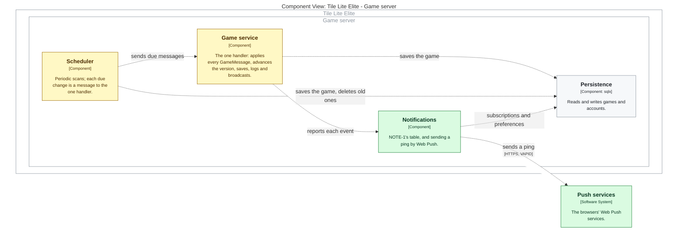

# One Game Model: the map change, drawn

**Generated from [71-map-change.md](71-map-change.md) on the map at Tile Lite
Elite branch `claude/project-thread-m9vn5b`. Do not edit.**

Green is new, yellow changed, red removed. The prototype draws no removed
relationships yet, so the old direct lines into the game model still show.

## WP A, changing a game

```mermaid
graph TB
  linkStyle default fill:#ffffff

  subgraph diagram ["Component View: Tile Lite Elite - Game server"]
    style diagram fill:#ffffff,stroke:#ffffff

    subgraph 4 ["Tile Lite Elite"]
      style 4 fill:#ffffff,stroke:#8c959f,color:#8c959f

      subgraph 9 ["Game server"]
        style 9 fill:#ffffff,stroke:#8c959f,color:#8c959f

        13["<div style='font-weight: bold'>Game service</div><div style='font-size: 70%; margin-top: 0px'>[Component]</div><div style='font-size: 80%; margin-top:10px'>The one handler: applies<br />every GameMessage, advances<br />the version, saves, logs and<br />broadcasts.</div>"]
        style 13 fill:#fff8c5,stroke:#9a6700,color:#4d2d00
        14["<div style='font-weight: bold'>Roster</div><div style='font-size: 70%; margin-top: 0px'>[Component]</div><div style='font-size: 80%; margin-top:10px'>Seat changes, sent as<br />messages to the one handler.</div>"]
        style 14 fill:#fff8c5,stroke:#9a6700,color:#4d2d00
        15["<div style='font-weight: bold'>Invitations</div><div style='font-size: 70%; margin-top: 0px'>[Component]</div><div style='font-size: 80%; margin-top:10px'>Invitation changes, sent as<br />messages to the one handler.</div>"]
        style 15 fill:#fff8c5,stroke:#9a6700,color:#4d2d00
        16["<div style='font-weight: bold'>Event stream</div><div style='font-size: 70%; margin-top: 0px'>[Component: WebSocket]</div><div style='font-size: 80%; margin-top:10px'>Pushes each game's state to<br />its players.</div>"]
        style 16 fill:#f6f8fa,stroke:#8c959f,color:#1f2328
        20["<div style='font-weight: bold'>Scheduler</div><div style='font-size: 70%; margin-top: 0px'>[Component]</div><div style='font-size: 80%; margin-top:10px'>Periodic scans; each due<br />change is a message to the<br />one handler.</div>"]
        style 20 fill:#fff8c5,stroke:#9a6700,color:#4d2d00
        21["<div style='font-weight: bold'>Game model</div><div style='font-size: 70%; margin-top: 0px'>[Component]</div><div style='font-size: 80%; margin-top:10px'>GameSession: one game's<br />authoritative state.</div>"]
        style 21 fill:#f6f8fa,stroke:#8c959f,color:#1f2328
        22["<div style='font-weight: bold'>Engine proxy</div><div style='font-size: 70%; margin-top: 0px'>[Component]</div><div style='font-size: 80%; margin-top:10px'>Takes an engine's turn<br />through the same validation<br />as a player's.</div>"]
        style 22 fill:#ffebe9,stroke:#cf222e,color:#6e0a12
        23["<div style='font-weight: bold'>Engines</div><div style='font-size: 70%; margin-top: 0px'>[Component: Rust crate]</div><div style='font-size: 80%; margin-top:10px'>The engine trait and the<br />Greedy engine.</div>"]
        style 23 fill:#f6f8fa,stroke:#8c959f,color:#1f2328
        24["<div style='font-weight: bold'>Rules</div><div style='font-size: 70%; margin-top: 0px'>[Component: Rust crate]</div><div style='font-size: 80%; margin-top:10px'>Board, validation, scoring<br />and the word lists.</div>"]
        style 24 fill:#f6f8fa,stroke:#8c959f,color:#1f2328
        25["<div style='font-weight: bold'>Persistence</div><div style='font-size: 70%; margin-top: 0px'>[Component: sqlx]</div><div style='font-size: 80%; margin-top:10px'>Reads and writes games and<br />accounts.</div>"]
        style 25 fill:#f6f8fa,stroke:#8c959f,color:#1f2328
        78["<div style='font-weight: bold'>In-process bot</div><div style='font-size: 70%; margin-top: 0px'>[Component]</div><div style='font-size: 80%; margin-top:10px'>An engine seat as a client of<br />the game, without the socket.</div>"]
        style 78 fill:#dafbe1,stroke:#1a7f37,color:#0a3622
        79["<div style='font-weight: bold'>Game wire</div><div style='font-size: 70%; margin-top: 0px'>[Component: Rust crate]</div><div style='font-size: 80%; margin-top:10px'>The messages and events every<br />client and the server share.</div>"]
        style 79 fill:#dafbe1,stroke:#1a7f37,color:#0a3622
      end

    end

    13-. "<div>applies the move to</div><div style='font-size: 70%'></div>" .->21
    14-. "<div>changes the seats of</div><div style='font-size: 70%'></div>" .->21
    15-. "<div>fills a seat of</div><div style='font-size: 70%'></div>" .->21
    20-. "<div>times out and sweeps</div><div style='font-size: 70%'></div>" .->21
    21-. "<div>validates and scores with</div><div style='font-size: 70%'></div>" .->24
    21-. "<div>asks for an engine turn</div><div style='font-size: 70%'></div>" .->22
    22-. "<div>requests a move from</div><div style='font-size: 70%'></div>" .->23
    22-. "<div>previews the candidate move<br />with</div><div style='font-size: 70%'></div>" .->24
    13-. "<div>publishes the new state to</div><div style='font-size: 70%'></div>" .->16
    14-. "<div>publishes the new state to</div><div style='font-size: 70%'></div>" .->16
    15-. "<div>publishes the new state to</div><div style='font-size: 70%'></div>" .->16
    20-. "<div>publishes the new state to</div><div style='font-size: 70%'></div>" .->16
    13-. "<div>saves the game</div><div style='font-size: 70%'></div>" .->25
    14-. "<div>saves the game</div><div style='font-size: 70%'></div>" .->25
    15-. "<div>saves the game and the<br />invitation</div><div style='font-size: 70%'></div>" .->25
    20-. "<div>saves the game, deletes old<br />ones</div><div style='font-size: 70%'></div>" .->25
    78-. "<div>submits its move,<br />re-validated on arrival</div><div style='font-size: 70%'></div>" .->13
    16-. "<div>tells it it is on turn</div><div style='font-size: 70%'></div>" .->78
    78-. "<div>searches with, holding no<br />lock</div><div style='font-size: 70%'></div>" .->23
    14-. "<div>sends seat messages</div><div style='font-size: 70%'></div>" .->13
    15-. "<div>sends invitation messages</div><div style='font-size: 70%'></div>" .->13
    20-. "<div>sends due messages</div><div style='font-size: 70%'></div>" .->13
    13-. "<div>speaks</div><div style='font-size: 70%'></div>" .->79

  end
```

## WP C, reaching a player who is not looking

