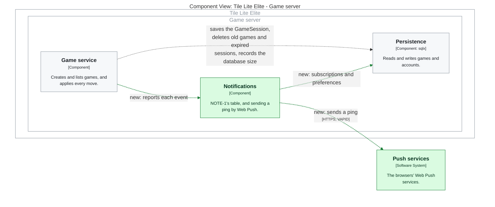

# One Game Model: the map change, drawn

**Generated by the programme's `scripts/docs/design-map/design-map.py --change`
from [71-map-change.md](71-map-change.md) and the application's `docs/design-map/`.
Do not edit.**

Green is new, yellow changed, red removed. A relationship's label starts with
its state too. Each work package is drawn alone: the packages it builds on are
not applied.

Sources hash: `c10f00840c44b32f342c88a88f61f02260c3535687e70fb5ce8dbf391142248a`.

## WP A, #268 Core Game Lifecycle

```mermaid
graph TB
  linkStyle default fill:#ffffff

  subgraph diagram ["Component View: Tile Lite Elite - Game server"]
    style diagram fill:#ffffff,stroke:#ffffff

    subgraph 4 ["Tile Lite Elite"]
      style 4 fill:#ffffff,stroke:#8c959f,color:#8c959f

      subgraph 9 ["Game server"]
        style 9 fill:#ffffff,stroke:#8c959f,color:#8c959f

        12["<div style='font-weight: bold'>Accounts</div><div style='font-size: 70%; margin-top: 0px'>[Component]</div><div style='font-size: 80%; margin-top:10px'>Registration, sign-in,<br />sessions, passwords, player<br />details and player search.</div>"]
        style 12 fill:#fff8c5,stroke:#9a6700,color:#4d2d00
        13["<div style='font-weight: bold'>Game service</div><div style='font-size: 70%; margin-top: 0px'>[Component]</div><div style='font-size: 80%; margin-top:10px'>Creates and lists games, and<br />sends each action as a<br />GameMessage to apply.</div>"]
        style 13 fill:#fff8c5,stroke:#9a6700,color:#4d2d00
        14["<div style='font-weight: bold'>Roster</div><div style='font-size: 70%; margin-top: 0px'>[Component]</div><div style='font-size: 80%; margin-top:10px'>Seats before the start,<br />force-resigning a seat, and<br />aborting a game.</div>"]
        style 14 fill:#fff8c5,stroke:#9a6700,color:#4d2d00
        15["<div style='font-weight: bold'>Invitations</div><div style='font-size: 70%; margin-top: 0px'>[Component]</div><div style='font-size: 80%; margin-top:10px'>Open and emailed invitations<br />to a seat.</div>"]
        style 15 fill:#fff8c5,stroke:#9a6700,color:#4d2d00
        16["<div style='font-weight: bold'>Event stream</div><div style='font-size: 70%; margin-top: 0px'>[Component: WebSocket]</div><div style='font-size: 80%; margin-top:10px'>Saves each applied change,<br />logs it, and pushes the<br />game's state to its players.</div>"]
        style 16 fill:#fff8c5,stroke:#9a6700,color:#4d2d00
        19["<div style='font-weight: bold'>Admin endpoints</div><div style='font-size: 70%; margin-top: 0px'>[Component]</div><div style='font-size: 80%; margin-top:10px'>The loopback-only /admin<br />routes.</div>"]
        style 19 fill:#fff8c5,stroke:#9a6700,color:#4d2d00
        20["<div style='font-weight: bold'>Scheduler</div><div style='font-size: 70%; margin-top: 0px'>[Component]</div><div style='font-size: 80%; margin-top:10px'>Periodic jobs: overdue turns,<br />move-time reminders and<br />stalled-job checks.</div>"]
        style 20 fill:#fff8c5,stroke:#9a6700,color:#4d2d00
        21["<div style='font-weight: bold'>Game model</div><div style='font-size: 70%; margin-top: 0px'>[Component]</div><div style='font-size: 80%; margin-top:10px'>GameSession: one game's<br />authoritative state, and<br />apply, the one method that<br />changes it.</div>"]
        style 21 fill:#fff8c5,stroke:#9a6700,color:#4d2d00
        22["<div style='font-weight: bold'>Engine proxy</div><div style='font-size: 70%; margin-top: 0px'>[Component]</div><div style='font-size: 80%; margin-top:10px'>Runs engine turns and applies<br />each move through the same<br />validation as a player's.</div>"]
        style 22 fill:#ffebe9,stroke:#cf222e,color:#6e0a12
        23["<div style='font-weight: bold'>Engines</div><div style='font-size: 70%; margin-top: 0px'>[Component: Rust crate]</div><div style='font-size: 80%; margin-top:10px'>The engine trait and the<br />Greedy engine.</div>"]
        style 23 fill:#f6f8fa,stroke:#8c959f,color:#1f2328
        24["<div style='font-weight: bold'>Rules</div><div style='font-size: 70%; margin-top: 0px'>[Component: Rust crate]</div><div style='font-size: 80%; margin-top:10px'>Board, validation, scoring<br />and the word lists.</div>"]
        style 24 fill:#f6f8fa,stroke:#8c959f,color:#1f2328
        25["<div style='font-weight: bold'>Persistence</div><div style='font-size: 70%; margin-top: 0px'>[Component: sqlx]</div><div style='font-size: 80%; margin-top:10px'>Reads and writes games and<br />accounts.</div>"]
        style 25 fill:#fff8c5,stroke:#9a6700,color:#4d2d00
        93["<div style='font-weight: bold'>In-process bot</div><div style='font-size: 70%; margin-top: 0px'>[Component]</div><div style='font-size: 80%; margin-top:10px'>An engine seat as a client of<br />the game: the bot and the<br />client core, over the glue.</div>"]
        style 93 fill:#dafbe1,stroke:#1a7f37,color:#0a3622
        94["<div style='font-weight: bold'>In-process glue</div><div style='font-size: 70%; margin-top: 0px'>[Component]</div><div style='font-size: 80%; margin-top:10px'>The in-process transport: the<br />bot's two calls without a<br />socket.</div>"]
        style 94 fill:#dafbe1,stroke:#1a7f37,color:#0a3622
        95["<div style='font-weight: bold'>Game wire</div><div style='font-size: 70%; margin-top: 0px'>[Component: Rust crate]</div><div style='font-size: 80%; margin-top:10px'>GameView, GameLink and<br />take_turn, and GameView's<br />conversion to and from the<br />DTOs.</div>"]
        style 95 fill:#dafbe1,stroke:#1a7f37,color:#0a3622
      end

    end

    19-. "<div>new: sends force-resign and<br />force-end messages to apply</div><div style='font-size: 70%'></div>" .->21
    13-. "<div>new: deletes old games and expired<br />sessions, records the<br />database size</div><div style='font-size: 70%'></div>" .->25
    93-. "<div>new: hears of each change through,<br />and submits its move through</div><div style='font-size: 70%'></div>" .->94
    93-. "<div>new: searches with, holding no<br />lock</div><div style='font-size: 70%'></div>" .->23
    93-. "<div>new: uses GameView, GameLink and<br />take_turn from</div><div style='font-size: 70%'></div>" .->95
    94-. "<div>new: hears of changes through<br />updates_for, which the<br />WebSocket also uses, to</div><div style='font-size: 70%'></div>" .->16
    94-. "<div>new: submits the bot's GameMessage<br />to, as the bot's account</div><div style='font-size: 70%'></div>" .->13
    12-. "<div>new: sends UpdateUserDetails to<br />each game the player is in</div><div style='font-size: 70%'></div>" .->21
    12-. "<div>new: publishes GameEventDto to</div><div style='font-size: 70%'></div>" .->16
    16-. "<div>new: saves each applied change and<br />appends it to the game log</div><div style='font-size: 70%'></div>" .->25
    16-. "<div>new: clears its unsaved flag, or<br />replaces it with the stored<br />row</div><div style='font-size: 70%'></div>" .->21
    14-. "<div>new: updates invitation rows</div><div style='font-size: 70%'></div>" .->25
    15-. "<div>new: writes invitation rows</div><div style='font-size: 70%'></div>" .->25
    20-. "<div>new: reads player rows</div><div style='font-size: 70%'></div>" .->25
    13-. "<div>new: converts each GameView to a<br />GameStateDto and reads each<br />MoveCandidateDto with</div><div style='font-size: 70%'></div>" .->95
    14-. "<div>new: converts each GameView to a<br />GameStateDto with</div><div style='font-size: 70%'></div>" .->95
    15-. "<div>new: converts each GameView to a<br />GameStateDto with</div><div style='font-size: 70%'></div>" .->95
    19-. "<div>new: converts each GameView to a<br />GameStateDto with</div><div style='font-size: 70%'></div>" .->95
    16-. "<div>new: converts each connection's<br />GameView to a GameStateDto<br />with</div><div style='font-size: 70%'></div>" .->95
    95-. "<div>new: converts to and from the<br />domain types of</div><div style='font-size: 70%'></div>" .->24
    13-. "<div>removed: applies the move to the<br />GameSession</div><div style='font-size: 70%'></div>" .->21
    13-. "<div>previews and suggests<br />MoveCandidate with</div><div style='font-size: 70%'></div>" .->24
    13-. "<div>removed: runs engine turns with</div><div style='font-size: 70%'></div>" .->22
    14-. "<div>removed: changes the seats of the<br />GameSession</div><div style='font-size: 70%'></div>" .->21
    15-. "<div>removed: fills a seat of the<br />GameSession</div><div style='font-size: 70%'></div>" .->21
    20-. "<div>removed: times out overdue turns of<br />the GameSession</div><div style='font-size: 70%'></div>" .->21
    19-. "<div>removed: force-ends the GameSession,<br />releases a deleted player's<br />seats</div><div style='font-size: 70%'></div>" .->21
    21-. "<div>validates and scores<br />MoveCandidate with</div><div style='font-size: 70%'></div>" .->24
    22-. "<div>removed: requests an EngineAction from</div><div style='font-size: 70%'></div>" .->23
    22-. "<div>removed: applies the EngineAction to<br />the GameSession</div><div style='font-size: 70%'></div>" .->21
    23-. "<div>searches the GameState with</div><div style='font-size: 70%'></div>" .->24
    13-. "<div>publishes GameEventDto to</div><div style='font-size: 70%'></div>" .->16
    14-. "<div>publishes GameEventDto to</div><div style='font-size: 70%'></div>" .->16
    15-. "<div>publishes GameEventDto to</div><div style='font-size: 70%'></div>" .->16
    20-. "<div>publishes GameEventDto to</div><div style='font-size: 70%'></div>" .->16
    19-. "<div>publishes GameEventDto to</div><div style='font-size: 70%'></div>" .->16
    13-. "<div>removed: saves the GameSession,<br />deletes old games and expired<br />sessions, records the<br />database size</div><div style='font-size: 70%'></div>" .->25
    14-. "<div>removed: saves the GameSession,<br />updates invitation rows</div><div style='font-size: 70%'></div>" .->25
    15-. "<div>removed: saves the GameSession and<br />invitation rows</div><div style='font-size: 70%'></div>" .->25
    20-. "<div>removed: saves the GameSession, reads<br />player rows</div><div style='font-size: 70%'></div>" .->25
    12-. "<div>reads and writes player,<br />session and password-reset<br />rows</div><div style='font-size: 70%'></div>" .->25
    19-. "<div>reads and writes player,<br />session and game rows, reads<br />the database-size history</div><div style='font-size: 70%'></div>" .->25
    19-. "<div>reads the scheduler's health</div><div style='font-size: 70%'></div>" .->20
    13-. "<div>expires an overdue turn with</div><div style='font-size: 70%'></div>" .->20
    13-. "<div>new: sends each action as a<br />GameMessage to apply</div><div style='font-size: 70%'></div>" .->21
    14-. "<div>new: sends seat messages to apply</div><div style='font-size: 70%'></div>" .->21
    15-. "<div>new: sends invitation messages to<br />apply</div><div style='font-size: 70%'></div>" .->21
    20-. "<div>new: sends due messages to apply</div><div style='font-size: 70%'></div>" .->21

  end
  linkStyle 0 stroke:#1a7f37,stroke-width:2px
  linkStyle 1 stroke:#1a7f37,stroke-width:2px
  linkStyle 2 stroke:#1a7f37,stroke-width:2px
  linkStyle 3 stroke:#1a7f37,stroke-width:2px
  linkStyle 4 stroke:#1a7f37,stroke-width:2px
  linkStyle 5 stroke:#1a7f37,stroke-width:2px
  linkStyle 6 stroke:#1a7f37,stroke-width:2px
  linkStyle 7 stroke:#1a7f37,stroke-width:2px
  linkStyle 8 stroke:#1a7f37,stroke-width:2px
  linkStyle 9 stroke:#1a7f37,stroke-width:2px
  linkStyle 10 stroke:#1a7f37,stroke-width:2px
  linkStyle 11 stroke:#1a7f37,stroke-width:2px
  linkStyle 12 stroke:#1a7f37,stroke-width:2px
  linkStyle 13 stroke:#1a7f37,stroke-width:2px
  linkStyle 14 stroke:#1a7f37,stroke-width:2px
  linkStyle 15 stroke:#1a7f37,stroke-width:2px
  linkStyle 16 stroke:#1a7f37,stroke-width:2px
  linkStyle 17 stroke:#1a7f37,stroke-width:2px
  linkStyle 18 stroke:#1a7f37,stroke-width:2px
  linkStyle 19 stroke:#1a7f37,stroke-width:2px
  linkStyle 20 stroke:#cf222e,stroke-width:2px
  linkStyle 22 stroke:#cf222e,stroke-width:2px
  linkStyle 23 stroke:#cf222e,stroke-width:2px
  linkStyle 24 stroke:#cf222e,stroke-width:2px
  linkStyle 25 stroke:#cf222e,stroke-width:2px
  linkStyle 26 stroke:#cf222e,stroke-width:2px
  linkStyle 28 stroke:#cf222e,stroke-width:2px
  linkStyle 29 stroke:#cf222e,stroke-width:2px
  linkStyle 36 stroke:#cf222e,stroke-width:2px
  linkStyle 37 stroke:#cf222e,stroke-width:2px
  linkStyle 38 stroke:#cf222e,stroke-width:2px
  linkStyle 39 stroke:#cf222e,stroke-width:2px
  linkStyle 44 stroke:#1a7f37,stroke-width:2px
  linkStyle 45 stroke:#1a7f37,stroke-width:2px
  linkStyle 46 stroke:#1a7f37,stroke-width:2px
  linkStyle 47 stroke:#1a7f37,stroke-width:2px
```

## WP C, #270 Additional Game Lifecycle

