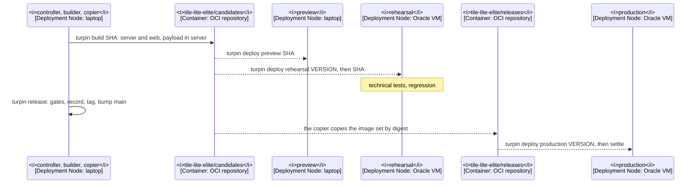

# Build once, promote: Tile Lite Elite on Turpin

The design for delphside/tile-lite-elite#545, for work packages #555 (the
deploy tooling) and #556 (the image). The generic tool is Turpin,
delphside/programme#117; *Turpin's design* is its
[design](../../../../../../records/2.5-changes/programme-tooling/117-generic-deliver-tool/design.md),
which owns every rule that is not Tile Lite Elite's. Read from Tile Lite
Elite's `main` at 7f07f889 (app 0.10.2).

Beside it:

- [questions.md](questions.md): the owner's answers, Q1 to Q6;
- [test-design.md](test-design.md): the changes to #555's tests;
- [turpin-gaps.md](turpin-gaps.md): Turpin's gaps T1 to T12, closed by
  delphside/programme#233 *Turpin: close the gaps for Tile Lite Elite*.

## Terms

From Turpin's design:

- *OCI*: Oracle Cloud Infrastructure for Oracle's cloud and registry; the
  Open Container Initiative for an image format (an OCI layout);
- *candidates* and *releases*: the two registry repositories; every build
  goes to candidates, and a release's images are copied, by digest, to
  releases;
- *the record*: a release's JSON (version, commit, each image's digest),
  the message of its tag `vVERSION`;
- *the payload*: the files a host runs to deploy, built into the server image
  at `/turpin/`;
- *the pivot*: the step after which a command is not undone; a deploy's is
  the one write that makes it `current` once `smoke` has passed;
- *`current`*, *`previous`*, *`changing`*: an environment's last finished
  deploy, the one before, and the state a deploy is in from its snapshot to
  the pivot (Turpin's
  [§11](../../../../../../records/2.5-changes/programme-tooling/117-generic-deliver-tool/design.md#11-on-the-host));
- *a first deploy*: one to a host whose state has no `current`;
- *root-ops*: the one `sudo` rule through which a deploy installs and removes
  host files;
- *`--off-level REASON`*: lets the first rehearsal deploy after a release be
  something other than what production runs;
- *settle*: moving the board to what the record says shipped.

This design's own: *an adopted host* runs the application under another tool
before Turpin's first deploy, as both VMs run `deploy.sh`.

## 1. As-is

Production runs 0.10.1 (`prod-0.10.1`, commit `2bbb957`), deployed by
`deploy.sh`. `main` is at 0.10.2.

| Step | Script, in `scripts/deliver/` | What it does |
| --- | --- | --- |
| build | `deploy.sh` | a detached worktree; `docker compose build`, build ID the short SHA; `docker save` to `artifacts/SHA.tar.gz`, reused by each environment; five kept |
| preview | `deploy-preview.sh` | loads the artefact on the laptop; `at REF` and `reset` wipe the volume |
| rehearsal | `deploy-rehearsal.sh` | `deploy.sh` with `rehearsal-target.sh`'s host; `reset` runs `down -v` |
| production | `deploy.sh` | the gates, then the steps that follow this table |
| rollback | `rollback.sh`, `rollback-rehearsal.sh` | retags `:previous`, restores a named snapshot |
| host settings | `rehearsal-access.sh`, `rehearsal-limits.sh`, `rehearsal-key.sh`, `seed-rehearsal.sh` | read or edit `~/tile-lite-elite/.env`, or restore a snapshot, then `docker compose up -d` |

`deploy.sh`'s steps on a host, over `ssh` and `scp`:

1. copy the artefact and the commit's `docker-compose.yml` to
   `~/tile-lite-elite`;
2. retag the running images `:previous`;
3. stop the server and tar the volume to
   `snapshots/pre-VERSION-SHA-TIME.tgz`, five kept;
4. `--migrate-only` within 300 s;
5. `compose up`;
6. smoke-test the public `/health` for `VERSION+SHA` within 60 s;
7. roll back on a failure in steps 3 to 6.

Then the tag, the Release, the bump and the settle.

Its gates, before anything is built:

- the commit on a remote branch;
- CI green on its push to `main`, with `e2e`, and on its pull request's run;
- production's `schema_version` within the build's migrations;
- a readable version, and `check-release-version.sh`;
- the milestone listed and confirmed;
- preview's and rehearsal's `/health` reporting the commit.

`DEPLOY_EMERGENCY` skips the last and reads CI from the pull request's run;
`DEPLOY_SKIP_CI=1` skips the CI gates.

The gaps #545 names:

- the build is copied by `scp`;
- the gates compare short SHAs;
- nothing records that rehearsal passed;
- the Caddyfile and build ID are baked into the image;
- the deploy script runs from the working tree;
- `main` is bumped after the production deploy;
- R8's host files are installed by hand.

## 2. To-be

Tile Lite Elite runs Turpin as
[Turpin's deployment view](../../../../../../records/2.5-changes/programme-tooling/117-generic-deliver-tool/design.md#tile-lite-elite)
draws it. What the owner types is
[1.2 *Making a release, then deploying it*](../../../../../../docs/1.2-change-lifecycle.md#making-a-release-then-deploying-it).



### 2.1 The profile

`app-profile.toml` gains Turpin's keys; the board's keys stay.

```toml
[release]
tag_prefix = "v"                       # was "prod-"; v0.10.1 already has it
history_prefixes = ["prod-"]
announcement = "Released in v"         # "Released in prod-" still matches
deploy_marker = "[deploy.sh]"          # unchanged: an identifier in GitHub
ci_status = "scripts/deliver/ci-status.sh --run push:main"
required_checks = ["fmt · clippy · test · wasm · docs",
                   "commit stamp (app/api versions)",
                   "e2e (Playwright · preview stack)"]
required_hooks = ["build", "pre-deploy", "save-state", "migrate", "smoke",
                  "restore-state", "release-check", "bump"]
overridable = ["milestone"]

[turpin]
candidates = "tile-lite-elite/candidates"
releases = "tile-lite-elite/releases"
images = ["server", "web"]
payload_image = "server"
join = ["docker-compose.yml", "Caddyfile"]
fallback = "see docs/4.3.3, Roll back a first Turpin deploy"

[[turpin.host_files]]                  # one table per file, 2.3
src = "scripts/operate/backup-to-oci.sh"
dest = "/opt/tile-lite-elite/backup-to-oci.sh"
mode = "0755"

[environments.preview]                 # existing env and url stay
role = "preview"
host = "controller"
project = "tile-lite-elite-preview"
join = ["docker-compose.preview.yml", "Caddyfile.preview"]

[environments.rehearsal]               # existing keys stay
role = "rehearsal"
login = "oci-instance-principal"
project = "tile-lite-elite"

[environments.production]              # existing env stays
role = "production"
login = "oci-instance-principal"
project = "tile-lite-elite"
url = "the public site address"
pull_timeout = 300
```

- **The check names are the CI jobs' `name:` values**, which the gate and
  GitHub match, so the jobs keep them
  ([1.10](../../../../../../docs/1.10-development-standards.md#a-string-stored-outside-the-repository-is-an-identifier)).
- **`project` on the VMs is `tile-lite-elite`**, the name `docker-compose.yml`
  pins, so the first deploy recreates the running containers in place and
  frees ports 80 and 443. The volumes keep their explicit names.
- **The laptop's three logins** take the default, `docker-config`.

### 2.2 The hooks

Executables in `turpin/hooks/`, in Bash. Each host hook is safe to run again
and bounds its own Docker calls with `timeout` ([3](#3-non-functional-design)).
A hook that cannot judge refuses.

| Hook | Runs on | Does | Reuses |
| --- | --- | --- | --- |
| `build` | laptop | [2.2.1](#221-the-build-hook) | `deploy.sh`'s build and schema reading |
| `release-check` | laptop | `check-release-version.sh VERSION`; refuses where the milestone is unread | that script |
| `pre-deploy` | host | refuses where the database's highest applied migration exceeds the pulled image's `org.tileliteelite.schema` label | the `schema` gate |
| `save-state` | host | [2.2.2](#222-the-snapshot-contract) | the snapshot step |
| `migrate` | host | `server --migrate-only`, through `TURPIN_COMPOSE` (T1), within 300 s | the migration step |
| `smoke` | host | `/health` through Caddy on the host reports `VERSION+` a prefix of `TURPIN_SHA` within 60 s | the smoke test |
| `restore-state` | host | [2.2.2](#222-the-snapshot-contract) | `rollback.sh`'s restore |
| `post-deploy` | laptop | `/health` at the public address; after production, the open `Release Check` issues | the smoke test's public leg |
| `bump` | laptop | `cargo update --workspace --offline`, so `Cargo.lock` follows the version | the bump's lockfile step |

`pre-deploy` reads `_sqlx_migrations` with `sqlite3`, in the running server
container or a one-off one of the pulled image. The smoke test runs on the
host, so the public DNS leg moves to `post-deploy`, after the pivot.

#### 2.2.1 The build hook

1. Set `TILE_LITE_ELITE_BUILD_ID` to `git rev-parse --short` of `TURPIN_SHA`.
2. Read the highest migration number in `crates/server-game/migrations/`.
3. Run one `docker buildx bake --builder turpin` of targets `server` and
   `web` from `docker-compose.yml`, setting Turpin's three labels and
   `org.tileliteelite.schema`, each to an OCI layout in `.turpin/oci/IMAGE`, or
   with `--load` under `TURPIN_LOCAL`.
4. Print each image's name and layout.

#### 2.2.2 The snapshot contract

**`save-state` and `restore-state` meet
[Turpin's §8 contract](../../../../../../records/2.5-changes/programme-tooling/117-generic-deliver-tool/design.md#8-profile-and-hooks)
by file names.** A snapshot is `turpin-N.tgz`, `N` the deploy number, in the
folder `TLE_SNAPSHOT_DIR` names in the environment's `.env`:

- on the VMs, `~/tile-lite-elite/snapshots`, where `rollback.sh --db-only`
  reads;
- on preview, the state folder's `snapshots/`.

`save-state`, given `TURPIN_DEPLOY` and `TURPIN_CURRENT`:

1. removes `turpin-$TURPIN_DEPLOY.tgz` and its `.partial`;
2. stops the server container, found by its Compose labels;
3. tars the volume, mounted read-only, with the pulled server image, to the
   `.partial` name, then renames it;
4. removes each `turpin-*.tgz` but `TURPIN_DEPLOY`'s and `TURPIN_CURRENT`'s;
   `deploy.sh`'s `pre-*` snapshots stay;
5. on role `preview`, empties the volume, so each preview deploy starts empty
   (Q5).

`restore-state`, given `TURPIN_DEPLOY`, stops the server and replaces the
volume's contents from `turpin-$TURPIN_DEPLOY.tgz` where it exists, and does
nothing where it is absent.

### 2.3 On the host

The state folder is `/var/lib/turpin/tile-lite-elite/ENV/`, which
`turpin host-install` makes, owned by the deploy user, `ubuntu`, with an empty
`.env`.

- **`.env`**: moves there from `~/tile-lite-elite/.env`, gaining Turpin's
  registry and login keys, `TLE_SNAPSHOT_DIR` and `TLE_UPLOAD`. The old path
  holds nothing, as `sed -i` replaces a link with a copy.
  `rehearsal-target.sh` names its path once, as `REHEARSAL_ENV_FILE`, for
  `rehearsal-access.sh`, `rehearsal-limits.sh` and `rehearsal-key.sh`.
- **Applying a change**: the `docker compose up -d` of those scripts and of
  `seed-rehearsal.sh`, which restores a database, becomes
  `turpin-host compose tile-lite-elite ENV up -d` (Q4), Turpin's own
  arguments for the current deploy under the environment's lock, since the old
  folder's compose file would start the old images.
- **The host files** are R8's, installed on rehearsal and production at each
  deploy:

  | Source | Destination | Mode | Unit enabled |
  | --- | --- | --- | --- |
  | `scripts/operate/backup-to-oci.sh` | `/opt/tile-lite-elite/` | 0755 | — |
  | `scripts/operate/check-log-hygiene-nightly.sh` | `/opt/tile-lite-elite/` | 0755 | — |
  | `scripts/operate/check-log-hygiene.py` | `/opt/tile-lite-elite/` | 0755 | — |
  | `docs/4.4.7-log-events.md` | `/opt/tile-lite-elite/` | 0644 | — |
  | the two `.service` units in `scripts/operate/systemd/` | `/etc/systemd/system/` | 0644 | — |
  | the two `.timer` units | `/etc/systemd/system/` | 0644 | yes |
  | the `sa` alias, a new file | `/etc/profile.d/tile-lite-elite-sa.sh` | 0644 | — |

- **The timers run on rehearsal too** (Q3). `backup-to-oci.sh` and
  `check-log-hygiene-nightly.sh` send every object, the backup and the marker
  object, through one upload function. `TLE_UPLOAD` chooses its adapter:
  - `par`, on production: the HTTP upload through the PAR (a
    pre-authenticated request) as today;
  - `local`, on rehearsal: writes each object into `uploads/` in the state
    folder, removing the older database copy first, and reports success;
  - `local-fail`, set by a test: reports failure.

  The scripts read `TLE_UPLOAD` from the one `.env` matching
  `/var/lib/turpin/tile-lite-elite/*/.env`, and refuse unless exactly one
  does; the PAR stays in `~/.tile-lite-elite-backup-par`. Both scripts change,
  so they ship in #556, and 4.4.1 lists the setting.
- **The backup takes the deploy lock**: the backup service runs its script
  under `flock -w 1800` on the environment's `lock`. A deploy that finds the
  lock held is refused, unless run with `--wait`.
- **Operational commands find the server container by its Compose labels**
  (project `tile-lite-elite`, service `server`): the `sa` alias,
  `backup-to-oci.sh`, which uses `docker exec` and `docker cp` on it, and
  `clean-test-accounts.sh`. The backup does not use `turpin-host compose`,
  which refuses while the lock is held.

### 2.4 The old scripts

`deploy.sh` and `rollback.sh` are the way back to 0.10.1 until 0.10.3 (#545's
order).

| Script | Becomes |
| --- | --- |
| `deploy.sh`, `rollback.sh`, `rollback-rehearsal.sh`, `ssh-preflight.sh` | the fallback; retired in 0.10.3 |
| `deploy-preview.sh` | `turpin build`, then `turpin deploy preview`; retired in 0.10.3 |
| `deploy-rehearsal.sh` | `turpin deploy rehearsal`; rehearsal's way back until 0.10.3, when `reset` (`turpin-host compose ... down -v`, then `up -d`) moves to `rehearsal-reset.sh` |
| `rehearsal-target.sh`, `run-log.sh` | kept for `bench-rehearsal.sh`, `restore-backup.sh`, the `rehearsal-*` scripts and the profile's `[environments.rehearsal].url_from`, which reads the address from `rehearsal-target.sh` |
| `verify.sh` | [2.4.1](#241-verifysh) |
| `check-release-version.sh` | called by `release-check` |
| `rehearsal-access.sh`, `rehearsal-limits.sh`, `rehearsal-key.sh`, `seed-rehearsal.sh` | [2.3](#23-on-the-host) |

#### 2.4.1 `verify.sh`

| Check | Becomes |
| --- | --- |
| `tests` | also runs the hooks' Bats tests |
| `gates` | `turpin release --check`, where `main` holds an unreleased image change, in place of `DEPLOY_GATES_ONLY=1 deploy.sh` |
| `deploys`, new | `turpin status rehearsal` and `turpin status production`: what each runs, its record and its host files against the payload (R8) |
| `envs`, `unreleased`, `rehearsal` | unchanged: each reads `/health` |
| `tree`, `pushed`, `branches`, `ci`, `token`, `hosts`, `prstate`, the board check | unchanged |

### 2.5 CI

- **The hooks' tests**: Bats, with stub `docker` and `curl`, in the `check`
  job; `deploy.sh`'s stay until 0.10.3.
- **`e2e`** builds its own preview stack, with the empty payload #556's
  `Dockerfile` allows, as it judges the commit before any build is stored.

### 2.6 The release step and the dev bump

The owner runs `turpin release` at rehearsal pass, in the `main` worktree. It
runs the gates, writes the record, has the copier copy the images to releases,
tags `vVERSION`, publishes the GitHub Release, bumps `main` to the next patch
with the `bump` hook, and opens the next milestone. The tag fixes the app and
API versions, through the tree it names; the record names that commit. Claude
writes the delivery-log row
([1.2](../../../../../../docs/1.2-change-lifecycle.md#making-the-release)).

### 2.7 `CLAUDE.md`

Tile Lite Elite's, under *Deliveries and releases*:

- a deploy is `turpin deploy ENV REF`, pulling the stored build by digest:
  Preview, Rehearsal, the release step, Production;
- after `turpin release`, wait for CI on the bump; after a production deploy,
  run `verify.sh`;
- `main`'s versions are provisional until a release fixes them (owner,
  2026-11-16): the bump starts the app version at the next patch, and later
  changes may move it;
- the milestone warning is the release's milestone gate;
- the scripted checks gain `turpin status ENV` and Turpin's reads of
  production's state and `/health`.

### 2.8 Documents that change

| Document | Change |
| --- | --- |
| Tile Lite Elite's 4.3.3 | part 1 becomes 1.2's table in Tile Lite Elite's terms; 2.5 describes the build, payload and record; until 0.10.3, *Roll back a first Turpin deploy*: [4](#4-migration-order) step 8's way back, with `DEPLOY_SKIP_CI=1` |
| 4.3.4 | the state folder, `.env`, snapshots and host files; a date milestone in place of the letter |
| 4.4.1 | `TLE_SNAPSHOT_DIR`, `TLE_UPLOAD`, Turpin's host keys, the schema label |
| 4.3.0 | the hooks and `rehearsal-reset.sh`; the scripts retired in 0.10.3 |
| 4.3.3 §2.4.1, §2.4.2 | the tree's versions are provisional, not "what the next release will be", and the app version moves at `turpin release`'s bump and with later changes, not "once per production release" |
| `CLAUDE.md` | [2.7](#27-claudemd) |
| the programme's 3.1.2 | the host files, state folders and the laptop's Buildx builder |
| the programme's 1.2 | its note that no application runs the model yet, once 0.10.2 ships |

### 2.9 Which package carries what

**What the payload carries reaches the image, so it is #556's**: the hooks,
the profile keys a host reads, the joined files, the host files' sources
(`backup-to-oci.sh` and `check-log-hygiene-nightly.sh` with the upload
function) and R7's deploy script. #555 keeps what runs on the laptop and in
CI: `verify.sh`, the `rehearsal-*` scripts, the CI workflow, the documents and
`CLAUDE.md`. Both ride #545's one branch; #555 is delivered when it lands,
and #556 with 0.10.2.

Turpin's payload carries only the profile keys a host reads. #555 sets
`[ships].carries_payload = true` on the branch, once the image carries the
payload (Q6), so a pin move ships only where it changes a file the payload
carries. `app-profile.toml` stays in `[ships].non_shipping` until Turpin's T13
is in, which is before #555 merges.

### 2.10 Requirements met

| Requirement | Met by |
| --- | --- |
| R1 | `turpin build` once per commit; each environment pulls its digest |
| R2 | #556: the Caddyfiles and compose files are joined at deploy |
| R3 | `turpin release`, [2.6](#26-the-release-step-and-the-dev-bump) |
| R4 | production pulls a record's digests from releases; `--unrecorded REASON` is the override |
| R5 | the gates and `verify.sh` read the record, the host state and the digests |
| R6 | 1.2's emergency row: a branch from production's tag, through rehearsal |
| R7 | the payload in the server image; Turpin refuses to reuse a version and pulls by digest, since the registry cannot make a tag immutable (#554) |
| R8 | host files in #556, `verify.sh`'s `deploys` check in #555 (Q1) |
| R9 | `turpin release` asks per issue, `[y/N]`, or `--confirm N`; the record keeps `carries.confirmed`; parents skipped (Q2) |
| R10 | #555 (Q1) |

## 3. Non-functional design

**Capacity**:

- a host keeps two Turpin image sets, about 300 MB, and until 0.10.3
  `deploy.sh`'s `:latest` and `:previous`: about 600 MB, on a disk 13% used;
- two `turpin-N.tgz` of a 5 MB database (#174's measure), beside
  `deploy.sh`'s five;
- the registry keeps every release (R7), each adding the layers it changed;
  `turpin prune` after a release removes candidates no environment runs;
  #554 checked the free allowance;
- the laptop's first build is cold: the `turpin` builder has its own cache;
- the OCI CLI's memory peak on the 1 GB host, measured at rehearsal's first
  deploy.

**Failure**:

- before the pivot a failed deploy restores `current`;
- on an adopted host's first Turpin deploy there is no `current`: a failed
  deploy restores the old files' content, the containers it stopped and each
  unit's enabled and active state, so a failure before `compose up` leaves
  0.10.1 serving; one at `compose up` or `smoke` takes
  [4](#4-migration-order)'s way back, since the same project name recreated
  the containers in place;
- a failed `pre-deploy` changes nothing; a failed `migrate` is restored from
  the snapshot;
- a reboot mid-deploy leaves `changing`, which `turpin rollback` clears.

**Limits and timeouts**:

| Limit | Value | From |
| --- | --- | --- |
| `pull_timeout` | 300 s | Turpin's default, unmeasured; then 3 times rehearsal's first cold pull. #554 pushed the 51 MB server image in about 64 s |
| `smoke` | 60 s | `deploy.sh`'s 30 tries 2 s apart |
| `migrate` | 300 s | `deploy.sh`'s guard against an image ignoring `--migrate-only` |
| `save-state`, `restore-state` | 120 s each | a guess: a 5 MB tar is seconds |
| `pre-deploy` | 30 s | a guess |
| the backup's wait for the lock | 1800 s | a deploy's limits: two pulls of 300, `pre-deploy` 30, `save-state` 120, `migrate` 300, `smoke` 60 and a restore's 120, 1,230 s, rounded up |

Turpin's own retries and call timeouts are its `settings.py`'s.

**Secrets and access**:

- the laptop holds a registry auth token each for the controller, builder and
  copier, typed at `turpin login`, and the builder's API key for removals;
  each VM pulls with its instance principal, so no secret is copied to a host;
- the application's secrets stay in each `.env`, mode 0600, out of the
  payload, record and logs;
- GitHub and `ssh` to the VMs use the owner's logins and key;
- the reads of production's state and `/health` are scripted checks
  ([2.7](#27-claudemd)).

## 4. Migration order

The hosts run `deploy.sh`'s layout, with no `/var/lib/turpin`, so Turpin's
first deploy finds no state.

1. **Laptop** (owner): Turpin's
   [§14 steps](../../../../../../records/2.5-changes/programme-tooling/117-generic-deliver-tool/design.md#14-moving-tile-lite-elite-to-it)
   (the Buildx builder, the builder's API key, the OCI CLI, `turpin login`
   for the three logins, the old releaser login gone);
   then `turpin host-install preview`, and `TLE_SNAPSHOT_DIR` in preview's
   `.env`.
2. **Branch** (Claude): #555 and #556 committed, CI green, `turpin build SHA`.
3. **Preview**: Claude runs `turpin deploy preview SHA`; the owner runs the
   user tests (#556).
4. **Rehearsal**:
   1. owner: clear any state folder a trial of Turpin's Bash version left
      (Turpin refuses one), then `turpin host-install rehearsal`, which makes
      the state folder and an empty `.env`;
   2. owner: move the `.env` into it and add Turpin's keys,
      `TLE_SNAPSHOT_DIR` and `TLE_UPLOAD=local`;
   3. Claude: `turpin deploy rehearsal SHA --off-level REASON`, timing the
      cold pull;
   4. Claude: the technical tests ([test-design.md](test-design.md)), the
      fallback among them; then `pull_timeout` set.

   **Way back** (Claude): copy the `.env` back to `~/tile-lite-elite`, then
   `deploy-rehearsal.sh prod-0.10.1`.
5. **Merge** (Claude): the branch lands on `main`; #555 is delivered, #556
   moves to Deployment.
6. **Production's host, ready** (owner): `turpin host-install production`,
   which changes nothing that runs; the release reads production through the
   `turpin-host` it installs, and its version from `/health`.
7. **Release**: Claude deploys `main`'s commit to rehearsal and runs the
   regression; the test manager checks it; the owner judges it passed and runs
   `turpin release --check`, then `turpin release`: `v0.10.2`, `main` at
   0.10.3.
8. **Production** (owner):
   1. move the `.env` into the state folder and add Turpin's keys,
      `TLE_SNAPSHOT_DIR` and `TLE_UPLOAD=par`;
   2. `turpin deploy production SHA --check`, with a commit's SHA, and
      `turpin deploy production VERSION --check`, with a version that has no
      record, each refused;
   3. `turpin deploy production 0.10.2`, then `verify.sh`;
   4. owner: start the backup service once by hand, then check in production's
      bucket that the marker object is refreshed. This is #556's
      post-deployment row for the upload through the PAR, the one path not
      tried before production.

   **Way back** (owner), 4.3.3's *Roll back a first Turpin deploy*, tried on
   rehearsal in step 4:
   1. copy the `.env` back to `~/tile-lite-elite`;
   2. where the deploy passed its pivot, stop the Turpin project and restore
      its snapshot with `rollback.sh --db-only turpin-N.tgz`;
   3. `docker compose up -d` in `~/tile-lite-elite`, whose compose file and
      `:latest` images are 0.10.1's;
   4. where those are gone, run `deploy.sh` with `DEPLOY_SKIP_CI=1`, since
      `DEPLOY_EMERGENCY` reads CI from a pull request's run and `2bbb957` has
      push runs only:

      ```bash
      DEPLOY_EMERGENCY=REASON DEPLOY_SKIP_CI=1 ./scripts/deliver/deploy.sh prod-0.10.1
      ```

9. **0.10.3** (Claude, then the owner on the hosts): the fallback scripts
   retire, with the old compose file and images in `~/tile-lite-elite` and
   4.3.3's fallback section.
