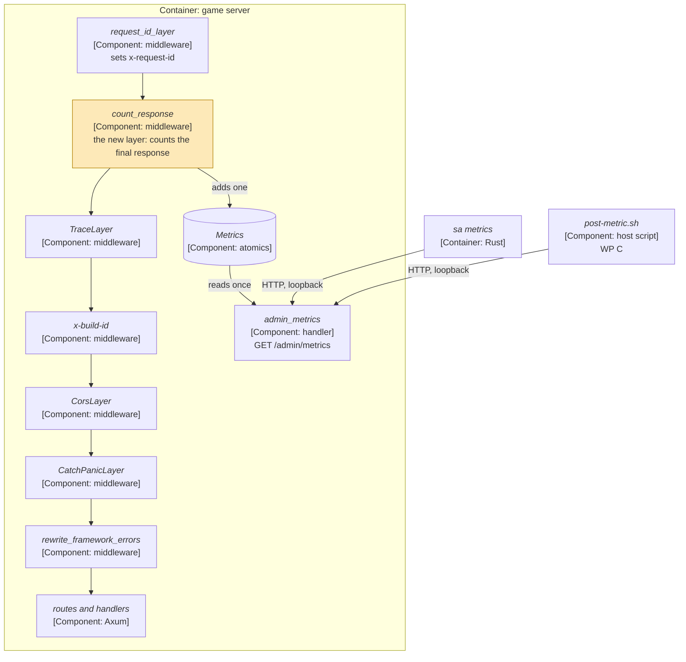

# 402 WP B symptom counters: design

The design for
[delphside/tile-lite-elite#609](https://github.com/delphside/tile-lite-elite/issues/609)
*#402 WP B: symptom counters*, the second of
[402-design.md](402-design.md)'s three work packages. Its decisions are
listed in [402-design.md *Decisions*](402-design.md#decisions).

The package delivers R3 and the counting column of R6
([the requirements](https://github.com/delphside/tile-lite-elite/issues/402#requirements)),
and its command exits by R9's statuses. **The server counts its own symptoms and
exposes them on a loopback endpoint**, as numbers that grow from the process's
start. It sends nothing and holds no credential: WP C reads the numbers and
decides what alarms. It counts what
[WP A's classification](402-design.md#the-model-one-reason-classifies-a-failure-r1)
decides, so it ships in its own release, after WP A's.

- **The endpoint**: `GET /admin/metrics`, loopback only, beside
  `/admin/scheduler-health`.
- **What is counted**: responses by status class and by error type, 429s apart
  from 503s, caught panics, WebSocket handshake failures and latency in nine
  fixed buckets, with the process's start time.
- **Where the layer sits**: one middleware between the trace and the request
  ID, counting with atomics ([the diagram](#where-it-counts)).
- **The command**: `sa metrics` (`sa` is the shell function that runs
  `tile-lite-elite-admin` in the server container,
  [4.3.4](https://github.com/delphside/tile-lite-elite/blob/main/docs/4.3.4-production-environment.md#admin-cli)).
- **Three small decisions**, [6 to 8](402-design.md#decisions): one latency
  histogram for every request, not one per route, because about 40 routes
  times nine buckets would be nearly all zeros at a handful of requests a
  week; the bounds fixed in code; and the command.

## What the server counts today

- **The server keeps no count of responses.** What it knows is in the log, one
  line per refusal (`request refused`), and a person reads that.
- **`/admin/scheduler-health` is the pattern**
  ([delphside/tile-lite-elite#400](https://github.com/delphside/tile-lite-elite/issues/400)
  *MAIN PROJECT: TLE Scheduler*): a loopback route that reads in-memory state
  and answers a data transfer object (DTO), with a command that prints a table
  or, under `--json`, the DTO.

## The endpoint

**`GET /admin/metrics` answers one JSON object**, `AdminMetricsDto`. Its row
is `row(Get, "/admin/metrics", Loopback, Unlimited, admin_metrics)`, so
`require_loopback` guards it, no limiter counts it, and `tests_routes.rs` holds
it to its row in 4.4.3. It reads atomics in memory and never the database. It
answers an object where `scheduler-health` answers a list: there is one set of
counters, not one row per job.

The counters are **cumulative from the process's start**, and the object says
when that was. Rates are the poller's work, as differences between two reads.

```rust
// crates/api, beside AdminSchedulerJobHealthDto
#[derive(Debug, Clone, Serialize, Deserialize, PartialEq, Eq)]
pub struct AdminMetricsDto {
    /// When this process started, epoch seconds in Coordinated Universal
    /// Time (UTC), as the other admin DTOs carry a time.
    pub started_at: i64,
    /// Every response, by the class of its status.
    pub responses: AdminResponseCountsDto,
    /// Every error response, by the reason's `error_type`.
    pub errors: AdminErrorTypeCountsDto,
    /// Responses with status 429, apart from 503s.
    pub too_many_requests: u64,
    /// Responses with status 503, apart from 429s.
    pub service_unavailable: u64,
    /// Panics `CatchPanicLayer` caught.
    pub panics_caught: u64,
    /// Requests to the events route that were not upgraded: any 4xx or 5xx.
    pub websocket_handshake_failures: u64,
    /// Time to the response's head, for every request.
    pub latency: AdminLatencyDto,
}

#[derive(Debug, Clone, Serialize, Deserialize, PartialEq, Eq)]
pub struct AdminResponseCountsDto {
    pub informational: u64, // 1xx: a WebSocket's 101
    pub success: u64,       // 2xx
    pub redirection: u64,   // 3xx
    pub client_error: u64,  // 4xx
    pub server_error: u64,  // 5xx
}

#[derive(Debug, Clone, Serialize, Deserialize, PartialEq, Eq)]
pub struct AdminErrorTypeCountsDto {
    pub business: u64,
    pub technical: u64,
    pub unexpected: u64,
    /// A 4xx or 5xx that carried no reason. Zero while every error is built
    /// by `ApiProblem`; a nonzero value is a defect in the layering.
    pub unclassified: u64,
}

#[derive(Debug, Clone, Serialize, Deserialize, PartialEq, Eq)]
pub struct AdminLatencyDto {
    /// Upper bounds in milliseconds, ascending, inclusive.
    pub bounds_ms: Vec<u64>,
    /// `counts[i]` requests took more than `bounds_ms[i - 1]` and at most
    /// `bounds_ms[i]`. One longer than `bounds_ms`: the last counts the
    /// requests that took longer than every bound.
    pub counts: Vec<u64>,
}
```

For example:

```json
{
  "started_at": 1795612800,
  "responses": { "informational": 3, "success": 412, "redirection": 0,
                 "client_error": 9, "server_error": 0 },
  "errors": { "business": 6, "technical": 3, "unexpected": 0,
              "unclassified": 0 },
  "too_many_requests": 1,
  "service_unavailable": 0,
  "panics_caught": 0,
  "websocket_handshake_failures": 2,
  "latency": { "bounds_ms": [10, 50, 100, 250, 500, 1000, 5000, 60000],
               "counts": [380, 31, 8, 3, 1, 1, 0, 0, 0] }
}
```

- **A request is in exactly one of `responses`' fields.** An error is also in
  exactly one of `errors`' fields, so `client_error + server_error` equals the
  sum of `errors`, and the sum of `latency.counts` equals the sum of
  `responses`.
- **The five classes are named after RFC 9110's**, and `informational` is
  there only because a WebSocket's 101 is a response.
- **`too_many_requests` and `service_unavailable` read the status**, so a 503
  from the throttle's floor and one from a busy database
  (`Reason::ServiceBusy` both ways) are together, as R5 treats them: the
  server asking its callers to wait.
- **The latency has no total and no sum.** The poller reads shares of the
  buckets; a sum in whole milliseconds would round most requests to zero, and
  one in microseconds would give the object two units.
- **The bounds ride in the body**, so a poller reads them rather than knowing
  them, and a release that moves a bound is read correctly.
- **A restart is a new `started_at`**, and every counter begins again at zero.
  A poller that finds `started_at` or `bounds_ms` different from its last read
  counts the new values from zero, and loses what was counted since that read.
- **The body holds only counts and bounds**, with no label that grows with
  use: no path, player or game.

## The bounds

**`LATENCY_BOUNDS_MS` is `[10, 50, 100, 250, 500, 1_000, 5_000, 60_000]`**,
nine buckets with the overflow one, in `app/metrics.rs`. The numbers come from
the cost of a read and from the pacing the server already sets, and they are
fixed. **`/start` and `/actions` carry engine time**: `run_engine_turns` runs
inside the request, and sleeps `ENGINE_TURN_BROADCAST_DELAY` (120 ms,
`games.rs`) after each engine turn that does not end the game, for up to
`MAX_ENGINE_TURNS_PER_TRIGGER` (400) turns. A move against one engine seat
takes at least 120 ms, and a game of engines only runs inside one `/start`.

| Bound | Reads as | Where it comes from |
| --- | --- | --- |
| 10 ms | a read of memory or one row | the greedy engine's move search takes medians of 0.126 to 0.815 ms on the laptop, and rehearsal runs 1.4 to 2 times slower ([4.2.8](https://github.com/delphside/tile-lite-elite/blob/main/docs/4.2.8-engine-performance.md)) |
| 50 ms, 100 ms | a database write; an Argon2 hash on the VM's two CPUs | estimates, not measured |
| 250 ms | a move against one or two engine seats, which take 120 ms and 240 ms plus the search | the 120 ms pacing; `HASH_PERMIT_WAIT` (`auth.rs`) is also 250 ms, so a 503 for a hash permit lands in the next bucket |
| 500 ms, 1 s | about four and eight engine turns | multiples of the 120 ms pacing; estimates |
| 5 s | about 40 engine turns, so a long chain of engine seats | `ENGINE_TURN_TIMEOUT` (`games.rs`), the longest one engine search may take |
| 60 s | beyond every limit the server sets | 400 turns of 120 ms is 48 s, with the searches |

**The estimates are 50, 100, 500 and 1,000 ms.** The upper buckets mostly hold
engine games, not trouble, and WP C's thresholds read them so
([WP C](402-design.md#wp-c-in-outline)). A bound is moved if a week of numbers
says so; moving one is a code change and a release, which 4.4.1's table
records.

## Where it counts

**One middleware counts, and it sits where the response is final.**



*Dynamic diagram: a request runs down the layers, and the counting layer adds
to the atomics the endpoint reads.*

In `build_router_with`'s stack the layers, from the inside, are the rewrite of
framework errors, `CatchPanicLayer`, cross-origin resource sharing (CORS),
`x-build-id`, the trace and the request ID. The new layer goes **between the
trace and the request ID**:

```rust
.layer(TraceLayer::new_for_http())
.layer(middleware::from_fn_with_state(state.metrics.clone(), count_response))
.layer(middleware::from_fn(request_id_layer))
```

Outside the panic layer and the rewrite, it sees what the caller sees: a
panic's 500, axum's rewritten 400, and a CORS preflight's answer. Inside the
request ID, it needs nothing from it. A response a layer outside it builds
would escape it, and none does: the request-ID layer only adds a header.

The layer takes an `Instant` before `next.run`, and afterwards:

1. adds one to the field of `responses` for the status's class;
2. for a 4xx or 5xx, reads the `Reason` the response carries and adds one to
   the field of `errors` for `reason.error_type()`, or to `unclassified` where
   it carries none;
3. adds one to `too_many_requests` for a 429 and to `service_unavailable` for
   a 503;
4. for a 4xx or 5xx whose `MatchedPath` is the events route, adds one to
   `websocket_handshake_failures`;
5. adds one to the latency bucket the elapsed time falls in, found by the
   first bound it does not exceed.

**Two small changes outside the layer tell it what it cannot see**:

- **`ApiProblem::render` puts the `Reason` in the response's extensions.**
  This is how the layer reads the classification, which is the one match in
  `crates/api`, and never re-derives it from the status. Every error leaves
  through `render`: a handler's, the throttle's 429 and 503, and axum's
  rewritten rejections. The fallback for a body that fails to serialise
  answers 500 whatever the reason, and puts `Internal` in the extension. An
  error response with none is `unclassified`.
- **`panic_response` puts a `PanicCaught` marker in the extensions** of the 500
  it builds, and the layer adds one to `panics_caught` where it finds it. A
  panic is then counted by the one layer that counts, and also as a 500 of type
  `unexpected`, as it is one.

**The events route's path is one constant**, `EVENTS_PATH`, which the row in
`routes::all` and the layer both read, so the two cannot differ. A request
`game_events` refuses, or that axum refuses before it (no upgrade headers), is
a 4xx on that path and counts. A failure after the upgrade, a close with 4500,
is not a handshake failure and is not counted: R3 asks for the handshake.

**The layer reads `MatchedPath`**, which is set when it runs, because a layer
added with `Router::layer` wraps each route. T6 proves it; if T6 fails, the
build takes the path from the request's URI and matches `EVENTS_PATH` by its
fixed parts.

**The counters are atomics.** `Metrics` is an `Arc` in `AppState`, as the
semaphores are, and holds a fixed set of `AtomicU64`: five classes, four types,
two statuses, the panics, the handshakes and nine buckets, 22 in all. Each is
`fetch_add(1, Relaxed)`. No lock is taken and nothing is allocated, so the
layer cannot wait on another request and cannot fail one. The snapshot reads
each atomic once, so a response in flight can be in one field and not yet in
another; the next read has it, and a rate over a minute is not changed. A
`static` would be shared by the tests that run in one process, so the state
holds it.

## The admin command

**`sa metrics` is added (decision 8).** Every other admin endpoint has a
command, `scheduler-health` among them, and the command is how the owner reads
a production number: `sa` runs it inside the container, where the endpoint is
reachable. It is one function in the shape of `run_scheduler_health`:

- a table of the counters, one row each, then the latency buckets with their
  bounds, and the start time in UTC to the second;
- `--json` prints the DTO, as every command does;
- its failures take the exit statuses of the error scheme, as the others
  (R9).

## What changes in the build

| Document | Change |
| --- | --- |
| 4.4.3 *Admin endpoints* | a row for `GET /admin/metrics`; its access and what it answers |
| 4.4.3 *Admin DTOs* | rows for the four DTOs, and where each field is read from |
| 4.4.3 admin sequence | the call, reading memory and not the database |
| 4.4.3 *Reasons* | a column, *Counted in*, per row: the status's class, the type, and `too_many_requests` or `service_unavailable` where the status is 429 or 503. R6's counting column. A short paragraph says the layer, not the handler, counts, and that a panic and a handshake have their own counters |
| 4.4.3 header | `API_VERSION` 2.18 |
| 4.3.4 admin CLI table | a row for `metrics` |
| 4.3.0 | the row for `scripts/develop/check-api-errors.py` gains the *Counted in* check |
| 4.4.1 *Server timings held in code* | a row for `LATENCY_BOUNDS_MS`: value, `crates/server-game/src/app/metrics.rs`, what it bounds. It is a product setting held in one code module ([1.10](../../../../../../docs/1.10-development-standards.md#where-an-applications-settings-are-held)) |
| 4.2.0's source, `docs/design-map/model.dsl` | a new component, *Response counters*, whose artefact is `crates/server-game/src/app/metrics.rs`; the relationships `adminApi -> counters` ("reads the counters") and `api -> counters` ("counts every response in"), the Transport API's artefact list already holding `app.rs` and `error.rs`; the Admin CLI's description names the counters; 4.2.0 is regenerated |
| `crates/api`'s version comment | a line for 2.18, as 2.15 has for `scheduler-health` |

**The API version moves to 2.18**, a minor by
[4.3.7 §4.3](https://github.com/delphside/tile-lite-elite/blob/main/docs/4.3.7-how-testing-and-release-work.md#43-decide-whether-the-api-version-moves):
a route is added, as 2.15 added `scheduler-health`. It is the minor after WP
A's 2.17, so WP B's release is the first to carry it.

**`check-api-errors.py` widens by one check**: the *Counted in* column of
each row must be what its status and type give, so the column cannot drift
from the rule. 4.4.7 changes nothing: the layer writes no log line. 4.3.4's
*Not monitored* row, *error rates, latency and volume*, is WP C's to change,
when something alarms on them.

## Non-functional design for the counters

- **Capacity**: none, because production sees a handful of requests a week
  (owner, 2026-11-24). Each request costs one `Instant` and four or five
  `fetch_add`s, against handlers that take 0.1 ms or more. WP C's poll is the
  largest traffic the endpoint sees, and is one small read.
- **Failure**: the layer awaits only `next` and does nothing that can fail, so
  it cannot turn a good response into a bad one. A response with no reason is
  counted `unclassified`, not refused. The counters are lost when the process
  stops, which `started_at` shows; a crash that restarts the container is
  itself a symptom, which WP C alarms on through `started_at`. The endpoint
  failing is a poll that fails, which WP C reports as a missing metric.
- **Limits and timeouts**: no limit and no timeout is added. The body is a
  fixed 22 numbers and the bounds, under 1 KB, whatever the traffic. The
  counters are `u64`, which at 1,000 requests a second take 584 million years
  to wrap. The latency bounds are the only numbers chosen, and
  [the bounds](#the-bounds) say where each comes from.
- **Secrets and access**: the route is `Loopback`, guarded by
  `require_loopback` before the handler, as every `/admin/*` route is; no token
  and no credential exists to leak, and the body holds counts only. The server
  holds no credential for the place the poller posts to
  ([delphside/tile-lite-elite#337](https://github.com/delphside/tile-lite-elite/issues/337)
  *[Decision]: D49 · What posts the metric from the production host*).

## Test approach

**Functional user tests, Preview**: none, because no user sees the counters:
the endpoint is loopback, and nothing in the client or the API's existing
bodies changes. The package still passes Preview in the release's route, as
every image does.

**Technical tests, CI**: T1 to T14 run on every push. Each derives from a
rule in this design, named by its section and its bold sentence.

- [ ] **Claude** — T1: every response is in exactly one class. A request
  answered 200, 404, and 500, and 101 and 301 through a route added with
  `build_router_with`, moves exactly the one field of `responses`, by one, and
  the sum of the fields equals the requests made. (*The endpoint*: "A request
  is in exactly one of `responses`' fields.")
- [ ] **Claude** — T2: the reason decides the type. For every variant of
  `Reason`, an error built with it moves exactly the field of `errors` that
  `reason.error_type()` names, and no other; the test iterates the variants, so
  a new reason is covered. (*Where it counts*: "`ApiProblem::render` puts the
  `Reason` in the response's extensions.")
- [ ] **Claude** — T3: an error a layer builds is classified as one a handler
  builds. A throttled 429, a busy-database 503, an axum 415, and a panic's 500
  each move `errors` by their reason's type, and `unclassified` stays zero; a
  hand-built 4xx with no reason moves `unclassified` and nothing else; a body
  that fails to serialise counts as `Internal`. (*Where it counts*: "Every
  error leaves through `render`.")
- [ ] **Claude** — T4: 429 and 503 are counted apart. A 429 moves
  `too_many_requests` only, a 503 `service_unavailable` only, a 500 neither.
  (*The endpoint*: "`too_many_requests` and `service_unavailable` read the
  status".)
- [ ] **Claude** — T5: a panic is counted once as a panic and once as an
  `unexpected` 500. A route added through `build_router_with` that panics
  moves `panics_caught`, `server_error` and `errors.unexpected` by one each,
  and the answer is still the 500 with the body. (*Where it counts*:
  "`panic_response` puts a `PanicCaught` marker in the extensions".)
- [ ] **Claude** — T6: a handshake failure is a non-upgraded request to the
  events route, and nothing else. A request with no token, a token with no
  session, a signed-in player who is not in the game, an unknown game, and a
  request without upgrade headers each move `websocket_handshake_failures`; a
  successful upgrade and the same refusals on another route do not. (*Where it
  counts*: "The events route's path is one constant".)
- [ ] **Claude** — T7: a latency falls in the bucket whose bound it first does
  not exceed. A function of elapsed time, tested at each bound, one microsecond
  under, on and one over it, and at zero and an hour, gives the expected index;
  `counts` is one longer than `bounds_ms`, and the bounds ascend. (*The
  bounds*: "`LATENCY_BOUNDS_MS` is `[10, 50, 100, 250, 500, 1_000, 5_000,
  60_000]`".)
- [ ] **Claude** — T8: counting is exact under concurrency. 200 requests from
  50 tasks at once leave the sum of `responses` at 200 and the sum of `counts`
  at 200. (*Where it counts*: "The counters are atomics.")
- [ ] **Claude** — T9: the counters are cumulative and never fall. Two reads
  with requests between them show every field equal or greater, and
  `started_at` the same in both. (*The endpoint*: "cumulative from the
  process's start".)
- [ ] **Claude** — T10: a new state starts every counter at zero, with
  `started_at` the time it was made, so two states made a second apart report
  different values. (*The endpoint*: "A restart is a new `started_at`".)
- [ ] **Claude** — T11: the endpoint is loopback only. A caller whose address
  is not loopback is answered `ADMIN_LOOPBACK_ONLY` 403 and no counters; one
  that is, the object. `tests_routes.rs` holds the row to 4.4.3's, in both
  directions. (*The endpoint*: "`GET /admin/metrics` answers one JSON
  object".)
- [ ] **Claude** — T12: the body is the DTO and holds only counts and bounds.
  The answer deserialises to `AdminMetricsDto`, the DTO round-trips through
  `serde_json`, and no value in the JSON is a string. (*The endpoint*: "The
  body holds only counts and bounds".)
- [ ] **Claude** — T13: the *Counted in* column of 4.4.3 is what the rule
  gives for every reason, and `check-api-errors.py` fails when a row is
  changed to say otherwise (shown by changing one). (*What changes in the
  build*: "`check-api-errors.py` widens by one check".)
- [ ] **Claude** — T14: `sa metrics` prints each counter and bucket from a
  given DTO, with UTC for the start time, and `--json` prints the DTO
  unchanged; an exit-status test for `metrics` is added to
  `crates/admin-cli/tests/exit_codes.rs`, which covers `size` only today.
  (*The admin command*: "`sa metrics` is added".)

**Technical tests, Rehearsal**: T15 to T19 run on the release build, as part of
this package's regression run on Rehearsal.

- [ ] **Claude** — T15: the start time is the process's. After the deploy,
  `sa metrics --json` gives a `started_at` within a few seconds of the
  container's own start (`docker inspect`). (*The endpoint*: "cumulative from
  the process's start".)
- [ ] **Claude** — T16: a known mix is counted. Between two reads, make a
  request for a game that does not exist (404), a request with a body that is
  not JSON (400) and a request with no token to a route that needs one (401).
  The second read differs from the first by `client_error` +3, `errors.business`
  +2 and `errors.technical` +1, and by nothing else in `errors`. (*Where it
  counts*: "One middleware counts".)
- [ ] **Claude** — T17: a restart is visible. After restarting the container,
  `started_at` is later than before, every counter is at or below its earlier
  value, and the sum of `responses` is lower. (*The endpoint*: "A restart is a
  new `started_at`".)
- [ ] **Claude** — T18: the public address never answers the counters. A `GET`
  of `/admin/metrics` through Caddy from outside the VM answers a 403 without
  the rehearsal cookie, and with it the web client's page, since Caddy does not
  proxy `/admin/*` (the `Caddyfile`); neither is the counters' JSON. (*The
  endpoint*: "`GET /admin/metrics` answers one JSON object", guarded by
  `require_loopback`.)
- [ ] **Claude** — T19: a handshake failure is counted on the deployed image.
  A WebSocket request to an existing game with no token moves
  `websocket_handshake_failures` by one. (*Where it counts*: "The events
  route's path is one constant".)

**The schedule is two releases.** WP A ships first. WP B's release follows, and
its regression run on Rehearsal includes T15 to T19, with the CI tests passing
on its branch tip.
