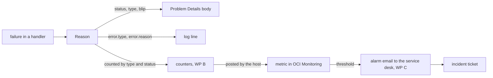

# 402 Server error handling: design

The design for
[delphside/tile-lite-elite#402](https://github.com/delphside/tile-lite-elite/issues/402)
*Server error handling*. It applies the programme's error scheme
([1.10 *Errors: one scheme for every system*](../../../../../../docs/1.10-development-standards.md#errors-one-scheme-for-every-system))
to Tile Lite Elite's server, client and admin CLI, and says how the server's
failures reach the owner. The requirements, R1 to R9, are in
[the issue's body](https://github.com/delphside/tile-lite-elite/issues/402#requirements).
In 1.10's terms, an error's *type* is *business* (the caller's request),
*technical* (a *blip*, which a retry may clear, or *fundamental*, which it
will not) or *unexpected* (a defect).

## What the owner is asked to approve

- **Two choices on cards of 2026-11-16**, which this design follows in their
  recommended form until they are answered: [Decisions](#decisions) 2 and 3.
  Decision 1 is answered.
- **Two choices this design makes**, decisions 4 and 5: the reason, not a URI,
  is the machine code, and the reason decides the status.
- **Four status changes on existing paths**, which make the API a minor:
  [401 against 403](#401-against-403).

## The work packages

| Package | Requirements | Route | Waits on |
| --- | --- | --- | --- |
| [delphside/tile-lite-elite#606](https://github.com/delphside/tile-lite-elite/issues/606) WP A: API errors to the scheme | R1, R2, R6 to R9, the correlation ID | Production Release | none |
| WP B: symptom counters | R3 | Production Release | WP A, whose classification it counts |
| WP C: alarms | R4, R5 | Other: the VM and the console | WP B, and [delphside/tile-lite-elite#224](https://github.com/delphside/tile-lite-elite/issues/224)'s `post-metric.sh` |

**R1's event types are 1.10's severities.** R1 names ITIL's *informational*,
*warning* and *exception*; 1.10, which R7 adopts, names the same three
*info*, *warning*, and *error* or *fatal*, and adds the type. This design uses
1.10's names, and #402's R1 is restated in them.



*Process diagram: one failure, classified once, read by the body, the log and
the counters (R1).*

## As-is

- **The status is chosen at each call site.** `ApiProblem`
  (`crates/server-game/src/app/error.rs`) has one constructor per status:
  `bad_request` (53 call sites), `not_found` (31), `unauthorized` (37),
  `forbidden` (7), `from_sqlx` (100) and five others. Nothing ties a refusal
  to its type. Nine refusals by the application's own rules answer 401.
- **The body is `ApiError { message, blocking_games }`**
  (`crates/api/src/lib.rs`), with no code. A client tells refusals apart only
  by status.
- **A 401 signs the player out.** The client treats a 401 on a request that
  carried a token as an expired session (`crates/ui/src/app.rs`, `request`),
  so a player who tries to change the seats of a game they did not create is
  told their session has expired.
- **Some responses are not an `ApiError`**: axum's own rejections (400, 415,
  422), the WebSocket's two refusals before the upgrade
  (`app/events.rs`, `game_events`), and a panic, which drops the connection
  because no layer catches it.
- **Some 500s carry a library's words**: `password hashing failed: {error}`
  (`auth.rs`) and `rate limiting failed: {other}` (`throttle.rs`).
- **Refusals are mostly not logged.** Database failures are, at `warn` and
  `error`, and a failed sign-in writes `login rejected` at `warn`
  ([4.4.7](https://github.com/delphside/tile-lite-elite/blob/main/docs/4.4.7-log-events.md)).
- **The admin CLI exits 1 for every failure**, 2 for clap's usage error and
  101 for a panic, and prints reqwest's text for a transport failure.
- **`check-api-errors.py` already gates the messages**: every message the API
  can construct is in 4.4.3, under its status where the row states one.

## The model: one reason classifies a failure (R1)

**A refusal names a `Reason`, and the reason decides everything else.** The
call site no longer chooses a status:

```rust
// crates/api: shared by the server, the client and the admin CLI
#[derive(Debug, Clone, Copy, PartialEq, Eq, Serialize, Deserialize)]
#[serde(rename_all = "SCREAMING_SNAKE_CASE")]
#[non_exhaustive]
pub enum Reason {
    SignInRequired,      // 401, technical, fundamental: no token
    SessionExpired,      // 401, technical, fundamental: a token, no session
    SignInFailed,        // 400, business: wrong User ID or password, one reason for both
    NotGameCreator,      // 403, business
    NotYourSeat,         // 403, business
    NotInGame,           // 403, business
    AdminLoopbackOnly,   // 403, business
    GameNotFound,        // 404, business
    DisplayNameTaken,    // 400, business
    MoveRefused,         // 400, business
    TooManyRequests,     // 429, technical, blip
    ServiceBusy,         // 503, technical, blip
    Internal,            // 500, unexpected
    // ... one per distinct refusal in 4.4.3's refusal tables
    #[serde(other)]
    Unknown,             // a reason a newer server sends; read by its status
}

impl Reason {
    pub const fn status(self) -> u16 { /* one match */ }
    pub const fn error_type(self) -> ErrorType { /* one match */ }
    pub const fn blip(self) -> bool { /* one match */ }
}
```

- **The match is the classification**, and the only one. The status code,
  the body, the log level and WP B's counters all read it.
- **A call site writes `ApiProblem::new(Reason::NotGameCreator, message)`.**
  The per-status constructors go, so a 401 for a rule's refusal can no longer
  be written. `from_sqlx` keeps its job: `ServiceBusy` for a pool timeout, a
  closed pool or a busy or locked database, `Internal` for anything else.
- **`ErrorType` is `Business`, `Technical` or `Unexpected`**, and `blip` is a
  separate flag, `false` for every reason that is not technical.
- **One reason per distinct refusal**, not per call site: the 23
  "Sign in to …"
  refusals are all `SignInRequired`, with their own messages, and the six
  "Session is invalid or has expired" are `SessionExpired`. A reason is stable
  and never reused once shipped. The estimate is 40 to 60 reasons.
- **The statuses are today's**, apart from the four changes under
  [401 against 403](#401-against-403). Every 4xx other than 401 and 429 is
  *business*, as RFC 9110 puts a 4xx with the caller.
- **The reason is in `crates/api`**, so the client and the admin CLI match on
  the same enum the server sends. `Unknown` keeps an older client working
  against a newer server: it falls back to the status, as today.
- **A game rule's refusal is `MoveRefused`**, carrying the rules engine's own
  sentence, because `game_state.rs` returns `Result<_, String>`. #71 Core
  (delphside/tile-lite-elite#268) replaces it with one reason per `ApplyError`
  variant ([Coordination with #71](#coordination-with-71)).

### Where the reasons are listed (R6)

**4.4.3 owns the reasons**, as the reference for the API:

- its status table gains a *Type* column;
- a new *Reasons* table lists each reason with its status, type and blip, what
  the caller does, and what is logged;
- every refusal row names its reason and states its status.

`check-api-errors.py` widens to match: each message is looked up with its
reason as well as its status, the *Reasons* table and the `Reason` enum must
agree both ways, row by row, and a row without a status fails rather than
being listed by `--unstated`.

R6's other three parts are each package's: what is counted is WP B's, and what
alarms and what the server does are WP C's, all as columns of the same
*Reasons* table.

## The body (R7)

**An error answers RFC 9457 Problem Details**, with content type
`application/problem+json`, the scheme's members as extensions, and the old
`message` beside `detail`:

```json
{
  "title": "Forbidden",
  "status": 403,
  "detail": "Only the game's creator can reorder seats.",
  "message": "Only the game's creator can reorder seats.",
  "outcome": "fatal",
  "error_type": "business",
  "blip": false,
  "reason": "NOT_GAME_CREATOR",
  "domain": "tile-lite-elite",
  "correlation_id": "7F3K9QWX2M4D"
}
```

| Member | Holds | Source |
| --- | --- | --- |
| `title` | the status's reason phrase | RFC 9457 |
| `status` | the HTTP status, repeated | RFC 9457 |
| `detail` | the sentence for the player: what happened and the next step | RFC 9457; 1.10's `message` |
| `message` | the same sentence, for clients built before this change | `ApiError` today |
| `outcome` | always `fatal`: a failed request is fatal to that request | 1.10 *The severity of an error* |
| `error_type`, `blip`, `reason`, `domain` | the classification; `blip` always present | 1.10 *The result object* |
| `violations` | for a value outside a stated limit: `field`, `value`, `limit`, `reason` | 1.10 *The result object* |
| `blocking_games` | the games standing in the way, as today | `ApiError` today |
| `correlation_id` | this request's ID | [The correlation ID](#the-correlation-id) |

- **1.10's `type` is sent as `error_type`**, because RFC 9457 owns `type`.
- **RFC 9457's `type` is left out**, so it is `about:blank`, and `title` is the
  status's phrase (RFC 9457 §4.2.1). The reason is the machine code. A type URI
  per reason, such as a `tag:` URI, would add a second code saying the same
  thing.
- **`cause` and `errors` are never sent**: every caller of the API is outside
  the programme, and an unexpected error's cause stays in the log.
- **`violations` is filled for the limits the API states**: a chat message
  over `MAX_CHAT_MESSAGE_LEN`, and a move time limit outside its range
  (`games.rs`). Its `limit` is the constant the check reads.
- **`message` stays for at least one release**, as 1.10 requires. Claude raises
  its removal as a requirement when WP A ships; removing it is an API major.
- **`ApiError` gains the new members with `#[serde(default)]`**, so the client
  still reads a body from an older server.

**The API version moves to 2.17**, a minor by
[4.3.3 §2.4.3](https://github.com/delphside/tile-lite-elite/blob/main/docs/4.3.3-testing-ci-and-release.md#243-decide-whether-the-api-version-moves):
every member is added, none removed or renamed, and the four status changes are
on paths that already exist.

## The correlation ID

**Every request gets an ID, and every error carries it**, as D60
([delphside/tile-lite-elite#446](https://github.com/delphside/tile-lite-elite/issues/446))
gave this project.

- **A middleware sets it before routing**: it drops any `x-request-id` the
  caller sent, makes 12 Crockford base32 characters from 60 random bits, short
  enough to read out, and sets it on the request and on the response, success
  included. A caller's own ID could be used to forge log lines, and nothing in
  front of the server sets one.
- **The request's task holds it** in a `tokio::task_local!`, because the log
  writes no span fields (`main.rs` sets `with_current_span(false)`). The lines
  that report an error read it from there as `request_id`: the new
  `request refused` line and the two database lines.
- **The body carries it** as `correlation_id`.
- **The client shows it on a 500 only** (decision 2): *Something went wrong on
  the server. It has been logged; quote reference 7F3K9QWX2M4D if you report
  it.*

## Every response is a result (R8)

**A panic answers 500** with the body, reason `INTERNAL`, through
`tower-http`'s `CatchPanicLayer`, whose handler logs the panic's message at
`error` and never sends it.

**axum's own rejections answer with the body.** A `map_response` layer,
inside the request-ID middleware, rewrites any error response that is not
already `application/problem+json`. Axum's words go to the log at `info`,
never to the caller, since they name serde's internals:

| Status from axum | Reason | Type |
| --- | --- | --- |
| 400 | `MALFORMED_REQUEST` | business |
| 404 | `NO_SUCH_ROUTE` | business |
| 405 | `METHOD_NOT_ALLOWED` | business |
| 413 | `BODY_TOO_LARGE` | business |
| 415 | `UNSUPPORTED_MEDIA_TYPE` | business |
| 422 | `INVALID_BODY` | business |
| any other | `INTERNAL`, answered as 500 and logged at `error` | unexpected |

**The WebSocket's refusals before the upgrade return `ApiProblem`**, split as
`resolve_viewer_access`'s `Rejected` is not today:

| Case | Reason |
| --- | --- |
| no such game, or a deleted one | `GameNotFound`, 404 |
| no token | `SignInRequired`, 401 |
| a token with no session | `SessionExpired`, 401 |
| signed in, not in the game, and not allowed to watch | `NotInGame`, 403 |

**A live WebSocket that fails closes with 4000 plus the status** it stands
for. Today it closes with no code.

| Case | Close code |
| --- | --- |
| sending fails for a reason of the server's | 4500 |
| its game is deleted under it | 4404, as Core reads a deleted game |
| the server stops | 1001, going away |

**The 500 sentence is stated once**, in the `Internal` row of 4.4.3, and
`error.rs` reads the same constant. It drops *please try again*, which told a
caller to loop on a defect. The 500s that carry a library's words take it too,
with the words moved to the log.

### 401 against 403

**401 is only "no valid credential"**: `SignInRequired` without a token,
`SessionExpired` with a token that names no session (unknown, expired, idle,
or a deleted player's). Every refusal by the application's own rules is 403.
The client has no token refresh, so 1.10's "refresh once on a 401" does not
apply: its first 401 is final.

The status changes, each a refusal on an existing path:

- **401 to 403, by the application's own rule** (nine call sites):
  - `roster.rs`: reorder seats, add, remove, force-resign and abort, each
    creator-only (`NotGameCreator`); withdraw, holder-only (`NotYourSeat`);
  - `invitations.rs`: inviting to another's game (`NotGameCreator`), and
    accepting an invitation not sent to you;
  - `events.rs`: signed in but not in the game (`NotInGame`).
- **401 to 401 or 403, split**: the WebSocket's refusal, above.
- **403 to 401, no session**: starting a game and asking for a suggestion
  answer 403 to a caller with no session today; they answer
  `SignInRequired`.
- **400 to 403**: removing a game from your list when you are not in it
  (`NotInGame`).

The client signs out only on 401, so a player refused something now sees the
refusal and stays signed in.

## Logs (R1, R6)

**Every error response writes one line, `request refused`**, from
`ApiProblem::into_response`, at the level 1.10 sets for a request: `info` for
*business*, `warn` for *technical*, `error` for *unexpected*. Its fields are
`status`, `error.type`, `error.reason`, `error.domain` and `request_id`. It
joins 4.4.7's catalogue and `check-log-hygiene.py`'s schema, as does
`request_id` on the two database lines.

- **The `error.` prefix is OpenTelemetry's**, and keeps the new fields apart
  from `login rejected`'s existing `reason`.
- **`login rejected` stays at `warn`**, as the audit line for repeated failed
  sign-ins, beside its `request refused` at `info`.
- **The volume is small.** A refusal is a player's action that failed, or a
  signed-out tab's first read. The client's one poll, the games list every
  10 seconds (`GAME_LIST_POLL_MS`), runs only while it holds a session, and its
  first 401 ends the session. #606's T9 measures the growth against the
  journal's cap
  ([3.1.2](../../../../3.1.2-artefacts.md)).

## The client and the admin CLI

**The client reads `detail`, then `message`**, so it works against either
server. It still decides what to do from the status alone.

**The admin CLI exits by the reason's type (R9)**, translating the server's
answer as 1.10 asks of a client:

| Answer | Exit |
| --- | --- |
| a *business* reason, other than `AdminLoopbackOnly` | `1` |
| a *technical, fundamental* reason, and `AdminLoopbackOnly`, which for the CLI is a setting at fault | `2` |
| a *technical, blip* reason, or a refused or timed-out connection | `75` |
| an *unexpected* reason, a body it cannot parse, or a panic | `70` |
| a usage error from clap | `64` |

It prints the body's `detail`, never reqwest's text; with `--json` it prints
the error's body to stdout, as it prints a success's. A panic is caught in
`main` and exits 70 rather than 101. Its `--help` lists the statuses.

## What the server does about a failure (R5)

**R5's automatic actions already exist; none is new here.** Each is ITIL's
*workaround*: it restores service and leaves the cause open.

| Failure | Action | Where it is set |
| --- | --- | --- |
| the caller asks too often | answer 429 with `Retry-After` | `throttle.rs` |
| everyone together asks for more than there is room for | answer 503 with `Retry-After` | `throttle.rs`, `auth.rs` |
| the server is unreachable | the client retries after 700 ms, then reconnects every 3 seconds | `crates/ui/src/app.rs` |
| the container exits | Docker restarts it | `restart: unless-stopped`, `docker-compose.yml` |

**What R5 owes is that each workaround is seen**, and WP C carries it:

- WP B counts each one: 429s, 503s, panics, and the process's start time,
  which shows a restart.
- WP C alarms on them, and sends the alarm email to the service desk's
  address, so intake raises the incident's ticket itself
  ([1.8](../../../../../../docs/1.8-service-desk.md#how-a-request-arrives)).
- The owner handles it as 1.8's incident rule says; an incident that recurs is
  a problem, with a row in the problem register
  ([1.4](../../../../../../docs/1.4-programme-activities.md#the-problem-register)).
  A problem closed without resolution, R5's accepted known error, says so in
  its row's *Initiative*.

**The server takes no new action on its own.** Restarting a component from
inside the process, or degrading a feature, would be a design of its own, and
no failure seen so far has needed one.

## WP B and WP C, in outline

Claude designs each fully when it reaches Design and Test Approach; this fixes
only what WP A must leave room for.

- **WP B exposes counters on a loopback endpoint**, `GET /admin/metrics`,
  beside `/admin/scheduler-health`
  ([delphside/tile-lite-elite#400](https://github.com/delphside/tile-lite-elite/issues/400))
  and in the same JSON shape, so one reporting pattern serves both. It counts
  responses by status class and by `error_type`, 429s apart from 503s, panics,
  WebSocket handshake failures and request latency in fixed buckets, and
  reports the process's start time. The counters are cumulative from start, so
  the poller computes the rate.
- **WP C extends #224's `post-metric.sh`**
  ([delphside/tile-lite-elite#608](https://github.com/delphside/tile-lite-elite/issues/608))
  to read `/admin/metrics` on the VM and post the rates to Oracle Cloud
  Infrastructure (OCI) Monitoring under the instance principal. The owner
  creates the alarms in the console. The application holds no OCI credential
  (D49). The thresholds come from the capacity plan
  ([delphside/tile-lite-elite#291](https://github.com/delphside/tile-lite-elite/issues/291))
  once WP B's numbers have been read for a week.

## Coordination with #71

#71 Core (delphside/tile-lite-elite#268) designed an `ErrorDto`
(`71-05b-wire-types.md`, *The error body, shared by every endpoint*, D65). Under
decision 1, **this design supplies that body**, and #268's section links
here. Core needs three things of it, all met:

| Core needs | Met by |
| --- | --- |
| a stable code per refusal, for `ApplyError`'s variants and the sender check | `Reason`: #268 adds one variant per `ApplyError` variant, replacing `MoveRefused` |
| a failed save, `SubmitError::NotSaved`, reads as a retryable blip | `ServiceBusy`: 503, *technical*, blip, with `Retry-After` |
| a message to a deleted game reads as a 404 | `GameNotFound`, whether the game never existed or was deleted |

`IllegalMove`'s `MoveError` detail, which the player sees, is the `detail`
sentence.

## Non-functional design

- **Capacity**: none, because the change adds one log line per refusal and
  one short ID per request; T9 measures the log's growth on rehearsal.
- **Failure**: a panic answers 500 instead of dropping the connection. A body
  that fails to serialise, the one failure inside the error path, falls back
  to a fixed `application/problem+json` string, tested.
- **Limits and timeouts**: none, because no limit or timeout changes. The ID's
  60 bits make a collision likely only after about a billion requests, against
  the service's few thousand a day.
- **Secrets and access**: the body never carries a driver's, axum's, a
  library's or a panic's words; the correlation ID is random and names
  nothing; `cause` is never sent. Answers kept vague for security stay vague:
  every failed sign-in is `SIGN_IN_FAILED`, and a password-reset request still
  answers 204.

## Decisions

| # | Decision | State |
| --- | --- | --- |
| 1 | #402 delivers the error body before 1.0.0, and #268 adopts it, superseding D65's sketch. | the owner, on his card of 2026-11-16 |
| 2 | The client shows the correlation ID on a 500 only. | the owner's card of 2026-11-16, open |
| 3 | Three work packages; R5 by 1.8's incidents and the problem register. | the owner's card of 2026-11-16, open |
| 4 | RFC 9457's `type` is left out; the reason is the machine code. | this design, for the owner's approval |
| 5 | The reason decides the status, and the per-status constructors go. | this design, for the owner's approval |
