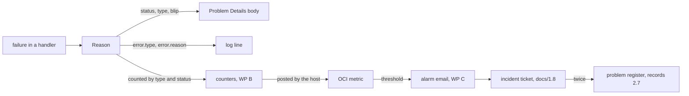

# 402 Server error handling: design

The design for
[delphside/tile-lite-elite#402](https://github.com/delphside/tile-lite-elite/issues/402)
*Server error handling*. It applies the programme's error scheme
([1.10 *Errors: one scheme for every system*](../../../../../docs/1.10-development-standards.md#errors-one-scheme-for-every-system))
to Tile Lite Elite's server, client and admin CLI, and says how the server's
failures reach the owner. The requirements, R1 to R9, are in the issue's body.

## The work packages

| Package | Requirements | Route | Waits on |
| --- | --- | --- | --- |
| WP A: API errors to the scheme | R1, R2, R6 to R9, the correlation id (D60) | Production Release | none |
| WP B: symptom counters | R3 | Production Release | WP A, whose classification it counts |
| WP C: alarms | R4 | Other: the VM and the console | WP B, and #224's `post-metric.sh` |

R5 has no package of its own: [What the server does about a failure](#what-the-server-does-about-a-failure)
answers it with the incident and problem records that already exist.



*Dynamic view: one failure, classified once and read four times (R1).*

## As-is

- **The status is chosen at each call site.** `ApiProblem`
  (`crates/server-game/src/app/error.rs`) has one constructor per status:
  `bad_request` (53 call sites), `not_found` (31), `unauthorized` (37),
  `forbidden` (7), `from_sqlx` (100) and five others. Nothing ties a refusal to
  its type, which is how about nine refusals by the application's own rules
  came to answer 401.
- **The body is `ApiError { message, blocking_games }`** (`crates/api/src/lib.rs`),
  with no code. A client tells refusals apart only by status.
- **A 401 signs the player out.** The client treats a 401 on a request that
  carried a token as an expired session (`crates/ui/src/app.rs`, `request`), so
  a player who is not a game's creator and opens its roster is told their
  session has expired.
- **Some responses are not an `ApiError`**: axum's own rejections (400, 415,
  422), the WebSocket's two refusals before the upgrade
  (`app/events.rs`, `game_events`), and a panic, which drops the connection
  because no layer catches it.
- **Business refusals are not logged.** Database failures are, at `warn` and
  `error` (4.4.7, `app/error.rs`).
- **The admin CLI exits 1 for every failure**, 2 for clap's usage error and 101
  for a panic, and prints reqwest's text.

The workstreams' review of 2026-11-14 has the file and line of each:
`notes/error-scheme/feedback-tle-application.md` in the project's files.

## The model: one reason classifies a failure (R1)

**A refusal names a `Reason`, and the reason decides everything else.** The
call site no longer chooses a status:

```rust
// crates/api: shared by the server, the client and the admin CLI
#[derive(Debug, Clone, Copy, PartialEq, Eq, Serialize, Deserialize)]
#[serde(rename_all = "SCREAMING_SNAKE_CASE")]
#[non_exhaustive]
pub enum Reason {
    SignInRequired,      // 401, technical, fundamental
    SessionExpired,      // 401, technical, fundamental
    NotGameCreator,      // 403, business
    NotYourSeat,         // 403, business
    GameNotFound,        // 404, business
    DisplayNameTaken,    // 409, business
    MoveRefused,         // 400, business
    TooManyRequests,     // 429, technical, blip
    ServiceBusy,         // 503, technical, blip
    Internal,            // 500, unexpected
    // ... one per row of 4.4.3's refusal tables
    #[serde(other)]
    Unknown,             // a reason a newer server sends; read by its status
}

impl Reason {
    pub const fn status(self) -> u16 { /* one match */ }
    pub const fn error_type(self) -> ErrorType { /* one match */ }
    pub const fn blip(self) -> bool { /* one match */ }
}
```

- **The match is the classification**, and it is the only one. The status code,
  the body, the log level and WP B's counters all read it, so they cannot
  disagree.
- **A call site writes `ApiProblem::new(Reason::NotGameCreator, message)`.** The
  per-status constructors go, so a 401 for a rule's refusal can no longer be
  written. `from_sqlx` keeps its job, and picks `ServiceBusy` or `Internal`.
- **The type is the scheme's**: `ErrorType` is `Business`, `Technical` or
  `Unexpected`, and `blip` is a separate flag, as in 1.10's result object.
- **One reason per distinct refusal**, not per call site: the 37 "Sign in to …"
  refusals are all `SignInRequired`, with their own messages. A reason is
  stable and never reused once shipped. The estimate is 40 to 60 reasons.
- **The reason belongs to `crates/api`**, so the client and the admin CLI match
  on the same enum the server sends. `Unknown` keeps an older client working
  against a newer server: it falls back to the status, as today.
- **A game rule's refusal** is `MoveRefused` for now, carrying the rules
  engine's own sentence as the message, because `game_state.rs` returns
  `Result<_, String>`. #71 Core (#268) replaces it with one reason per
  `ApplyError` variant ([Coordination with #71](#coordination-with-71)).

### Where the reasons are listed (R6)

**4.4.3 owns the reasons**, as the reference for the API. Its status table
gains a *Type* column, and a new *Reasons* table lists each reason with its
status, type and blip and the refusal rows that use it. Each refusal table
row (*What each Games call refuses, and why*, and its siblings) gains the
reason it answers. A unit test reads 4.4.3 and fails when a `Reason` variant is
missing from the table or a row names one that does not exist, so the list and
the enum cannot drift.

## The body (R7)

**An error answers RFC 9457 Problem Details**, with content type
`application/problem+json`, the scheme's members as extensions, and the old
`message` beside `detail`:

```json
{
  "title": "Forbidden",
  "status": 403,
  "detail": "Only the game's creator can change its players.",
  "message": "Only the game's creator can change its players.",
  "outcome": "fatal",
  "error_type": "business",
  "blip": false,
  "reason": "NOT_GAME_CREATOR",
  "domain": "tile-lite-elite",
  "correlation_id": "7F3K9QWX2M4D"
}
```

| Member | Holds | Source |
| --- | --- | --- |
| `title` | the status's reason phrase | RFC 9457 |
| `status` | the HTTP status, repeated | RFC 9457 |
| `detail` | the sentence for the player: what happened and the next step | RFC 9457; the scheme's `message` |
| `message` | the same sentence, kept for clients built before this change | `ApiError` today |
| `outcome` | always `fatal`: a failed request is fatal to that request | 1.10 *The severity of an error* |
| `error_type`, `blip`, `reason`, `domain` | the classification | 1.10 *The result object* |
| `violations` | for a refused value, one entry per value at fault: `field`, `value`, `limit`, `reason` | 1.10 *The result object* |
| `blocking_games` | the games standing in the way, as today | `ApiError` today |
| `correlation_id` | this request's id ([The correlation id](#the-correlation-id)) | D60 |

- **`type` is left out**, so it is `about:blank`, and `title` is the status's
  phrase, as RFC 9457 §4.2.1 asks. The reason, not a URI, is the machine code;
  a URI per reason would need a page per reason.
- **`cause` and `errors` are never sent.** Every caller of the API is outside
  the programme in the scheme's sense (a browser, the desktop client), and the
  cause of an unexpected error stays in the log.
- **`violations` is filled where a value broke a stated limit**: a display
  name or password too short or too long, a page size over its cap. Its `limit`
  is the same constant the check reads.
- **`message` stays for at least one release**, as 1.10 requires of an API
  moving to Problem Details. Removing it is a later requirement, raised when
  this ships, and it is an API major.
- **`ApiError` gains the new members with `#[serde(default)]`**, so the client
  still reads a body from an older server, and the server's tests still parse
  every body.

**The API version moves to 2.17**, a minor: every member is added, none is
removed or renamed, and the only status changes are the 401-to-403 fixes, which
docs/3.3's third row already counts as minor.

## The correlation id

**Every request gets an id, and every error carries it.** D60 gave it to this
project.

- **A layer sets it before routing**: `tower-http`'s `SetRequestIdLayer` with
  a generator of 12 Crockford base32 characters from 60 random bits, short
  enough for a player to read out. It is the response's `x-request-id` header
  on every response, success included.
- **The trace span carries it**, as `request_id`, so every log line of the
  request has it, the error's line among them.
- **The body carries it** as `correlation_id`.
- **A caller's own `x-request-id` is ignored**: an id a caller sets could be
  used to forge or flood log lines, and nothing upstream of the server sets one.

**Whether the client shows it is the owner's choice** (card, 2026-11-16). The
recommendation is to show it on a 500 only, as *Something went wrong on the
server. It has been logged: quote reference 7F3K9QWX2M4D if you report it.*

## Every response is a result (R8)

- **A panic answers 500** with the body, reason `INTERNAL`, through
  `tower-http`'s `CatchPanicLayer` and a handler that logs the panic's message
  at `error` and never sends it.
- **axum's own rejections answer with the body.** A `map_response` layer,
  outermost but for the request id, rewrites any error response that is not
  already `application/problem+json`: 400 `MALFORMED_REQUEST`, 404
  `NO_SUCH_ROUTE`, 405 `METHOD_NOT_ALLOWED`, 413 `BODY_TOO_LARGE`, 415
  `UNSUPPORTED_MEDIA_TYPE` and 422 `INVALID_BODY`, all *business*. Axum's own
  words go to the log at `info` and never to the caller, since they name
  serde's internals. Any other status that reaches the layer unconverted is a
  defect: it answers its own status, reason `INTERNAL`, and logs at `error`.
- **The WebSocket's refusals before the upgrade** return `ApiProblem`:
  `GameNotFound` (404) and `NotInGame` (403, today 401).
- **A live WebSocket that fails closes with 4000 plus the status** it stands
  for: 4500 when sending fails for a reason of the server's, 4404 when its game
  is deleted under it, as Core reads a deleted game, and 1001 (going away) when the server stops. Today it
  closes with no code.
- **The 500 sentence is stated once**, in the `Internal` reason's row of 4.4.3,
  and `error.rs` reads the same constant. It drops *please try again*, which
  told a caller to loop on a defect.

### 401 against 403

**401 is only "no valid credential"**: `SignInRequired` when the request
carried no token, `SessionExpired` when its token is unknown or expired. Every
refusal by the application's own rules is 403, *business*. The nine call
sites that answer 401 today become 403: the six creator-only roster calls
(`roster.rs`), inviting to someone else's game and accepting an invitation not
sent to you (`invitations.rs`), and the WebSocket's "not part of this game"
(`events.rs`). The client then stops signing out a player who was refused
something, since it signs out only on 401.

## Logs (R1, R6)

**Every error response writes one line, `request refused`**, from
`ApiProblem::into_response`, at the level 1.10 sets for a request: `info` for
*business*, `warn` for *technical*, `error` for *unexpected*. Its fields are
`status`, `error.type`, `error.reason` and `error.domain`, and the span's
`request_id`, with `player_id` where the handler knows it. It joins 4.4.7's
catalogue and `check-log-hygiene.py`'s schema.

- **The `error.` prefix is OpenTelemetry's**, and keeps the new fields apart
  from `login rejected`'s existing `reason`.
- **The database lines stay**, and gain `request_id` from the span: they carry
  the driver's words, which the refusal line must not.
- **The volume is small.** A refusal is a player's action that failed, or a
  signed-out tab's first read. The client's one poll, the games list every
  ten seconds (`GAME_LIST_POLL_MS`), runs only while it holds a session, and
  its first 401 ends the session. Rehearsal measures it
  (test approach, T9), against the journal's cap of 100 MB over 7 days, at
  51 MB on 2026-09-21.

## The client and the admin CLI

**The client reads `detail`, then `message`**, so it works against either
server. It still decides what to do from the status alone, so nothing else in
its error handling changes, and on 403 it now shows the refusal rather than
"your session has expired".

**The admin CLI exits by the scheme (R9)**, from the reason's type:

| Failure | Exit |
| --- | --- |
| a business refusal (4xx other than 401 and 429) | `1` |
| 401, or the server refusing the CLI's loopback address | `2` |
| 429, 502, 503, 504, connection refused or timed out | `75` |
| 500, a body it cannot parse, or a panic | `70` |
| a usage error from clap | `64` |

It prints the body's `detail`, never reqwest's text, and with `--json` it
prints the error's body to stdout, as it prints a success's. A panic is caught
in `main` and exits 70 rather than 101. None of its commands answers a
question, so it has no *no*.

## What the server does about a failure

**R5's automatic actions already exist, and none is new here.** The client
retries a blip after `Retry-After`; the throttle sheds load with 429 and the
capacity guard with 503; Docker restarts a container that exits
(`restart: unless-stopped`, `docker-compose.yml`). Each is ITIL's
*workaround*: it restores service and leaves the cause open.

**What R5 owes is that a workaround is seen.** WP B counts each one (429s,
503s, panics, and the process's start time, which reveals a restart), WP C
alarms on them, and an alarm email is an incident: the owner opens a ticket of
category `Incident` ([1.8](../../../../../docs/1.8-service-desk.md)). An
incident that recurs is a problem with a row in the problem register
([2.7](../../../../../records/2.7-improvement-registers.md#the-problem-register)),
carried to a fix or accepted as a known error. So a problem record needs no new
issue type: 2.7 is the known error database at this size.

**The server takes no new action on its own.** Restarting a component from
inside the process, or degrading a feature, would be a design of its own, and
no failure seen so far has needed one.

## WP B and WP C, in outline

Each is designed fully when it reaches Design and Test Approach; this fixes
only what WP A must leave room for.

- **WP B exposes counters on a loopback endpoint**, `GET /admin/metrics`,
  beside `/admin/scheduler-health` (#400) and in the same JSON shape, so one
  reporting pattern serves both (#166's *exposed, not emailed*). It counts
  responses by status and by `error_type`, 429s apart from 503s, panics,
  WebSocket handshake failures, and request latency in fixed buckets; it
  reports the process's start time. The counters are cumulative from start, so
  the poller computes the rate.
- **WP C extends #224's `post-metric.sh`** to read `/admin/metrics` on the VM
  and post the rates to OCI Monitoring under the instance principal, and
  creates the alarms in the console. The application holds no OCI credential
  (D49). Its thresholds come from the capacity plan (#291) once WP B's numbers
  have been read for a week.

## Coordination with #71

#71 Core (#268) designed an `ErrorDto` (`71-05b-wire-types.md`, *The error
body*, D65). **This design supplies that body**, if the owner agrees on his
card of 2026-11-16, and #268's section then links here. Core needs three things
of it, all met:

| Core needs | Met by |
| --- | --- |
| a stable code per refusal, for `ApplyError`'s variants and the sender check | `Reason`: #268 adds one variant per `ApplyError` variant, replacing `MoveRefused` |
| a failed save (`SubmitError::NotSaved`) reads as a retryable blip | `ServiceBusy`: 503, *technical*, blip, with `Retry-After` |
| a message to a deleted game reads as a 404 | `GameNotFound`, whether the game never existed or was deleted |

`IllegalMove`'s `MoveError` detail, which the player sees, is the `detail`
sentence; a move that breaks a numeric limit may add `violations`.

## Non-functional design

- **Capacity**: none, because the change adds one log line per refusal and one
  short id per request; T9 measures the log's growth on rehearsal.
- **Failure**: a panic now answers 500 instead of dropping the connection; a
  body that fails to serialise, the one failure inside the error path, falls
  back to a fixed `application/problem+json` string, tested.
- **Limits and timeouts**: none, because no limit or timeout is added or
  changed. The id's 12 characters come from 60 bits, enough that two ids
  collide once in about a billion requests, against the service's few thousand
  a day.
- **Secrets and access**: the body never carries a driver's, axum's or a
  panic's words; the correlation id is random and names nothing; `cause` is
  never sent. The answers kept vague for security stay vague: every failed
  sign-in is one reason, `SIGN_IN_FAILED`, and a password-reset request still
  answers 204.

## Decisions

| # | Decision | Answered |
| --- | --- | --- |
| 1 | #402 delivers the error body before 1.0.0, and #268 adopts it (supersedes D65's sketch) | owner's card, 2026-11-16 |
| 2 | the client shows the correlation id on a 500 | owner's card, 2026-11-16 |
| 3 | three work packages; R5 by 1.8's incidents and 2.7's problem register | owner's card, 2026-11-16 |
| 4 | `type` left out (`about:blank`); the reason is the machine code | this design |
| 5 | the reason decides the status, and the per-status constructors go | this design |
