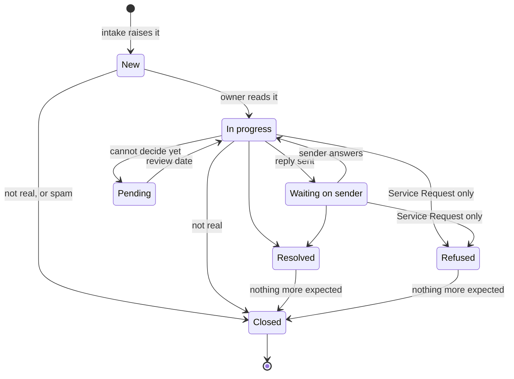

# 1.8 Service desk

The programme has one *service desk*, shared by every application: the single
point of contact for players and anyone else who needs help. The practice is
ITIL's service desk, with incident management and service request management
behind it, run by one person, the owner.

## How a request arrives

- **Email.** Anything sent to `support@mail.tileliteelite.com` reaches the
  desk. The address works without access to any application.
- **Replies to an application's own email.** Each application sets the
  support address as the Reply-To of every email it sends, so a reply reaches
  the desk.
- **From inside an application.** An application that offers an in-app way to
  raise a request sends an email to the same address. Each application's
  documents describe its own.

## What a Ticket is

Each request is a *Ticket*: an issue of the organisation's `Ticket` type
([1.6](1.6-github-project-board.md#what-is-held-in-github)) in the private
`delphside/service-desk` repository. The repository is private because a
Ticket holds personal details, and the programme's other repositories are
public.

The desk's intake workflow collects new mail every 30 minutes. An
application's mail poller, a job that checks the mail provider for new mail,
also starts the workflow when mail arrives (Tile Lite Elite's server checks
every 60 seconds). Each message raises a Ticket, with two exceptions:

- a follow-up, a message from the sender about an existing Ticket, joins it
  ([*Follow-ups*](#acknowledging-and-answering));
- mail from the desk's own address is skipped.

GitHub's notification tells the owner. Intake also adds each new Ticket to the
programme's board ([*Running the desk*](#running-the-desk)).

The intake workflow fills `Sender email` with the sender's address. The owner
sets `Ticket Kind` on reading the Ticket:

| Kind | Meaning, in ITIL's terms |
| --- | --- |
| `Incident` | something is not working as it should |
| `Service Request` | a request for something normal, such as an address change or closing an account |
| `Complaint` | dissatisfaction, including with another player's behaviour |

The intake workflow sets three labels:

- `unverified`: the sender's address failed the Domain-based Message
  Authentication, Reporting and Conformance (DMARC) check, or the mail provider
  gave no authentication result or no readable sender, so it may be forged.
- `spam`: the mail provider's spam or virus check flagged the message.
- `automated`: a bounce, an auto-reply or list mail.

## Acknowledging and answering

- **Acknowledgement.** Mail that raises a new Ticket gets one email quoting the
  Ticket's reference, for example "Ticket 12", saying that a reply adds to it,
  when the mail is:
  - verified;
  - neither spam nor automated;
  - less than 24 hours old.

  A sender gets at most one acknowledgement a day, and the intake workflow
  sends at most 20 a day in all. Setting the repository variable
  `DESK_ACKNOWLEDGE` to `off`, or to anything but `on` or empty, turns
  acknowledgements off.
- **Follow-ups.** A message joins a Ticket when it:
  - comes from the Ticket's sender, with the reference in its subject;
  - is verified;
  - is neither spam nor automated.

  Anything else raises a Ticket of its own.
- **Answering.** The owner answers by commenting on the Ticket. The desk's
  reply workflow emails a comment to the sender at once, from the support
  address, when:
  - its first word is `reply`, in any case and with or without punctuation
    after it;
  - its author is the owner, a member of the organisation or a collaborator on
    the repository;
  - its author's account is a person's, not a bot's.

  Every other comment is an internal note, so a note never starts with that
  word.
- **Unverified senders.** A `reply` comment on an `unverified` Ticket still goes
  to the address in its From line, which may be forged. Before replying, the
  owner treats that sender as unconfirmed and leaves out anything personal.

## A Ticket's state

`Ticket State` follows ITIL's common status model for incidents and requests.
Every kind uses the same field and some of its states. A Ticket is *not real*
when no genuine request lies behind it.

| State | Meaning | Incident | Service Request | Complaint |
| --- | --- | --- | --- | --- |
| `New` | not yet read | yes | yes | yes |
| `In progress` | being worked on, or the sender has just answered | yes | yes | yes |
| `Waiting on sender` | a reply has gone to the sender | yes | yes | yes |
| `Pending` | cannot be decided yet; the Ticket's last note gives a review date | yes | no | no |
| `Resolved` | answered, fixed or a Requirement raised | yes | yes | yes |
| `Refused` | the request is declined, and the sender has been told | no | yes | no |
| `Closed` | nothing further, including a Ticket that is not real or is spam | yes | yes | yes |

The diagram draws the usual path. The desk's two workflows make three moves:

- the intake workflow starts a new Ticket at `New`;
- the intake workflow sets `In progress`, from any state, when a sender's
  answer joins a Ticket, and reopens a closed Ticket;
- the reply workflow sets `Waiting on sender`, from any state, when it sends a
  `reply`, and reopens a closed Ticket, so the board shows it.

The owner makes every other move. After a reply that answers the Ticket, the
owner sets `Resolved`, because the workflows cannot tell an answer from a
question.

- **Incident.** The owner takes the first case that fits:
  - it matches a problem in the problem register
    ([2.7](../records/2.7-improvement-registers.md#the-problem-register)):
    link the problem and reply with what is known;
  - it is a defect: it needs a change
    ([When a Ticket needs a change](#when-a-ticket-needs-a-change)), and the
    owner sets `Resolved` once the Requirement is raised;
  - it is not real: set `Closed`;
  - it cannot be decided yet: set `Pending` with a review date, and look again
    on that date.

  An incident that recurs is a problem, and has a row in the problem
  register.
- **Service Request.** Ask for anything missing, then do it and set
  `Resolved`, or decline it and set `Refused`.
- **Complaint.** Take any account action first, then reply and set `Resolved`.

## When a Ticket needs a change

When the owner decides that a Ticket needs a change and says so, Claude raises a
Requirement in the application's repository, worded in general terms with no
personal details, and adds a link to it on the Ticket. The Ticket stays in the
desk, and the Requirement goes through triage like any other.

## Closing a Ticket

Only the owner closes a Ticket, and closing the issue and setting `Closed` are
done together:

- after `Resolved` or `Refused`, once nothing more is expected;
- at once, for a Ticket that is not real or is spam.

`spam` and `automated` Tickets wait for the owner like any other.

## Running the desk

The desk's code and workflows are in `delphside/service-desk`, whose README
introduces them.

- **A sent reply gets a rocket reaction** on its comment. With no rocket, the
  failed run says why. An error naming `/reactions` means the email went and
  the run stopped after it, so the owner does not post the comment again, and
  reopens the Ticket and sets `Waiting on sender` by hand; any other error
  means the send failed, and the owner posts it again. A Ticket the reply
  cannot reopen costs one log line.
- **Intake adds each new Ticket to the board** when the repository variable
  `DESK_BOARD_ID` holds the board's node ID, the programme's `board.project_id`;
  unset, it adds nothing. It needs the secret `DESK_ORG_TOKEN` as well, because
  a workflow's own token cannot write to an organisation's board: a
  fine-grained token owned by the organisation, with Projects and Issues read
  and write. The calls that set Ticket fields use it too, and the workflow's
  token when it is unset. The programme's board sweep uses the same token as
  `BOARD_TOKEN`. A Ticket that intake fails to add costs one log line, and the
  owner adds it by hand.
- **The first intake run records every message the mail provider still
  holds**, about 30 days of mail, and acknowledges only those under 24 hours
  old.
- **The tests** run with `python3 -m unittest discover -s desk` and use no
  network.

## Design notes

- One desk serves the whole programme, not one per application, so there is
  one inbox to watch.
- Mail is collected every 30 minutes because GitHub Actions minutes are
  limited: anything more often would use more than the free plan's 2,000 a
  month. GitHub does not run a schedule reliably, so an application's poller
  starts the workflow as well.
