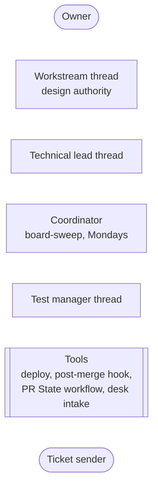
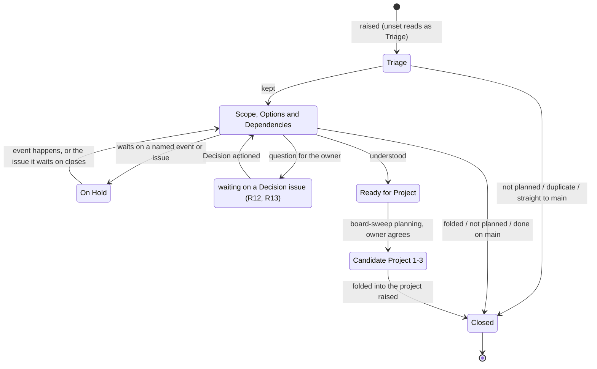
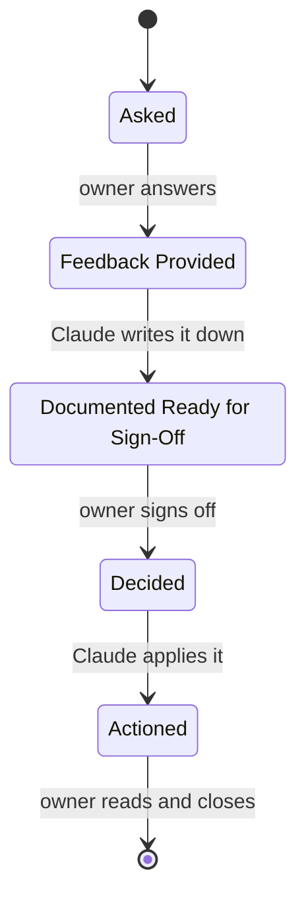
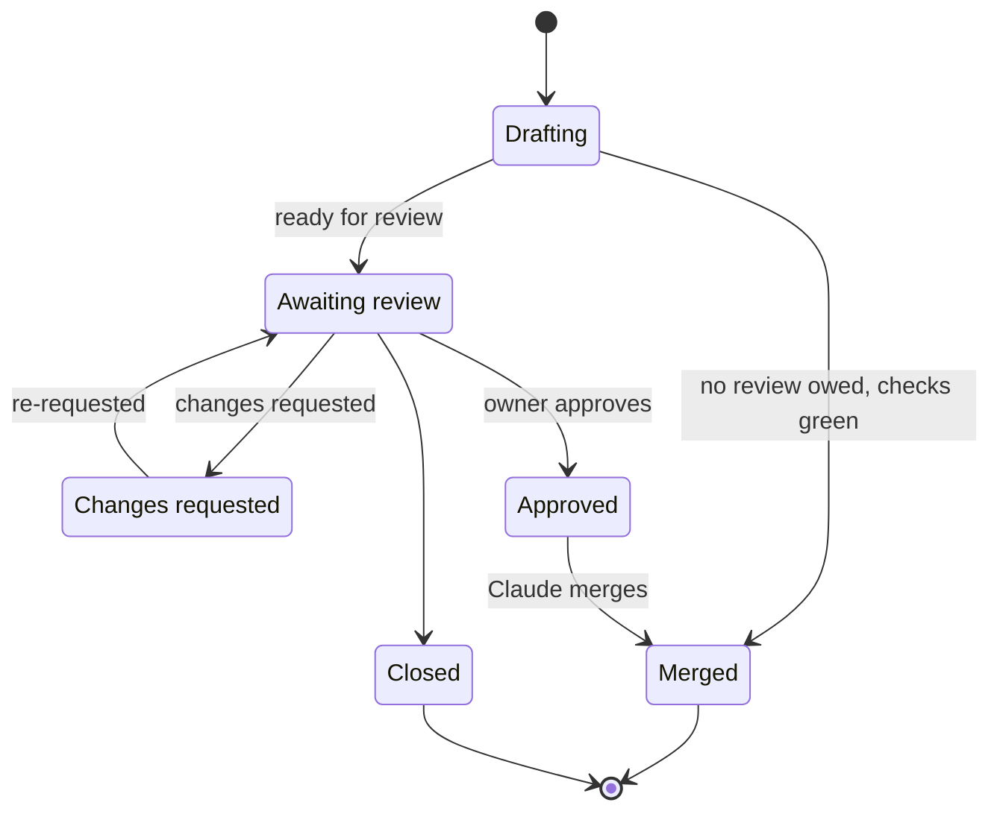
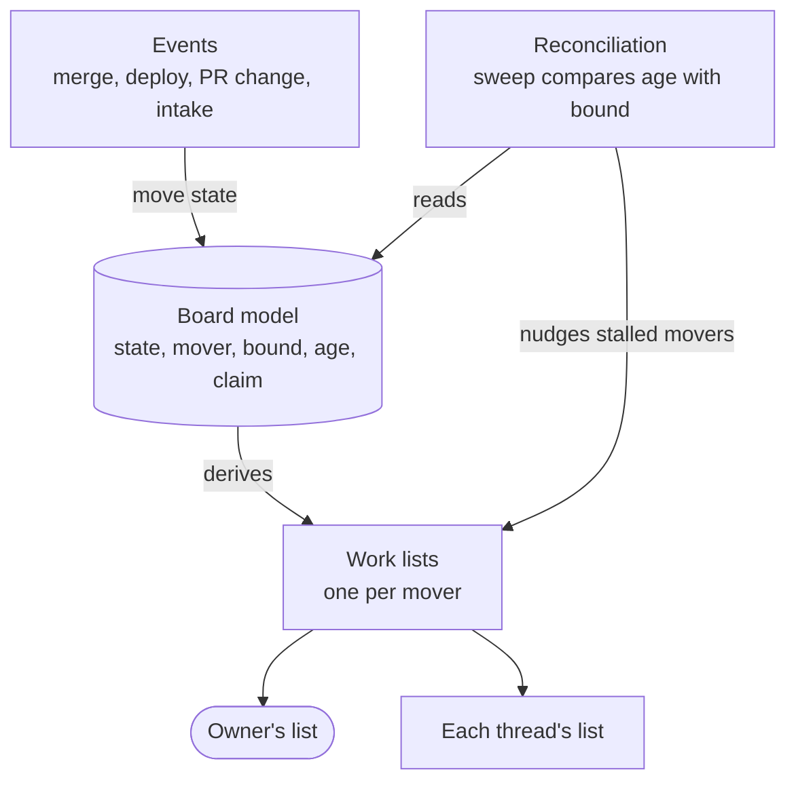

# 176 Project Board flow: the technology-agnostic model

**Draft for the owner's review.** The design step 2 of
delphside/programme#176: one state machine per issue type, each move with its
guard, mover, trigger and bound, before any choice of how it is built. It
starts from what the board model already encodes (`scripts/board/model.py`,
`turn.py`, `obligations.py`) and marks what is missing against R1 to R14. The
requirements are in the issue body, not repeated here.

The questions in [Open questions](#open-questions) come to the owner as
cards, in the order the programme answers decisions.

## The vocabulary

The model's words come from Kanban and ITIL (R6) where they have one.

| Word | Means | From |
| --- | --- | --- |
| **mover** | who makes an item's next move: the owner, a role's thread, or a tool | Kanban *pull*: the one who pulls it |
| **trigger** | what starts the move: an event, a schedule, or a person's action | ITIL value stream *trigger* |
| **guard** | what must be true before the move is allowed | state machine guard |
| **bound** | how long an item may sit in a state before somebody is told | Kanban *service level expectation* |
| **age** | how long an item has been in its current state | Kanban *work item age* |
| **stalled** | age past bound, or a mover that is not running | — |
| **resting** | a state where the item legitimately waits on something named, with no move owed by its holder | R13 |
| **claim** | a record of who is working an item now, so nobody else starts it | job-queue *lease* |

## The actors

| Actor | Moves | Runs when |
| --- | --- | --- |
| owner | joint triage, approvals, answers, user tests, reviews of application changes | when told, in the chat |
| workstream thread (design authority) | requirements; a project at `Scope` and `Design and Test Approach`; a parent's later phases | while its thread runs |
| technical lead thread | a work package from `Development` to closing | while its thread runs |
| coordinator | queue planning (`Ready for Project`, candidates, `Q3` to `Q1`), pulling `Q1` into design, nudging stalled threads | the weekly `board-sweep`, and when prompted |
| test manager thread | test approval before design ends; regression check before a release | on call, started by the coordinator |
| tools | PR State; `Post-deployment` on deploy; a local merge's post-merge move | on their event |

## Requirement

| State | Mover | Owes | Leaves on | Bound | Encoded today |
| --- | --- | --- | --- | --- | --- |
| unset / `Triage` | workstream thread; owner first where triage is joint | the minimum fields, then an outcome | the thread's action, at raising (R10) | 1 day: R10 says at once | unset read as `Triage`; `board-stage.py` writes it (TLE only) |
| `Scope, Options and Dependencies` | workstream thread | options, dependencies, a recommendation | the thread's action | 7 days (R11) | nothing reports age |
| waiting on a `Decision` | owner, through the Decision's own machine | — (resting) | the Decision reaching `Actioned` | the Decision's own bounds | not a value; the Decision is listed, not the requirement |
| `On Hold` | nobody, until its trigger | — (resting) | the named event, or the issue it waits on closing | a review at each sweep that its reason still holds | the value only; reason is prose |
| `Ready for Project` | coordinator | a slot at planning | `board-sweep` planning; owner agrees | none: a queue meant to have a length | the value only |
| `Candidate Project 1-3` | coordinator | raise the project when 1 is next | `board-sweep` planning | none for 2 and 3; slot 1 one sweep | the value only |
| closed | — | — | — | — | GitHub state reason, `folded` label |

R13 names ten resting states. Seven map onto the machine above: the three
closed reasons and *folded* are closed; the two kinds of `On Hold` are one
value, told apart by whether the dependency section links an issue; *waiting
for project planning* is `Ready for Project` and the candidates. The other
three are a label rather than a state: *waiting on a `Decision`* is a
dependency link to it, and *waiting on the owner's approval of its scope* and
*of its project scoping* carry `needs owner approval`
([question 2](#open-questions)).

## Project

```mermaid
stateDiagram-v2
    [*] --> Scope: raised (raise-project skill)
    Scope --> Queue: design authority, scope done
    Queue --> Design: board-sweep pulls Q1 (owner agrees)
    Scope --> Design: owner agrees directly
    Design --> Development: design authority; test approach approved
    Development --> UserTesting: test deploy of the branch tip
    UserTesting --> Deployment: tests pass; merge
    Development --> PostDeployment: tooling route, merge
    Deployment --> PostDeployment: deploy ships it
    PostDeployment --> Closedown: review done
    Closedown --> [*]: lessons to the digest, closed

    state "Q3 / Q2 / Q1" as Queue
    state "Design and Test Approach" as Design
    state "User testing" as UserTesting
    state "Post-deployment" as PostDeployment
    state "Project Closedown" as Closedown
```

A parent runs `Scope` to `Design and Test Approach`, then rests while its work
packages run, and returns for `Post-deployment` (where a requirement needs it)
and `Project Closedown`.

| State | Mover | Leaves on | Bound | Encoded today |
| --- | --- | --- | --- | --- |
| `Scope` | design authority | its action; owner agrees the next move | 7 days | `obligations.py` checks the headings |
| `Q3` to `Q1` | coordinator | `board-sweep` planning | none: a queue | the sweep's rule, in prose only |
| `Design and Test Approach` | design authority; test manager approves; owner answers `Design` boxes | design done and test approach approved | 7 days without a move | `DUE_SECTIONS` lists his `Design` boxes |
| `Development` | technical lead | first test deploy, or merge | 7 days without a commit | nothing |
| `User testing` | owner (browser tests); technical lead (rehearsal) | tests ticked | 7 days | `waiting_on_owner` lists unticked browser tests |
| `Deployment` | technical lead; release manager | the deploy | none: waits for the release | nothing; `Release Check` label marks a wait |
| `Post-deployment` | technical lead | the review, after 7 days | 7 days, then due | `waiting_on_claude`, `REVIEW_DUE_DAYS` |
| `Project Closedown` | technical lead (parent: design authority) | lessons written, closed | 7 days | nothing |
| *parent waiting on its packages* | — (resting) | last package closes | its packages' bounds | not a value |

## Decision

The turn alternates and is the only machine fully encoded today
(`DECISION_TURNS`). Missing: a bound, and a starting state for a Decision
raised without one (R7). Bound: 7 days on each step, the owner's steps shown
with their age as now.

## Pull request

Derived from GitHub's own state by `board-pr-state.py`, never typed. Gaps: the
infrastructure repository has no PR State workflow (#383 R15), and a merge on
GitHub does not move the work package it delivers (#383 R13). A pull request
that owes no review is merged on green by its author thread, with no state
saying so. Bound: 7 days in any state.

## Ticket

`Ticket State`'s machine is ITIL's, owned by
[1.8](../../../../docs/1.8-service-desk.md#a-tickets-state) and not redrawn
here. For this model it needs only its mover per state (`New` and
`In progress`: owner; `Waiting on sender`: the sender; `Pending`: the review
date in its last note) and a bound per state, which 1.8 does not yet give.

## What runs the flow

Three mechanisms keep items moving. Which mix to use is design step 3; this
lists what each would need from the model.

- **R3**: every column in the tables above (mover, owes, trigger, bound)
  becomes data in the model, not prose in a document. Today only the Decision
  row is.
- **R8 and R9**: *stalled* is age past bound, or a claim whose thread has not
  moved the item within the bound. A claim names the thread working it, so a
  recovering sweep restarts only items with no live claim.
- **R7**: on each sweep, an item with no type is written as a Requirement, an
  item with no state gets its type's starting state, and a non-requirement with
  no workstream is raised with the owner.

## Gaps against the requirements

| Req | Gap today |
| --- | --- |
| R1 | a mover is encoded only for Decisions and a few project phases; requirements, Tickets and most phases have none in the model |
| R2 | no bound is encoded except `REVIEW_DUE_DAYS`; ages are read only for the owner's and Claude's lists |
| R3 | movers, triggers and bounds live in 1.2, 1.8 and habit |
| R4 | the model reads through GraphQL; cloud threads cannot run it (REST first agreed) |
| R5 | Tickets and pull requests are modelled; their bounds and movers are not |
| R7 | only a requirement's starting state is written, in one repository, and the write is refused |
| R8 | nothing finds a stalled item; recovery depends on the owner noticing |
| R9 | no claim exists; threads find each other's work by reading the chat |
| R10 | triage at raising is a habit, not checked |
| R11 | no age is reported for requirements |
| R12 | the sweep does not nudge threads by workstream |
| R13 | three of the ten resting states have no representation; the label answers two |
| R14 | `board-actions.py` shows none of the three; it is to list `needs owner approval` with its age |

## Open questions

In the programme's order: document structure, then functional, then
technical.

1. **Document structure.** Answered (owner, 2026-11-13): this file holds the
   model; the options and the technology choices follow in this folder as
   `options.md` and `implementation.md`. What stays true once shipped goes to
   1.2 (the machines) and 1.6 (the fields).
2. **Functional: how the three missing resting states show (R14).** Answered
   (owner, 2026-11-13): a label, `needs owner approval`, on the issue itself,
   with a board view that filters on it. It brings forward the real issue
   rather than a surrogate `Decision`, works on every type and repository,
   and adds any number of *waiting for approval* states without new columns.
   A comment on the issue says what is to be approved. The owner answers in a
   comment, and the issue's thread removes the label and moves it on.
   A specific question for the owner is a `Decision` issue, except during
   the first discussion, while he is engaged, when comments are enough
   (owner, 2026-11-13). This makes a third
   programme label, beside `folded` and `Release Check`, so 1.6's *everything
   else is a field* gains a reason, and R12's *a `Decision` issue for a wait on
   the owner* narrows to waits that are
   questions asked after that first discussion.
3. **Functional: the bounds.** Answered (owner, 2026-11-13): 7 days, one
   sweep, for every state where the owner or a thread owes a move, with the
   exceptions in the tables above: a day for triage, and none for the queues
   and `Deployment`.
4. **Functional: what a claim is (R9).** Answered (owner, 2026-11-13): a
   `Claimed by` issue field, a text field naming the **role** that holds the
   item and a link to the thread holding that role now. The role is the stable
   part, since threads end and are recreated: a thread taking over a role
   rewrites the link at handover, and a one-off thread claims in the name of
   the role it works for. A claim is stale once the item passes its bound with
   no move, and the sweep then offers it to the role's current thread. GitHub
   refuses issue fields on pull requests, so a pull request's claim is the
   thread that owns its branch.
