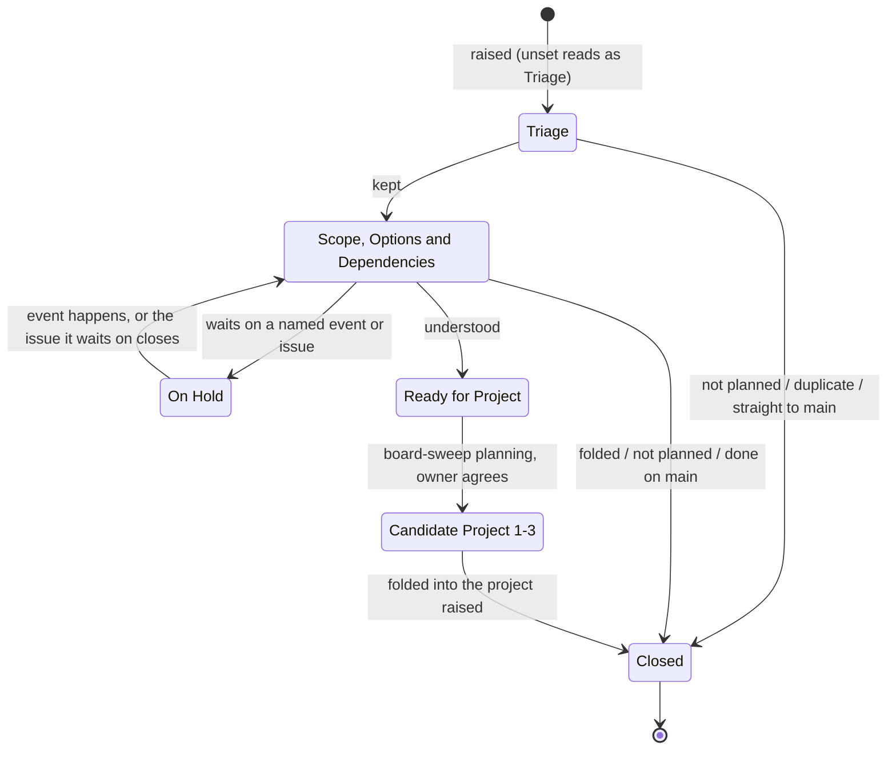
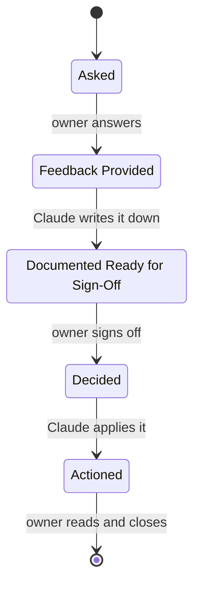
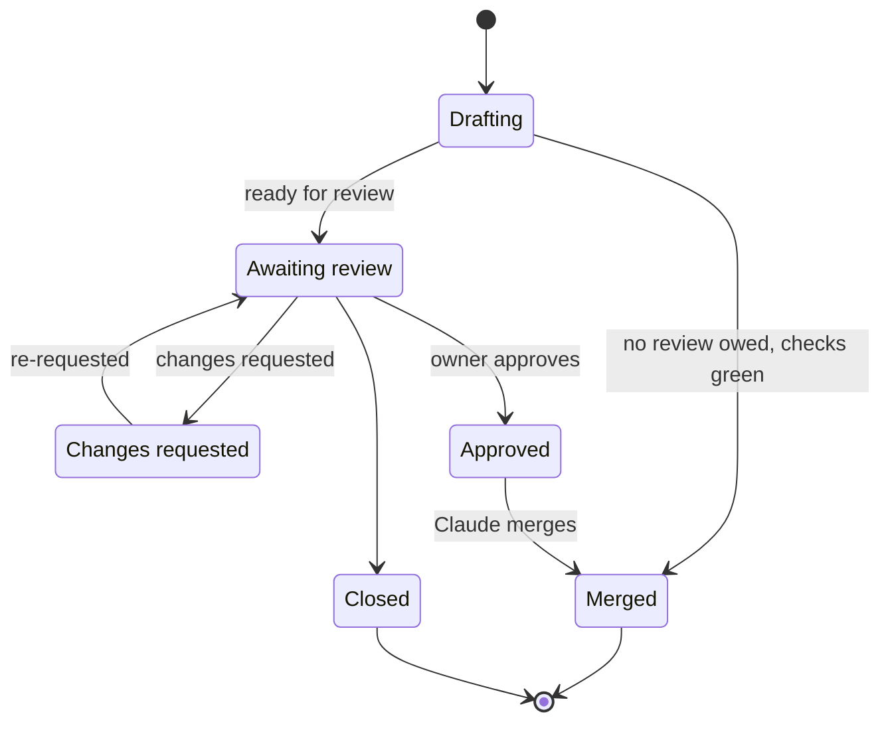
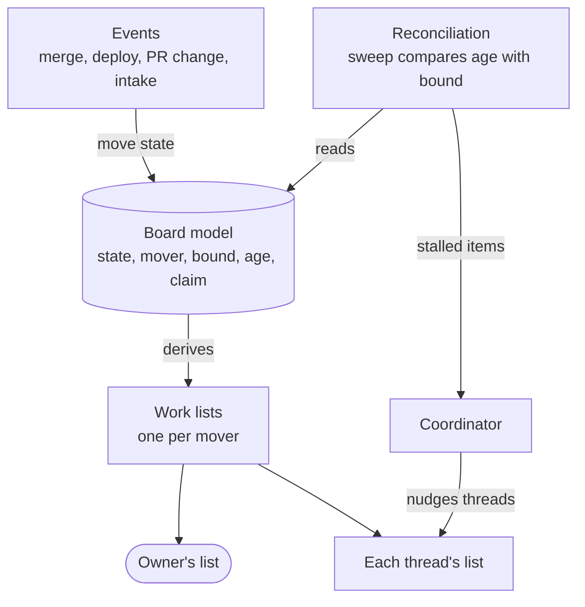

# 176 Project Board flow: the technology-agnostic model

Design step 2 of
[delphside/programme#176](https://github.com/delphside/programme/issues/176),
whose requirements R1 to R15 are in its body (R15's design is in
implementation.md's
[section 6](implementation.md#6-the-session-start-to-do-list-and-the-comment-check-r15)).
The four steps are the requirements, this model, the [options](options.md) for
keeping items moving, and the [technology choices](implementation.md). This
file gives one state machine per issue type, each state with its holder, what
it owes, what it leaves on and its bound, before any choice of how it is built.
It starts from what the board model already encodes (`scripts/board/model.py`,
`turn.py`, `obligations.py`) and marks what is missing against R1 to R14.

The [questions for the owner](#questions-for-the-owner) are answered, in the
order the programme answers decisions.

## The vocabulary

The model's words come from Kanban and ITIL (R6) where they have one.

| Word | Means | From |
| --- | --- | --- |
| *holder* | the one actor an item in a state has (R1): the mover of the move it owes or, where it rests, whoever reviews the wait. Anyone else with a part in the state sees it on their own list. | Kanban *pull*: the one who pulls it |
| *mover* | who makes an item's next move: the owner, a role's thread or a tool | Kanban *pull* |
| *trigger* | what starts the move: an event, a schedule or a person's action | ITIL value stream *trigger* |
| *flow table* | the table of holder, `Turn`, bound, what the state owes and what it leaves on, per type and state, held as data in the model and built in [implementation.md](implementation.md#1-the-flow-table-lives-in-the-board-model) | — |
| *bound* | how long an item may sit in a state before somebody is told | Kanban *service level expectation* |
| *age* | how long an item has been in its current state | Kanban *work item age* |
| *stalled* | age past bound, or a claim whose thread has not moved the item within the bound | — |
| *resting* | a state where the item legitimately waits on something named, with no move owed by its holder | R13 |
| *claim* | a record of who is working an item now, so nobody else starts it | job-queue *lease* |
| *turn* | the `Turn` issue field: `Owner`, `Claude` or `Hold`, whose move the item is | Kanban *pull* |

## The actors

| Actor | Moves | Runs when |
| --- | --- | --- |
| owner | joint triage, approvals, answers, user tests, reviews of application changes | when told, in the chat |
| workstream thread (design authority) | requirements; a project at `Scope` and `Design and Test Approach`; a parent's later phases | while its thread runs |
| technical lead thread | a work package from `Development` to closing | while its thread runs |
| coordinator | queue planning (`Ready for Project`, candidates, `Q3` to `Q1`) and pulling `Q1` into design at the weekly `board-sweep`; nudging stalled threads, or starting one, after the daily sweep | weekly, daily and when prompted |
| test manager thread | test approval before design ends; regression check before a release | on call, started by the coordinator |
| release manager thread | making a release: the milestone, the release record, the tag | when a release is due |
| tools | PR State; `Post-deployment` on deploy; a local merge's post-merge move; a Ticket set to `New` on intake | on their event |

## Requirement

A requirement waiting on a `Decision` has no state of its own: it stays at
`Scope, Options and Dependencies` with `Turn` = `Hold` and the `Decision`
linked under *Dependencies and related work*.

| State | Holder (R1) | Owes | Leaves on | Bound | Encoded today |
| --- | --- | --- | --- | --- | --- |
| unset / `Triage` | the workstream thread; where triage is joint, the owner (`Turn` = `Owner`) until his comment, then the thread again | the minimum fields, then an outcome | the thread's action, at raising (R10) | 1 day: R10 says at once | unset read as `Triage`; the stage workflow writes it (Tile Lite Elite's only) |
| `Scope, Options and Dependencies` | the workstream thread; while waiting on a `Decision` (`Turn` = `Hold`), the thread at the bound | options, dependencies, a recommendation | the thread's action | 7 days (R11) | nothing reports age |
| `On Hold` | the workstream thread, at the hold's review (`Turn` = `Hold`) | none: resting | the named event, or the issue it waits on closing | its review date | the value only; reason is prose |
| `Ready for Project` | coordinator | a slot at planning | `board-sweep` planning; owner agrees | none: a queue meant to have a length | the value only |
| `Candidate Project 1` | coordinator | raise the project, since it is next | `board-sweep` planning | 7 days: raising its project is a move owed, not a queue | the value only |
| `Candidate Project 2` and `3` | coordinator | a slot at planning | `board-sweep` planning | none: a queue | the value only |
| closed | none | none | none | none | GitHub state reason, `folded` label |

A requirement with no state is written `Triage`, as `model.py`'s
`stage_to_record` already does (owner, 2026-09-29).

### R13's resting states

R13 names ten resting states. Each is shown as follows.

| R13's resting state | Shown as |
| --- | --- |
| waiting on a `Decision` | `Scope, Options and Dependencies`, `Turn` = `Hold`, the `Decision` linked under *Dependencies and related work* |
| `On Hold`, waiting on a named event | `On Hold`, no issue linked, the event and its review date named |
| `On Hold`, dependent on another issue | `On Hold`, the issue linked under *Dependencies and related work* |
| closed as not planned | closed, state reason `not planned` |
| closed completed | closed, state reason `completed` |
| closed as a duplicate | closed, state reason `duplicate` |
| closed as folded into a project | closed, the `folded` label |
| waiting for project planning | `Ready for Project`, or a `Candidate Project` slot |
| waiting on the owner's approval of its scope | `Turn` = `Owner`, with a comment saying what is to be approved |
| waiting on the owner's approval of its project scoping | `Turn` = `Owner`, with a comment saying what is to be approved |

## Project

```mermaid
stateDiagram-v2
    [*] --> Scope: raised (raise-project skill)
    Scope --> Queue: design authority, scope done
    Queue --> Design: board-sweep pulls Q1 (owner agrees)
    Scope --> Design: owner agrees directly
    Design --> Development: design authority; test approach approved
    Development --> UserTesting: test deploy of the branch tip
    UserTesting --> Deployment: tests pass; merge
    Development --> PostDeployment: tooling route, merge
    Deployment --> PostDeployment: deploy ships it
    PostDeployment --> Closedown: review done
    Closedown --> [*]: lessons to the digest, closed

    state "Q3 / Q2 / Q1" as Queue
    state "Design and Test Approach" as Design
    state "User testing" as UserTesting
    state "Post-deployment" as PostDeployment
    state "Project Closedown" as Closedown
```

A parent runs `Scope` to `Design and Test Approach`, then rests there while any
of its work packages is open, its bound suspended until the last one closes. It
returns for `Post-deployment` (where a requirement needs it) and
`Project Closedown`.

| State | Holder (R1) | Leaves on | Bound | Encoded today |
| --- | --- | --- | --- | --- |
| `Scope` | design authority | its action; owner agrees the next move | 7 days | `obligations.py` checks the headings |
| `Q3` to `Q1` | coordinator | `board-sweep` planning | none: a queue | the sweep's rule, in prose only |
| `Design and Test Approach` | the design authority. Parts on their own lists: the test manager's approval, the owner's `Design` boxes. | design done and test approach approved | 7 days without a move | `DUE_SECTIONS` lists his `Design` boxes |
| `Development` | technical lead | first test deploy, or merge | 7 days without a commit. The age is that of the head commit of the package's open pull request; with none, the field's own age. | nothing |
| `User testing` | the technical lead. Part on the owner's list: unticked browser tests. | tests ticked | 7 days | `waiting_on_owner` lists unticked browser tests |
| `Deployment` | the technical lead, `Turn` = `Hold` with the release as its reason. Part on the release manager's list: making the release. | the deploy | none: waits for the release | nothing |
| `Post-deployment` | technical lead | the review, due after 7 days | 14 days: 7 days after the review fell due. A work package waiting for the next release carries the `Release Check` label (Tile Lite Elite's only), owes nobody a review and does not stall: it waits on the release, so its `Turn` = `Hold`. | `waiting_on_claude`, `REVIEW_DUE_DAYS`, `RELEASE_CHECK` |
| `Project Closedown` | technical lead (parent: design authority) | lessons written, closed | 7 days | nothing |

The sweep reads the closed release milestone of a deploy that `deploy.sh`
missed, and moves each open work package the milestone carries. It reads a merge
on GitHub that did not move its work package from the merged pull request's
`Refs #N`.

## Decision

The turn alternates and is the only machine fully encoded today
(`DECISION_TURNS`): `Asked`, `Documented Ready for Sign-Off` and `Actioned` are
the owner's, `Feedback Provided` and `Decided` Claude's. Bound: 7 days on each
step, the owner's steps shown with their age as now. A Decision with no state
starts at `Asked` (R7).

## Pull request

Derived from GitHub's own state by `board-pr-state.py`, never typed. `Awaiting
review` is the owner's; every other state is its author's. Bound: 7 days in any
state. A pull request that owes no review is merged on green by its author
thread, with no state saying so.

Issue fields are not set on a pull request:
[1.6's `github:issue fields`](../../../../docs/1.6-github-project-board.md) says
REST accepts a value but cannot clear it again, so a field set on one is stuck
until the UI removes it. A pull request's turn is therefore derived from
`PR State` and shown in `board-actions.py`, not in the owner's view. Its claim
is the project thread its body's attribution line links.

Gaps: the infrastructure repository has no PR State workflow
(delphside/tile-lite-elite#383 R15), and a merge on GitHub does not move the
work package it delivers (delphside/tile-lite-elite#383 R13).

## Ticket

`Ticket State`'s machine is ITIL's, owned by
[1.8](../../../../docs/1.8-service-desk.md#a-tickets-state) and not redrawn
here. For this model it needs a holder and a bound per state, which 1.8 does
not yet give. Delivery 2 updates 1.8 to:

| State | Holder | Bound |
| --- | --- | --- |
| `New`, `In progress` | owner | 7 days |
| `Waiting on sender` | the owner: `Turn` = `Hold`, the sender the reason | 7 days: the owner reviews the hold |
| `Pending` | owner, at the review date in the Ticket's last note | stalled after that date |
| `Resolved`, `Refused` | owner, to close | 7 days |

## The turn

`Turn` is written by the model wherever it can derive the holder (a Decision's
turn, a project's phase, a pull request's `PR State`). Three rules govern the
rest:

- A thread-set `Owner` with an approval comment, or a `Hold` with a valid
  reason, is kept by the sweep. Any other `Turn` is overwritten by the derived
  value.
- A held item's holder is the role holding it, at its review. A wait on a tool
  (`Deployment` waiting for a release) is `Hold`, with the release as its
  reason.
- An invalid `Hold` is one whose reason is missing or has ended: none of the
  [accepted reasons](#hold-reasons) holds. It is listed for its role with the
  reason, and `Turn` is rewritten to the derived value.

An item with a state the model cannot derive a holder for and no `Turn` set is
lost: the sweep reports it to the holder role of its type where the type and
workstream are known, and to the owner otherwise. A value not in the flow
table (a renamed option) is reported and never rewritten, as 1.6 says of a
renamed option.

### Hold reasons

A `Hold` is valid while one of these reasons holds, and is reviewed as stated.

| Reason | Reviewed |
| --- | --- |
| an issue linked under *Dependencies and related work*, a `Decision` included | when the linked issue closes |
| a named event, with a review date | at the review date |
| an open release milestone: `Deployment` waits for its release, and a `Release Check` work package at `Post-deployment` waits for the next one | when the milestone closes |
| a Ticket's sender, at `Waiting on sender` | after 7 days |

## Claims

A claim is the `Claimed by` issue field: a text field naming the **role** that
holds the item and a link to the thread holding that role now.

- The role is the stable part, since threads end and are recreated. A thread
  taking over a role rewrites the link at handover; a one-off thread claims in
  the name of the role it works for.
- Where a role has no permanent thread, the claim names the role alone, and the
  coordinator starts a thread for it when the role's list has something to do.
- A claim is stale once the item passes its bound with no move. The sweep keeps
  a stale claim and lists the item as offered to the role's current thread; the
  thread that takes the item rewrites the claim.
- A malformed claim is reported and treated as no claim.
- A recovering sweep restarts only items with no live claim (R8, R9).
- A thread stopped without notice is detected only through the bound.
- [Pull request](#pull-request) says what a pull request's claim is.

## What runs the flow

Three mechanisms keep items moving. Option 4 in [options.md](options.md) uses
all three; each needs from the model:

- **R3**: every holder and bound in the tables of this file, the *owes* of the
  Requirement table and the *leaves on* of the Requirement and Project tables
  become data in the [flow table](#the-vocabulary), not prose in a document.
  Today only `DECISION_TURNS` is.
- **R8 and R9**: a stalled item is found by its age or its stale claim, and a
  claim names the thread working it ([Claims](#claims)).
- **R7**: on each sweep, the sweep writes an item with no type as a
  Requirement, gives an item with no state its type's starting state, and lists
  a non-requirement with no workstream for the owner.
- **The sweep's contract**: it refuses, naming it, when the list it publishes
  is missing. It exits 0 when nothing is stalled, 1 when something is and 2
  when it could not finish. A dry run writes nothing and prints what it would
  write.
- **The owner's list** shows an item once, however many of its sources name it.

## Gaps against the requirements

| Requirement | Gap today |
| --- | --- |
| R1 | a mover is encoded only for Decisions, pull requests' `PR State` and a few project phases; requirements, Tickets and most phases have none in the model |
| R2 | no bound is encoded except `REVIEW_DUE_DAYS`; ages are read only for the owner's and Claude's lists and `board-check.py`'s overtaken check, through `step_ages` |
| R3 | movers, triggers and bounds live in [1.2](../../../../docs/1.2-change-lifecycle.md), 1.8 and habit |
| R4 | `sources.fetch` already falls back to REST; what remains is the board-only fields (`PR State`, views) and `set_field`, which is GraphQL-only |
| R5 | Tickets and pull requests are modelled; their bounds and movers are not |
| R7 | only a requirement's starting state is written, in one repository |
| R8 | nothing finds a stalled item; recovery depends on the owner noticing |
| R9 | no claim exists; threads find each other's work by reading the chat |
| R10 | triage at raising is a habit, not checked |
| R11 | no age is reported for requirements |
| R12 | the sweep does not nudge threads by workstream |
| R13 | three of the ten resting states have no representation; `Turn` answers them |
| R14 | `board-actions.py` shows none of the three; a `Turn` view will, with each item's age |

## Questions for the owner

In the programme's order: document structure, then functional, then
technical.

1. **Document structure.** Answered (owner, 2026-11-13): this file holds the
   model; the options and the technology choices follow in this folder as
   `options.md` and `implementation.md`. What stays true once shipped goes to
   1.2 (the machines) and 1.6 (the fields).
2. **Functional: how the three missing resting states show (R14).** Answered
   (owner, 2026-11-13): a `Turn` issue field, `Owner · Claude · Hold`, on every
   issue. It makes R1 visible: every open item says whose move it is, and an
   item with no `Turn` is lost by definition, so the sweep finds it. The
   owner's view filters on `Owner` and groups by issue type, bringing forward
   the real issue rather than a surrogate.
   - **The model writes it**, wherever it can derive the holder; a thread sets
     it only where the model cannot, such as an approval or a hold ([the
     turn](#the-turn)).
   - **`Owner`** with a comment saying what is to be approved covers the
     approvals. The owner answers in a comment, and the thread moves it on.
   - **`Hold`** needs one of the [accepted reasons](#hold-reasons), each
     checkable by the model and each reviewed as that table says.
   - **Pull requests** take no `Turn`; [pull request](#pull-request) says why
     and where theirs is derived.
   - Retiring `Requirement State`'s `On Hold` is left for later
     ([implementation.md *Deliveries*](implementation.md#deliveries)).
   - A specific question for the owner is a `Decision` issue, except during the
     first discussion, while he is engaged, when comments are enough (owner,
     2026-11-13). R12's *a `Decision` issue for a wait on the owner* narrows to
     those questions.
3. **Functional: the bounds.** Answered (owner, 2026-11-13): 7 days for every
   state where the owner or a thread owes a move, with the exceptions in the
   tables of this file: a day for triage, and none for the queues and
   `Deployment`.
4. **Functional: what a claim is (R9).** Answered (owner, 2026-11-13): a
   `Claimed by` issue field, with the rules in [Claims](#claims). Not every
   workstream has a permanent thread (owner, 2026-11-13).
