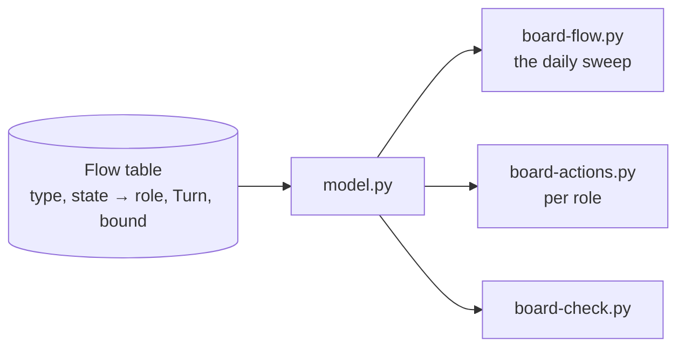
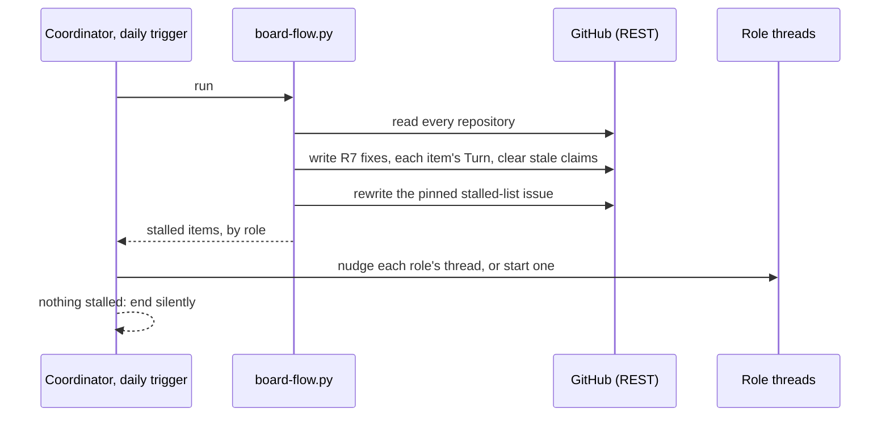

# 176 Project Board flow: technology choices

Design step 4 of delphside/programme#176. [design.md](design.md) holds the
model and [options.md](options.md) the chosen option: events for speed, a
daily reconciliation sweep for correctness, and a pulled work list per mover.
This file says how each part is built on the tools in use today, around the
board model in `scripts/board/`.

## What exists to build on

| Part | Today |
| --- | --- |
| reading the board | `sources.py` is the only module that talks to GitHub, and already has a REST path (`_rest_fetch`, `_rest_write`) beside GraphQL, so `board-check.py`, `board-status.py` and `board-actions.py` run from cloud threads (since 2026-11-09) |
| writing fields | `sources.set_field` (GraphQL) and `_rest_write`; issue fields take the option's name over REST |
| scheduled jobs | GitHub Actions with `BOARD_TOKEN`: `board-add.yml` runs hourly and `pr-state.yml` on events; both stay, and nothing is added to Actions |
| events | `pr-state.yml` on pull request and review events; the post-merge hook on a local merge; `deploy.sh` on a deploy |
| Claude's schedule | the Monday trigger into the coordinator, for the weekly activities |
| the movers' lists | `board-actions.py` (the owner's) and `--claude` (Claude's, one list), read by the session-start hook in WSL |

## The choices

### 1. The flow table lives in the board model

One table in `model.py`, the generalisation of `DECISION_TURNS`: for each type
and state, the mover (a role, or the owner), the `Turn` it implies where that
can be derived, and the bound. Every caller reads it (R3). The documents link
to it rather than restating it, as 1.2 already does for `DECISION_TURNS`.

### 2. The daily sweep is a new `board-flow.py`, run by the coordinator

**No new GitHub Actions jobs** (owner, 2026-11-13: minimise dependence on
them). `board-flow.py` is plain Python over REST, so where it is scheduled is
a thin wrapper and can move.

- **The coordinator's daily cloud trigger runs it** (owner, 2026-11-13), then nudges
  each stalled item's role thread, or starts one where the role has no
  permanent thread, as most workstreams do not. When nothing is stalled it
  ends without a message. The Monday trigger stays as it is.
- **A missed day is tolerated.** A day when Claude's limits are reached runs
  nothing, and the next run corrects it: reconciliation needs no history. A
  black start is the owner prompting the coordinator, whose first act is the
  sweep.
- **The alternative** is cron on one of the VMs: it runs whatever Claude is
  doing, but puts a GitHub token on a host.
- **The time** keeps clear of the Claude plan's daily reset (about 21:10 to
  22:10 UTC).

### 3. Events are moved by the thread that causes them

The sweep makes each event's move within a day whatever happens, so the
events need no new automation: the thread that causes one makes its move, as
part of the same action.

| Event | Who moves it | If missed |
| --- | --- | --- |
| an issue is raised | the raising thread sets its starting state and `Turn` (R7, R10) | the next sweep writes them |
| a pull request merges on GitHub | the merging thread moves its work package by route (#383 R13) | the next sweep, reading `Refs #N` with `refs.py` |
| a deploy | `deploy.sh` moves what it ships | the next sweep |
| a pull request changes state | `pr-state.yml`, kept as it is, since `PR State` is a board field and needs GraphQL | the infrastructure repository has none (#383 R15); its pull requests' movers are derived from REST |

### 4. Two new issue fields

Both are organisation issue fields, which only the owner can create
(organisation settings are out of a cloud session's reach).

| Field | Kind | Values |
| --- | --- | --- |
| `Turn` | single select | `Owner` green, `Claude` blue, `Hold` yellow, as 1.2's colour rule |
| `Claimed by` | text | the role, then a link to the thread holding it now |

The owner's board view filters on `Turn` = `Owner` and groups by issue type.
Pull requests cannot carry issue fields, so theirs stay in `PR State` and in
`board-actions.py`.

### 5. Each mover pulls its own list

`board-actions.py --role <role>` lists one role's items, oldest first, with
age and bound, from the same table. A thread runs it at start and at each wake,
through the cloud session-start hook as well as WSL's. The owner's list adds
every `Turn` = `Owner` item to today's three sources.

## Non-functional design

| Question | Answer |
| --- | --- |
| capacity | One sweep reads every open issue and pull request in the five repositories: 88 on 2026-11-13. At about four REST calls each (fields, sub-issues, dependencies, the timeline for age), that is about 400 calls, against the 15,000 an hour the token's limit allowed that day. Writes are one call per item that changed. The coordinator's session is one a day, ending at once when nothing is stalled. |
| failure | A failed run writes what it reached and exits non-zero, naming the item and call that failed; the pinned issue says when the last complete run was. The next run corrects everything, because reconciliation keeps no history. A missed day (Claude's limits, a stopped coordinator) delays nudges by a day and loses nothing. A field the model cannot read is *not visible*, never a default (the existing `Unavailable` rule). |
| limits and timeouts | Each REST call is cut at 120 s, as `board-add.yml` does today. The bounds are the owner's (7 days; a day for triage), held in the flow table, not in code elsewhere. |
| secrets and access | None new. The sweep runs with the cloud session's own GitHub access, which is repository-scoped REST; no token is added to a host or to Actions. Creating the two fields is an organisation setting, so it is the owner's. |

## Deliveries

Planned in the order each needs the one before it. The route of each is its
artefact's ([1.2 §2.15](../../../../docs/1.2-change-lifecycle.md#215-classifying-a-change)).

| # | What it delivers | Route | Milestone | Work package or steps |
| --- | --- | --- | --- | --- |
| 1 | the `Turn` and `Claimed by` issue fields, with `Turn`'s options and colours, and the owner's board view | Other | a date, the day it lands | a work package: the owner's steps, with a runbook |
| 2 | the flow table in `model.py`, `board-flow.py`, `board-actions.py --role`, their tests, the pinned stalled-list issue (created by hand before the first real run), and the documents: 1.2's machines, 1.6's fields, 1.4's daily activity, 1.7's movers | Docs and Programme Tooling | none | a work package carrying its tests; then each application's pin move |
| 3 | the coordinator's daily trigger and the cloud session-start hook pulling each role's list | Other | a date, the day it lands | a work package |

Left out, for later: retiring `Requirement State`'s `On Hold` in favour of
`Hold` (design.md question 2), and anything delphside/programme#138 takes.

## Details settled from the test design

The test design ([test-design.md](test-design.md), part 10) found these
details unstated. Settled by the design authority on 2026-11-13; G1, G4 and
G25 change requirement wording, so they go to the owner.

| Gap | Settled |
| --- | --- |
| G2 | A held item's mover is the role holding it, at its review. A wait on a tool (`Deployment` waiting for a release) is `Hold`, with the release as its reason. |
| G3 | A thread-set `Owner` with an approval comment, or a `Hold` with a valid reason, is kept by the sweep; any other `Turn` is overwritten by the derived value. |
| G5 | A typed requirement with no state is written `Triage`, as `model.py`'s `stage_to_record` already does (owner, 2026-09-29). |
| G6 | A Decision with no state starts at `Asked`. |
| G7 | Tickets: `Waiting on sender` is `Hold`, its reason the sender; `Resolved` and `Refused` are the owner's, to close, 7 days. 1.8 is updated to match. |
| G8 | `Candidate Project 1`'s bound is 7 days. |
| G9 | A stale claim is kept and listed as offered; the thread that takes the item rewrites it. |
| G10 | A parent stays at `Design and Test Approach` while any work package is open, and its bound is suspended until the last closes. |
| G11 | `Development`'s age is the head commit of the package's open pull request; with none, the field's own age. |
| G12 | `Post-deployment` is stalled 7 days after its review fell due: 14 days in all. |
| G13 | A missed deploy is read from the closed release milestone: each open work package it carries is moved. |
| G14 | An invalid `Hold` is listed for its role with the reason, and `Turn` is rewritten to the derived value. |
| G15 | A malformed claim is reported and treated as no claim. |
| G16 | A pull request's claim is the project thread its body's attribution line links. |
| G17 | A value not in the flow table is reported, never rewritten, as 1.6 says of a renamed option. |
| G18 | With no pinned issue, `board-flow.py` refuses and names it. Delivery 2 creates the issue by hand before its first real run. |
| G19 | An item appears once on the owner's list. |
| G20 | The REST timeout is a setting, so a test can shorten it. |
| G21 | `board-flow.py` exits 0 when nothing is stalled, 1 when something is, and 2 when it could not finish. |
| G22 | `board-flow.py --dry-run` writes nothing and prints what it would write. The technical tests run it dry first, then for real. |
| G23 | A stopped thread is detected only through the bound. |
| G24 | The owner's view shows `Requirement State` and `Turn` as columns; he judges R14's check. |
| G26 | R6 is met by document review, not by a test. |

## Known gaps on today's tools

The table delphside/programme#138 is judged on.

| Gap | Workaround | Carried by |
| --- | --- | --- |
| Projects v2 board fields (`PR State`, views) need GraphQL | Actions writes them; cloud threads read pull request state from REST | `pr-state.yml` |
| pull requests cannot carry `Turn` or `Claimed by` | derived from `PR State` and the branch's thread | `board-actions.py` |
| organisation paths are refused from the cloud | the owner creates fields and options by hand | owner, once |
| the context header needs GraphQL | the WSL session regenerates it | WSL session |

## Questions for the owner

1. **Where the daily sweep runs.** Answered (owner, 2026-11-13): the
   coordinator's daily trigger.
2. **Where the stalled list is published.** Answered (owner, 2026-11-13): a
   pinned issue in the programme repository, its body rewritten by each
   sweep, so the owner can see stalls without asking and its history shows
   how they changed.
