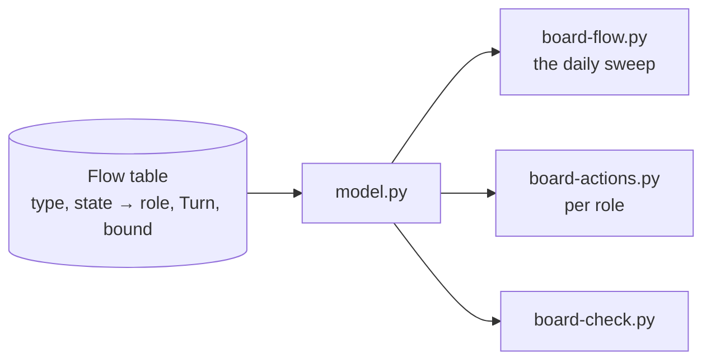
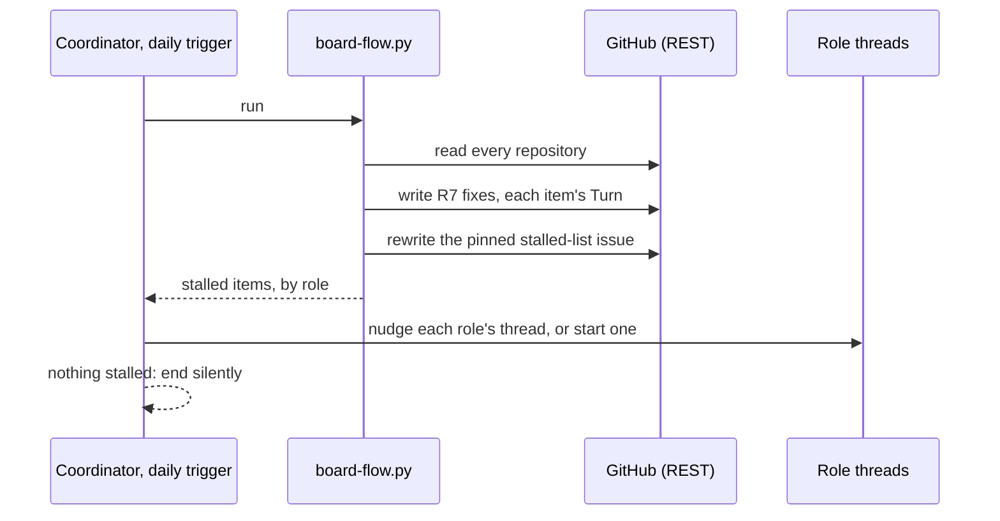

# 176 Project Board flow: technology choices

Design step 4 of delphside/programme#176. [design.md](design.md) holds the
model and [options.md](options.md) the chosen option: events for speed, a daily
reconciliation sweep for correctness and a pulled work list per mover. This
file says how each part is built on the tools in use today, around the board
model in `scripts/board/`.

## What exists to build on

| Part | Today |
| --- | --- |
| reading the board | `sources.py` is the only module that talks to GitHub. `sources.fetch` already falls back to REST (`_rest_fetch`, `_rest_write`) beside GraphQL, so `board-check.py`, `board-status.py` and `board-actions.py` run from cloud threads (since 2026-11-09) |
| writing fields | `sources.set_field` (GraphQL only) and `_rest_write`; issue fields take the option's name over REST |
| scheduled jobs | GitHub Actions with `BOARD_TOKEN`, all kept and none added: `board-add.yml` hourly, `pr-state.yml` on pull request and review events, `context.yml` daily, Tile Lite Elite's `requirement-stage.yml` on issues opened or typed (it runs `board-stage.py`) and its `programme-activities.yml` on Mondays |
| events | `pr-state.yml` on pull request and review events; Tile Lite Elite's `requirement-stage.yml` on an issue opened or typed; the service desk's `intake.yml`, which sets a Ticket to `New`; the post-merge hook on a local merge; `deploy.sh` on a deploy |
| Claude's schedule | the Monday trigger into the coordinator, for the weekly activities |
| the movers' lists | `board-actions.py` (the owner's) and `--claude` (Claude's, one list), read by the session-start hook in WSL (Windows Subsystem for Linux, the owner's local machine) |

## The choices

### 1. The flow table lives in the board model

One table in `model.py`, the generalisation of `DECISION_TURNS`: for each type
and state, the holder (a role, or the owner), the `Turn` it implies where that
can be derived, and the bound. Every caller reads it (R3). The documents link
to it rather than restating it.

### 2. The daily sweep is a new `board-flow.py`, run by the coordinator

**No new GitHub Actions jobs** (owner, 2026-11-13: minimise dependence on
them). `board-flow.py` is plain Python over REST, so where it is scheduled is
a thin wrapper and can move.

- **The coordinator's daily cloud trigger runs it** (owner, 2026-11-13), then
  nudges each stalled item's role thread, or starts one where the role has no
  permanent thread, as most workstreams do not. When nothing is stalled it ends
  without a message. The Monday trigger stays as it is.
- **A missed day is tolerated.** A day when Claude's limits are reached runs
  nothing, and the next run corrects it: reconciliation needs no history. A
  [black start](options.md#4-a-mix-events-for-speed-the-sweep-for-correctness-lists-for-the-work)
  begins with the sweep.
- **The alternative** is cron on one of the VMs (virtual machines the
  applications run on): it runs even when Claude's limits are reached, but puts
  a GitHub token on a host.
- **The time** is set when delivery 3 creates the trigger, outside the Claude
  plan's daily reset (about 21:10 to 22:10 UTC).

### 3. Each event's move is made by the thread that causes it

The sweep makes each event's move within a day whatever happens, so the events
need no new automation: the thread that causes one makes its move, as part of
the same action.

| Event | Who moves it | If missed |
| --- | --- | --- |
| an issue is raised | the raising thread sets its starting state and `Turn` (R7, R10); Tile Lite Elite's `requirement-stage.yml` writes `Triage` there and stays as that event's tool, the sweep covering the other repositories; the service desk's `intake.yml` sets a Ticket to `New` | the next sweep writes them |
| a pull request merges on GitHub | the merging thread moves its work package by route (delphside/tile-lite-elite#383 R13) | the next sweep, reading `Refs #N` with `refs.py` |
| a deploy | `deploy.sh` moves what it ships | the next sweep, reading the closed release milestone |
| a pull request changes state | `pr-state.yml`, kept as it is, since `PR State` is a board field and needs GraphQL | the next sweep derives the mover from REST |

The infrastructure repository has no `PR State` workflow
(delphside/tile-lite-elite#383 R15), so its pull requests' movers are derived
from REST.

### 4. Two new issue fields

Both are organisation issue fields, which only the owner can create
(organisation settings are out of a cloud session's reach).

| Field | Kind | Values |
| --- | --- | --- |
| `Turn` | single select | `Owner` green, `Claude` blue, `Hold` yellow, as 1.2's colour rule |
| `Claimed by` | text | the role, then a link to the thread holding it now |

The owner's board view filters on `Turn` = `Owner`, groups by issue type and
shows `Requirement State` and `Turn` as columns; he judges R14's check from it.
Pull requests stay out of both fields, because
[1.6's `github:issue fields`](../../../../docs/1.6-github-project-board.md)
says REST accepts a value on one but cannot clear it again. Theirs stay in
`PR State` and in `board-actions.py`.

### 5. Each mover pulls its own list

`board-actions.py --role <role>` lists one role's items, oldest first, with age
and bound, from the same table. A thread runs it at start and at each wake,
through the cloud session-start hook as well as WSL's. The owner's list adds
every `Turn` = `Owner` item to the five sources of `turn.waiting_on_owner`: a
`Decision` on his turn, a pull request awaiting his review, unticked browser
tests at `User testing`, due recurrences and due **owner** boxes.

### 6. The session-start to-do list and the comment check (R15)

A thread's list at start has a second part beside its role's items: the
owner's comments it has not answered, read by `board-inbox.py` and shown by
`inbox-hook.sh`, and a check before Claude comments, `comment-check.sh`. R15
folds delphside/tile-lite-elite#455's defects in these. Each is fixed in
delivery 2, in `scripts/board/`, with a test shown red first.

| #455 | Fix |
| --- | --- |
| R1 | comments older than Claude's own account (2026-08-25) are never a to-do: a floor, held as a setting (**owner's answer awaited**) |
| R2 | every heading names whose move it is; the cache line says *any age* |
| R3 | `--issue N` goes through the same open-issues rule and the same comment read, pull request diff comments included, as the board-wide path: one function, two callers |
| R4 | the cap counts comments, so it bounds the lines shown, then one line says how many more on how many issues (**owner's answer awaited**) |
| R5 | `comment-check.sh` matches every way Claude posts a comment (`gh issue comment` with flags anywhere, `-R`, an issue URL, `gh api -X POST …/comments`, the GitHub MCP comment tools) and nothing else: not a read, not text inside a body |
| R6 | docs/1.1's `board-inbox.py` row describes `--open`, `--issue` and `--all` |
| R7 | each section of the hook is read and shown on its own, so one failed read prints its failure and the others still show |
| R8 | a hook's context reaches Claude only after the command runs, so the check **denies the first attempt** with the unanswered comments as its reason, and allows the retry; it shapes the comment because Claude reads the reason before posting |
| R10 | the hook's text says what it shows in the order shown; each line shows when the comment was made; `--issue` and `--all` without `--open` are refused, not ignored |
| R11 | tests for `comments_on`, the hook's to-do section, the check's exit status and which comments survive the cap |

R9, a cloud session's comment read as the owner's, was fixed straight to
`main` by delphside/programme#180.

## Non-functional design

| Question | Answer |
| --- | --- |
| capacity | One sweep reads every open issue and pull request in the five repositories: 88 on 2026-11-13. At about four REST calls each (fields, sub-issues, dependencies, the timeline for age), that is about 400 calls, against the 15,000 an hour the token's limit allowed that day. Writes are one call per item that changed. The coordinator's session is one a day, ending at once when nothing is stalled. |
| failure | A failed run writes what it reached and exits non-zero, naming the item and call that failed; the pinned issue says when the last complete run was. The next run corrects everything, because reconciliation keeps no history. A missed day (Claude's limits, a stopped coordinator) delays nudges by a day and loses nothing. A field the model cannot read is *not visible*, never a default (the existing `Unavailable` rule). |
| limits and timeouts | Each REST call is cut at 120 s, the figure of `sources.py`'s REST reads, held as a setting so a test can shorten it. The bounds are the owner's (7 days; 1 day for triage), held in the flow table, not in code elsewhere. |
| secrets and access | None new. The sweep runs with the cloud session's own GitHub access, which is repository-scoped REST; no token is added to a host or to Actions. Creating the two fields is an organisation setting, so it is the owner's. |

## Deliveries

Planned in the order each needs the one before it. The route of each is its
artefact's ([1.2 §2.15](../../../../docs/1.2-change-lifecycle.md#215-classifying-a-change)).

| # | What it delivers | Route | Milestone | Work package or steps |
| --- | --- | --- | --- | --- |
| 1 | the `Turn` and `Claimed by` issue fields, with `Turn`'s options and colours, and the owner's board view | Other | a date, the day it lands | a work package: the owner's steps, with a runbook |
| 2 | the flow table in `model.py`, `board-flow.py`, `board-actions.py --role`, R15's fixes to `board-inbox.py`, `inbox-hook.sh` and `comment-check.sh`, the cloud session-start hook pulling each role's list, their tests, and the documents: 1.1's new tools, 1.2's machines, 1.4's daily activity, 1.6's fields, 1.7's movers and 1.8's Ticket bounds | Docs and Programme Tooling | none | a work package carrying its tests; then each application's pin move. Its technical tests create the pinned stalled-list issue by hand before the first real run |
| 3 | the coordinator's daily trigger and the pinned stalled-list issue, which delivery 2's technical tests first create by hand | Other | a date, the day it lands | a work package |

Left out, for later: retiring `Requirement State`'s `On Hold` in favour of
`Hold` (design.md question 2), and anything
[delphside/programme#138](https://github.com/delphside/programme/issues/138),
the workflow tool of our own, takes.

## Details settled from the test design

The test design's gaps, labelled as in
[test-design.md part 10](test-design.md#10-gaps), were settled on 2026-11-13
by the design authority, except G1, G4 and G25, which the owner settled the
same day by rewording R1, R11 and R12. [design.md](design.md) holds each value.

| Gap | Held in |
| --- | --- |
| [G2](test-design.md#10-gaps), [G3](test-design.md#10-gaps), [G14](test-design.md#10-gaps), [G17](test-design.md#10-gaps) | design.md [the turn](design.md#the-turn) |
| [G5](test-design.md#10-gaps), [G8](test-design.md#10-gaps) | design.md [Requirement](design.md#requirement) |
| [G6](test-design.md#10-gaps) | design.md [Decision](design.md#decision) |
| [G7](test-design.md#10-gaps) | design.md [Ticket](design.md#ticket) |
| [G9](test-design.md#10-gaps), [G15](test-design.md#10-gaps), [G16](test-design.md#10-gaps), [G23](test-design.md#10-gaps) | design.md [Claims](design.md#claims) |
| [G10](test-design.md#10-gaps), [G11](test-design.md#10-gaps), [G12](test-design.md#10-gaps), [G13](test-design.md#10-gaps) | design.md [Project](design.md#project) |
| [G18](test-design.md#10-gaps), [G19](test-design.md#10-gaps), [G21](test-design.md#10-gaps), [G22](test-design.md#10-gaps) | design.md [What runs the flow](design.md#what-runs-the-flow), and the pinned issue's creation in *Deliveries* above |
| [G20](test-design.md#10-gaps) | *Non-functional design*, limits and timeouts, above |
| [G24](test-design.md#10-gaps) | the owner's view, choice 4 above |
| [G26](test-design.md#10-gaps) | R6 is met by document review: the vocabulary in design.md names its sources |

## Known gaps on today's tools

The table
[delphside/programme#138](https://github.com/delphside/programme/issues/138)
is judged on.

| Gap | Workaround | Carried by |
| --- | --- | --- |
| Projects v2 board fields (`PR State`, views) need GraphQL | Actions writes them; cloud threads read pull request state from REST | `pr-state.yml` |
| pull requests cannot carry `Turn` or `Claimed by` (1.6: REST cannot clear a field once set) | derived from `PR State` and the branch's thread | `board-actions.py` |
| organisation paths are refused from the cloud | the owner creates fields and options by hand | owner, once |
| the context header needs GraphQL | `context.yml` regenerates it daily in Actions, in the programme, Tile Lite Elite and Dark Portal | `context.yml` |

## Questions for the owner

1. **Where the daily sweep runs.** Answered (owner, 2026-11-13): the
   coordinator's daily trigger.
2. **Where the stalled list is published.** Answered (owner, 2026-11-13): a
   pinned issue in the programme repository, its body rewritten by each sweep,
   so the owner can see stalls without asking and its history shows how they
   changed.
