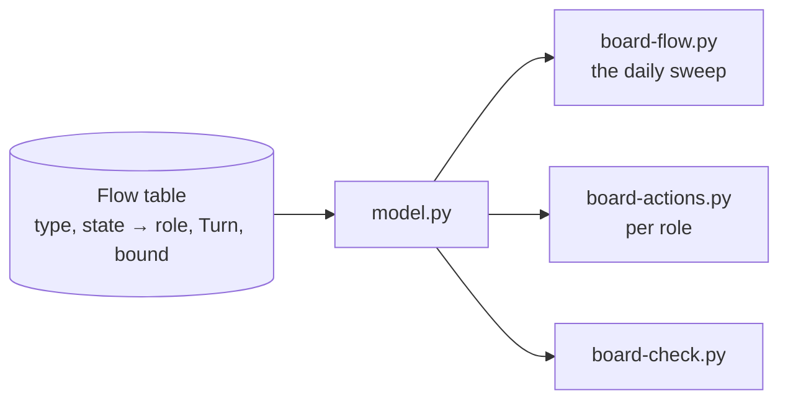
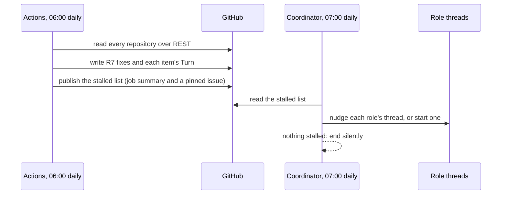

# 176 Project Board flow: technology choices

Design step 4 of delphside/programme#176. [design.md](design.md) holds the
model and [options.md](options.md) the chosen option: events for speed, a
daily reconciliation sweep for correctness, and a pulled work list per mover.
This file says how each part is built on the tools in use today, around the
board model in `scripts/board/`.

## What exists to build on

| Part | Today |
| --- | --- |
| reading the board | `sources.py` is the only module that talks to GitHub, and already has a REST path (`_rest_fetch`, `_rest_write`) beside GraphQL, so `board-check.py`, `board-status.py` and `board-actions.py` run from cloud threads (since 2026-11-09) |
| writing fields | `sources.set_field` (GraphQL) and `_rest_write`; issue fields take the option's name over REST |
| scheduled jobs | GitHub Actions in the programme repository with `BOARD_TOKEN`: `board-add.yml` runs hourly |
| events | `pr-state.yml` on pull request and review events; the post-merge hook on a local merge; `deploy.sh` on a deploy |
| Claude's schedule | the Monday trigger into the coordinator, for the weekly activities |
| the movers' lists | `board-actions.py` (the owner's) and `--claude` (Claude's, one list), read by the session-start hook in WSL |

## The choices

### 1. The flow table lives in the board model

One table in `model.py`, the generalisation of `DECISION_TURNS`: for each type
and state, the mover (a role, or the owner), the `Turn` it implies where that
can be derived, and the bound. Every caller reads it (R3). The documents link
to it rather than restating it, as 1.2 already does for `DECISION_TURNS`.

### 2. The daily sweep is a new `board-flow.py`, in two halves

- **The writing half runs in GitHub Actions**, as `board-add.yml` does. It is
  deterministic, needs no Claude, and so keeps running when every thread is
  stopped (R8's black start). It writes R7's starting states, writes `Turn`
  where the model derives it, clears claims that have gone stale, and
  publishes the list of stalled items.
- **The nudging half is a daily cloud trigger into the coordinator**, because
  only a Claude session can message a thread. It reads the published list and
  nudges each stalled item's role thread, or starts one. When nothing is
  stalled it ends without a message. The Monday trigger stays as it is.
- **Times** keep both clear of the Claude plan's daily reset (about 21:10 to
  22:10 UTC).

### 3. Events fill the gaps the model has today

| Event | Today | Added |
| --- | --- | --- |
| an issue is raised | `board-add.yml` adds it to the board within the hour | the same run writes its starting state and `Turn` (R7, R10) |
| a pull request merges on GitHub | nothing moves its work package | an Actions job reads its `Refs #N` with `refs.py` and moves the package by route, as the post-merge hook does locally (#383 R13) |
| a deploy | `deploy.sh` moves what it ships | unchanged |
| a pull request changes state | `pr-state.yml`, not in the infrastructure repository | the workflow in every repository (#383 R15) |

### 4. Two new issue fields

Both are organisation issue fields, which only the owner can create
(organisation settings are out of a cloud session's reach).

| Field | Kind | Values |
| --- | --- | --- |
| `Turn` | single select | `Owner` green, `Claude` blue, `Hold` yellow, as 1.2's colour rule |
| `Claimed by` | text | the role, then a link to the thread holding it now |

The owner's board view filters on `Turn` = `Owner` and groups by issue type.
Pull requests cannot carry issue fields, so theirs stay in `PR State` and in
`board-actions.py`.

### 5. Each mover pulls its own list

`board-actions.py --role <role>` lists one role's items, oldest first, with
age and bound, from the same table. A thread runs it at start and at each wake,
through the cloud session-start hook as well as WSL's. The owner's list adds
every `Turn` = `Owner` item to today's three sources.

## Known gaps on today's tools

The table delphside/programme#138 is judged on.

| Gap | Workaround | Carried by |
| --- | --- | --- |
| Projects v2 board fields (`PR State`, views) need GraphQL | Actions writes them; cloud threads read pull request state from REST | `pr-state.yml` |
| pull requests cannot carry `Turn` or `Claimed by` | derived from `PR State` and the branch's thread | `board-actions.py` |
| organisation paths are refused from the cloud | the owner creates fields and options by hand | owner, once |
| the context header needs GraphQL | the WSL session regenerates it | WSL session |
| a thread cannot be messaged from Actions | the coordinator's daily trigger relays | coordinator |

## Questions for the owner

1. **Where the daily sweep runs.** Recommended: writes in Actions, nudges by a
   daily cloud trigger into the coordinator. The alternative, everything in
   the cloud trigger, is one place but stops writing when Claude's limits are
   reached, and costs a session every day.
2. **Where the stalled list is published** for the coordinator and the owner:
   a pinned issue rewritten each day, or only the Actions job summary.
