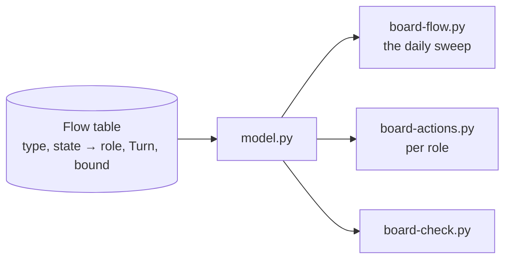
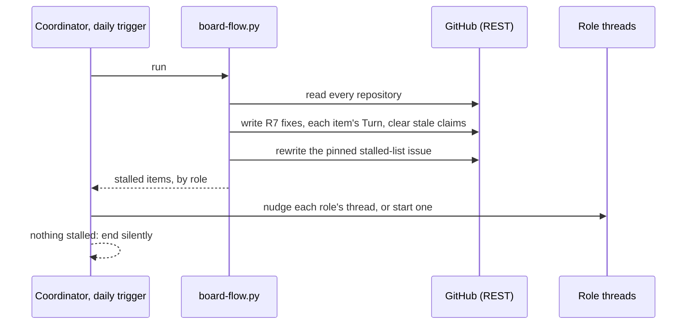

# 176 Project Board flow: technology choices

Design step 4 of delphside/programme#176. [design.md](design.md) holds the
model and [options.md](options.md) the chosen option: events for speed, a
daily reconciliation sweep for correctness, and a pulled work list per mover.
This file says how each part is built on the tools in use today, around the
board model in `scripts/board/`.

## What exists to build on

| Part | Today |
| --- | --- |
| reading the board | `sources.py` is the only module that talks to GitHub, and already has a REST path (`_rest_fetch`, `_rest_write`) beside GraphQL, so `board-check.py`, `board-status.py` and `board-actions.py` run from cloud threads (since 2026-11-09) |
| writing fields | `sources.set_field` (GraphQL) and `_rest_write`; issue fields take the option's name over REST |
| scheduled jobs | GitHub Actions with `BOARD_TOKEN`: `board-add.yml` runs hourly and `pr-state.yml` on events; both stay, and nothing is added to Actions |
| events | `pr-state.yml` on pull request and review events; the post-merge hook on a local merge; `deploy.sh` on a deploy |
| Claude's schedule | the Monday trigger into the coordinator, for the weekly activities |
| the movers' lists | `board-actions.py` (the owner's) and `--claude` (Claude's, one list), read by the session-start hook in WSL |

## The choices

### 1. The flow table lives in the board model

One table in `model.py`, the generalisation of `DECISION_TURNS`: for each type
and state, the mover (a role, or the owner), the `Turn` it implies where that
can be derived, and the bound. Every caller reads it (R3). The documents link
to it rather than restating it, as 1.2 already does for `DECISION_TURNS`.

### 2. The daily sweep is a new `board-flow.py`, run by the coordinator

**No new GitHub Actions jobs** (owner, 2026-11-13: minimise dependence on
them). `board-flow.py` is plain Python over REST, so where it is scheduled is
a thin wrapper and can move.

- **The coordinator's daily cloud trigger runs it** (owner, 2026-11-13), then nudges
  each stalled item's role thread, or starts one where the role has no
  permanent thread, as most workstreams do not. When nothing is stalled it
  ends without a message. The Monday trigger stays as it is.
- **A missed day is tolerated.** A day when Claude's limits are reached runs
  nothing, and the next run corrects it: reconciliation needs no history. A
  black start is the owner prompting the coordinator, whose first act is the
  sweep.
- **The alternative** is cron on one of the VMs: it runs whatever Claude is
  doing, but puts a GitHub token on a host.
- **The time** keeps clear of the Claude plan's daily reset (about 21:10 to
  22:10 UTC).

### 3. Events are moved by the thread that causes them

The sweep makes each event's move within a day whatever happens, so the
events need no new automation: the thread that causes one makes its move, as
part of the same action.

| Event | Who moves it | If missed |
| --- | --- | --- |
| an issue is raised | the raising thread sets its starting state and `Turn` (R7, R10) | the next sweep writes them |
| a pull request merges on GitHub | the merging thread moves its work package by route (#383 R13) | the next sweep, reading `Refs #N` with `refs.py` |
| a deploy | `deploy.sh` moves what it ships | the next sweep |
| a pull request changes state | `pr-state.yml`, kept as it is, since `PR State` is a board field and needs GraphQL | the infrastructure repository has none (#383 R15); its pull requests' movers are derived from REST |

### 4. Two new issue fields

Both are organisation issue fields, which only the owner can create
(organisation settings are out of a cloud session's reach).

| Field | Kind | Values |
| --- | --- | --- |
| `Turn` | single select | `Owner` green, `Claude` blue, `Hold` yellow, as 1.2's colour rule |
| `Claimed by` | text | the role, then a link to the thread holding it now |

The owner's board view filters on `Turn` = `Owner` and groups by issue type.
Pull requests cannot carry issue fields, so theirs stay in `PR State` and in
`board-actions.py`.

### 5. Each mover pulls its own list

`board-actions.py --role <role>` lists one role's items, oldest first, with
age and bound, from the same table. A thread runs it at start and at each wake,
through the cloud session-start hook as well as WSL's. The owner's list adds
every `Turn` = `Owner` item to today's three sources.

## Known gaps on today's tools

The table delphside/programme#138 is judged on.

| Gap | Workaround | Carried by |
| --- | --- | --- |
| Projects v2 board fields (`PR State`, views) need GraphQL | Actions writes them; cloud threads read pull request state from REST | `pr-state.yml` |
| pull requests cannot carry `Turn` or `Claimed by` | derived from `PR State` and the branch's thread | `board-actions.py` |
| organisation paths are refused from the cloud | the owner creates fields and options by hand | owner, once |
| the context header needs GraphQL | the WSL session regenerates it | WSL session |

## Questions for the owner

1. **Where the daily sweep runs.** Answered (owner, 2026-11-13): the
   coordinator's daily trigger.
2. **Where the stalled list is published.** Answered (owner, 2026-11-13): a
   pinned issue in the programme repository, its body rewritten by each
   sweep, so the owner can see stalls without asking and its history shows
   how they changed.
