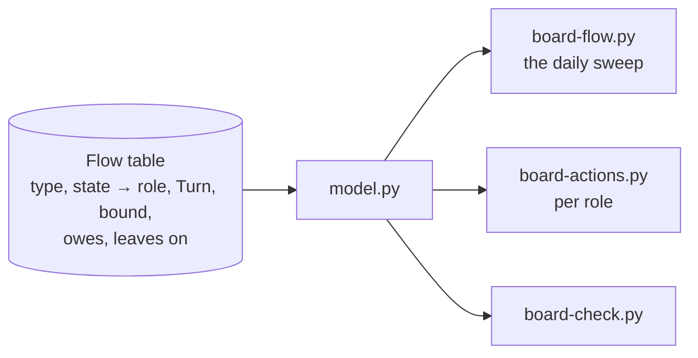
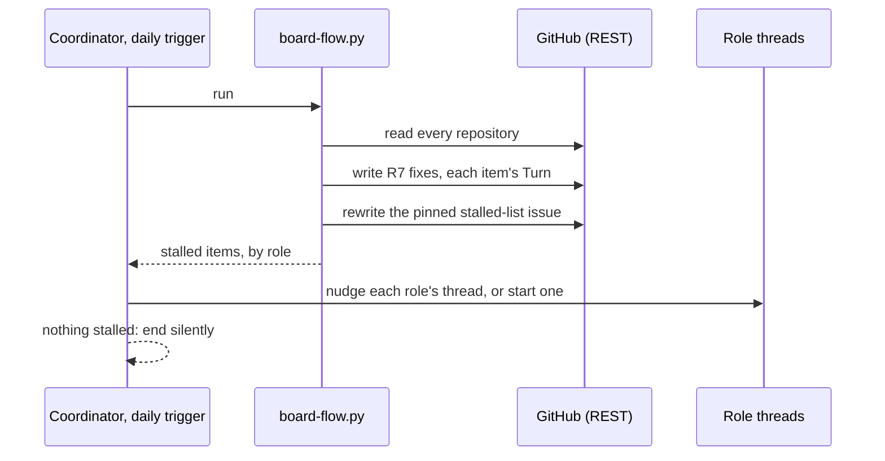

# 176 Project Board flow: technology choices

Design step 4 of delphside/programme#176. [design.md](design.md) holds the
model and [options.md](options.md) the chosen option: events for speed, a daily
reconciliation sweep for correctness and a pulled work list per mover. This
file says how each part is built on the tools in use today, around the board
model in `scripts/board/`.

## What exists to build on

| Part | Today |
| --- | --- |
| reading the board | `sources.py` is the only module that talks to GitHub. `sources.fetch` already falls back to REST (`_rest_fetch`) beside GraphQL, so `board-check.py`, `board-status.py` and `board-actions.py` run from cloud threads (since 2026-11-09) |
| writing fields | `sources.set_field`, which is GraphQL only. `_rest_write` writes milestones, comments, issue state and new issues; no issue field is written over REST yet |
| scheduled jobs | GitHub Actions, all kept and none added. With `BOARD_TOKEN`: `board-add.yml` hourly, `pr-state.yml` on pull request and review events, `context.yml` daily, and Tile Lite Elite's `requirement-stage.yml` on issues opened or typed (it runs `board-stage.py`). With `github.token`: Tile Lite Elite's `programme-activities.yml` on Mondays and `advisories.yml` daily. With `DESK_ORG_TOKEN`: the service desk's `intake.yml`, half-hourly and its own `pr-state.yml`; `reply.yml` is in the events row |
| events | `pr-state.yml` on pull request and review events; Tile Lite Elite's `requirement-stage.yml` on an issue opened or typed; the service desk's `intake.yml`, a half-hourly poll that stands in for the event, sets a Ticket to `New` and sets it to `In progress` when a sender answers, and its `reply.yml`, on a sent `reply` comment, which sets `Waiting on sender` ([1.8](../../../../docs/1.8-service-desk.md)); the post-merge hook on a local merge; `deploy.sh` on a deploy |
| Claude's schedule | the Monday trigger into the coordinator, for the weekly activities |
| the movers' lists | `board-actions.py` (the owner's, which he runs by hand) and `--claude` (Claude's, one list), which the session-start hook runs in WSL (Windows Subsystem for Linux, the owner's local machine) |

## The choices

### 1. The flow table lives in the board model

One table in `model.py`, the generalisation of `DECISION_TURNS`: for each type
and state, the holder (a role, or the owner), the `Turn` it implies where that
can be derived, the bound, and what the state owes and what it leaves on, as
[design.md](design.md#the-vocabulary) defines it. Every caller reads it (R3).
The documents link to it rather than restating it.

### 2. The daily sweep is a new `board-flow.py`, run by the coordinator

**No new GitHub Actions jobs** (owner, 2026-11-13: minimise dependence on
them). `board-flow.py` is plain Python over REST, so where it is scheduled is
a thin wrapper and can move.

- **The coordinator's daily cloud trigger runs it** (owner, 2026-11-13), then
  nudges each stalled item's role thread, or starts one where the role has no
  permanent thread, as most workstreams do not. When nothing is stalled it ends
  without a message. The Monday trigger stays as it is.
- **A missed day is tolerated.** A day when Claude's limits are reached runs
  nothing, and the next run corrects it: reconciliation needs no history. A
  [black start](options.md#4-a-mix-events-for-speed-the-sweep-for-correctness-lists-for-the-work)
  begins with the sweep.
- **The alternative** is cron on one of the VMs (virtual machines the
  applications run on): it runs even when Claude's limits are reached, but puts
  a GitHub token on a host.
- **The time** is set when delivery 3 creates the trigger, outside the Claude
  plan's daily reset (about 21:10 to 22:10 UTC).

### 3. Each event's move is made by the thread that causes it

The sweep makes each event's move within a day whatever happens, so the events
need no new automation: the thread that causes one makes its move, as part of
the same action.

| Event | Who moves it | If missed |
| --- | --- | --- |
| an issue is raised | the raising thread sets its starting state and `Turn` (R7, R10); Tile Lite Elite's `requirement-stage.yml` writes `Triage` there and stays as that event's tool, the sweep covering the other repositories; the service desk's `intake.yml` sets a Ticket to `New` | the next sweep writes them |
| a pull request merges on GitHub | the merging thread moves its work package by route (delphside/tile-lite-elite#383 R13) | the next sweep, reading `Refs #N` with `refs.py` |
| a deploy | `deploy.sh` moves what it ships | the next sweep, reading the closed release milestone |
| a pull request changes state | `pr-state.yml`, kept as it is, since `PR State` is a board field and needs GraphQL | the next sweep derives the mover from REST |

The infrastructure repository has no `PR State` workflow
(delphside/tile-lite-elite#383 R15), so its pull requests' movers are derived
from REST.

### 4. Two new issue fields

Both are organisation issue fields, which only the owner can create
(organisation settings are out of a cloud session's reach).

| Field | Kind | Values |
| --- | --- | --- |
| `Turn` | single select | `Owner` green, `Claude` blue, `Hold` yellow, as [1.2](../../../../docs/1.2-change-lifecycle.md)'s colour rule |
| `Claimed by` | text | the role, then a link to the thread holding it now |

The owner's board view filters on `Turn` = `Owner`, groups by issue type and
shows `Requirement State` and `Turn` as columns; he judges R14's check from it.
Pull requests stay out of both fields, for the reason
[design.md](design.md#pull-request) gives. Theirs stay in `PR State` and in
`board-actions.py`.

### 5. Each mover pulls its own list

`board-actions.py --role <role>` lists one role's items, oldest first, with age
and bound, from the same table. A thread runs it at start and at each wake,
through the cloud session-start hook as well as WSL's. The owner's list adds
every `Turn` = `Owner` item to the five sources of `turn.waiting_on_owner`: a
`Decision` on his turn, a pull request awaiting his review, unticked browser
tests at `User testing`, due recurrences and due **owner** boxes.

### 6. The session-start to-do list and the comment check (R15)

R15 folds the defects of delphside/tile-lite-elite#455 into this design. A
defect is written `#455-R1` for that issue's R1; a bare `R1` is
delphside/programme#176's.

A thread's list at start has a second part beside its role's items: the
owner's comments it has not answered, which `board-inbox.py` reads and
`inbox-hook.sh` shows. The hook has these sections, in this order:

1. a note on the programme checkout and its pin;
2. what opened or closed in the last 7 days;
3. the unanswered comments;
4. reports from the scheduled workflows;
5. the board actions for Claude;
6. `board-check.py`'s findings;
7. overdue programme activities, with the reason when they cannot be judged.

The cap on the unanswered comments is in `board-inbox.py --open`: today 12
issues, each with every comment, the most recent 12.

A check before Claude comments, `comment-check.sh`, lists the same unanswered
comments.

The list and the check run in WSL today in Tile Lite Elite. Their
fixed versions reach WSL when each application's pin moves, at the end of
delivery 2, and cloud threads once the owner pastes the setup script in
delivery 3. Each defect is fixed in delivery 2, in `scripts/board/` and
`.claude/hooks/`, with a test shown red first.

| delphside/tile-lite-elite#455 | Fix |
| --- | --- |
| #455-R1 | comments older than Claude's own account (2026-08-25) are never a to-do: a floor, held as a setting. Recommended, awaiting the owner's answer ([question 4](#questions-for-the-owner)) |
| #455-R2 | every heading names whose move it is; the cache line says *any age* |
| #455-R3 | `--issue N` goes through the same open-issues rule and the same comment read, pull request diff comments included, as the board-wide path: one function, two callers |
| #455-R4 | the cap counts comments, so it bounds the lines shown; the 12 that show are the oldest, longest waiting first, as `turn.py` orders; then one line says how many more on how many issues. Recommended, awaiting the owner's answer ([question 3](#questions-for-the-owner)): if he chooses 12 issues, every comment on the 12 oldest-waiting issues shows |
| #455-R5 | `comment-check.sh` matches every way Claude posts a comment, in [the table of ways](#the-ways-claude-posts-a-comment), and nothing else |
| #455-R6 | [1.1](../../../../docs/1.1-programme-tooling.md)'s `board-inbox.py` row describes `--open`, `--issue` and `--all` |
| #455-R7 | each section of the hook is read and shown on its own, so one failed read prints its failure and the others still show |
| #455-R8 | the check **denies once**, as [deny once](#deny-once) defines |
| #455-R10 | the hook's text says what it shows in the order shown; each line shows when the comment was made; `--issue` and `--all` without `--open` are refused, not ignored |
| #455-R11 | tests for `comments_on`, the hook's to-do section, the check's exit status and which comments survive the cap |

#### The ways Claude posts a comment

The check covers each way marked *yes*.

| Way | Covered |
| --- | --- |
| `gh issue comment` and `gh pr comment`, flags before or after the number, `-R`, a URL in place of the number | yes |
| `gh issue close` and `gh pr close` with `--comment` | yes |
| `gh pr review` with `--body` (comment, approve or request changes) | yes |
| `gh api -X POST` to `issues/N/comments`, `pulls/N/comments`, `pulls/N/reviews` or a comment's `replies` | yes |
| the GitHub MCP tools `add_issue_comment`, `add_reply_to_pull_request_comment` and `pull_request_review_write` when it creates or submits a review with a body (`create` with an `event`, or `submit_pending`) | yes, once wired: in WSL by delivery 2's pin moves and wiring, in a cloud thread by the setup script pasted in delivery 3 |
| a reaction, through a tool's `reaction` parameter | no: it posts no comment, so it is let through |
| `add_comment_to_pending_review` | no: nothing is posted until the review is submitted, which is covered |
| editing Claude's own comment (`update_issue_comment`, `gh api -X PATCH`) | no: it answers nothing new |
| a commit message, a pull request body, an issue body | no: not a comment |
| a read (`gh issue view`, `gh api` GET), or a post command's text quoted inside a body | no: nothing is posted |

The hook is wired with the matcher `Bash` and reads only `tool_input.command`,
so an MCP tool's call passes it today. Delivery 2 makes `comment-check.sh` read
an MCP tool's input (repository and issue number) as well, and adds a matcher
for the GitHub MCP comment tools to each application's `.claude/settings.json`
and to the cloud setup script's user-level hook.

#### Deny once

A hook's context reaches Claude only after the command runs, but a denial's
reason is read before the post, so the denial shapes the comment.

- The first post to an issue with unanswered owner comments is denied. The
  reason lists them, oldest first.
- A retry is the same kind of post to the same issue within 10 minutes of the
  denial, in the same session. It is allowed.
- The 10 minutes is a setting
  ([docs/1.10](../../../../docs/1.10-development-standards.md)): chosen on
  2026-11-13 as ample for reading the reason and rewriting the comment within
  one turn, with no measurement behind it. Claude revisits it if a retry is ever
  denied for being late.
- A marker in the session's temporary directory, keyed by repository, issue and
  the unanswered comments' IDs, records the denial.
- If an owner comment arrives between the denial and the retry, the set of
  IDs changes, so the retry is denied again, with the new list.
- Claude's own comments in between change nothing.
- If the check cannot read the comments, it allows the post and says so: it
  is a check, not a gate (docs/1.2 §2.16), so Claude answers through an outage.

Defect #455-R6 is met by document review, not by a test.

Defect #455-R9 is fixed on `main` (delphside/programme#180): a cloud session's
comment is read as Claude's. Its tests are in
`scripts/board/tests/test_inbox.py`.

## Non-functional design

| Question | Answer |
| --- | --- |
| capacity | One sweep reads every open issue and pull request in the five repositories: 88 on 2026-11-13. At about four REST calls each (fields, sub-issues, dependencies, the timeline for age), that is about 400 calls, against the 15,000 an hour the token's limit allowed that day. Writes are one call per item that changed. The coordinator's session is one a day, ending at once when nothing is stalled. |
| failure | A failed run writes what it reached and exits non-zero, naming the item and call that failed; the pinned issue says when the last complete run was. The next run corrects everything, because reconciliation keeps no history. A missed day (Claude's limits, a stopped coordinator) delays nudges by a day and loses nothing. A field the model cannot read is *not visible*, never a default (the existing `Unavailable` rule). |
| limits and timeouts | Each REST call is cut at 120 s, the figure of `sources.py`'s REST reads, held as a setting so a test can shorten it. The bounds are the owner's (7 days; 1 day for triage), held in the flow table, not in code elsewhere. |
| secrets and access | None new. The sweep runs with the cloud session's own GitHub access, which is repository-scoped REST; no token is added to a host or to Actions. Creating the two fields is an organisation setting, so it is the owner's. |

## Deliveries

Planned in the order each needs the one before it. The route of each is its
artefact's ([1.2 §2.15](../../../../docs/1.2-change-lifecycle.md#215-classifying-a-change)).

| # | What it delivers | Route | Milestone | Work package or steps |
| --- | --- | --- | --- | --- |
| 1 | the `Turn` and `Claimed by` issue fields, with `Turn`'s options and colours, and the owner's board view | Other | a date, the day it lands | a work package: the owner's steps, with a runbook |
| 2 | the sweep, the role lists, R15's fixes and the cloud hooks, with their tests and documents | Docs and Programme Tooling | none | a work package carrying its tests, and the artefacts and steps listed after this table |
| 3 | the coordinator's daily trigger, and the owner's step of pasting the updated `cloud-environment-setup.sh` into the cloud environment's settings, which puts the cloud hooks in force. It keeps the pinned stalled-list issue | Other | a date, the day it lands | a work package. Its post-deployment check includes a cloud thread showing the session-start list and the comment check running |

Delivery 2's artefacts, by repository. Why a cloud thread's hooks are only the
user-level ones the setup script writes is in
[1.1's `cloud-environment-setup.sh` row](../../../../docs/1.1-programme-tooling.md).

- **Programme:**
  - scripts: the flow table in `model.py`, `board-flow.py`,
    `board-actions.py --role`, R15's fixes to `board-inbox.py` and
    `inbox-hook.sh`, and `comment-check.sh` (which also reads the GitHub MCP
    tools' inputs), with their tests;
  - the hooks: the cloud session-start hook, which pulls each role's list and
    shows `inbox-hook.sh`'s unanswered comments as well, so a cloud thread gets
    the whole to-do list; and `comment-check.sh` as a `PreToolUse` hook on
    `Bash` and the GitHub MCP comment tools;
  - `.claude/cloud-environment-setup.sh`, extended to write the user-level hooks
    for both, and its header comment, which drops the reason that `gh` cannot
    sign in from a cloud thread;
  - documents:
    [1.1](../../../../docs/1.1-programme-tooling.md)'s rows for the new tools,
    `board-inbox.py`, `inbox-hook.sh`, `comment-check.sh`,
    `.claude/settings.json` (corrected to name the MCP matcher) and
    `cloud-environment-setup.sh` (corrected to the user-level hooks it now
    writes, dropping the same `gh` reason);
    [1.2](../../../../docs/1.2-change-lifecycle.md)'s machines;
    [1.4](../../../../docs/1.4-programme-activities.md)'s daily activity;
    [1.6](../../../../docs/1.6-github-project-board.md)'s fields;
    [1.7](../../../../docs/1.7-roles-and-responsibilities.md)'s movers; and
    [1.8](../../../../docs/1.8-service-desk.md)'s Ticket bounds.
- **Tile Lite Elite:** `.claude/settings.json`, gaining the matcher for the
  GitHub MCP comment tools.
- **Dark Portal:** a new `.claude/settings.json`, `.claude/programme-hook.sh`
  and the hook wiring: it has no hooks at all today.

Delivery 2's steps:

1. Claude creates the pinned stalled-list issue by hand.
2. Claude writes the code and documents, each defect's test shown red first, and
   runs the suites and `scripts/docs/check-docs.sh --programme`.
3. Once delivery 1 has landed, Claude runs TT1 to TT6, TT9 and TT10; TT1, TT2
   and TT4 run `--dry-run` first.
4. Claude merges the change straight to main.
5. Claude moves each application's pin, and its wiring lands with it
   ([1.2 §2.15](../../../../docs/1.2-change-lifecycle.md#215-classifying-a-change)
   makes these Docs and Programme Tooling too, straight to main): Tile Lite
   Elite's `.claude/settings.json` gains the MCP matcher, and Dark Portal gains
   its whole wiring.

Left out, for later: retiring `Requirement State`'s `On Hold` in favour of
`Hold` ([design.md question 2](design.md#questions-for-the-owner)), and anything
[delphside/programme#138](https://github.com/delphside/programme/issues/138),
the programme's own workflow tool, takes.

## Details settled from the test design

The test design's gaps, labelled as in
[test-design.md part 10](test-design.md#10-gaps), were settled on 2026-11-13
by the design authority, except G1, G4 and G25, which the owner settled the
same day by rewording R1, R11 and R12. [design.md](design.md) holds each value.

| Gap | Held in |
| --- | --- |
| [G2](test-design.md#10-gaps), [G3](test-design.md#10-gaps), [G14](test-design.md#10-gaps), [G17](test-design.md#10-gaps) | design.md [the turn](design.md#the-turn) |
| [G5](test-design.md#10-gaps), [G8](test-design.md#10-gaps) | design.md [Requirement](design.md#requirement) |
| [G6](test-design.md#10-gaps) | design.md [Decision](design.md#decision) |
| [G7](test-design.md#10-gaps) | design.md [Ticket](design.md#ticket) |
| [G9](test-design.md#10-gaps), [G15](test-design.md#10-gaps), [G16](test-design.md#10-gaps), [G23](test-design.md#10-gaps) | design.md [Claims](design.md#claims) |
| [G10](test-design.md#10-gaps), [G11](test-design.md#10-gaps), [G12](test-design.md#10-gaps), [G13](test-design.md#10-gaps) | design.md [Project](design.md#project) |
| [G18](test-design.md#10-gaps), [G19](test-design.md#10-gaps), [G21](test-design.md#10-gaps), [G22](test-design.md#10-gaps) | design.md [What runs the flow](design.md#what-runs-the-flow), and the pinned issue's creation in [Deliveries](#deliveries) |
| [G20](test-design.md#10-gaps) | [Non-functional design](#non-functional-design), limits and timeouts |
| [G24](test-design.md#10-gaps) | the owner's view, [choice 4](#4-two-new-issue-fields) |
| [G26](test-design.md#10-gaps) | R6 is met by document review: the vocabulary in design.md names its sources |

## Known gaps on today's tools

The table
[delphside/programme#138](https://github.com/delphside/programme/issues/138)
is judged on.

| Gap | Workaround | Carried by |
| --- | --- | --- |
| Projects v2 board fields (`PR State`, views) need GraphQL | Actions writes them; cloud threads read pull request state from REST | `pr-state.yml` |
| pull requests cannot carry `Turn` or `Claimed by` ([design.md](design.md#pull-request) gives why) | derived from `PR State` and the branch's thread | `board-actions.py` |
| organisation paths are refused from the cloud | the owner creates fields and options by hand | owner, once |
| the context header needs GraphQL | `context.yml` regenerates it daily in Actions, in the programme, Tile Lite Elite and Dark Portal | `context.yml` |

## Questions for the owner

1. **Where the daily sweep runs.** Answered (owner, 2026-11-13): the
   coordinator's daily trigger.
2. **Where the stalled list is published.** Answered (owner, 2026-11-13): a
   pinned issue in the programme repository, its body rewritten by each sweep,
   so the owner can see stalls without asking and its history shows how they
   changed.
3. **Whether the to-do cap counts comments or issues (#455-R4).** Awaited. The
   recommendation is the cap by comments: the 12 oldest-waiting comments show,
   then one line counts the rest. The alternative is the cap by issues: every
   comment on the 12 oldest-waiting issues shows.
4. **Whether comments before Claude's account count as to-dos (#455-R1).**
   Awaited. The recommendation is a floor at 2026-08-25, held as a setting, so
   no earlier comment is a to-do. The alternative is no floor.
