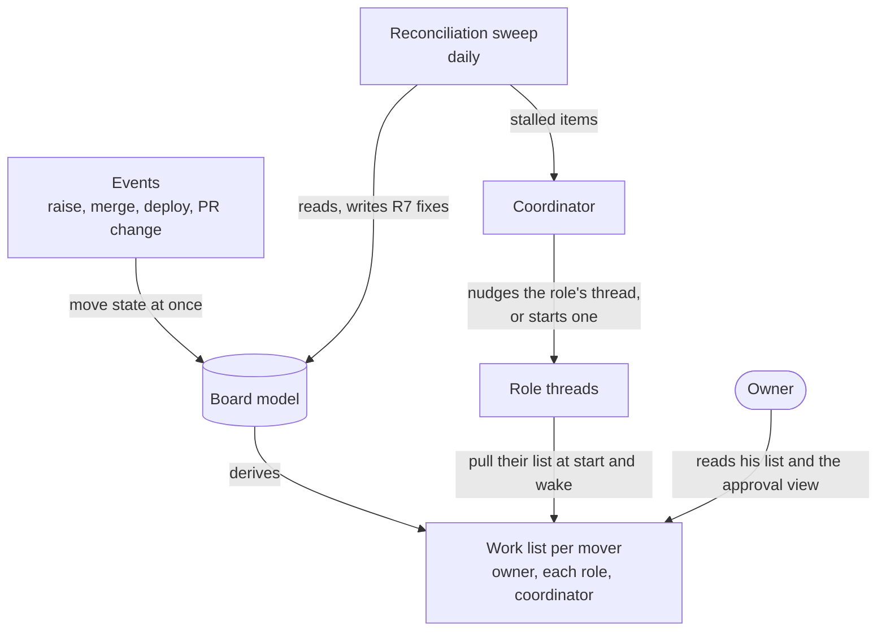

# 176 Project Board flow: options for keeping items moving

Design step 3 of delphside/programme#176. [design.md](design.md) says, for each
type and state, who moves an item, on what trigger, and how long it may wait.
This file compares the ways of making that happen, each saying what it
constrains. How the chosen option is built on today's tools is
`implementation.md`, next.

## What any option has to do

| Job | Requirement |
| --- | --- |
| make the moves a tool can make, when their event happens | R1, R2 |
| tell each mover what is theirs, oldest first | R3, R14 |
| find an item past its bound, or with a stale claim, and tell its mover | R8, R11, R12 |
| put an item in an invalid state into a valid starting state | R7 |
| avoid two movers starting the same item | R9 |
| keep working when some or all threads are stopped | R8 |

## The options

### 1. Events only

Each event moves its item: raising an issue sets its starting state, a merge
moves its work package, a deploy moves what it shipped, a pull request change
sets `PR State`.

- **Constrains:** every move needs an event and a hook to catch it. Waiting has
  no event, so nothing notices a stall (fails R8, R11). A lost event leaves an
  item wrong until somebody looks.
- **Today:** partly built: `pr-state.yml`, `board-add.yml`, the post-merge hook
  and `deploy.sh`.

### 2. A reconciliation sweep

A scheduled job compares each item's state, age and claim with the model, as a
controller compares desired state with actual. It writes R7's fixes, and lists
every item past its bound with its mover.

- **Constrains:** an item is only as current as the last run, so the interval
  must be shorter than the shortest bound (triage's one day). Nudging a
  thread needs something that can reach threads, which only the coordinator
  can.
- **Today:** the weekly `board-sweep`, run by hand from the Monday trigger,
  does part of this.

### 3. A work list per mover, pulled

Each mover asks the model *what is mine* when it starts or wakes: the owner's
list, each role's list, the coordinator's.

- **Constrains:** only a mover that is running pulls, so a stopped thread's items
  wait unseen (fails R8 alone). Every thread has to ask, at start and at each
  wake.
- **Today:** `board-actions.py` (the owner's) and `--claude` (Claude's, as one
  list, not per role), read by the session-start hook in WSL only.

### 4. A mix: events for speed, the sweep for correctness, lists for the work

Events make the moves they can, as soon as they can. The lists tell each mover
what is theirs. The sweep is the safety net: it finds whatever an event missed
or a mover left past its bound, and hands it to the coordinator, which nudges
the role's thread or starts one. A black start is the owner prompting the
coordinator, whose first act is a sweep.

- **Constrains:** three mechanisms to keep consistent, so all three must read
  one model (R3) rather than keep their own rules. The sweep's interval sets how
  late a stall is noticed.
- **Today:** each part exists in some form; none reads bounds or claims.

## Recommendation

**Option 4**, the controller pattern: events are an optimisation, the sweep is
what makes the flow correct, and the lists are how movers pull. Option 1 or 3
alone fails R8, and option 2 alone is slow for moves that have an event.

## Questions for the owner

1. **Which option.** Answered (owner, 2026-11-13): option 4, the mix.
2. **How often the reconciliation sweep runs.** Answered (owner, 2026-11-13):
   daily, the longest interval that still catches triage's one-day bound. It
   also writes each item's `Turn` ([design.md](design.md#open-questions)).
   The weekly `board-sweep` keeps its planning (queues and candidates), which
   has no bound.
