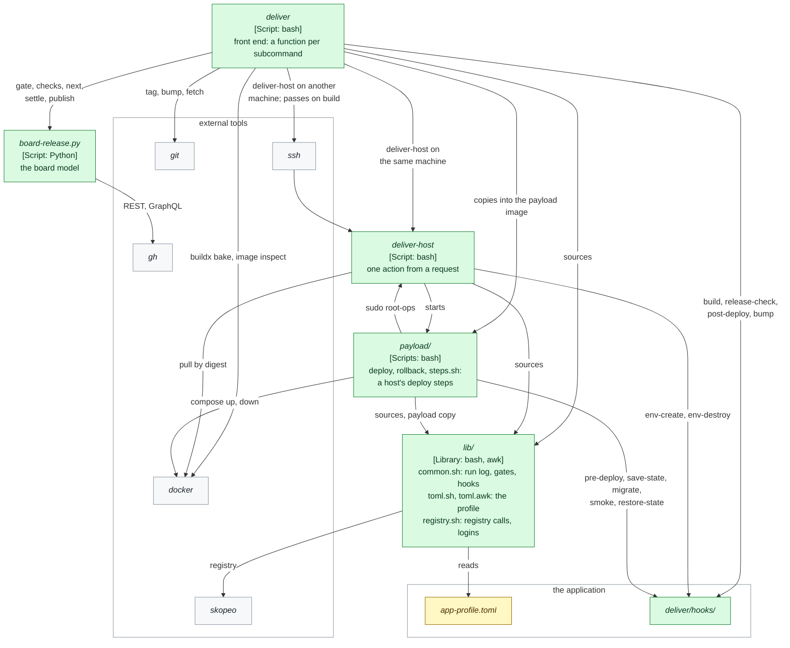
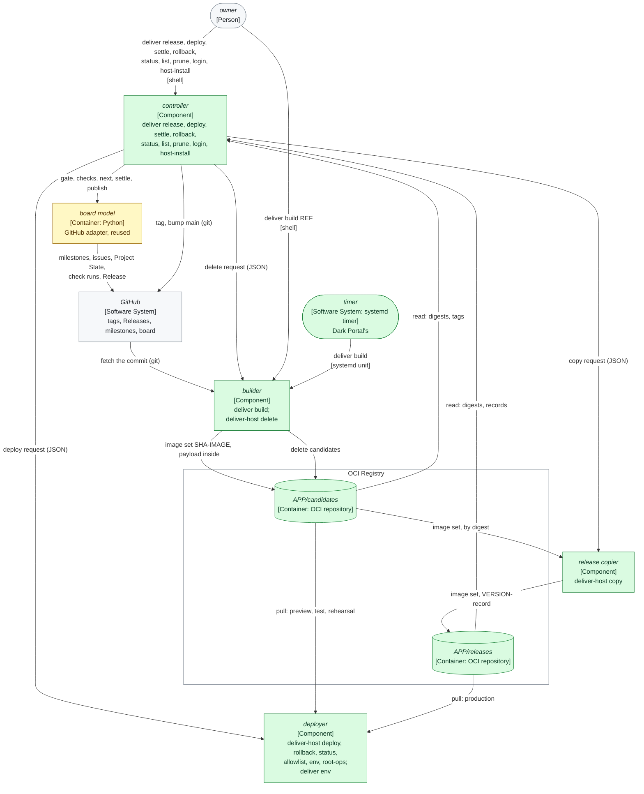
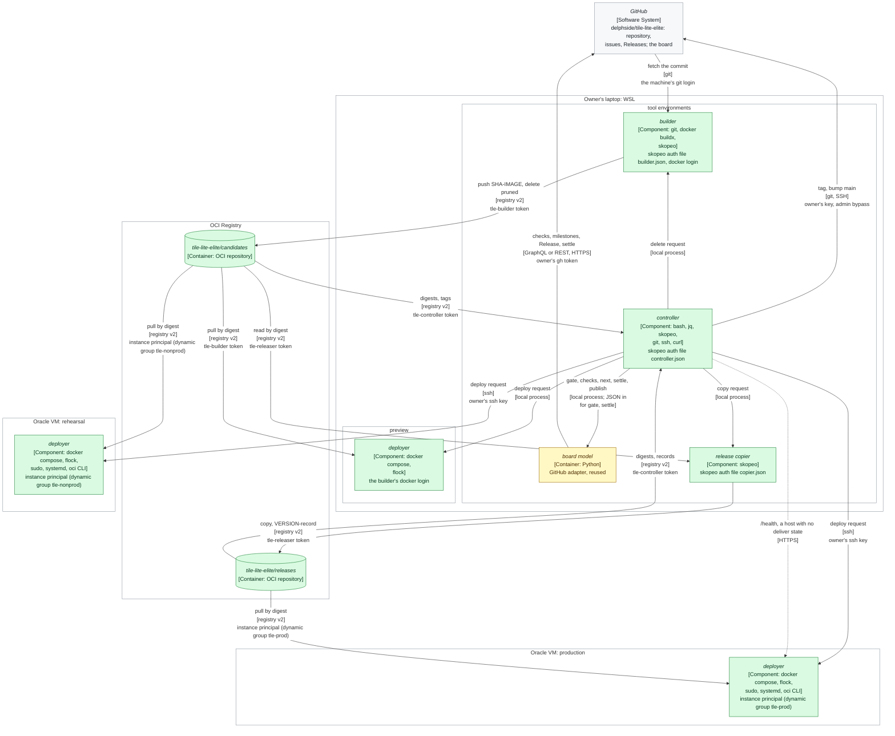
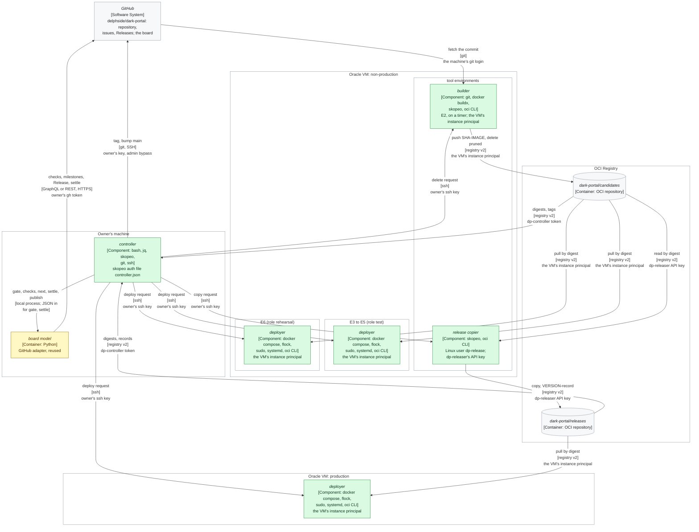
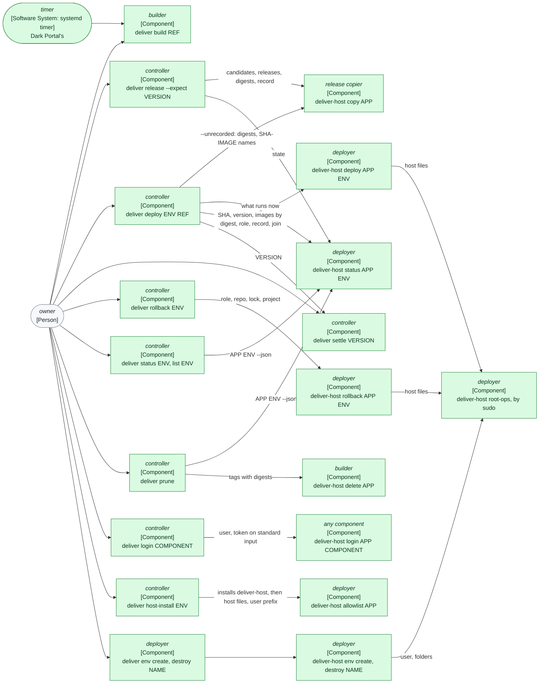
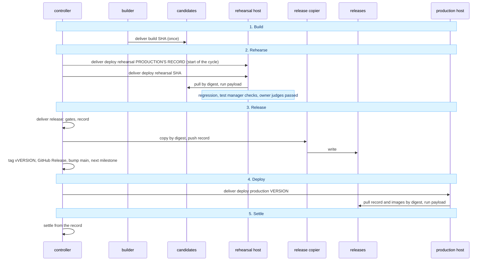
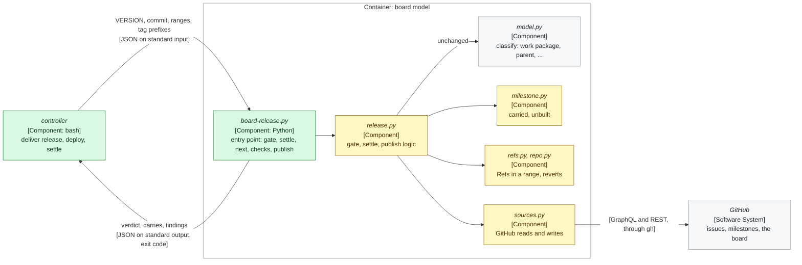

<!-- markdownlint-disable-file MD013 -->
# The deliver tool: design

Design for delphside/programme#117, which introduces Turpin, a generic tool to
build and deliver application images. The tool implements the generic rules for
releasing application images described in
[docs/1.2 *Making a release, then deploying it*](../../../../docs/1.2-change-lifecycle.md#making-a-release-then-deploying-it).
Its decisions are in #117's body.

Two applications are building implementations alongside it, and they ship with
it in the same release:

- Tile Lite Elite: delphside/tile-lite-elite#545 (work packages
  delphside/tile-lite-elite#555 and delphside/tile-lite-elite#556).
- Dark Portal: delphside/dark-portal#11 (delphside/dark-portal#15).

Once the projects are delivered, this project document will be moved into
permanent design documents. Application implementation details will be split
out into application-specific documents:

- deployment view ([§2](#2-the-tool-and-its-components))
- profile and hooks ([§5](#5-profile-and-hooks))
- registry policies and logins ([§10](#10-oci-integration))

## 1. As-is

| | Tile Lite Elite | Dark Portal |
| --- | --- | --- |
| build | `scripts/deliver/deploy.sh` builds each commit once on the owner's laptop into a local tarball, `artifacts/SHA.tar.gz`, shared by every environment | none yet |
| store | none: the tarball is copied to each host with `scp` | registry repositories `dark-portal/candidates` and `dark-portal/releases` exist (delphside/dark-portal#14), nothing pushed |
| release | until 0.10.0, inside `deploy.sh` after the production deploy: tag `prod-X.Y.Z`, GitHub Release, bump `main`, settle the milestone. 0.10.1 was released by hand at rehearsal pass, as the annotated tag `v0.10.1` (2026-10-27) | none yet |
| deploy | `deploy.sh` from the operator's working tree, over ssh. Its gates count themselves and refuse if one did not run: on the remote, CI green with e2e, pull request, schema, version, milestone, preview and rehearsal `/health` short SHA | none yet |
| configuration | Caddyfile baked into the web image; compose file copied from the commit; secrets in each host's `.env`; preview uses its own compose file and `Caddyfile.preview` from the working tree | designed in delphside/dark-portal#11 |
| rollback | retags `:previous` and restores a snapshot; the earlier compose file is not restored | designed in delphside/dark-portal#11 |

## 2. The tool and its components

### The tool

*Turpin* is the programme's generic tool for building, releasing and
deploying application images.

Builds are stored in two repositories: `candidates` and `releases`.

The process in short is:

1. A commit is built and stored in the candidates repository (the key is the
   commit's SHA).
2. From the candidates repository it is deployed to non-production
   environments for testing.
3. After testing, the build is promoted to a release and stored in the releases
   repository.
4. From the releases repository it is deployed into the production environment.

The repositories contain *image sets*, which are the same for every
environment. Environment-specific information, secrets included, is stored in
each environment's `.env` file. A deployment needs an image set from a
repository and an environment's `.env` file.

Turpin is made of CLI *programs*, implemented as shell scripts. `turpin` is the
Turpin client. It is run from a checkout of the application and can be close to
the user. `turpin-host` is deployed on the machine where it carries out its
action. Mainly it is invoked from `turpin`, but it can also be invoked
directly. It is installed by `host-install`. The deployment model is flexible,
and many copies of the programs can be deployed to wherever particular commands
need to run. The application's profile, `app-profile.toml`, defines where each
command runs.

Turpin exposes CLI *commands*, each of which is a program and a subcommand,
such as `turpin build` or `turpin-host copy`, typed by a person or sent by
another component.

A *component* is a logical collection of related commands with a common
responsibility and shared credentials. The commands in a component may be
implemented across both programs, but all run on the same machine, with the
exception of the deployer, which runs beside each application environment it
changes. This is specified in the [deployment model](#deployment-model).

There are four components:

| Component | Responsibility | Commands it runs |
| --- | --- | --- |
| controller | decides what ships, and changes `main`, tags and the board | `deliver release`, `deploy`, `settle`, `rollback`, `status`, `list`, `prune`, `login`, `host-install` |
| builder | builds each commit once, and owns the candidates | `deliver build`; `deliver-host delete`, which `prune` sends it |
| release copier | writes releases | `deliver-host copy` |
| deployer | changes one application environment | `deliver-host deploy`, `rollback`, `status`, `allowlist`, `env`, `root-ops`; `deliver env create`, `destroy`, typed on the environment's host |

`deliver-host login`, which `deliver login` sends, runs as whichever component
the login is for.

Each program is one bash script with a front end that reads the subcommand and
calls that subcommand's function (`cmd_build`, `cmd_copy` and so on). Both
source the same libraries in `scripts/deliver/lib/`: `common.sh` (run log,
gates, hooks, errors), `toml.sh` with `toml.awk` (the profile) and `registry.sh`
(registry calls and logins). The deploy steps a host runs are not in either
program but in the payload (`scripts/deliver/payload/`, [§9](#9-on-the-host)).

#### Scripts and their dependencies

What each script sources, runs or calls: the tool's own scripts, the
application's profile and hooks, and the external tools
([Technologies](#technologies)). As in every diagram here, each box is coloured
by what this change does to it: green new, yellow changed, grey unchanged
([change state](https://github.com/delphside/tile-lite-elite/blob/main/docs/diagrams/README.md#change-state)).
Every line in these diagrams is new unless labelled unchanged, and the
component view's repositories are new for Tile Lite Elite and already exist for
Dark Portal.



Both programs are installed and run directly on their machine by a Linux user;
only the application runs in Docker, started by the deployer with
`docker compose`. They integrate with OCI Registry, which holds the images
([§10](#10-oci-integration)), and GitHub, which holds the code and tracks each
delivery ([§11](#11-github-integration)).

### Deployment model

The programs are designed to run distributed, so each component is placed
wherever suits it, on one machine or several, and differently for each
application:

- The controller, builder and release copier each run in a *tool environment*;
  the controller's is the one a run is started from.
- Each deployer runs beside the application environment it changes, one
  running copy of the application ([roles](#application-environments)), as
  that environment's *deploy user* ([§9](#9-on-the-host)).
- A *host* is a machine running one or more environments.
- The application's profile (`app-profile.toml`, [§5](#5-profile-and-hooks))
  names the host for each component, and a program is installed on every host
  where one of its components runs.
- Every component has a registry login of its own, so components sharing a
  host keep separate logins ([§10](#10-oci-integration)).
- `deliver build`, typed on the controller's host, is passed by `ssh` to the
  builder's (`[deliver.build].on`), where the same command runs as the builder.
  A command started on the builder's own host, such as a timer's, sets
  `DELIVER_ON_BUILD_HOST=1`, so it builds there rather than passing itself on.

The scripts live in the programme repository ([Layout](#layout)) and run from
three places:

| Scripts | Run from |
| --- | --- |
| `deliver` | the application's checkout, as `programme/scripts/deliver/deliver`, from the `programme/` submodule at the commit the application pins |
| `deliver-host` and `lib/` | `/usr/local/bin/deliver-host` and `/usr/local/lib/deliver/`, copied there by `deliver host-install` |
| `payload/` and the hooks | the deploy's folder under the environment's [state folder](#9-on-the-host), taken out of the payload image |

Tile Lite Elite runs all four components on the owner's laptop, with a deployer
on each VM as well. Dark Portal runs its controller on the owner's machine and
its builder, release copier and test deployers on the non-production VM. The
[deployment views](#deployment-views) show each placement.

### Docker image repositories (OCI Registry)

What is stored for one commit is an *image set*: one image for each name in the
profile's `images` (Tile Lite Elite's `server` and `web`, Dark Portal's `dp`),
built once and tagged `SHA-IMAGE`, the commit's SHA then the image's name. One
of them, the profile's `payload_image`, also carries the *payload* at
`/deliver/`. A release adds the *record* ([§7](#7-the-release-and-its-record)):
the version, the commit and each image's digest, stored as a one-layer image
beside the images and as the annotated tag's message.

Every image set and every release is kept in two OCI Registry repositories per
application ([§10](#10-oci-integration)):

- **`APP/candidates`** holds every commit built, as `SHA-IMAGE`. The builder
  writes it; preview, test and rehearsal
  ([roles](#application-environments)) deploy from it, and `prune` deletes
  from it.
- **`APP/releases`** holds every release, as `VERSION-IMAGE` and
  `VERSION-record`. The release copier writes it, by copying a candidate by
  digest, so production runs the bytes rehearsal ran; production deploys from it
  alone.

The payload is what each host runs to deploy the image set
([§9](#9-on-the-host)): deploy steps, hooks,
[joined files](#5-profile-and-hooks) such as the compose file, and host files.
It holds nothing secret; secrets stay in each host's `.env`.

- `deliver build` assembles it into `<worktree>/.deliver-payload/` and exports
  `DELIVER_PAYLOAD_DIR`; the Dockerfile copies it to `/deliver/` in the
  `payload_image`.
- Steps and libraries come from the `programme` submodule at the commit the
  built commit pins (the running tool's own without one), read with
  `git archive` and recorded as `tool.programme`; hooks and files from the
  application.
- Joined files come from the payload, never a working tree; an environment may
  name its own (Tile Lite Elite's preview joins `docker-compose.preview.yml`,
  `Caddyfile.preview`).

### Application environments

An *application environment* is one running copy of the application, with an
*environment role* that [gates](#6-gates-and-checks) key on.

| Environment role | Reads | Gates that key on it |
| --- | --- | --- |
| `preview` | candidates | none beyond every deploy's |
| `test` | candidates | none beyond every deploy's |
| `rehearsal` | candidates | release reads what it runs; each [cycle](#stages) starts at production's level, production's current release deployed first |
| `production` | releases only | needs a [record](#7-the-release-and-its-record); [settle](#8-settling) follows (a check) |

### The components

For each component: where it runs, its local dependencies, who starts it
(*reached by*), what it calls (*reaches*) and the credentials it holds. What
each command may do with those credentials is [§4's privileges](#privileges).
Every component also needs the tools its registry login needs
([§10](#10-oci-integration)), and every machine `host-install` installs on
needs `flock`. Common tools are named only; the others are described
under [Dependencies](#dependencies).

- **Controller.** Decides what ships, and is the only component that changes
  `main`, tags or the board.
  - Runs where the owner works, with a route to every other component.
  - Local dependencies: `deliver` in a checkout of the application, whose
    `programme/` submodule carries it; bash, awk, git, `gh`, `jq`, `ssh`,
    `curl`, Python 3; the board model; `skopeo`; Docker, for a preview
    `--local` deploy; the application's `release-check`, `post-deploy` and
    `bump` hooks.
  - Reached by the owner, at a shell.
  - Reaches GitHub (git, and the board model's API calls), OCI Registry (reads),
    and by `ssh` the builder, the release copier and every environment's host
    on another machine.
  - Credentials: its own `skopeo` registry login; the owner's `gh` login, which
    the board model uses; the owner's git login; an `ssh` key for each machine
    it reaches.
- **Builder.** Builds each commit once and owns the candidates.
  - Runs where there is enough memory and processor to build the application.
  - Local dependencies: `deliver` on the `PATH`, with `DELIVER_REPO` naming a
    checkout of the application, both set where a non-interactive `ssh`
    session reads them, since a passed-on build starts in the home folder; bash,
    awk, git, `jq`; Docker, to build and push; `skopeo`; `deliver-host`, for
    `delete`; the application's `build` hook.
  - Reached by the controller by `ssh`, the owner at a shell, and a timer where
    the application has one.
  - Reaches GitHub (git fetch) and OCI Registry (push, read and delete
    candidates).
  - Credentials: its own `skopeo` registry login; the machine user's `docker`
    login; the machine's git login.
- **Release copier.** Writes releases.
  - Runs on the host the profile's `copy_on` names, with a registry login of
    its own. Tile Lite Elite's is Oracle user `tle-releaser`, on the
    controller's machine; Dark Portal also gives it a Linux user, `dp-release`,
    on the non-production VM.
  - Local dependencies: `deliver-host`; bash, awk, `jq`; `skopeo`.
  - Reached by the controller, by `ssh` where it is on another machine.
  - Reaches OCI Registry (read candidates, write releases).
  - Credentials: its own `skopeo` registry login.
- **Deployer.** Changes one application environment by one locked, restorable
  path.
  - Runs on the host of the environment it changes, as its deploy user.
  - Local dependencies: `deliver-host`; bash, awk, `jq`; Docker with
    `docker compose`; the payload's deploy steps, which run the application's
    `pre-deploy`, `save-state`, `migrate`, `smoke` and `restore-state` hooks,
    while `deliver-host env` runs its `env-*` hooks; the `sudo` rule
    *root-ops* ([privileges](#privileges));
    for `deliver env`, `deliver` in a checkout of the application, with
    `DELIVER_PROFILE` naming its profile.
  - Reached by the controller, by `ssh` where it is on another machine, and by
    the owner on the host, for `deliver env`.
  - Reaches OCI Registry (pull candidates, or releases for production).
  - Credentials: the machine user's `docker` login: an instance principal on a
    VM, the builder's on the laptop for preview.
  - Holds: the environment's `.env`, which holds what differs per environment,
    and its [state folder](#9-on-the-host).

#### Dependencies

- **Board model** (`scripts/board/`, Python): an existing programme tool,
  reused here and installed beside the controller. It handles all integration
  with the GitHub project board, and decides every question about issues,
  milestones and `Refs`, so a release is gated by the same code that checks
  the board ([the board model's part](#the-board-models-part)).
- **[skopeo](https://github.com/containers/skopeo)**: a command-line tool that
  inspects, copies and deletes images in a registry without pulling them or
  running a Docker daemon. The controller, builder and release copier use it
  ([§10](#10-oci-integration)).
- **Application hooks**: the application's own scripts in `deliver/hooks/`,
  which the tool calls at fixed points to build, check, migrate and smoke-test
  that application ([§5](#5-profile-and-hooks)). The controller and builder run
  theirs from the checkout, at the commit being built or shipped (`bump` at
  `main`'s tip); the deployer runs its hooks from the payload.

### Component view

The diagrams use the programme's
[diagram views](https://github.com/delphside/tile-lite-elite/blob/main/docs/diagrams/README.md#which-view-a-diagram-takes-and-saying-so).
Each component's box names the commands it runs. Each arrow is labelled with
what it carries.



### Deployment views

They show each host's environments, the technology inside each
component, and on each arrow what it carries, `[protocol]` and the credential
used. The registry is Oracle's Container Registry; every registry arrow is the
Docker Registry HTTP API v2 over HTTPS ([§10](#10-oci-integration)), and a
`deliver-host` arrow sends its request as JSON on standard input
([§4](#4-commands)).

#### Tile Lite Elite



#### Dark Portal



#### Credential labels

The credential on an arrow or in a box is one of these:

| Label | What it is |
| --- | --- |
| instance principal (dynamic group X) | the VM's own identity, which the policy grants by the named dynamic group; its token comes from the `oci` CLI on the host ([§10](#10-oci-integration)) |
| the VM's instance principal | the same, with the group not shown |
| `NAME token` | the auth token of Oracle user NAME, typed once at `deliver login` ([§10](#10-oci-integration)) |
| API key | Oracle user dp-releaser's key, which never leaves its machine ([§10](#10-oci-integration)) |
| skopeo auth file, docker login | the logins `deliver login` makes: a file per component, and the machine user's `docker` login ([§10](#10-oci-integration)) |
| owner's gh token | the controller's `gh` login ([§11](#11-github-integration)) |
| owner's key, admin bypass | the owner's git credential, which bypasses `main`'s ruleset ([§11](#11-github-integration)) |
| owner's ssh key | the owner's key for `ssh` to a host |
| the machine's git login | the credential the machine's `git` uses to fetch `origin`: none, as both applications' repositories are public; a private one needs a read-only fetch credential |

On Tile Lite Elite's laptop the controller, builder and copier run as one Linux
user with four logins (three skopeo auth files and the `docker` login), and the
payload's deploy steps run on each host as its deploy user, reaching root
through `root-ops` ([privileges](#privileges)).

### Technologies

Where each runs is in the two deployment views.

| Technology | What it is | Used for |
| --- | --- | --- |
| [bash](https://www.gnu.org/software/bash/), [jq](https://jqlang.org/) | the shell the tool is written in; a command-line JSON processor | the tool; requests, state and records |
| [awk](https://www.gnu.org/software/gawk/manual/) | a text-processing language | reading the profile (`toml.awk`) |
| [skopeo](https://github.com/containers/skopeo) | a registry image tool ([Dependencies](#dependencies)) | registry reads, the release copy, the record, deletes ([§10](#10-oci-integration)) |
| [Docker](https://docs.docker.com/), [Compose](https://docs.docker.com/compose/), [Buildx](https://docs.docker.com/build/) | the container engine; its multi-container runner; its builder, which can build several architectures in one run | pull by digest and run; the default `build` hook |
| [Python 3](https://www.python.org/) | the language of the reused board model | `board-release.py`'s gate, checks, next, settle and publish, on the controller ([§6](#the-board-models-part)) |
| [git](https://git-scm.com/) | version control | worktrees, the payload archive, tag, bump |
| [GitHub CLI](https://cli.github.com/) (`gh`) | GitHub's command-line client, which also calls its REST and GraphQL APIs | every GitHub call, made through the board model ([§11](#11-github-integration)) |
| [OpenSSH](https://www.openssh.com/), [curl](https://curl.se/) | remote commands; HTTP requests | `deliver-host` calls; production's `/health` ([§6](#6-gates-and-checks)) |
| [flock](https://man7.org/linux/man-pages/man1/flock.1.html), [sudo](https://www.sudo.ws/), [systemd](https://systemd.io/) | a file lock; running one command as root; Linux's service manager | the deploy lock; `root-ops`; units ([§9](#9-on-the-host)) |
| [OCI CLI](https://docs.oracle.com/en-us/iaas/Content/API/Concepts/cliconcepts.htm) (`oci`) | Oracle Cloud's command-line client | the registry token for `oci-instance-principal` and `oci-api-key` ([§10](#10-oci-integration)) |
| [Bats](https://github.com/bats-core/bats-core) | a test framework for bash | the tool's tests, in development and CI |

### Layout

In the programme repository:

| Path | What |
| --- | --- |
| `scripts/deliver/deliver`, `deliver-host` | the commands; `deliver-host` is installed by `host-install` |
| `scripts/deliver/payload/` | deploy and rollback steps for the payload image |
| `scripts/deliver/lib/` | profile, run log, gate list, registry and login adapters |
| `scripts/tests/deliver-*.bats` | tests |
| `scripts/board/` | the board model, reused, which is the GitHub adapter: `board-release.py` its entry point, `sources.py` its GitHub calls; the board reads tags with `tag_prefix` as releases and `history_prefixes` as history |
| docs/1.1, 1.2 | 1.1: the tool's row. 1.2: *Making a release, then deploying it*, and §1.0, which states that a release is "a commit on `main`" (delphside/tile-lite-elite#545 R5) |

## 3. The route

### Command flow

A component view: who starts each command, what it is given (its parameters),
and which `deliver-host` command it runs with what request.
[§4](#4-commands) lists each request's fields.



### Stages

A dynamic view of the stages, in order.



1. **Build.** The builder builds a commit once and pushes `SHA-IMAGE`, payload
   inside, to candidates.
2. **Rehearse.** A *cycle* is rehearsal between one release being made and the
   next. It first deploys production's current record to rehearsal
   (*production's level*), so the commit is rehearsed as an upgrade, then the
   commit ([§9](#9-on-the-host)). Regression runs, the test manager checks, the
   owner judges rehearsal passed. Preview and test have no cycle.
3. **Release.** `deliver release` runs the release gates
   ([§6](#6-gates-and-checks)), asks the owner to confirm the version and makes
   the release ([§7](#7-the-release-and-its-record)).
4. **Deploy.** `deliver deploy production VERSION` pulls the record and images
   from releases by digest and runs the same steps.
5. **Settle.** The controller settles the board from the record
   ([§8](#8-settling)); a failure leaves the deploy standing, exit 3.
   `post-deploy` follows ([§6](#6-gates-and-checks)).

## 4. Commands

Every command writes a run log naming each gate it ran, and refuses if one in
its list did not.

| Exit | Meaning |
| --- | --- |
| 0 | done |
| 1 | refused or failed, previous deploy restored if any |
| 3 | live, but a later step (settle, GitHub Release, milestone) failed, named |

### The commands

`ENV` is a profile environment, `REF` a commit or version, `GATE` a
[§6](#6-gates-and-checks) gate, `COPIER` the release copier's host (`copy_on`),
`BUILDER` the builder's (`build.on`), `COMPONENT` `controller`, `builder`,
`copier` or an `ENV`. The `deliver-host` commands are called by `deliver` (over
`ssh`, or directly on the same machine), or, as `root-ops`, by the payload steps
through `sudo`; `deploy`, `rollback`, `copy` and `delete` take a JSON request on
standard input.

| Command | Component | Called by | What | Privileges |
| --- | --- | --- | --- | --- |
| `deliver build [REF] [--local]` | builder | owner; timer; controller by `ssh` | builds REF (default `HEAD`) once, pushes to candidates; non-interactive. The `build` hook (default `docker buildx bake`); labels `org.opencontainers.image.revision` (SHA) and `.version` (from the version file); prints digests (an index digest for a multi-arch build). `--local` (preview only): local Docker, no push; identified by image id and revision label, not `RepoDigests` | builder: its `skopeo` login (read candidates), the machine user's `docker` login (push candidates), the machine's git login (fetch) |
| `deliver deploy ENV REF [--wait[=MIN]] [--check] [--set-aside GATE REASON] [--unrecorded REASON] [--off-level REASON]` | controller | owner | preview, test, rehearsal: REF is a SHA (full or short; ambiguous refuses) or version, resolved to candidates' digests. Production: a version with a record | controller: its `skopeo` login (read), the owner's `ssh` key. Deployer: the machine user's `docker` login (pull candidates, or releases for production); the deploy user and *root-ops* |
| `deliver release [--expect VERSION] [--commit REF] [--emergency REASON] [--skip-rehearsal REASON] [--set-aside GATE REASON] [--check]` | controller; copy on the copier | owner | releases the commit rehearsal runs; `--commit REF` names another commit instead, as `--skip-rehearsal` needs. Shows version (from the version file at that commit), commit, digests, last passing rehearsal deploy; the owner types the version to confirm (`--expect` if non-interactive). Gates [§6](#6-gates-and-checks), steps [§7](#7-the-release-and-its-record) | controller: its `skopeo` login (read), the owner's `gh` login (through the board model), the owner's git login (push `main` and the tag, by admin bypass), the owner's `ssh` key to the copier's machine. Copier: its `skopeo` login (write releases) |
| `deliver settle VERSION` | controller | owner | the board to what the record says shipped ([§8](#8-settling)); safe to rerun | controller: the owner's `gh` login, through the board model |
| `deliver rollback ENV` | controller | owner | `deliver-host rollback`: ENV's previous deploy ([§9](#9-on-the-host)) | controller: the owner's `ssh` key. Deployer: as for `deploy` |
| `deliver status ENV`, `list ENV` | controller | owner | digests ENV runs (`RepoDigests`), their record, deploy state, host files against the payload's (a check); `list`: the records beside what ENV runs | controller: its `skopeo` login (read), the owner's `ssh` key |
| `deliver prune [--dry-run]` | controller; delete on the builder | owner | the controller picks the unneeded candidates, reading every environment's state and the registry with its own login, and sends the list to the builder (`[deliver.build].on`), whose login deletes them; never releases. `--dry-run` lists and sends nothing. Exit 1 if the builder fails to delete any chosen candidate (the rest are deleted) | controller: its `skopeo` login (read), `ssh` to every host and the builder. Builder: its `skopeo` login (delete candidates) |
| `deliver login COMPONENT` | controller; `deliver-host login` on the component's machine | owner | the owner's one `docker-config` login for `controller`, `builder`, `copier` or an environment (its deployer): asks for the registry user, reads the token at a hidden prompt, and sends both on standard input to `deliver-host login` on the component's machine ([§10](#10-oci-integration) says which login each makes). Prints nothing of the token | the owner's `ssh` key to the component's machine; writes only that component's login |
| `deliver env create\|destroy NAME` | deployer, on the environment's host | owner, on the environment's host | an ephemeral environment from the profile template: user, state folder, `.env` (secrets at a hidden prompt), Compose project; the `env-*` hooks | deployer: the deploy user and *root-ops* |
| `deliver host-install ENV\|COPIER\|BUILDER` | controller | owner | installs or updates `deliver-host` and libraries on ENV's host, the copier or the builder; installs `jq` if missing; refuses if `flock` or the login adapter's tools (`oci`) are absent. A copier or builder hosting no environment gets `deliver-host` and libraries (including `registry.sh`), no allowlist or sudo rule. Refuses environments that would remove each other's host files ([§6](#6-gates-and-checks)) | the owner's `ssh` key, as a user with `sudo` on the target machine, to install into `/usr/local` |
| `deliver-host deploy APP ENV < request` | deployer | `deliver deploy` | [§9](#9-on-the-host)'s steps. The request: `app`, `env`, `role`, `sha`, `version`, `images` by digest, `repo`, `login`, `login_component`, `payload_image`, `pull_timeout`, `lock`, `project`, `wait`, `check`, `local`, `record`, `set_aside`, `host_files`, `env_join` | the machine user's `docker` login (pull); the deploy user and *root-ops* |
| `deliver-host rollback APP ENV < request` | deployer | `deliver rollback` | switch to `previous`. The request: `app`, `env`, `role`, `login`, `repo`, `lock`, `project`, `pull_timeout`, `wait` | as for `deploy` |
| `deliver-host status APP ENV --json` | deployer | `status`, `list`, `prune`, release, the rehearsal-level gate, production's version read | what runs, its record, state | the deploy user (reads its state) |
| `deliver-host copy APP < request` | release copier | `deliver release` and `deliver deploy --unrecorded`, on `[deliver.release].copy_on` with `copy_login` | image set to releases by digest, then the record; the controller only reads. The request: `login`, `candidates`, `releases`, `copies` (`digest`, `dest` name), `record` (`tag`, `body`) or null | its `skopeo` login (read candidates, write releases) |
| `deliver-host delete APP < request` | builder | `deliver prune`, on `[deliver.build].on` with the build login | delete each candidate the controller chose, the request being `login`, `candidates` and `deletes` (`tag`, `digest`), and only while the tag still has that digest; an absent tag is done | its `skopeo` login (delete candidates) |
| `deliver-host login APP COMPONENT [ENV]` | the component the login is for | `deliver login`, on the component's machine | `skopeo login --authfile` for the controller and copier; both that and `docker login` for the builder; `docker login` for a deployer; all `--password-stdin`, user and token on standard input | writes only that component's login |
| `deliver-host allowlist APP < lines` | deployer | `host-install`, as root | the root-owned allowlist | root, through `host-install`'s `sudo` |
| `deliver-host env create\|destroy NAME` | deployer | `deliver env` | an ephemeral environment | the deploy user and *root-ops* |
| `deliver-host root-ops ...` | deployer | payload steps and `env`, by one `sudo` rule | the deploy user's root operations ([privileges](#privileges)) | root, by the one `sudo` rule |

`prune` removes a candidate only if built before the newest release was made,
not released, and not run by any current or previous deploy. "Built" is the
image's `org.opencontainers.image.created` label, the time the build started
(skopeo gives no push time); a build begun before a release and pushed after
costs a rebuild.

### Privileges

Each component holds least access, apart from the deployer's root (the *Root*
point), and the *Privileges* column of
[the commands](#the-commands) says which credential each
command uses. An `ssh` key is used only where the component is on another
machine; on the same one `deliver` runs `deliver-host` directly. The registry's
side of each login is [§10](#10-oci-integration)'s policy, GitHub's is
[§11](#11-github-integration)'s. The split of access:

- GitHub: the controller holds the API credential, the owner's `gh` login used
  by the board model, and is the one component that pushes to git; the builder
  only fetches, and the copier and deployer have no GitHub credential
  ([§11](#11-github-integration)).
- `ssh`: the controller is the one component that calls out by it.
- Registry: the controller only reads; the builder writes and deletes
  candidates and reads nothing of releases; the copier writes releases; each
  deployer pulls what its role reads. Tile Lite Elite's preview deployer uses
  the builder's login, which can also write candidates.
- Root: the payload's steps reach root through *root-ops*, the `sudo` rule
  `host-install` writes ([§9](#9-on-the-host) lists what it may do). By
  default the deploy user is the user who ran `host-install`, which has full
  `sudo`, so *root-ops* only routes the steps; a dedicated deploy user, with
  the rule changed by hand, reaches root only through it. Either way the deploy
  user is root-equivalent through Docker, so *root-ops* guards against
  mistakes; the deploy user is trusted as root.

### Flags that set a gate aside

Each takes a reason, kept in the record if there
is one and always in the run log:

| Flag | Sets aside |
| --- | --- |
| `--emergency REASON` (release) | the commit being on `main` |
| `--skip-rehearsal REASON` (release) | rehearsal having passed this commit; raises the retrospective issue ([§7](#7-the-release-and-its-record)) |
| `--unrecorded REASON` (production deploy) | the need for a record: REF is a full SHA, copied to releases by the release copier as `SHA-IMAGE` (no-op where the same digests are present; another digest refuses); no version spent, nothing to settle |
| `--off-level REASON` (rehearsal deploy) | a cycle starting from production's level |
| `--set-aside GATE REASON` | a gate in `[release].overridable`: a hook's name, or `milestone` |

`--check` runs every gate and stops before anything changes (Tile Lite Elite's
`verify.sh` uses it). `deploy --wait[=MIN]` waits for the lock and for a hook
answering *not yet*, checking each minute, 60 minutes by default (Dark Portal's
longest wait outside its window is 50); at the limit it refuses, exit 1,
naming what it waited for.

## 5. Profile and hooks

**Profile.** The application's `app-profile.toml` keeps its sections and gains
keys in them, never the registry address ([§10](#10-oci-integration)). Tile Lite
Elite's example; Dark Portal's values in comments (`dp:`):

```toml
[release]
tag_prefix = "v"
history_prefixes = ["prod-"]               # earlier tags: history, release notes, version order, production's tag
announcement = "Released in v"             # starts settle's comment (§8); matched also with each history prefix
deploy_marker = "[deliver]"
required_checks = ["e2e"]
required_hooks = ["pre-deploy", "save-state", "migrate", "smoke", "restore-state", "release-check"]
overridable = ["milestone"]

[deliver]
candidates = "tile-lite-elite/candidates"  # dp: "dark-portal/candidates"
releases   = "tile-lite-elite/releases"    # dp: "dark-portal/releases"
images     = ["server", "web"]             # dp: ["dp"]; tag is SHA-IMAGE
payload_image = "server"
join = ["docker-compose.yml", "Caddyfile"]

login = "docker-config"                    # the controller's own login: reads candidates and releases

[deliver.build]
on    = "controller"                     # dp: ssh alias of the non-production VM; builds and deletes candidates
login = "docker-config"                    # dp: "oci-instance-principal"

[deliver.release]
copy_on    = "controller"                # dp: the non-production VM, user dp-release
copy_login = "docker-config"               # dp: "oci-api-key"

[[deliver.host_files]]
src  = "scripts/operate/backup-to-oci.sh"
dest = "/opt/tile-lite-elite/backup-to-oci.sh"
mode = "0755"
# a systemd unit adds: enable = true

[environments.preview]                     # existing keys stay
role  = "preview"
host  = "controller"
login = "docker-config"                    # the machine user's docker login, shared with the builder on the laptop
join  = ["docker-compose.preview.yml", "Caddyfile.preview"]

[environments.rehearsal]
role  = "rehearsal"
ssh   = "tile-lite-elite-rehearsal"
login = "oci-instance-principal"

[environments.production]
role  = "production"
ssh   = "tile-lite-elite"
login = "oci-instance-principal"
host_files = true                          # default: true for roles rehearsal and production
# lock = "/var/lib/deliver/APP/vm.lock"    # dp: one lock for E3 to E6 and its heavy runs
pull_timeout = 300                         # from delphside/tile-lite-elite#554's measured pull
```

Also:

- a `login` is one of the [§10](#10-oci-integration) adapters; where a component has none
  it is `docker-config`;
- `[deliver].fallback`, the sentence a failed first deploy prints;
- `[deliver.ephemeral]` (`user_prefix`, `home`, `secrets`), `deliver env`'s
  template;
- per environment `project` (Compose project) and `url`;
- `[versions].deployed` (`path`, `field`), where `/health` reports production's
  version ([§6](#6-gates-and-checks));
- `on` (builder), `copy_on` and `host` take `"controller"` (`"control-node"` still works);
  `on` and `copy_on` also take an `ssh` alias.

Each key is read from one of two profiles:

- the commit's: `required_checks`, `required_hooks`, `overridable`, `images`
  and `payload_image`, read by the gates, and `join` and `[[deliver.host_files]]`,
  carried in the payload with the hooks;
- the controller's working tree: every other key, including each
  environment's host, role, `login`, `host_files`, `pull_timeout` and `lock`.

**Hooks** are executables in the application's `deliver/hooks/`, carried in the
payload. A `required_hooks` hook missing or not executable refuses; any other
missing hook is a no-op. Only `build` has a default.

| Exit | Meaning |
| --- | --- |
| 0 | passed |
| 75 | not yet (`--wait` retries; else refuse) |
| other | refused, or step failed |

Each hook gets `DELIVER_APP`, `DELIVER_ENV`, `DELIVER_ROLE` (`controller` for
the release step, `ephemeral` for create and destroy), `DELIVER_SHA`,
`DELIVER_VERSION`, `DELIVER_STATE` (state folder) and `DELIVER_IMAGE_<NAME>`
(each image by digest). A hook that cannot judge answers refused.

| Hook | Kind | Component | Tile Lite Elite | Dark Portal |
| --- | --- | --- | --- | --- |
| `build` | step | builder | `docker compose build`, build id | `docker buildx`, arm64 and amd64 |
| `release-check` | gate | controller | no `functional` change in a patch | none |
| `pre-deploy` | gate | deployer | database not ahead of the build's schema | window :40 to :10 (75 outside) |
| `save-state` | step | deployer | stop server, snapshot database, keep five | copy DuckLake catalog aside |
| `migrate` | step | deployer | `server --migrate-only` | catalog migrations |
| `smoke` | gate | deployer | `/health` shows `VERSION+SHA` within 60 s | release's own checks |
| `restore-state` | step | deployer | restore snapshot | restore catalog copy; bronze untouched |
| `post-deploy` | check | controller | list open `Release Check` issues | next collection, about :36, lands |
| `env-create`, `env-destroy` | step | deployer | preview slot's volume | user, `/srv/dp/NAME` |

The optional `bump` step (neither application has one) runs in the worktree that
bumps `main`, with `DELIVER_VERSION`, for a lockfile refresh the version pattern
cannot do.

## 6. Gates and checks

A gate refuses and work stops; a check reports and a person decides. A check's
failure leaves the exit code alone, except settle's after a production deploy,
which exits 3 ([§8](#8-settling)).

| Where | For | Criterion | Kind | Set aside by |
| --- | --- | --- | --- | --- |
| build | nothing local | clean worktree of a remote commit | gate | `--local` (preview) |
| build | no overwrite | existing `SHA-IMAGE` not rebuilt; failed registry query refuses; releases tags never overwritten | gate | — |
| every deploy | exact bytes | pulled by digest; revision label is the SHA; running `RepoDigests` match (`--local`: image id and label) | gate | — |
| every deploy | no overlap | lock free, held to the end | gate | nothing (`--wait` waits) |
| every deploy | *state gate* | state is finished, restored or `failed, no previous deploy`; else refuses, naming the step reached and `deliver rollback ENV`. A failed restore leaves `failed: the restore did not complete`, which refuses alike | gate | nothing: `deliver rollback` |
| deploy, release | application's hooks | every `required_hooks` hook present and executable; `pre-deploy` (deploy) and `release-check` (release) pass | gate | the two hooks by `--set-aside`, where overridable |
| every deploy | allowed host files | destination off the allowlist refuses ([§9](#9-on-the-host)) | gate | nothing: rerun `deliver host-install` |
| deploy, host-install | no mutual removal | two environments of one application on one host both installing host files refuse | gate | nothing: `host_files = false` on all but one |
| every deploy | failure keeps previous | `migrate` fails or `smoke` refuses: restore ([§9](#9-on-the-host)) | gate | — |
| rehearsal deploy | production's level | a [cycle](#3-the-route)'s first deploy (first to a rehearsal-role environment since the last release was made: `deployed` in `meta.json` at or after, to the second, the newest release tag's creation date) is production's current record ([Which release production runs](#which-release-production-runs)), the same digests, pulled from candidates. Production running a build with no record refuses, as at the first cycle ([§13](#13-moving-tile-lite-elite-to-it)) | gate | `--off-level` |
| release | what rehearsal passed | rehearsal runs this commit's digests, last deploy finished, `smoke` passed, owner confirms the version | gate | `--skip-rehearsal` |
| release | ships `main` | commit on `origin/main` | gate | `--emergency` |
| release | emergency ships nothing unreleased | with `--emergency`, commit descends from the tag of the release production runs ([Which release production runs](#which-release-production-runs)), none of its later commits on `main` | gate | — |
| release | tests passed | every work package in milestone VERSION has a *Functional user tests* or a *Technical tests* heading, and every box under the headings it has is ticked (`release.outstanding`); a package with neither heading refuses | gate; a check with `--emergency` | `--emergency` |
| release | CI passed | every `required_checks` check green on the commit | gate | — |
| release | version spent once | no tag for it; a `VERSION-record` in releases is reused if it has this commit and digests; above the newest release tag of any prefix | gate | — |
| release | shipping list | open issues in milestone VERSION evidenced by commits in the release; Production Release work packages the commits name in it or an undeployed release's ([The milestone gate](#the-milestone-gate)) | gate | `--set-aside milestone REASON` |
| release | no silent drop | an item an earlier release in the range carried and this drops: `#N is in X but not carried by Y` ([§7](#7-the-release-and-its-record)) | check | — |
| production deploy | made releases only | a record exists for VERSION; digests pulled from releases | gate | `--unrecorded` |
| after production deploy | board is current | `settle` ([§8](#8-settling)); failure reported, exit 3, deploy stands | check | — |
| after deploy | application's view | `post-deploy` hook, from the commit's hooks, run on the controller after a deploy finishes (on production, after settle), never under `--check` | check | — |
| any time | release's host files | `deliver status`: host files against the payload | check | — |

### The milestone gate

- Parents are left aside.
- Every open issue in milestone VERSION has a `Refs #N` commit since the release
  production runs, the carried range's start
  ([§7](#7-the-release-and-its-record)).
  - A commit a later commit in the range reverts, and that revert, name nothing.
  - A parent's `Refs` is shown beside its work package, never counted for it
    ([the board model's part](#the-board-models-part)).
- Every work package the commits name with `Route` Production Release is in the
  milestone, or that of a release made but not deployed whose tag is in the
  range. Other routes are left out: they deliver on date milestones (docs/1.2
  §2.15).
- With `--emergency`, open issues evidenced only by commits on `main` are left
  out, and moved to the next milestone by [§7](#7-the-release-and-its-record)
  step 7.

### The board model's part

Every rule about issues, milestones and `Refs` is the board model's, in
`scripts/board/`, so the lifecycle's checks and gates share one code and one
logic: `board-check.py` before a release, this tool's gates at it, `settle`
after it. The controller calls one command, `board-release.py`, and keeps only
what is about images, hosts and git. Python 3 is therefore a controller
prerequisite; the builder, copier and hosts need no Python.



| Command | Rule it holds | Answers |
| --- | --- | --- |
| `board-release.py gate < request` | the tests-passed and milestone gates: `Refs` in the range, reverts, the work-package classification | passed or refused, with each finding; what the release carries (`work_packages`, `issues`, and `releases` with `dropped`), which goes into the record; with `--emergency`, the items left out |
| `board-release.py settle --announcement TEXT --tag TAG < record` | [§8](#8-settling)'s table | does the table, skipping what is done; prints what is left; exit 3 if anything is, with a reason where the issues could not be read |
| `board-release.py next VERSION [--move N...]` | step 7 of [§7](#7-the-release-and-its-record) | opens the next milestone and moves the left-out items into it |
| `board-release.py checks SHA --require NAME...` | the `ci-passed` gate's read | each `required_checks` check's conclusion on the commit |
| `board-release.py publish TAG [--notes-start-tag PREV] [--retrospective REASON --version V --commit SHA]` | step 5 of [§7](#7-the-release-and-its-record), and `--skip-rehearsal`'s issue | the GitHub Release, and the retrospective issue, each skipped where it exists; `--notes-start-tag` is left out for a first release |

The gate's request carries the version, the commit, the release's range, the
range on `main` (for `--emergency`), where the carried range starts and the tag
prefixes; it holds no records. `settle` takes this release's own record.
`board-release.py` reads the earlier releases' records from their tags'
messages in git, so it never touches the registry. Only `gate` and `settle` read
standard input.

Exit codes are the tool's: 0 passed or done; 1 refused, or for `gate` and
`checks` the board or git could not be read; 2 usage (an unknown command);
3 partly done (`settle`, `next`, `publish`), with what is left named; 70 a profile error or a crash
(`profile.EXIT_PROFILE_ERROR`), never read as refused.

**The revert rule** ([the milestone gate](#the-milestone-gate)) is in
`repo.py`, so `board-check.py`'s pre-flight counts reverts as the gate does.

### Which release production runs

For rehearsal's level and the emergency gate, it is the record in production's
host state, read over ssh. Only where the host has no `current` at all (a
production deployed before the tool) is it read from `/health` through
`[versions].deployed` and the environment's `url`. A `current` with no record
(`--unrecorded`) makes the gate refuse.

## 7. The release and its record

The release step ([§3](#3-the-route), stage 3) puts what cannot be undone last:

1. every release gate ([§6](#6-gates-and-checks)), then the owner's
   confirmation;
2. copy each image by digest to releases as `VERSION-IMAGE`
   (`skopeo copy --all --preserve-digests`, on the copier; a same-digest copy is
   a no-op, another digest refuses);
3. push the record as a scratch image `VERSION-record`;
4. push the annotated tag `vVERSION`, whose message is the record. **The version
   is spent here**: a rerun checks the tag's record and resumes at 5;
5. the GitHub Release, notes from the previous release tag of any prefix
   ([§11](#11-github-integration));
6. bump `main` to the next patch after the released version, skipped if `main`
   already holds that or higher, with the version-only change `[versions.bump]`
   allows (and the `bump` hook), a subject from `versions.stamp_form` and
   `versions.api`, and push;
7. open the next milestone and, after an emergency, move into it the issues the
   milestone gate left out.

The record is made once, at step 1, and kept in the controller's state. A rerun
after a failure:

| Failure point | Outcome |
| --- | --- |
| before step 4 | nothing is spent; a rerun reuses the images and any `VERSION-record` whose commit and digests match, else refuses |
| after step 4 | exit 3; a rerun resumes |
| a tag with a different record | refuses |
| all steps done | exits 0 |

**The retrospective issue.** Once the tag is pushed, `--skip-rehearsal` raises
`Retrospective: VERSION released with rehearsal skipped`, which names the reason
and what was skipped (rehearsal of this commit and its smoke test). An existing
issue with that title prevents a second; failing to read or raise it exits 3.
`--emergency` raises none.

**The record** is JSON, version 1; a reader refuses an unknown version. Tags
without a JSON message (`v0.10.1`, every `prod-*`) predate the tool: history
only.

```json
{
  "record": 1,
  "application": "tile-lite-elite",
  "version": "0.10.2",
  "commit": "full SHA of the application's commit",
  "images": {"server": "sha256:...", "web": "sha256:..."},
  "made": "2026-11-02T19:04:00Z",
  "rehearsal": {"environment": "rehearsal", "deployed": "2026-11-02T18:40:00Z", "smoke": "passed"},
  "emergency": null,
  "rehearsal_skipped": null,
  "set_aside": [{"gate": "milestone", "reason": "..."}],
  "tool": {"programme": "the programme commit the application pins"},
  "carries": {"work_packages": [555, 556], "issues": [560],
              "releases": [{"version": "0.10.1", "work_packages": [555], "issues": [], "dropped": []}]}
}
```

`carries` lists what production gains: the milestone's open items once the gate
passed or was set aside, less any an emergency left out (work packages and open
non-project issues, parents aside), and the items of `releases`. `Refs` are
evidence, never the list: an issue only referenced is never carried. The range:

- It starts at the release production runs
  ([Which release production runs](#which-release-production-runs)), not the
  nearest tag, so an undeployed earlier release is carried too. If that cannot
  be read or has no tag the milestone gate refuses; a first release takes the
  whole history.
- `releases` has one entry per other release tag in the range: the items its
  record carried, less any named only by a commit a later commit in the range
  reverts (`This reverts commit <sha>.`, short SHA too; both commits are left
  out). `dropped` lists those.
  - Reverts count by parity: a revert of a revert keeps the change, a third
    leaves it out; a revert of a commit outside the range has no effect.
  - A cherry-picked revert, naming the original's SHA, is not matched: a stated
    limit.
- A release in the range with no record has its milestone's open items stand for
  it: those an unreverted commit in the range names (or whose parent it names)
  are carried, the rest `dropped`.
- For each dropped item the release says, as a check,
  `#N is in 0.10.2 but not carried by 0.10.3`.

`set_aside` lists each `--set-aside` gate with its reason, and is empty where
none was. `rehearsal.deployed` is the last finished rehearsal deploy of these
digests, from the rehearsal host's state. The owner's judgement that rehearsal
passed is step 1's confirmation; the tool reads no test report.

## 8. Settling

`deliver settle VERSION` reads the record and acts on exactly what it lists, as
docs/1.2 §2.5 says, parents aside:

| Item | Becomes |
| --- | --- |
| a carried work package (a release milestone holds only Production Release ones) | `Project State` Post-deployment, with a comment starting with `[release].announcement` and the version, so the board recognises it |
| a carried non-project issue | closed as completed, same comment |
| milestone VERSION, and each release's in `carries.releases` | closed |
| an item of a release in `carries.releases` | the same as a carried item of its kind, with the comment `<announcement><its version>, deployed with v<VERSION>`, unless it has that release's own |
| a `dropped` item still in its release's milestone | comment `<announcement><VERSION> without this (not shipped): ...` then removed from that milestone; state and openness left alone |

**Worked example.** Production runs 0.10.1. 0.10.2 is made with #1 #2 #3 and
never deployed; #2 is reverted on `main`. 0.10.3 carries #1 #3 #4 and `releases`
holds 0.10.2 (`issues` [1, 3], `dropped` [2]). Deploying it settles #4; settles
items 1 and 3 with `Released in v0.10.2, deployed with v0.10.3`; comments on #2
that it did not ship and removes it from 0.10.2; and closes both milestones.

Each action skips what is done, so a rerun is harmless. A failure is reported
with the items left, and the deploy exits 3.

## 9. On the host

```text
/var/lib/deliver/APP/ENV/
  .env                  the host's own settings: registry address, login settings, keys, limits
  lock                  flock, held to the end of a deploy or rollback; `lock` may share a path across environments
  state                 the step reached, written at each step; "finished" at the end
  host_files.installed  the host files the current deploy installed
  deploys/<n>/          per deploy:
    deliver.env           images by digest
    meta.json             the deploy's facts: SHA, version, images, role, joined files, host files or not, finish time, smoke result
    payload/              the payload as built, with the commit's `profile.json`, the hooks and the host files
    record.json           the record, if any
    the joined files, at their own paths
  current -> deploys/<n>
  previous -> deploys/<n-1>
```

Compose runs with a fixed project name (volumes persist), `--project-directory`
the deploy's folder, `--env-file` the host's `.env` then `deliver.env`,
`--no-build`. Tile Lite Elite's compose file names images
`${DELIVER_IMAGE_SERVER:-tile-lite-elite-server}` with `pull_policy: never`; the
builder uses it with its `build:` blocks.

**A deploy's steps** (gates in [§6](#6-gates-and-checks)):

1. take the lock;
2. check the state; `failed, no previous deploy` does not refuse, because the
   next deploy is the way forward;
3. pull every image by digest, within `pull_timeout`;
4. take the payload out of `payload_image`;
5. run `pre-deploy`;
6. write the new deploy folder;
7. run `save-state`, then `migrate`;
8. install host files where `host_files` is true (default only for rehearsal and
   production, so environments sharing a host never overwrite each other's; an
   application whose test environments need a schedule keeps it inside its
   Compose project, not as a host unit): copy with
   modes, `systemctl daemon-reload`, enable and restart units marked `enable`,
   as root through `root-ops`. A host file the previous deploy installed (listed in
   `host_files.installed`) and this one lacks is removed;
9. switch `current`, run `compose up`, then `smoke`;
10. mark the state `finished` and prune images under the registry address, and
    `deploys/<n>` folders, other than current and previous (local images are
    untouched).

A failure after `save-state` runs `restore-state`, switches to `previous`,
reinstalls its host files and exits 1. A host's first `deliver` deploy has no
`previous`: failure runs `restore-state`, stops the new containers, removes
`current`, marks the state `failed, no previous deploy` and exits 1 naming the
fallback (`[deliver].fallback`).

**Rollback** is the same switch to `previous` on demand, with `restore-state`
and host files restored alike. It removes `previous`, so a second refuses, as
does one with no previous deploy, naming the fallback
([§5](#5-profile-and-hooks)).

**Root-ops and the allowlist.** The deploy user is root-equivalent through
Docker, so these checks guard against mistakes, not against a hostile user; a
non-production host may run any branch's build, as no builder builds a fork.

`deliver host-install`, run by the owner with sudo, writes root-owned files in
`/etc/deliver/APP/` (0755, files 0644) and the one `sudo` rule letting the
deploy user run `deliver-host root-ops` as root:

| File | Holds |
| --- | --- |
| `host_files.allow` | per host file: destination, payload source, mode, unit enabled |
| `ephemeral.prefix` | the `user_prefix` of ephemeral users |
| `installed` | written by root-ops: what it installed |

root-ops reads only those, never the deploy user's state folder.

| Operation | Allowed |
| --- | --- |
| `install` | a regular file, not a link, whose resolved path (`realpath`) is under the application's own deploy folders and is the one source its destination lists, with the allowlist's mode and the caller naming the same; setuid, setgid, sticky and world-writable modes refused |
| `rm` | a file in `installed` |
| `systemctl` | `daemon-reload`, or `enable`, `disable`, `restart` or `stop` of one unit named by an enabled destination's basename, no other argument |
| `useradd`, `userdel` | a name with the prefix recorded for the calling application |

**The allowlist is merged, never replaced.** Rerunning `host-install` writes the
profile's lines and:

- keeps an old line the profile lacks while the current or previous deploy of an
  environment installing host files lists it, so rollback and a dropped unit's
  stop find their entries;
- keys lines by destination, source and mode, so a changed source or mode keeps
  the old line for rollback;
- drops an unused old line: if root-ops installed its file and the profile no
  longer lists the destination, `host-install` removes the file and stops and
  disables its unit. A deploy removes only files its own payload dropped (step
  8); only `host-install` removes the files of allowlist lines it drops, so an
  environment switched to `host_files = false`, which never runs step 8, loses
  its files at the next `host-install` once no deploy lists them;
- reads, as root, the current and previous deploys' `profile.json` and
  `meta.json` in the state folder, trusted for one decision, which lines to
  keep. They never add a line; a forged file only keeps one longer.

## 10. OCI integration

Images and the record live in Oracle's Container Registry (OCIR);
delphside/tile-lite-elite#554's runbook sets it up.

**Repositories.** Two private per application, `APP/candidates` and
`APP/releases` (immutable where offered). Candidates hold `SHA-IMAGE`; releases
hold `VERSION-IMAGE` and `VERSION-record` (an `--unrecorded` copy is
`SHA-IMAGE`). The registry address carries the tenancy's namespace, so it is
never in a repository or profile: each component reads `DELIVER_REGISTRY` from
`~/.config/deliver/APP.env` (controller, builder, copier) or the host's `.env`
(`/var/lib/deliver/APP/ENV/.env`, a deployer; [§9](#9-on-the-host)); a builder
or copier on another machine reads its own user's `APP.env`. A `skopeo`
failure is summarised (`reg_summarise`) to *refused*, *not found*, *unreachable*
or *failed*, keeping the address and repository off screen and log (the `build`
hook prints image references, which carry the address).

**APIs.** No registry client of its own: the Docker Registry HTTP API v2 through
`skopeo` and `docker`:

| Operation | Through | Used for |
| --- | --- | --- |
| inspect an image | `skopeo inspect` | digest and labels; only *absent*, told from *unreachable*, allows a build |
| list tags | `skopeo list-tags` | resolving a short SHA; the candidates `prune` considers (`list` reads git tags); the controller's read |
| copy an image set | `skopeo copy --all --preserve-digests` | the release copy: every architecture, the bytes rehearsal ran |
| push the record | `skopeo copy` from an OCI layout | `VERSION-record`: a one-layer scratch image holding `record.json` |
| delete a candidate | `skopeo delete` | `prune`, run by the builder |
| pull on a host | `docker pull` by digest | every deploy ([§9](#9-on-the-host)) |
| push from the builder | the `build` hook | `SHA-IMAGE` to candidates |

**Identities.** Each component has its own login, with the least access
[§4's privileges](#privileges) set out.

| Component | Tile Lite Elite | Dark Portal |
| --- | --- | --- |
| controller | Oracle user `tle-controller`, group `tle-controllers`, auth token; `docker-config` | Oracle user `dp-controller`, group `dp-controllers`, auth token; `docker-config` |
| builder | Oracle user `tle-builder`, group `tle-builders`, auth token; `docker-config` | the non-production VM, instance principal |
| release copier | Oracle user `tle-releaser`, group `tle-releasers`, auth token; `docker-config` | Linux user `dp-release` on the non-production VM, holding Oracle user `dp-releaser`'s API key (never leaves it); `oci-api-key` |
| preview deployer | the laptop's `preview` environment, which uses the builder's `docker` login ([§10](#10-oci-integration)); `docker-config` | none |
| rehearsal, production hosts | instance principal, dynamic groups `tle-nonprod` (rehearsal) and `tle-prod` (production) | instance principal |

The Oracle users have no console password.

**One login per component.** `skopeo` takes its login from the auth file
`REGISTRY_AUTH_FILE` names, so a component that only calls `skopeo` has a file
of its own, `~/.config/deliver/auth/APP/COMPONENT.json` (`DELIVER_CONFIG_DIR`
moves `~/.config/deliver`), in a 0700 directory with the file 0600, both set on
every use:

| Component | Calls | Login |
| --- | --- | --- |
| controller | `skopeo` reads | `controller.json` |
| release copier | `skopeo` copy and record push | `copier.json` |
| builder | `skopeo` reads in `build`, and the delete `prune` sends | `builder.json` |
| builder | `docker` push, by the `build` hook | the machine user's `docker` login |
| deployer | `docker` pull | the machine user's `docker` login |

`docker` keeps the machine user's login in `~/.docker`, with the user's contexts
and `buildx` builders (Dark Portal's multi-arch build needs a `docker-container`
builder there), so the tool never sets `DOCKER_CONFIG`, and the builder's push
and each deployer's pull use that login as they always did. The tool sets
`REGISTRY_AUTH_FILE` only, before a `skopeo` call.

**The one shared login.** On Tile Lite Elite's laptop the builder and the
`preview` deployer are the same machine user, so they share its `docker` login,
Oracle user `tle-builder`'s. That is safe: it is one user's login on one
machine, and the builder's access (read and write candidates) is a superset of
preview's (read candidates). The VMs' deployers have users of their own, with
instance principals; on Dark Portal's non-production VM the builder and the
test and rehearsal deployers share one too, the instance's own identity. An
environment is on the builder's machine when its `ssh` alias is the builder's
`on` value, matched by name.

`deliver login COMPONENT` makes the login, on the component's machine and with
the token on standard input only: `controller` and `copier` run `skopeo login
--authfile` for their file; `builder` does that for `builder.json` and also
`docker login` for the machine user; an environment runs `docker login` for its
machine user, except one on the builder's machine (preview on the laptop), which
refuses and names `deliver login builder`: it shares the builder's login. The controller's adapter is `[deliver].login`; the builder's,
`[deliver.build].login`; the copier's, `[deliver.release].copy_login`; a
deployer's, its environment's `login`; each defaults to `docker-config`. An
`oci-*` adapter makes a `docker` user's login with `docker login` and a
`skopeo` user's with `skopeo login --authfile`. A refusal by the registry
(an expired or revoked token, or a missing right) names `deliver login` and the
component (`builder` for an environment on the builder's machine). The controller makes its login on its first registry read, so a
command that reads none, a local preview deploy, needs none. An `oci-*`
controller login runs on each registry read, with no caching; both applications
use `docker-config` for the controller.

**Policy.** One per application; Tile Lite Elite's:

```text
Allow group tle-controllers to read repos in tenancy where target.repo.name = 'tile-lite-elite/candidates'
Allow group tle-controllers to read repos in tenancy where target.repo.name = 'tile-lite-elite/releases'
Allow group tle-builders to manage repos in tenancy where target.repo.name = 'tile-lite-elite/candidates'
Allow group tle-releasers to read repos in tenancy where target.repo.name = 'tile-lite-elite/candidates'
Allow group tle-releasers to manage repos in tenancy where target.repo.name = 'tile-lite-elite/releases'
Allow dynamic-group tle-nonprod to read repos in tenancy where target.repo.name = 'tile-lite-elite/candidates'
Allow dynamic-group tle-prod to read repos in tenancy where target.repo.name = 'tile-lite-elite/releases'
```

The controller's credential writes nothing; the builder's `manage` on candidates
is what deletes them, so `prune` deletes on the builder. The build credential
cannot write releases, and production reads releases only.
So production runs a release that was made from a rehearsed commit. Two flags
go round that ([§4](#4-commands)): `--unrecorded` deploys a SHA with no
record; `--skip-rehearsal` releases a commit rehearsal has not passed.

Dark Portal's statements are `in compartment COMPARTMENT`; `dp-controllers`
reads both repositories, and its non-production group manages candidates, as
its builder runs there.

**Login adapters** are named for the vendor; another registry adds one, nothing
else changing. Docker's credential store holds the login.

| Adapter | How the login is made |
| --- | --- |
| `docker-config` | a login made once by `deliver login COMPONENT`, the auth token typed at a hidden prompt; a `skopeo` user's file is checked on each use and `deliver login` named if it holds no login for the registry; a `docker` user's is the machine user's own |
| `oci-instance-principal` | runs the host's `DELIVER_OCI_TOKEN_CMD`, an `oci` call (such as `oci raw-request --auth instance_principal`) printing a short-lived token, then `docker login -u $DELIVER_REGISTRY_USER --password-stdin` |
| `oci-api-key` | the same with the API key: `OCI_CLI_KEY_FILE` or `OCI_CLI_CONFIG_FILE`, or `~/.oci/config` |

A host's `.env` is read as text, never sourced, for `DELIVER_REGISTRY`,
`DELIVER_OCI_TOKEN_CMD`, `DELIVER_REGISTRY_USER`, `OCI_CLI_AUTH`,
`OCI_CLI_KEY_FILE` and `OCI_CLI_CONFIG_FILE`, so `oci-instance-principal` works
over non-interactive `ssh`, which carries no environment.
`~/.config/deliver/APP.env` is sourced as shell. The `oci-*` adapters write a
short-lived token into the login the component uses
([one login per component](#10-oci-integration)): the machine user's `docker`
login, or the component's auth file.

## 11. GitHub integration

**git, gh, REST and GraphQL.** GitHub is reached two ways, and one has two
forms:

- `git` speaks git's own protocol, over SSH here, to the repository itself:
  commits, branches and tags. It knows nothing of issues or Releases.
- Everything else (issues, milestones, Releases, check runs, the board) is
  GitHub's web API, which comes in two forms. The REST API has one URL per
  kind of thing (`repos/R/issues/N`) and suits single reads and writes. The
  GraphQL API is one endpoint taking a query that names exactly the fields
  wanted across linked objects. `Project State` is an issue field: REST
  reads it (`issue_field_values`), but only GraphQL sets it.
- `gh`, the GitHub CLI, is a client for both: `gh api` sends a REST or
  GraphQL request with `gh`'s stored login, and `gh release create` wraps
  REST calls. So the tool holds no GitHub token of its own.

Only the board model calls GitHub's API, beside the controller and under the
owner's `gh` login; the builder fetches the commit by git, and it, the copier
and the hosts hold no GitHub API credential
([privileges](#privileges)). **The board model is the GitHub
adapter**: every call goes through it, by `board-release.py`
([the board model's part](#the-board-models-part)), and `deliver` keeps no
GitHub code of its own. The issue reads (`fetch`, `issues_in_full`) take
GraphQL where the token allows it and fall back to REST where GraphQL is
refused, as it is to a cloud session's token. Check runs, milestones,
comments, an issue found by title and Releases are REST always, and the
`Project State` write is GraphQL only (`setIssueFieldValue`), so settle needs a GraphQL-capable token:
where GraphQL is refused it leaves that step, and the comment after it, undone
and exits 3. A read that neither answers refuses, never reads as empty. The
repository is `DELIVER_GH_REPO` or the origin URL's.

| Call | Through | Used for |
| --- | --- | --- |
| every open issue, with type, parent, sub-issues, `Route` and `Project State`, plus the issues the commits name, open or closed | GraphQL; REST where refused | the milestone and tests-passed gates, carries |
| check runs on a commit | REST | the `required_checks` gate |
| milestones: find, open, close; an issue's milestone set or cleared | REST | step 7, settle |
| an issue's comments: read, add; close as completed | REST | settle |
| `Project State` set to Post-deployment | GraphQL only | settle |
| an issue found by title, raised | REST | the retrospective issue |
| a Release found by tag, created with notes from the previous release tag | REST | the GitHub Release |

**git, not the API.** The tag `vVERSION` and the bump to `main` are pushed with
the controller's git credential, which bypasses `main`'s ruleset (admin bypass).

**Credential.** The controller's `gh` login; the tool keeps none. Fine-grained
scopes: Contents read and write (the Release; tag and bump go by git), Issues
read and write (milestones, comments, close), Checks read, Metadata read,
organisation issue fields read and write (`Project State`).

**The board.** Release and settle assume the programme's board: issue types
(projects, with sub-issues as work packages), the `Route` and `Project State`
fields and `Refs #N` in commits; field names are the board model's. Build,
deploy and rollback use none. An application without it sets the milestone gate
aside through `[release].overridable`; settle reports its board steps as not
done (exit 3).

## 12. Non-functional design

- **Capacity.** On Tile Lite Elite's 1 GB production host the instance-principal
  login needs the OCI CLI (delphside/tile-lite-elite#554 installs it). Hosts
  keep two image sets; the registry every release and the candidates `prune`
  leaves.
- **Failure.** Gates refuse before a host changes ([§6](#6-gates-and-checks)); a
  failed deploy restores ([§9](#9-on-the-host)); a release resumes
  ([§7](#7-the-release-and-its-record)).
- **Limits and timeouts.** `pull_timeout` per environment, from a measured pull
  on its host (delphside/tile-lite-elite#554's check); a hook's limit is the
  application's, such as Tile Lite Elite's 60-second smoke test.
- **Secrets and access.** The tool holds no credential of its own: each
  component's registry login is in its own auth file or the machine user's
  `docker` login, written by those tools ([§10](#10-oci-integration)), and GitHub's is the `gh` login
  ([§11](#11-github-integration)); the [privileges](#privileges) are
  least access, and a token reaches `deliver login` at a hidden prompt, then
  standard input only. Nothing secret
  reaches a profile, record, tag or log. Reading production's host state or
  `/health` (rehearsal's level, the emergency gate) is a scripted, bounded,
  read-only check each application's CLAUDE.md names.

## 13. Moving Tile Lite Elite to it

Production runs 0.10.0, built the old way. 0.10.1 is released (`v0.10.1`, a text
tag, no record) and has never run in production. 0.10.2 is the first release
made with `deliver` (owner, 2026-10-28), and the first with a record.

- **The first rehearsal cycle** has no production record to start from. It
  starts from production's commit deployed by `deploy.sh`, as today, and the
  first `deliver deploy` to rehearsal takes
  `--off-level "first deliver deploy"`.
- **The fallback.** Until 0.10.2 has run in production, the way back is to
  0.10.0, the only earlier version production has run. It is a written
  procedure, delphside/tile-lite-elite#555's artefact, tried on rehearsal before
  0.10.2's production deploy: stop the `deliver` project; restore the snapshot
  `save-state` took (Tile Lite Elite's hook keeps it in
  `~/tile-lite-elite/snapshots`, where `rollback.sh --db-only` reads it); then
  `deploy.sh` at 0.10.0's commit with `DEPLOY_EMERGENCY` and a reason, which
  copies that commit's compose file and so its image names. `deploy.sh` and
  `rollback.sh` are retired in 0.10.3.
- **The logins.** Before the first `deliver` command: run `deliver login
  controller`, `copier` and `builder` on the laptop (each asks for its Oracle
  user and auth token; preview shares the builder's `docker` login); `host-install` on a remote builder before
  `prune` deletes there; and `docker logout` of any old `tle-releaser` login left
  in the laptop's `~/.docker`, so the builder's and preview's `docker` login is
  `tle-builder`'s alone.
- **The board** reads the `v` prefix for releases and keeps `prod-*` as history
  (`history_prefixes`); "running in production" comes from settle and `/health`,
  not from the tag.
- **What changes in Tile Lite Elite** is delphside/tile-lite-elite#555's and
  delphside/tile-lite-elite#556's: the profile keys
  ([§5](#5-profile-and-hooks)); the hooks, which wrap today's schema,
  snapshot, migrate and smoke steps and refuse where today's pass for want of
  an answer; the compose files' `image:` lines; the payload in
  the server image; `Caddyfile` mounted, not copied; `[ships].non_shipping` no
  longer listing what the payload carries; `verify.sh` using `deliver status`
  and `--check`; the `sa` alias as an `/etc/profile.d` host file naming the
  Compose project, not a compose file; CLAUDE.md's dev bump moving to the
  release step; the record replacing `deploy.sh`'s build manifest.
