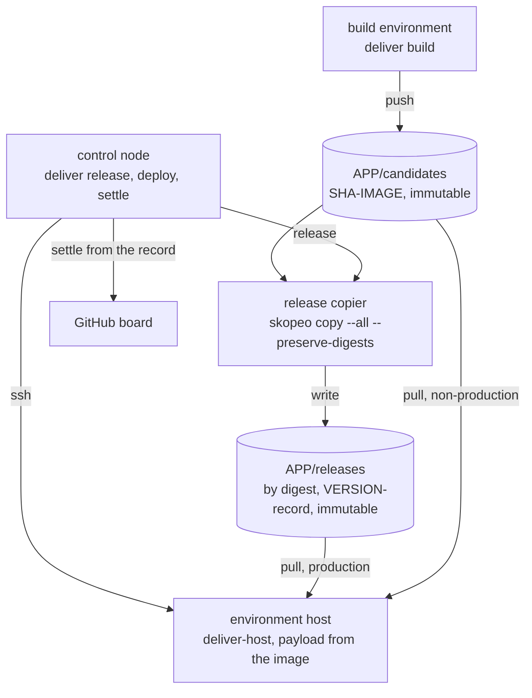

<!-- markdownlint-disable-file MD013 -->
# The deliver tool: design

Design for delphside/programme#117, the build, release and deploy tool every
application in the programme uses. Its customers are delphside/tile-lite-elite#545
(work packages #555 and #556) and delphside/dark-portal#11 (#15). The generic
rule it implements is [docs/1.2 *Making a release, then deploying it*](../../../../docs/1.2-change-lifecycle.md#making-a-release-then-deploying-it).
The owner's decisions (2026-10-27 and 28) are listed in #117's body.

## 1. As-is

| | Tile Lite Elite | Dark Portal |
| --- | --- | --- |
| build | `scripts/deliver/deploy.sh` builds each commit once on the owner's laptop into a local tarball, `artifacts/SHA.tar.gz`, shared by every environment | none yet |
| store | none: the tarball is copied to each host with `scp` | registry repositories `dark-portal/candidates` and `dark-portal/releases` exist (dark-portal#14), nothing pushed |
| release | until 0.10.0, inside `deploy.sh` after the production deploy: tag `prod-X.Y.Z`, GitHub Release, bump `main`, settle the milestone. 0.10.1 was released by hand at rehearsal pass, as the annotated tag `v0.10.1` (2026-10-27) | none yet |
| deploy | `deploy.sh` from the operator's working tree, over ssh. Its gates count themselves and refuse if one did not run: on the remote, CI green with e2e, pull request, schema, version, milestone, preview and rehearsal `/health` short SHA | none yet |
| configuration | Caddyfile baked into the web image; compose file copied from the commit; secrets in each host's `.env`; preview uses its own compose file and `Caddyfile.preview` from the working tree | designed in dark-portal#11 |
| rollback | retags `:previous` and restores a snapshot; the earlier compose file is not restored | designed in dark-portal#11 |

## 2. Roles

The tool names roles, never machines or applications. *Control node* is
Ansible's name for the machine a run is started from. Each application's
profile says where each role is.

| role | holds | does |
| --- | --- | --- |
| **build environment** | the repository, the candidates write credential | makes one image set per commit from a clean checkout, pushes it to candidates |
| **release copier** | the release credential | copies a rehearsed image set by digest from candidates to releases, and pushes the record |
| **control node** | git with push rights to `main`, a GitHub credential | runs the release step's gates, tag and bump; starts deploys; settles the board from the record |
| **environment host** | its own registry identity, its `.env`, its state folder | `deliver-host`: pulls by digest, takes the payload out of the image, runs the deploy steps, holding the environment's lock throughout |
| **payload** | nothing secret; inside one named image at `/deliver/` | the deploy steps, the application's hooks, the files joined at deploy, the host files |

Each environment also has a **role** of its own, which the gates key on, never
its name:

| environment role | reads | gates that key on it |
| --- | --- | --- |
| `preview` | candidates | none beyond every deploy's |
| `test` | candidates | none beyond every deploy's |
| `rehearsal` | candidates | the release step reads what it runs; a rehearsal starts from production's level |
| `production` | releases only | a record is needed; settle follows |

| role | Tile Lite Elite | Dark Portal |
| --- | --- | --- |
| build environment | the owner's laptop (WSL): production's 1 GB host cannot compile | the non-production VM's build environment (E2), on a timer |
| release copier | the control node, Oracle user `tle-releaser` | the non-production VM, user `dp-release`, whose key never leaves it |
| control node | the owner's laptop (WSL) | the owner's machine |
| environments | `preview` (role preview, on the control node itself), `rehearsal` VM, `production` VM | E3 to E5 (role test), E6 (role rehearsal) on the non-production VM; production VM |

| who | registry access |
| --- | --- |
| build environment | writes candidates |
| release copier | reads candidates, writes releases |
| hosts of preview, test and rehearsal roles | read candidates |
| production host | reads releases only |



The payload is copied at build into the image the profile names
(`payload_image`), from the pinned programme submodule and the application's
repository, so production runs what rehearsal ran and a host needs only the
registry, never GitHub. The files joined at deploy come from the payload too,
never from a working tree. Most environments join the same files; an
environment may name its own (Tile Lite Elite's preview joins
`docker-compose.preview.yml` and `Caddyfile.preview`), and they are still the
commit's. Each host's `.env` holds what differs: addresses, keys, limits.

The registry login methods are vendor adapters, named for the vendor:
`oci-instance-principal`, `oci-api-key`, and `docker-config` (a login already
made with `docker login`, such as an auth token). Another registry adds an
adapter; nothing else changes.

## 3. The route

```mermaid
sequenceDiagram
  participant BE as build environment
  participant CN as control node
  participant C as candidates
  participant H as rehearsal host
  participant RC as release copier
  participant R as releases
  participant P as production host
  BE->>C: deliver build SHA (once)
  CN->>H: deliver deploy rehearsal PRODUCTION'S RECORD (start of the cycle)
  CN->>H: deliver deploy rehearsal SHA
  H->>C: pull by digest, run payload
  Note over H: regression; test manager checks; owner judges passed
  CN->>CN: deliver release: gates, record
  CN->>RC: copy by digest, push record
  RC->>R: write
  CN->>CN: tag vVERSION, GitHub Release, bump main, next milestone
  CN->>P: deliver deploy production VERSION
  P->>R: pull record and images by digest, run payload
  CN->>CN: settle from the record
```

## 4. Commands

| command | role | what |
| --- | --- | --- |
| `deliver build [REF]` | build environment | non-interactive. Refuses REF unless it is a commit on the remote. Builds from a clean worktree with the `build` hook (default `docker buildx bake`), labels each image `org.opencontainers.image.revision` (SHA) and `.version` (from the version file), pushes each as `SHA-IMAGE`, prints the digests (an index digest for a multi-arch build). Images already present are not rebuilt; a registry query error refuses. `--local` (preview role only) builds an unpushed commit into the local Docker and pushes nothing, as today's preview allows; such a build can reach no other environment, and a preview deploy of it is identified by local image id and revision label instead of `RepoDigests` |
| `deliver deploy ENV REF` | control node | role preview, test or rehearsal: REF is a full or short SHA, or a version, resolved to digests in candidates. A short SHA that matches more than one candidate refuses. Role production: REF is a version with a record. Runs `deliver-host deploy` on ENV's host over ssh (or locally where the host is the control node), then `settle` for production |
| `deliver release [--expect VERSION]` | control node; copy on the release copier | releases the commit the rehearsal environment runs (§6): reads its version from the version file at that commit, shows version, commit, digests and the last passing rehearsal deploy, and asks the owner to confirm by typing the version (`--expect` for a non-interactive run). Then record, copy, tag, GitHub Release, bump, milestone, in the order of §7 |
| `deliver settle VERSION` | control node | §8; safe to rerun |
| `deliver rollback ENV` | control node | `deliver-host rollback`: the environment's previous deploy (§9) |
| `deliver status ENV` | control node | the digests ENV runs, matched by `RepoDigests`, the record they match, the deploy state, and whether the host files equal the payload's (a check) |
| `deliver list ENV` | control node or host | records beside what ENV runs |
| `deliver prune` | control node | removes candidates pushed before the newest release was made, not released and not run by any environment's current or previous deploy; releases are never removed. Hosts keep their current and previous images |
| `deliver env create\|destroy NAME` | the environment's host | an ephemeral environment from the profile's template: user, state folder, `.env` (secrets at a hidden prompt), Compose project, `env-create` and `env-destroy` hooks |
| `deliver host-install ENV` | control node | installs or updates `deliver-host` and its dependencies (`jq`, the login adapter's tools) on ENV's host |

**Flags that set a gate aside** each take a reason, which goes into the record
where there is one and always into the run log:

| flag | sets aside |
| --- | --- |
| `--emergency REASON` (release) | the commit being on `main`; requires instead that it descends from the release production runs (§6) |
| `--skip-rehearsal REASON` (release) | rehearsal having passed this commit; raises the retrospective issue (§8) |
| `--unrecorded REASON` (deploy, production) | the need for a record: REF is a full SHA, whose image set the release copier copies to releases as `SHA-IMAGE` (a no-op where the same digests are there already) with no record; no version is spent, and settle has nothing to move |
| `--off-level REASON` (deploy, rehearsal) | a rehearsal cycle starting from production's level |
| `--set-aside GATE REASON` | a gate the profile lists in `[release].overridable`, named as in §6: a hook's name, or `milestone` |

`--check` runs every gate and stops before anything changes (what `verify.sh`
uses). `deploy --wait[=MINUTES]` waits for the lock and for a hook that answers *not
yet*, checking each minute, for at most 60 minutes by default: Dark Portal's
longest wait outside its window is 50. At the limit it refuses, exit 1, naming
what it waited for.

Every command writes a run log on the machine it runs on, naming each gate it
ran. A command that ends without every gate in its list having run refuses, as
`deploy.sh` does today. Exit codes: 0 done; 1 refused or failed, with the previous
deploy restored where there is one; 3 live, but a later step (settle, GitHub Release,
milestone) failed and is named.

## 5. Profile and hooks

**Profile.** The application's `app-profile.toml` keeps its existing sections
and gains keys in them; nothing is said twice. The registry address carries
the tenancy's namespace and the application repositories on GitHub are public,
so the address is never in the profile: each role reads `DELIVER_REGISTRY`
from its own local configuration (`~/.config/deliver/APP.env`, or a host's
`.env`). The registry repositories themselves are private.

```toml
[release]
tag_prefix = "v"                           # owner, 2026-10-27
history_prefixes = ["prod-"]               # earlier tags, read for history and release notes
announcement = "Released in v"             # starts settle's comment; the board matches it, and the same text with each history prefix
deploy_marker = "[deliver]"
required_checks = ["e2e"]                  # CI checks that must be green on the commit
required_hooks = ["pre-deploy", "save-state", "migrate", "smoke", "restore-state", "release-check"]
overridable = ["milestone"]               # gates --set-aside may name: hooks by name, or the tool's own milestone gate

[deliver]
candidates = "tile-lite-elite/candidates"  # dp: "dark-portal/candidates"
releases   = "tile-lite-elite/releases"    # dp: "dark-portal/releases"
images     = ["server", "web"]             # dp: ["dp"]; tag is SHA-IMAGE
payload_image = "server"
keep_images = ["tile-lite-elite-server:latest", "tile-lite-elite-server:previous", "tile-lite-elite-web:latest", "tile-lite-elite-web:previous"]  # until 0.10.3
join = ["docker-compose.yml", "Caddyfile"]

[deliver.build]
on    = "control-node"                     # dp: ssh alias of the non-production VM
login = "docker-config"                    # dp: "oci-instance-principal"

[deliver.release]
copy_on    = "control-node"                # dp: the non-production VM, user dp-release
copy_login = "docker-config"               # dp: "oci-api-key"

[[deliver.host_files]]
src  = "scripts/operate/backup-to-oci.sh"
dest = "/opt/tile-lite-elite/backup-to-oci.sh"
mode = "0755"

[[deliver.host_files]]
src  = "scripts/operate/systemd/tile-lite-elite-backup.timer"
dest = "/etc/systemd/system/tile-lite-elite-backup.timer"
mode = "0644"
enable = true

[environments.preview]                     # existing keys stay
role  = "preview"
host  = "control-node"
join  = ["docker-compose.preview.yml", "Caddyfile.preview"]

[environments.rehearsal]
role  = "rehearsal"
ssh   = "tile-lite-elite-rehearsal"
login = "oci-instance-principal"

[environments.production]
role  = "production"
ssh   = "tile-lite-elite"
login = "oci-instance-principal"
host_files = true                          # default: true for roles rehearsal and production
# lock = "/var/lib/deliver/APP/vm.lock"    # dp: one lock for E3 to E6 and its heavy runs; default per environment
pull_timeout = 300                         # set from #554's measured pull
```

**Hooks.** Executables in the application's `deliver/hooks/`, carried in the
payload. A hook in `required_hooks` that is missing or not executable refuses,
so a renamed hook cannot pass silently; any other missing hook is a no-op. The
`build` hook alone has a default.

| exit | meaning |
| --- | --- |
| 0 | passed |
| 75 | not yet (with `--wait`, try again; otherwise refuse) |
| any other | refused, or the step failed |

Each hook gets `DELIVER_APP`, `DELIVER_ENV`, `DELIVER_ROLE`, `DELIVER_SHA`,
`DELIVER_VERSION`, `DELIVER_STATE` (the state folder) and `DELIVER_IMAGE_<NAME>`
(each image by digest). A hook that cannot judge refuses: it never passes for
want of an answer.

| hook | kind | role | Tile Lite Elite | Dark Portal |
| --- | --- | --- | --- | --- |
| `build` | step | build environment | `docker compose build` with the build id | `docker buildx`, arm64 and amd64 |
| `release-check` | gate | control node | refuses a patch carrying a `functional` change | none |
| `pre-deploy` | gate | environment host | the database is not ahead of the build's schema | the window :40 to :10 (75 outside it) |
| `save-state` | step | environment host | stop the server, snapshot the database, keep five | copy the DuckLake catalog aside |
| `migrate` | step | environment host | `server --migrate-only` | catalog migrations |
| `smoke` | gate | environment host | `/health` reports `VERSION+SHA` within 60 s | the release's own checks |
| `restore-state` | step | environment host | restore the snapshot | restore the catalog copy; bronze is append-only and untouched |
| `post-deploy` | check | control node | list open `Release Check` issues | the next collection, about :36, lands |
| `env-create`, `env-destroy` | step | environment host | the preview slot's volume | the user and `/srv/dp/NAME` |

A check's non-zero exit is reported, changes nothing else, and leaves the exit code as it was.

## 6. Gates and checks

A gate refuses and the work stops; a check reports and a person decides. Each
row says what it is for before what it compares.

| where | for | criterion | kind | set aside by |
| --- | --- | --- | --- | --- |
| build | a build is what the commit says, nothing local | built from a clean worktree of a commit on the remote | gate | nothing |
| build | the store is never overwritten | an image whose `SHA-IMAGE` is present is not rebuilt; a failed registry query refuses; releases is immutable | gate | nothing |
| every deploy | the host runs exactly the bytes named | each image pulled by digest; its revision label is the SHA; the running containers' `RepoDigests` match (for a `--local` preview build, the local image id and its revision label) | gate | nothing |
| every deploy | two deploys, or a deploy and the application's own heavy run, never overlap | the environment's lock is free, and held to the end | gate | `--wait` waits |
| every deploy | an interrupted deploy is not built upon | the state folder shows the last deploy finished, or `failed, no previous deploy` | gate | nothing: `deliver rollback` or a fresh deploy of the previous REF |
| every deploy | the application's deploy-time conditions | the `pre-deploy` hook | gate | `--set-aside`, where overridable |
| every deploy | a failed deploy leaves the previous deploy running | `migrate` fails or `smoke` refuses: `restore-state`, then the previous deploy's digests and joined files | gate | nothing |
| rehearsal deploy | rehearsal starts from production's level | the first deploy of a cycle (the deploys to a rehearsal-role environment since the last release was made) is production's current record, read from the production host's state over ssh and pulled from candidates by the same digests. Production running a build with no record refuses: a production deployed before the tool, as at the first cycle (§10) | gate | `--off-level` |
| release | the release is what rehearsal passed | the rehearsal-role environment runs this commit's digests, its last deploy finished and its `smoke` passed, and the owner confirms the version | gate | `--skip-rehearsal`, which raises the retrospective issue |
| release | a normal release ships what `main` holds | the commit is on `origin/main` | gate | `--emergency` |
| release | an emergency ships nothing unreleased | with `--emergency`, the commit descends from the tag of the release production runs (its record, read from production's host state as for rehearsal's level; where production has no `deliver` state, the version its `/health` reports, whose tag is the release's) and none of its commits after that tag is on `main` | gate | nothing |
| release | CI has passed the commit | every check in `required_checks` is green on the commit | gate | nothing |
| release | the version is spent once, and moves forward | no tag or record exists for the version, and it is higher than the newest release tag of any prefix | gate | nothing |
| release | the milestone is a shipping list | parents aside, every open issue in milestone VERSION is evidenced by a commit in the release (`Refs #N` since the previous release tag; a parent's `Refs` counts for its work package where the parent has exactly one in the milestone), and every work package the commits name is in the milestone. With `--emergency`, open issues evidenced only by commits on `main` are left out of the check and moved by step 6 | gate | `--set-aside milestone REASON` |
| release | the application's own release rules | the `release-check` hook | gate | `--set-aside`, where overridable |
| production deploy | production runs only rehearsed releases | a record exists for VERSION; its digests are pulled from releases | gate | `--unrecorded` |
| after a production deploy | the board says what shipped | `settle` (§8) | check: a failure is reported, exit 3, the deploy stands | — |
| any time | a host's installed files are the release's | `deliver status` compares the host files with the payload | check | — |

## 7. The release step's order

The steps run in this order, so that what cannot be undone comes last and a
rerun resumes rather than repeats:

1. every release gate, then the owner's confirmation;
2. copy each image by digest to releases (`skopeo copy --all --preserve-digests`, on the release copier); a copy already present with the same digest is a no-op;
3. push the record as a scratch image `VERSION-record`;
4. push the annotated tag `vVERSION`, whose message is the record. **The version is spent here**: from now on a rerun finds the tag, checks its record matches, and resumes at step 5;
5. the GitHub Release, with notes from the previous release tag of any prefix;
6. bump the version on `main` to the next patch above the released one and above `main`'s own, with the version-only change `[versions.bump]` allows and a subject built from `versions.stamp_form` and `versions.api`, and push; the control node's credential bypasses `main`'s ruleset, as the release has always needed. An emergency's release leaves `main` at a version above it, so `main` moves on: if `main` already held the emergency's number, it moves to the next patch, and the open issues of that milestone move with it;
7. open the next milestone.

The record is made once, at step 1, and kept in the control node's state for
the release. A failure before step 4 leaves nothing spent: a rerun reads the
images and any `VERSION-record` already in releases and reuses them when their
commit and digests match the record, and refuses when they do not. A failure after it is reported (exit 3) and
resumed by rerunning `deliver release`. A rerun that finds the tag carrying a
different record refuses; one that finds every step done says so and exits 0.

**The record.** JSON, version 1. A reader refuses a record version it does not
know. Tags without a JSON message (`v0.10.1`, every `prod-*`) are releases made
before the tool and are read as history only.

```json
{
  "record": 1,
  "application": "tile-lite-elite",
  "version": "0.10.2",
  "commit": "full SHA of the application's commit, whose payload is the deploy steps",
  "images": {"server": "sha256:...", "web": "sha256:..."},
  "made": "2026-11-02T19:04:00Z",
  "rehearsal": {"environment": "rehearsal", "deployed": "2026-11-02T18:40:00Z", "smoke": "passed"},
  "emergency": null,
  "rehearsal_skipped": null,
  "set_aside": [{"gate": "milestone", "reason": "..."}],
  "tool": {"programme": "the programme commit the application pins"},
  "carries": {"work_packages": [555, 556], "issues": [560]}
}
```

`set_aside` lists each gate `--set-aside` named, with its reason, and is empty
where none was. `carries` is the milestone's open items once the gate has passed,
or has been set aside, less any issue an emergency left out: its work
packages, and its open issues that are not projects, parents aside. The
commits' `Refs` are the gate's evidence, never the list itself, so an issue
that is only referenced, such as an application's notes issue, is never
carried. The record replaces `deploy.sh`'s build manifest.

`rehearsal.deployed` is the time of the last finished rehearsal deploy of these
digests, read from the rehearsal host's state. The owner's judgement that
rehearsal passed is the confirmation at step 1; the test manager's report is
the owner's input to it and is not read by the tool.

## 8. Settling, and the emergency's retrospective

`deliver settle VERSION` reads the record and acts on exactly what it lists,
as docs/1.2 §2.5 says, parents aside:

| item | becomes |
| --- | --- |
| a carried work package, of any route (docs/1.2 §2.5: a project advances) | `Project State` Post-deployment, with a comment that starts with the profile's `[release].announcement` and the version, so the board recognises it |
| a carried issue that is not a project | closed as completed, with the same comment |
| the milestone VERSION | closed |

Each action checks first and does nothing if it is already done, so a rerun is
harmless. A failure is reported with the items left, and the deploy's exit is 3.

A release with `--skip-rehearsal` raises the retrospective issue the
emergency path owes (tile-lite-elite#545 R6), naming the reason and what was
skipped, as `deploy.sh` does today.

## 9. On the host

```text
/var/lib/deliver/APP/ENV/
  lock                  flock, held for the whole deploy or rollback; the profile's `lock` may name one path shared by several environments
  state                 the step reached, written at each step; "finished" at the end
  deploys/<n>/          one folder per deploy: deliver.env (images by digest), the joined files, the record if any
  current -> deploys/<n>
  previous -> deploys/<n-1>
```

The state folder is on disk, so a step reached survives a reboot. Compose runs
with a fixed project name (the volumes persist across deploys),
`--project-directory current`, `--env-file` for the host's `.env` and then
`current/deliver.env`, and `--no-build`. The compose file names each image as
`${DELIVER_IMAGE_SERVER:-tile-lite-elite-server}` and so on, the default
keeping a developer's and CI's local builds working, with `pull_policy: never`: the images are
pulled by digest before the switch, so compose never pulls by tag or builds.
The build environment uses the same compose file with its `build:` blocks.

A deploy's steps: take the lock; check the state (a deploy that did not reach
`finished` and was not restored refuses, naming the step reached; `failed, no
previous deploy` does not, because the next deploy is the way forward); pull every image by digest
(within `pull_timeout`); take the payload out of `payload_image`; `pre-deploy`;
write the new deploy folder; `save-state`; `migrate`; install the host files where the environment has `host_files` true, which by
default only rehearsal and production roles do, so environments sharing a host
never overwrite each other's. An application whose test environments need a
schedule keeps it inside its Compose project, not as a host unit (copy with their modes, `systemctl daemon-reload`, enable and restart the
units marked `enable`, as root through one `sudo` rule `deliver-host
host-install` writes; a non-production host may run any branch's build, which
is safe only because no build environment builds a fork); switch `current`; `compose up`; `smoke`; mark finished;
prune host images other than current and previous, sparing those the profile lists in `[deliver].keep_images` (Tile Lite Elite keeps the `deploy.sh` images, `tile-lite-elite-server` and `-web` at `:latest` and `:previous`, until 0.10.3, for its fallback). A host file the previous deploy installed and this one does not carry is removed; a rollback restores the previous deploy's set the same way. A failure after
`save-state` runs `restore-state`, switches back to `previous`, reinstalls its
host files, and exits 1. On a host's first `deliver` deploy there is no
`previous`: the failure runs `restore-state`, stops the new containers, removes
`current`, marks the state `failed, no previous deploy`, and exits 1 naming the application's fallback.

**Rollback** is the same switch to `previous`, with `restore-state`, run on
demand. With no previous deploy it refuses and names the application's
fallback (§10).

## 10. Moving Tile Lite Elite to it

Production runs 0.10.0, built the old way. 0.10.1 is released (`v0.10.1`, a
text tag, no record) and has never run in production. 0.10.2 is the first
release made with `deliver` (owner, 2026-10-28), and the first with a record.

- **The first rehearsal cycle** has no production record to start from. It
  starts from production's commit deployed by `deploy.sh`, as today, and the
  first `deliver deploy` to rehearsal takes `--off-level "first deliver
  deploy"`.
- **The fallback.** Until 0.10.2 has run in production, the way back is to
  0.10.0, the only earlier version production has run. It is a written
  procedure, #555's artefact, tried on rehearsal before 0.10.2's production
  deploy: stop the `deliver` project; restore the snapshot `save-state` took
  (Tile Lite Elite's hook keeps it in `~/tile-lite-elite/snapshots`, where
  `rollback.sh --db-only` reads it); then `deploy.sh` at 0.10.0's commit with
  `DEPLOY_EMERGENCY` and a reason, which copies that commit's compose file
  and so its image names. `deploy.sh` and `rollback.sh` are retired in
  0.10.3.
- **The board** reads the `v` prefix for releases and keeps `prod-*` as
  history (`history_prefixes`); "running in production" comes from settle and
  `/health`, not from the tag.
- **What changes in Tile Lite Elite** is #555's and #556's: the profile keys
  above; the hooks, which wrap today's schema, snapshot, migrate and smoke
  steps and refuse where today's pass for want of an answer; the compose files'
  `image:` lines; the payload in the server image; `Caddyfile` mounted, not
  copied; `[ships].non_shipping` no longer listing what the payload carries;
  `verify.sh` using `deliver status` and `--check`; the `sa` alias as an
  `/etc/profile.d` host file naming the Compose project, not a compose file; CLAUDE.md's dev bump moving to the release step.

## 11. Non-functional design

- **Capacity**: the on-host part is bash, `jq` and an image pull. On Tile Lite
  Elite's 1 GB production host the instance-principal login needs the OCI CLI
  (#554 installs it and measures the peak). Each host keeps two image sets
  (current and previous). The registry keeps every release and the candidates
  `deliver prune` leaves.
- **Failure**: every gate refuses before anything on a host changes; a failed
  deploy restores the previous deploy and its saved state; an interrupted one
  is found by its state and refused until rolled back or redeployed; the
  release step resumes from its last finished step.
- **Limits and timeouts**: `pull_timeout` per environment, from a measured
  pull on its host (#554's check for Tile Lite Elite); each hook's own limit is
  the application's, such as Tile Lite Elite's 60-second smoke test.
- **Secrets and access**: the tool reads credentials and holds none. Hosts log
  in with their own identity (owner, 2026-10-28); the release copier uses its
  own credential; a role's credential cannot do another role's writes; nothing
  secret is written to a profile, record, tag or log.

## 12. Language and layout

Bash, with `skopeo` for registry copies (the release copier needs no Docker
daemon) and `jq` for the record. In the programme repository:

| path | what |
| --- | --- |
| `scripts/deliver/deliver` | the control-node and build commands |
| `scripts/deliver/deliver-host` | the host command, installed by `deliver host-install` |
| `scripts/deliver/payload/` | the deploy and rollback steps copied into the payload image |
| `scripts/deliver/lib/` | profile reading, run log, gate list, login adapters |
| `scripts/tests/deliver-*.bats` | the tool's tests, against a dummy application, stub hooks and a local registry |
| `scripts/board/` | reading `tag_prefix` as released and `history_prefixes` as history |
| docs/1.1 | the tool's row |
| docs/1.2 | *Making a release, then deploying it* names the tool; §1.0's "made from `main`'s tip" becomes "a commit on `main`", since `main` may move on after rehearsal (tile-lite-elite#545 R5) |
