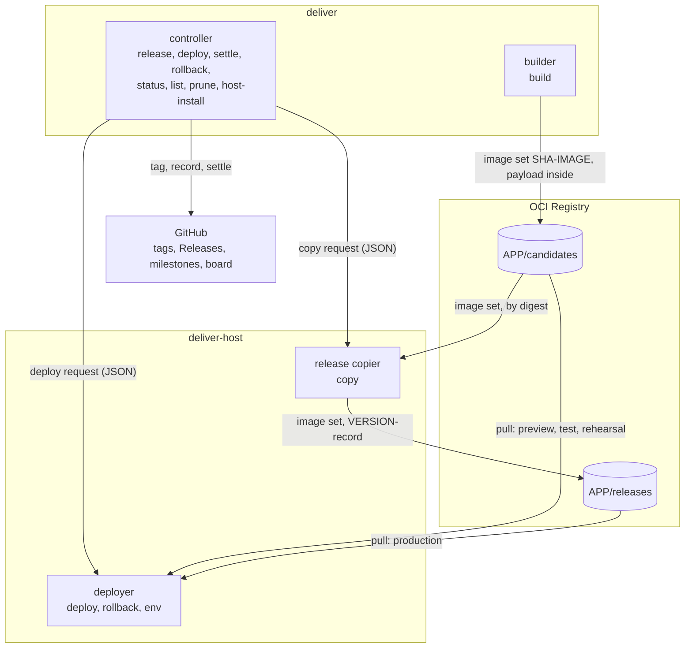
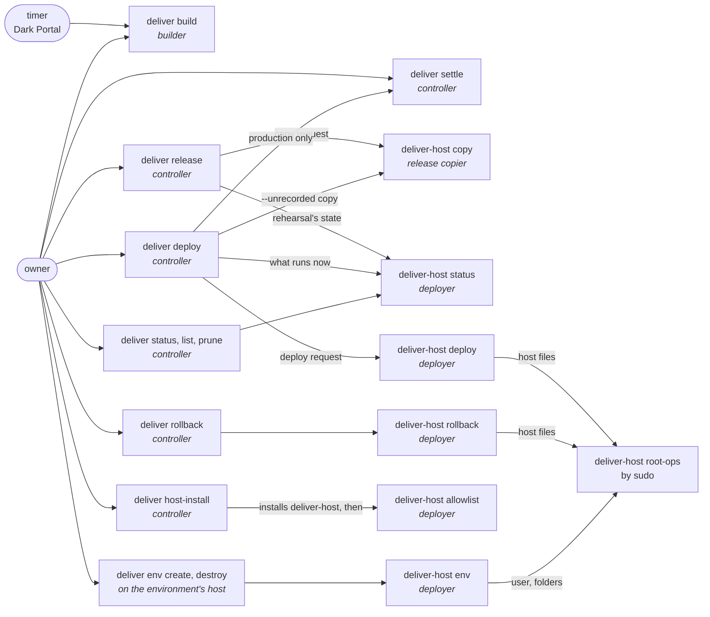
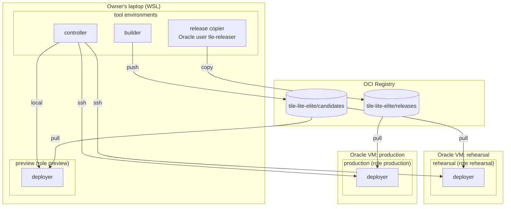
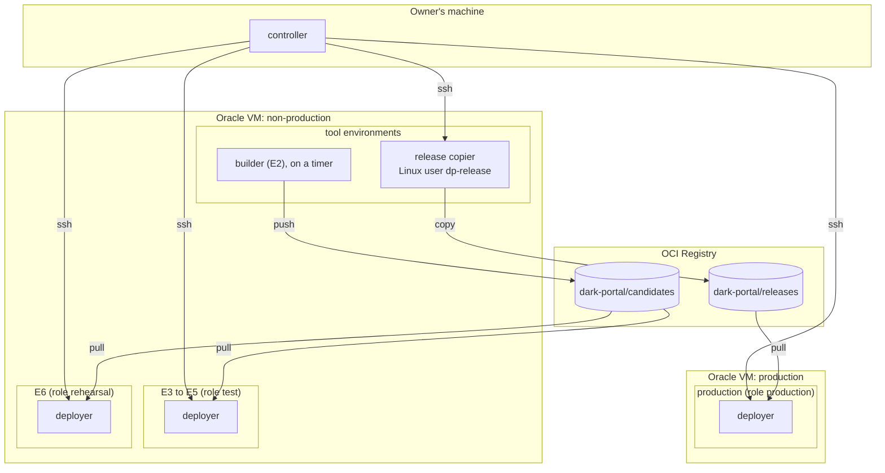
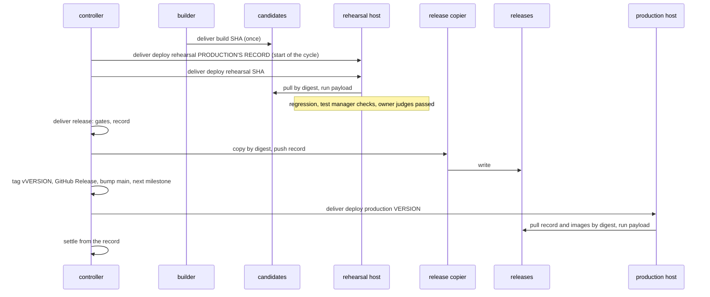

<!-- markdownlint-disable-file MD013 -->
# The deliver tool: design

Design for delphside/programme#117, the build, release and deploy tool every
application in the programme uses. Its customers are
delphside/tile-lite-elite#545 (work packages delphside/tile-lite-elite#555 and
delphside/tile-lite-elite#556) and delphside/dark-portal#11
(delphside/dark-portal#15). The generic rule it implements is
[docs/1.2 *Making a release, then deploying it*](../../../../docs/1.2-change-lifecycle.md#making-a-release-then-deploying-it).
Its decisions are in #117's body.

## 1. As-is

| | Tile Lite Elite | Dark Portal |
| --- | --- | --- |
| build | `scripts/deliver/deploy.sh` builds each commit once on the owner's laptop into a local tarball, `artifacts/SHA.tar.gz`, shared by every environment | none yet |
| store | none: the tarball is copied to each host with `scp` | registry repositories `dark-portal/candidates` and `dark-portal/releases` exist (delphside/dark-portal#14), nothing pushed |
| release | until 0.10.0, inside `deploy.sh` after the production deploy: tag `prod-X.Y.Z`, GitHub Release, bump `main`, settle the milestone. 0.10.1 was released by hand at rehearsal pass, as the annotated tag `v0.10.1` (2026-10-27) | none yet |
| deploy | `deploy.sh` from the operator's working tree, over ssh. Its gates count themselves and refuse if one did not run: on the remote, CI green with e2e, pull request, schema, version, milestone, preview and rehearsal `/health` short SHA | none yet |
| configuration | Caddyfile baked into the web image; compose file copied from the commit; secrets in each host's `.env`; preview uses its own compose file and `Caddyfile.preview` from the working tree | designed in delphside/dark-portal#11 |
| rollback | retags `:previous` and restores a snapshot; the earlier compose file is not restored | designed in delphside/dark-portal#11 |

## 2. Components

*deliver* is the programme's generic tool, started by a person or timer; it
invokes `deliver-host` elsewhere.

**Environments.** An *application environment* is one running copy of the
application, with an *environment role* that [gates](#6-gates-and-checks) key
on. *Candidates* and *releases* are its two registry repositories
([§10](#10-oci-integration)):

| Environment role | Reads | Gates that key on it |
| --- | --- | --- |
| `preview` | candidates | none beyond every deploy's |
| `test` | candidates | none beyond every deploy's |
| `rehearsal` | candidates | release reads what it runs; starts at production's level |
| `production` | releases only | needs a [record](#7-the-release-and-its-record); [settle](#8-settling) follows (a check) |

*Tool environments* run the controller, builder or release copier (the
controller's is the environment a run is started from); a *host* runs one or
more environments. The profile (`app-profile.toml`, [§5](#5-profile-and-hooks))
maps components to tool environments. A host's `.env` holds what differs per
environment: addresses, keys, limits.

| Component | Purpose | Runs | Holds | Does |
| --- | --- | --- | --- | --- |
| *controller* | Decides what ships; only it changes `main`, tags, the board | all `deliver` commands but `build`, `env` | push rights to `main`; GitHub credential | gates, tag, bump, deploys, settle |
| *builder* | Builds each commit once | `build` | repository; candidates write credential | image set to candidates |
| *release copier* | Only writes releases | `deliver-host copy`, from `release` and `deploy --unrecorded` | login that reads candidates, writes releases | copy by digest; record |
| *deployer* | Changes an environment by one locked, restorable path | `deliver-host deploy`, `rollback`, `status`, `allowlist`, `env`; `deliver env create`, `destroy` | registry identity, `.env`, [state folder](#9-on-the-host) | lock, pull by digest, deploy steps |

| Component | Tile Lite Elite | Dark Portal |
| --- | --- | --- |
| controller | the owner's laptop (WSL) | the owner's machine |
| builder | the laptop: production's 1 GB host cannot compile | the non-production VM (E2), on a timer |
| release copier | the controller, as Oracle user `tle-releaser` | the non-production VM, as Linux user `dp-release` ([§10](#10-oci-integration)) |
| deployer, environments | `preview` on the laptop; `rehearsal`, `production` on their VMs | E3 to E5 (test), E6 (rehearsal) on the non-production VM; production |

Terms and
[views](https://github.com/delphside/tile-lite-elite/blob/main/docs/diagrams/README.md#which-view-a-diagram-takes-and-saying-so)
are C4's: `deliver` and `deliver-host` are *containers*, environments
*deployment nodes*.

**Container view**: what each arrow carries.



**Component view, command flow**: who starts each command, and which
`deliver-host` command it runs.



**Deployment view, Tile Lite Elite**: which environments each host runs.



**Deployment view, Dark Portal**: which environments each host runs.



The *payload* ([§9](#9-on-the-host)) is what hosts run, not a component. It
holds nothing secret: deploy steps, hooks, [joined files](#5-profile-and-hooks)
and host files.

- `deliver build` assembles it into `<worktree>/.deliver-payload/` and exports
  `DELIVER_PAYLOAD_DIR`; the Dockerfile copies it to `/deliver/` in the
  `payload_image`.
- Steps and libraries come from the `programme` submodule at the commit the
  built commit pins (the running tool's own without one), read with
  `git archive` and recorded as `tool.programme`; hooks and files from the
  application.
- Joined files come from the payload, never a working tree; an environment may
  name its own (Tile Lite Elite's preview joins `docker-compose.preview.yml`,
  `Caddyfile.preview`).

**Technologies.**

| Technology | Used for | Where |
| --- | --- | --- |
| bash, `jq` | the tool; JSON | all |
| `skopeo` | registry reads, copy, record (§10) | controller, builder, copier |
| `docker`, `compose`, `buildx` | pull by digest; run; build (`buildx`: default hook); login by the `oci-*` adapters | hosts, builder, controller, release copier |
| `git` | worktrees, payload archive, tag, bump | controller, builder |
| `gh` | every GitHub call (§11) | controller only |
| `ssh`, `curl` | `deliver-host` calls, remote build; production `/health` (§6) | controller |
| `flock`, `sudo`, `systemd` | the lock; `root-ops`, units (§9) | hosts |
| `oci` | registry token for `oci-instance-principal` and `oci-api-key` (§10) | components with those logins |
| `bats` | tests | development, CI |

**Layout.** In the programme repository:

| Path | What |
| --- | --- |
| `scripts/deliver/deliver`, `deliver-host` | the commands; `deliver-host` is installed by `host-install` |
| `scripts/deliver/payload/` | deploy and rollback steps for the payload image |
| `scripts/deliver/lib/` | profile, run log, gate list, registry and login adapters, GitHub |
| `scripts/tests/deliver-*.bats` | tests |
| `scripts/board/` | the board reads tags with `tag_prefix` as releases and `history_prefixes` as history |
| docs/1.1, 1.2 | 1.1: the tool's row. 1.2: *Making a release, then deploying it*, and §1.0, which states that a release is "a commit on `main`" (delphside/tile-lite-elite#545 R5) |

## 3. The route

The stages, in order.



1. **Build.** The builder builds a commit once and pushes `SHA-IMAGE`, payload
   inside, to candidates.
2. **Rehearse.** A *cycle* is rehearsal between one release being made and the
   next. It first deploys production's current record to rehearsal
   (*production's level*), so the commit is rehearsed as an upgrade, then the
   commit ([§9](#9-on-the-host)). Regression runs, the test manager checks, the
   owner judges rehearsal passed. Preview and test have no cycle.
3. **Release.** `deliver release` runs the release gates
   ([§6](#6-gates-and-checks)), asks the owner to confirm the version and makes
   the release ([§7](#7-the-release-and-its-record)).
4. **Deploy.** `deliver deploy production VERSION` pulls the record and images
   from releases by digest and runs the same steps.
5. **Settle.** The controller settles the board from the record
   ([§8](#8-settling)); a failure leaves the deploy standing, exit 3.
   `post-deploy` follows ([§6](#6-gates-and-checks)).

## 4. Commands

Every command writes a run log naming each gate it ran, and refuses if one in
its list did not.

| Exit | Meaning |
| --- | --- |
| 0 | done |
| 1 | refused or failed, previous deploy restored if any |
| 3 | live, but a later step (settle, GitHub Release, milestone) failed, named |

**The `deliver` commands.** `ENV` is a profile environment, `REF` a commit or
version, `GATE` a [§6](#6-gates-and-checks) gate, `COPIER` the release copier's
host (`copy_on`).

| Command | Component | What |
| --- | --- | --- |
| `deliver build [REF] [--local]` | builder | builds REF (default `HEAD`) once, pushes to candidates; non-interactive. The `build` hook (default `docker buildx bake`); labels `org.opencontainers.image.revision` (SHA) and `.version` (from the version file); prints digests (an index digest for a multi-arch build). `--local` (preview only): local Docker, no push; identified by image id and revision label, not `RepoDigests` |
| `deliver deploy ENV REF [--wait[=MIN]] [--check] [--set-aside GATE REASON] [--unrecorded REASON] [--off-level REASON]` | controller | preview, test, rehearsal: REF is a SHA (full or short; ambiguous refuses) or version, resolved to candidates' digests. Production: a version with a record |
| `deliver release [--expect VERSION] [--commit REF] [--emergency REASON] [--skip-rehearsal REASON] [--set-aside GATE REASON] [--check]` | controller; copy on the copier | releases the commit rehearsal runs; `--commit REF` names another commit instead, as `--skip-rehearsal` needs. Shows version (from the version file at that commit), commit, digests, last passing rehearsal deploy; the owner types the version to confirm (`--expect` if non-interactive). Gates [§6](#6-gates-and-checks), steps [§7](#7-the-release-and-its-record) |
| `deliver settle VERSION` | controller | the board to what the record says shipped ([§8](#8-settling)); safe to rerun |
| `deliver rollback ENV` | controller | `deliver-host rollback`: ENV's previous deploy ([§9](#9-on-the-host)) |
| `deliver status ENV`, `list ENV` | controller | digests ENV runs (`RepoDigests`), their record, deploy state, host files against the payload's (a check); `list`: the records beside what ENV runs |
| `deliver prune [--dry-run]` | controller | removes unneeded candidates, never releases |
| `deliver env create\|destroy NAME` | deployer, on the environment's host | an ephemeral environment from the profile template: user, state folder, `.env` (secrets at a hidden prompt), Compose project; the `env-*` hooks |
| `deliver host-install ENV\|COPIER` | controller | installs or updates `deliver-host` and libraries on ENV's host or the copier; installs `jq` if missing; refuses if `flock` or the login adapter's tools (`oci`) are absent. A copier hosting no environment gets `deliver-host` and libraries (including `registry.sh`), no allowlist or sudo rule. Refuses environments that would remove each other's host files ([§6](#6-gates-and-checks)) |

`prune` removes a candidate only if built before the newest release was made,
not released, and not run by any current or previous deploy. "Built" is the
image's `org.opencontainers.image.created` label, the time the build started
(skopeo gives no push time); a build begun before a release and pushed after
costs a rebuild.

**The `deliver-host` commands** are called by `deliver` (over `ssh`, or directly
on the controller's host), or, as `root-ops`, by the payload steps through
`sudo`; `deploy`, `rollback` and `copy` take a JSON request on standard input.

| Command | Called by | What |
| --- | --- | --- |
| `deliver-host deploy APP ENV < request` | `deliver deploy` | [§9](#9-on-the-host)'s steps |
| `deliver-host rollback APP ENV < request` | `deliver rollback` | switch to `previous` |
| `deliver-host status APP ENV --json` | `status`, `list`, `prune`, release, the rehearsal-level gate, production's version read | what runs, its record, state |
| `deliver-host copy APP < request` | `deliver release` and `deliver deploy --unrecorded`, on `[deliver.release].copy_on` with `copy_login` | image set to releases by digest, then the record; the controller only reads |
| `deliver-host allowlist APP < lines` | `host-install`, as root | the root-owned allowlist |
| `deliver-host env create\|destroy NAME` | `deliver env` | an ephemeral environment |
| `deliver-host root-ops ...` | payload steps and `env`, by one `sudo` rule | the deploy user's only root operations |

**Flags that set a gate aside** each take a reason, kept in the record if there
is one and always in the run log:

| Flag | Sets aside |
| --- | --- |
| `--emergency REASON` (release) | the commit being on `main` |
| `--skip-rehearsal REASON` (release) | rehearsal having passed this commit; raises the retrospective issue ([§7](#7-the-release-and-its-record)) |
| `--unrecorded REASON` (production deploy) | the need for a record: REF is a full SHA, copied to releases by the release copier as `SHA-IMAGE` (no-op where the same digests are present; another digest refuses); no version spent, nothing to settle |
| `--off-level REASON` (rehearsal deploy) | a cycle starting from production's level |
| `--set-aside GATE REASON` | a gate in `[release].overridable`: a hook's name, or `milestone` |

`--check` runs every gate and stops before anything changes (Tile Lite Elite's
`verify.sh` uses it). `deploy --wait[=MIN]` waits for the lock and for a hook
answering *not yet*, checking each minute, 60 minutes by default (Dark Portal's
longest wait outside its window is 50); at the limit it refuses, exit 1,
naming what it waited for.

## 5. Profile and hooks

**Profile.** The application's `app-profile.toml` keeps its sections and gains
keys in them, never the registry address ([§10](#10-oci-integration)). Tile Lite
Elite's example; Dark Portal's values in comments (`dp:`):

```toml
[release]
tag_prefix = "v"
history_prefixes = ["prod-"]               # earlier tags: history, release notes, version order, production's tag
announcement = "Released in v"             # starts settle's comment (§8); matched also with each history prefix
deploy_marker = "[deliver]"
required_checks = ["e2e"]
required_hooks = ["pre-deploy", "save-state", "migrate", "smoke", "restore-state", "release-check"]
overridable = ["milestone"]

[deliver]
candidates = "tile-lite-elite/candidates"  # dp: "dark-portal/candidates"
releases   = "tile-lite-elite/releases"    # dp: "dark-portal/releases"
images     = ["server", "web"]             # dp: ["dp"]; tag is SHA-IMAGE
payload_image = "server"
join = ["docker-compose.yml", "Caddyfile"]

[deliver.build]
on    = "controller"                     # dp: ssh alias of the non-production VM
login = "docker-config"                    # dp: "oci-instance-principal"

[deliver.release]
copy_on    = "controller"                # dp: the non-production VM, user dp-release
copy_login = "docker-config"               # dp: "oci-api-key"

[[deliver.host_files]]
src  = "scripts/operate/backup-to-oci.sh"
dest = "/opt/tile-lite-elite/backup-to-oci.sh"
mode = "0755"
# a systemd unit adds: enable = true

[environments.preview]                     # existing keys stay
role  = "preview"
host  = "controller"
join  = ["docker-compose.preview.yml", "Caddyfile.preview"]

[environments.rehearsal]
role  = "rehearsal"
ssh   = "tile-lite-elite-rehearsal"
login = "oci-instance-principal"

[environments.production]
role  = "production"
ssh   = "tile-lite-elite"
login = "oci-instance-principal"
host_files = true                          # default: true for roles rehearsal and production
# lock = "/var/lib/deliver/APP/vm.lock"    # dp: one lock for E3 to E6 and its heavy runs
pull_timeout = 300                         # from delphside/tile-lite-elite#554's measured pull
```

Also:

- `[deliver].fallback`, the sentence a failed first deploy prints;
- `[deliver.ephemeral]` (`user_prefix`, `home`, `secrets`), `deliver env`'s
  template;
- per environment `project` (Compose project) and `url`;
- `[versions].deployed` (`path`, `field`), where `/health` reports production's
  version ([§6](#6-gates-and-checks));
- `on`, `copy_on` and `host` take `"controller"` (`"control-node"` still works);
  `on` and `copy_on` also take an `ssh` alias.

Each key is read from one of two profiles:

- the commit's: `required_checks`, `required_hooks`, `overridable`, `images`
  and `payload_image`, read by the gates, and `join` and `[[deliver.host_files]]`,
  carried in the payload with the hooks;
- the controller's working tree: every other key, including each
  environment's host, role, `login`, `host_files`, `pull_timeout` and `lock`.

**Hooks** are executables in the application's `deliver/hooks/`, carried in the
payload. A `required_hooks` hook missing or not executable refuses; any other
missing hook is a no-op. Only `build` has a default.

| Exit | Meaning |
| --- | --- |
| 0 | passed |
| 75 | not yet (`--wait` retries; else refuse) |
| other | refused, or step failed |

Each hook gets `DELIVER_APP`, `DELIVER_ENV`, `DELIVER_ROLE` (`controller` for
the release step, `ephemeral` for create and destroy), `DELIVER_SHA`,
`DELIVER_VERSION`, `DELIVER_STATE` (state folder) and `DELIVER_IMAGE_<NAME>`
(each image by digest). A hook that cannot judge answers refused.

| Hook | Kind | Component | Tile Lite Elite | Dark Portal |
| --- | --- | --- | --- | --- |
| `build` | step | builder | `docker compose build`, build id | `docker buildx`, arm64 and amd64 |
| `release-check` | gate | controller | no `functional` change in a patch | none |
| `pre-deploy` | gate | deployer | database not ahead of the build's schema | window :40 to :10 (75 outside) |
| `save-state` | step | deployer | stop server, snapshot database, keep five | copy DuckLake catalog aside |
| `migrate` | step | deployer | `server --migrate-only` | catalog migrations |
| `smoke` | gate | deployer | `/health` shows `VERSION+SHA` within 60 s | release's own checks |
| `restore-state` | step | deployer | restore snapshot | restore catalog copy; bronze untouched |
| `post-deploy` | check | controller | list open `Release Check` issues | next collection, about :36, lands |
| `env-create`, `env-destroy` | step | deployer | preview slot's volume | user, `/srv/dp/NAME` |

The optional `bump` step (neither application has one) runs in the worktree that
bumps `main`, with `DELIVER_VERSION`, for a lockfile refresh the version pattern
cannot do.

## 6. Gates and checks

A gate refuses and work stops; a check reports and a person decides. A check's
failure leaves the exit code alone, except settle's after a production deploy,
which exits 3 ([§8](#8-settling)).

| Where | For | Criterion | Kind | Set aside by |
| --- | --- | --- | --- | --- |
| build | nothing local | clean worktree of a remote commit | gate | `--local` (preview) |
| build | no overwrite | existing `SHA-IMAGE` not rebuilt; failed registry query refuses; releases tags never overwritten | gate | — |
| every deploy | exact bytes | pulled by digest; revision label is the SHA; running `RepoDigests` match (`--local`: image id and label) | gate | — |
| every deploy | no overlap | lock free, held to the end | gate | nothing (`--wait` waits) |
| every deploy | *state gate* | state is finished, restored or `failed, no previous deploy`; else refuses, naming the step reached and `deliver rollback ENV`. A failed restore leaves `failed: the restore did not complete`, which refuses alike | gate | nothing: `deliver rollback` |
| deploy, release | application's hooks | every `required_hooks` hook present and executable; `pre-deploy` (deploy) and `release-check` (release) pass | gate | the two hooks by `--set-aside`, where overridable |
| every deploy | allowed host files | destination off the allowlist refuses ([§9](#9-on-the-host)) | gate | nothing: rerun `deliver host-install` |
| deploy, host-install | no mutual removal | two environments of one application on one host both installing host files refuse | gate | nothing: `host_files = false` on all but one |
| every deploy | failure keeps previous | `migrate` fails or `smoke` refuses: restore ([§9](#9-on-the-host)) | gate | — |
| rehearsal deploy | production's level | a [cycle](#3-the-route)'s first deploy (first to a rehearsal-role environment since the last release was made: `deployed` in `meta.json` at or after, to the second, the newest release tag's creation date) is production's current record ([Which release production runs](#which-release-production-runs)), the same digests, pulled from candidates. Production running a build with no record refuses, as at the first cycle ([§13](#13-moving-tile-lite-elite-to-it)) | gate | `--off-level` |
| release | what rehearsal passed | rehearsal runs this commit's digests, last deploy finished, `smoke` passed, owner confirms the version | gate | `--skip-rehearsal` |
| release | ships `main` | commit on `origin/main` | gate | `--emergency` |
| release | emergency ships nothing unreleased | with `--emergency`, commit descends from the tag of the release production runs ([Which release production runs](#which-release-production-runs)), none of its later commits on `main` | gate | — |
| release | CI passed | every `required_checks` check green on the commit | gate | — |
| release | version spent once | no tag for it; a `VERSION-record` in releases is reused if it has this commit and digests; above the newest release tag of any prefix | gate | — |
| release | shipping list | open issues in milestone VERSION evidenced by commits in the release; Production Release work packages the commits name in it or an undeployed release's ([The milestone gate](#the-milestone-gate)) | gate | `--set-aside milestone REASON` |
| release | no silent drop | an item an earlier release in the range carried and this drops: `#N is in X but not carried by Y` ([§7](#7-the-release-and-its-record)) | check | — |
| production deploy | made releases only | a record exists for VERSION; digests pulled from releases | gate | `--unrecorded` |
| after production deploy | board is current | `settle` ([§8](#8-settling)); failure reported, exit 3, deploy stands | check | — |
| after deploy | application's view | `post-deploy` hook, from the commit's hooks, run on the controller after a deploy finishes (on production, after settle), never under `--check` | check | — |
| any time | release's host files | `deliver status`: host files against the payload | check | — |

### The milestone gate

- Parents are left aside.
- Every open issue in milestone VERSION has a `Refs #N` commit since the release
  production runs, the carried range's start
  ([§7](#7-the-release-and-its-record)).
  - A commit a later commit in the range reverts, and that revert, name nothing.
  - A parent's `Refs` counts for its work package where it has exactly one in
    the milestone.
- Every work package the commits name with `Route` Production Release is in the
  milestone, or that of a release made but not deployed whose tag is in the
  range. Other routes are left out: they deliver on date milestones (docs/1.2
  §2.15).
- With `--emergency`, open issues evidenced only by commits on `main` are left
  out, and moved to the next milestone by [§7](#7-the-release-and-its-record)
  step 7.

### Which release production runs

For rehearsal's level and the emergency gate, it is the record in production's
host state, read over ssh. Only where the host has no `current` at all (a
production deployed before the tool) is it read from `/health` through
`[versions].deployed` and the environment's `url`. A `current` with no record
(`--unrecorded`) makes the gate refuse.

## 7. The release and its record

The release step ([§3](#3-the-route), stage 3) puts what cannot be undone last:

1. every release gate ([§6](#6-gates-and-checks)), then the owner's
   confirmation;
2. copy each image by digest to releases as `VERSION-IMAGE`
   (`skopeo copy --all --preserve-digests`, on the copier; a same-digest copy is
   a no-op, another digest refuses);
3. push the record as a scratch image `VERSION-record`;
4. push the annotated tag `vVERSION`, whose message is the record. **The version
   is spent here**: a rerun checks the tag's record and resumes at 5;
5. the GitHub Release, notes from the previous release tag of any prefix
   ([§11](#11-github-integration));
6. bump `main` to the next patch after the released version, skipped if `main`
   already holds that or higher, with the version-only change `[versions.bump]`
   allows (and the `bump` hook), a subject from `versions.stamp_form` and
   `versions.api`, and push;
7. open the next milestone and, after an emergency, move into it the issues the
   milestone gate left out.

The record is made once, at step 1, and kept in the controller's state. A rerun
after a failure:

| Failure point | Outcome |
| --- | --- |
| before step 4 | nothing is spent; a rerun reuses the images and any `VERSION-record` whose commit and digests match, else refuses |
| after step 4 | exit 3; a rerun resumes |
| a tag with a different record | refuses |
| all steps done | exits 0 |

**The retrospective issue.** Once the tag is pushed, `--skip-rehearsal` raises
`Retrospective: VERSION released with rehearsal skipped`, which names the reason
and what was skipped (rehearsal of this commit and its smoke test). An existing
issue with that title prevents a second; failing to read or raise it exits 3.
`--emergency` raises none.

**The record** is JSON, version 1; a reader refuses an unknown version. Tags
without a JSON message (`v0.10.1`, every `prod-*`) predate the tool: history
only.

```json
{
  "record": 1,
  "application": "tile-lite-elite",
  "version": "0.10.2",
  "commit": "full SHA of the application's commit",
  "images": {"server": "sha256:...", "web": "sha256:..."},
  "made": "2026-11-02T19:04:00Z",
  "rehearsal": {"environment": "rehearsal", "deployed": "2026-11-02T18:40:00Z", "smoke": "passed"},
  "emergency": null,
  "rehearsal_skipped": null,
  "set_aside": [{"gate": "milestone", "reason": "..."}],
  "tool": {"programme": "the programme commit the application pins"},
  "carries": {"work_packages": [555, 556], "issues": [560],
              "releases": [{"version": "0.10.1", "work_packages": [555], "issues": [], "dropped": []}]}
}
```

`carries` lists what production gains: the milestone's open items once the gate
passed or was set aside, less any an emergency left out (work packages and open
non-project issues, parents aside), and the items of `releases`. `Refs` are
evidence, never the list: an issue only referenced is never carried. The range:

- It starts at the release production runs
  ([Which release production runs](#which-release-production-runs)), not the
  nearest tag, so an undeployed earlier release is carried too. If that cannot
  be read or has no tag the milestone gate refuses; a first release takes the
  whole history.
- `releases` has one entry per other release tag in the range: the items its
  record carried, less any named only by a commit a later commit in the range
  reverts (`This reverts commit <sha>.`, short SHA too; both commits are left
  out). `dropped` lists those.
  - Reverts count by parity: a revert of a revert keeps the change, a third
    leaves it out; a revert of a commit outside the range has no effect.
  - A cherry-picked revert, naming the original's SHA, is not matched: a stated
    limit.
- A release in the range with no record has its milestone's open items stand for
  it: those an unreverted commit in the range names (or whose parent it names)
  are carried, the rest `dropped`.
- For each dropped item the release says, as a check,
  `#N is in 0.10.2 but not carried by 0.10.3`.

`set_aside` lists each `--set-aside` gate with its reason, and is empty where
none was. `rehearsal.deployed` is the last finished rehearsal deploy of these
digests, from the rehearsal host's state. The owner's judgement that rehearsal
passed is step 1's confirmation; the tool reads no test report.

## 8. Settling

`deliver settle VERSION` reads the record and acts on exactly what it lists, as
docs/1.2 §2.5 says, parents aside:

| Item | Becomes |
| --- | --- |
| a carried work package (a release milestone holds only Production Release ones) | `Project State` Post-deployment, with a comment starting with `[release].announcement` and the version, so the board recognises it |
| a carried non-project issue | closed as completed, same comment |
| milestone VERSION, and each release's in `carries.releases` | closed |
| an item of a release in `carries.releases` | as above, comment `<announcement><its version>, deployed with v<VERSION>`, unless it has that release's own |
| a `dropped` item still in its release's milestone | comment `<announcement><VERSION> without this (not shipped): ...` then removed from that milestone; state and openness left alone |

**Worked example.** Production runs 0.10.1. 0.10.2 is made with #1 #2 #3 and
never deployed; #2 is reverted on `main`. 0.10.3 carries #1 #3 #4 and `releases`
holds 0.10.2 (`issues` [1, 3], `dropped` [2]). Deploying it settles #4; settles
items 1 and 3 with `Released in v0.10.2, deployed with v0.10.3`; comments on #2
that it did not ship and removes it from 0.10.2; and closes both milestones.

Each action skips what is done, so a rerun is harmless. A failure is reported
with the items left, and the deploy exits 3.

## 9. On the host

```text
/var/lib/deliver/APP/ENV/
  .env                  the host's own settings: registry address, login settings, keys, limits
  lock                  flock, held to the end of a deploy or rollback; `lock` may share a path across environments
  state                 the step reached, written at each step; "finished" at the end
  host_files.installed  the host files the current deploy installed
  deploys/<n>/          per deploy:
    deliver.env           images by digest
    meta.json             the deploy's facts: SHA, version, images, role, joined files, host files or not, finish time, smoke result
    payload/              the payload as built, with the commit's `profile.json`, the hooks and the host files
    record.json           the record, if any
    the joined files, at their own paths
  current -> deploys/<n>
  previous -> deploys/<n-1>
```

Compose runs with a fixed project name (volumes persist), `--project-directory`
the deploy's folder, `--env-file` the host's `.env` then `deliver.env`,
`--no-build`. Tile Lite Elite's compose file names images
`${DELIVER_IMAGE_SERVER:-tile-lite-elite-server}` with `pull_policy: never`; the
builder uses it with its `build:` blocks.

**A deploy's steps** (gates in [§6](#6-gates-and-checks)):

1. take the lock;
2. check the state; `failed, no previous deploy` does not refuse, because the
   next deploy is the way forward;
3. pull every image by digest, within `pull_timeout`;
4. take the payload out of `payload_image`;
5. run `pre-deploy`;
6. write the new deploy folder;
7. run `save-state`, then `migrate`;
8. install host files where `host_files` is true (default only for rehearsal and
   production, so environments sharing a host never overwrite each other's; an
   application whose test environments need a schedule keeps it inside its
   Compose project, not as a host unit): copy with
   modes, `systemctl daemon-reload`, enable and restart units marked `enable`,
   as root through `root-ops`. A host file the previous deploy installed (listed in
   `host_files.installed`) and this one lacks is removed;
9. switch `current`, run `compose up`, then `smoke`;
10. mark the state `finished` and prune images under the registry address, and
    `deploys/<n>` folders, other than current and previous (local images are
    untouched).

A failure after `save-state` runs `restore-state`, switches to `previous`,
reinstalls its host files and exits 1. A host's first `deliver` deploy has no
`previous`: failure runs `restore-state`, stops the new containers, removes
`current`, marks the state `failed, no previous deploy` and exits 1 naming the
fallback (`[deliver].fallback`).

**Rollback** is the same switch to `previous` on demand, with `restore-state`
and host files restored alike. It removes `previous`, so a second refuses, as
does one with no previous deploy, naming the fallback
([§5](#5-profile-and-hooks)).

**Root-ops and the allowlist.** The deploy user is root-equivalent through
Docker, so these checks guard against mistakes, not against a hostile user; a
non-production host may run any branch's build, as no builder builds a fork.

`deliver host-install`, run by the owner with sudo, writes root-owned files in
`/etc/deliver/APP/` (0755, files 0644) and the one `sudo` rule letting the
deploy user run `deliver-host root-ops` as root:

| File | Holds |
| --- | --- |
| `host_files.allow` | per host file: destination, payload source, mode, unit enabled |
| `ephemeral.prefix` | the `user_prefix` of ephemeral users |
| `installed` | written by root-ops: what it installed |

root-ops reads only those, never the deploy user's state folder.

| Operation | Allowed |
| --- | --- |
| `install` | a regular file, not a link, whose resolved path (`realpath`) is under the application's own deploy folders and is the one source its destination lists, with the allowlist's mode and the caller naming the same; setuid, setgid, sticky and world-writable modes refused |
| `rm` | a file in `installed` |
| `systemctl` | `daemon-reload`, or `enable`, `disable`, `restart` or `stop` of one unit named by an enabled destination's basename, no other argument |
| `useradd`, `userdel` | a name with the prefix recorded for the calling application |

**The allowlist is merged, never replaced.** Rerunning `host-install` writes the
profile's lines and:

- keeps an old line the profile lacks while the current or previous deploy of an
  environment installing host files lists it, so rollback and a dropped unit's
  stop find their entries;
- keys lines by destination, source and mode, so a changed source or mode keeps
  the old line for rollback;
- drops an unused old line: if root-ops installed its file and the profile no
  longer lists the destination, `host-install` removes the file and stops and
  disables its unit. A deploy removes only files its own payload dropped (step
  8); only `host-install` removes the files of allowlist lines it drops, so an
  environment switched to `host_files = false`, which never runs step 8, loses
  its files at the next `host-install` once no deploy lists them;
- reads, as root, the current and previous deploys' `profile.json` and
  `meta.json` in the state folder, trusted for one decision, which lines to
  keep. They never add a line; a forged file only keeps one longer.

## 10. OCI integration

Images and the record live in Oracle's Container Registry (OCIR);
delphside/tile-lite-elite#554's runbook sets it up.

**Repositories.** Two private per application, `APP/candidates` and
`APP/releases` (immutable where offered). Candidates hold `SHA-IMAGE`; releases
hold `VERSION-IMAGE` and `VERSION-record` (an `--unrecorded` copy is
`SHA-IMAGE`). The registry address carries the tenancy's namespace, so it is
never in a repository or profile: each component reads `DELIVER_REGISTRY` from
`~/.config/deliver/APP.env` (controller, builder, copier) or the host's `.env`
(`/var/lib/deliver/APP/ENV/.env`, a deployer; [§9](#9-on-the-host)). A `skopeo`
failure is summarised (`reg_summarise`) to *refused*, *not found*, *unreachable*
or *failed*, keeping the address and repository off screen and log (the `build`
hook prints image references, which carry the address).

**APIs.** No registry client of its own: the Docker Registry HTTP API v2 through
`skopeo` and `docker`:

| Operation | Through | Used for |
| --- | --- | --- |
| inspect an image | `skopeo inspect` | digest and labels; only *absent*, told from *unreachable*, allows a build |
| list tags | `skopeo list-tags` | resolving a short SHA; the candidates `prune` considers (`list` reads git tags) |
| copy an image set | `skopeo copy --all --preserve-digests` | the release copy: every architecture, the bytes rehearsal ran |
| push the record | `skopeo copy` from an OCI layout | `VERSION-record`: a one-layer scratch image holding `record.json` |
| delete a candidate | `skopeo delete` | `prune` |
| pull on a host | `docker pull` by digest | every deploy ([§9](#9-on-the-host)) |
| push from the builder | the `build` hook | `SHA-IMAGE` to candidates |

**Identities.** Each component has its own login, with least access. Two cases
are open (#117): components sharing an environment, such as Tile Lite Elite's
builder, release copier and preview deployer on the laptop, and the
controller's own login.

| Component | Tile Lite Elite | Dark Portal |
| --- | --- | --- |
| builder | Oracle user `tle-builder`, group `tle-builders`, auth token; `docker-config` | the non-production VM, instance principal |
| release copier | Oracle user `tle-releaser`, group `tle-releasers`, auth token; `docker-config` | Linux user `dp-release` on the non-production VM, holding Oracle user `dp-releaser`'s API key (never leaves it); `oci-api-key` |
| rehearsal, production hosts | instance principal, dynamic groups `tle-nonprod` (rehearsal) and `tle-prod` (production) | instance principal |

The Oracle users have no console password.

**Policy.** One per application; Tile Lite Elite's:

```text
Allow group tle-builders to manage repos in tenancy where target.repo.name = 'tile-lite-elite/candidates'
Allow group tle-releasers to read repos in tenancy where target.repo.name = 'tile-lite-elite/candidates'
Allow group tle-releasers to manage repos in tenancy where target.repo.name = 'tile-lite-elite/releases'
Allow dynamic-group tle-nonprod to read repos in tenancy where target.repo.name = 'tile-lite-elite/candidates'
Allow dynamic-group tle-prod to read repos in tenancy where target.repo.name = 'tile-lite-elite/releases'
```

The build credential cannot write releases, and production reads releases only.
So production runs a release that was made from a rehearsed commit. Two flags
go round that ([§4](#4-commands)): `--unrecorded` deploys a SHA with no
record; `--skip-rehearsal` releases a commit rehearsal has not passed.

Dark Portal's statements are `in compartment COMPARTMENT`; its non-production
group manages candidates, as its builder runs there.

**Login adapters** are named for the vendor; another registry adds one, nothing
else changing. Docker's credential store holds the login.

| Adapter | How the login is made |
| --- | --- |
| `docker-config` | a login made once with `docker login`, the auth token pasted at a hidden prompt |
| `oci-instance-principal` | runs the host's `DELIVER_OCI_TOKEN_CMD`, an `oci` call (such as `oci raw-request --auth instance_principal`) printing a short-lived token, then `docker login -u $DELIVER_REGISTRY_USER --password-stdin` |
| `oci-api-key` | the same with the API key: `OCI_CLI_KEY_FILE` or `OCI_CLI_CONFIG_FILE`, or `~/.oci/config` |

A host's `.env` is read as text, never sourced, for `DELIVER_REGISTRY`,
`DELIVER_OCI_TOKEN_CMD`, `DELIVER_REGISTRY_USER`, `OCI_CLI_AUTH`,
`OCI_CLI_KEY_FILE` and `OCI_CLI_CONFIG_FILE`, so `oci-instance-principal` works
over non-interactive `ssh`, which carries no environment.
`~/.config/deliver/APP.env` is sourced as shell.

## 11. GitHub integration

Only the controller calls GitHub; the builder, copier and hosts hold no GitHub
credential. Every call is in `lib/github.sh`, through `gh api` (and
`gh release create`); the repository is `DELIVER_GH_REPO` or the origin URL's.

| REST call | Used for |
| --- | --- |
| `GET repos/R/commits/SHA/check-runs` | the `required_checks` gate |
| `GET`, `POST repos/R/milestones`; `PATCH repos/R/milestones/N` | find the release's milestone, open the next, close one |
| `PATCH repos/R/issues/N` | set or clear a milestone; close as completed |
| `GET`, `POST repos/R/issues/N/comments` | settle's comments, already-there check |
| `GET repos/R/issues?state=all` (paginated), `POST repos/R/issues` | find, raise the retrospective issue |
| `GET repos/R/releases/tags/TAG`, `gh release create TAG --verify-tag --generate-notes --notes-start-tag PREV` | the GitHub Release |

**GraphQL.** Queries `MilestoneItems` (a milestone's open issues with type,
parent, sub-issue count, `Route`), `IssueInfo` (one issue's state, type, parent,
milestone and `Route`, which the milestone gate and settle read an item by),
`ProjectState` (the item's current state and the field's option ids the mutation
needs); mutation `updateProjectV2ItemFieldValue`, setting `Project State` to
Post-deployment.

**git, not the API.** The tag `vVERSION` and the bump to `main` are pushed with
the controller's git credential, which bypasses `main`'s ruleset (admin bypass).

**Credential.** The controller's `gh` login; the tool keeps none. Fine-grained
scopes: Contents read and write (the Release; tag and bump go by git), Issues
read and write (milestones, comments, close), Checks read, Metadata read,
organisation Projects read and write (`Project State`).

**The board.** Release and settle assume the programme's board: issue types
(projects, with sub-issues as work packages), the `Route` and `Project State`
fields and `Refs #N` in commits; field names are in `lib/github.sh`. Build,
deploy and rollback use none. An application without it sets the milestone gate
aside through `[release].overridable`; settle reports its board steps as not
done (exit 3).

## 12. Non-functional design

- **Capacity.** On Tile Lite Elite's 1 GB production host the instance-principal
  login needs the OCI CLI (delphside/tile-lite-elite#554 installs it). Hosts
  keep two image sets; the registry every release and the candidates `prune`
  leaves.
- **Failure.** Gates refuse before a host changes ([§6](#6-gates-and-checks)); a
  failed deploy restores ([§9](#9-on-the-host)); a release resumes
  ([§7](#7-the-release-and-its-record)).
- **Limits and timeouts.** `pull_timeout` per environment, from a measured pull
  on its host (delphside/tile-lite-elite#554's check); a hook's limit is the
  application's, such as Tile Lite Elite's 60-second smoke test.
- **Secrets and access.** The tool holds no credential
  ([§10](#10-oci-integration), [§11](#11-github-integration)); nothing secret
  reaches a profile, record, tag or log. Reading production's host state or
  `/health` (rehearsal's level, the emergency gate) is a scripted, bounded,
  read-only check each application's CLAUDE.md names.

## 13. Moving Tile Lite Elite to it

Production runs 0.10.0, built the old way. 0.10.1 is released (`v0.10.1`, a text
tag, no record) and has never run in production. 0.10.2 is the first release
made with `deliver` (owner, 2026-10-28), and the first with a record.

- **The first rehearsal cycle** has no production record to start from. It
  starts from production's commit deployed by `deploy.sh`, as today, and the
  first `deliver deploy` to rehearsal takes
  `--off-level "first deliver deploy"`.
- **The fallback.** Until 0.10.2 has run in production, the way back is to
  0.10.0, the only earlier version production has run. It is a written
  procedure, delphside/tile-lite-elite#555's artefact, tried on rehearsal before
  0.10.2's production deploy: stop the `deliver` project; restore the snapshot
  `save-state` took (Tile Lite Elite's hook keeps it in
  `~/tile-lite-elite/snapshots`, where `rollback.sh --db-only` reads it); then
  `deploy.sh` at 0.10.0's commit with `DEPLOY_EMERGENCY` and a reason, which
  copies that commit's compose file and so its image names. `deploy.sh` and
  `rollback.sh` are retired in 0.10.3.
- **The board** reads the `v` prefix for releases and keeps `prod-*` as history
  (`history_prefixes`); "running in production" comes from settle and `/health`,
  not from the tag.
- **What changes in Tile Lite Elite** is delphside/tile-lite-elite#555's and
  delphside/tile-lite-elite#556's: the profile keys above; the hooks, which wrap
  today's schema, snapshot, migrate and smoke steps and refuse where today's
  pass for want of an answer; the compose files' `image:` lines; the payload in
  the server image; `Caddyfile` mounted, not copied; `[ships].non_shipping` no
  longer listing what the payload carries; `verify.sh` using `deliver status`
  and `--check`; the `sa` alias as an `/etc/profile.d` host file naming the
  Compose project, not a compose file; CLAUDE.md's dev bump moving to the
  release step; the record replacing `deploy.sh`'s build manifest.
