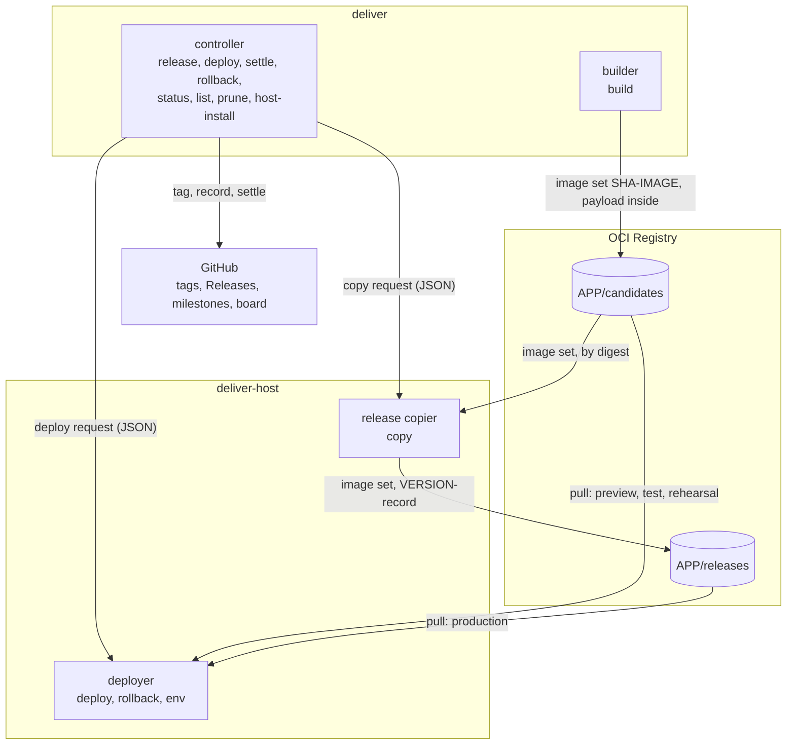
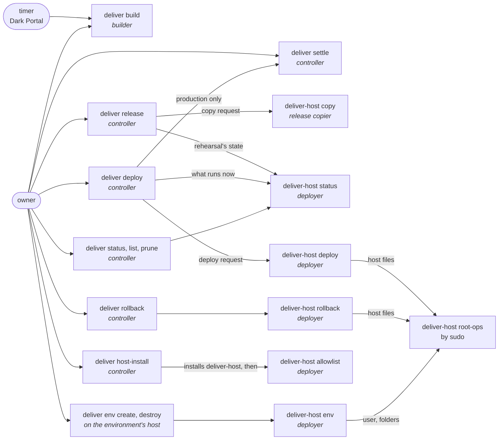
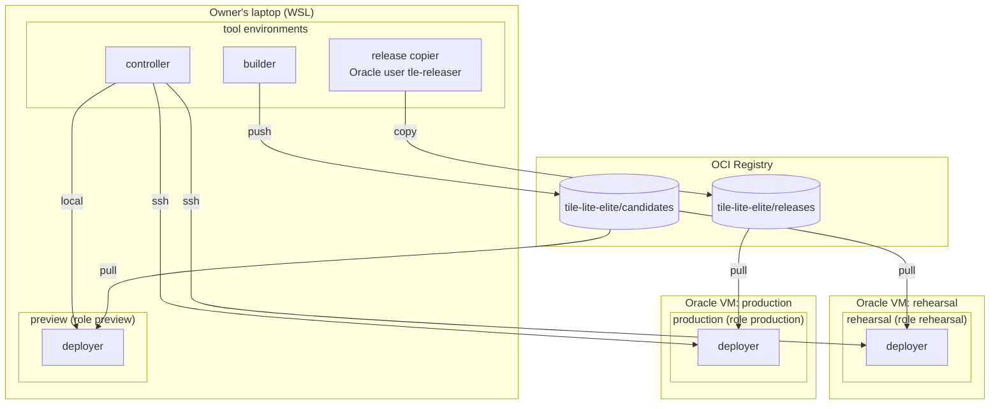
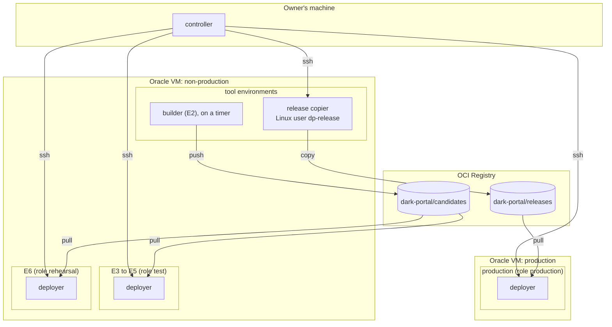
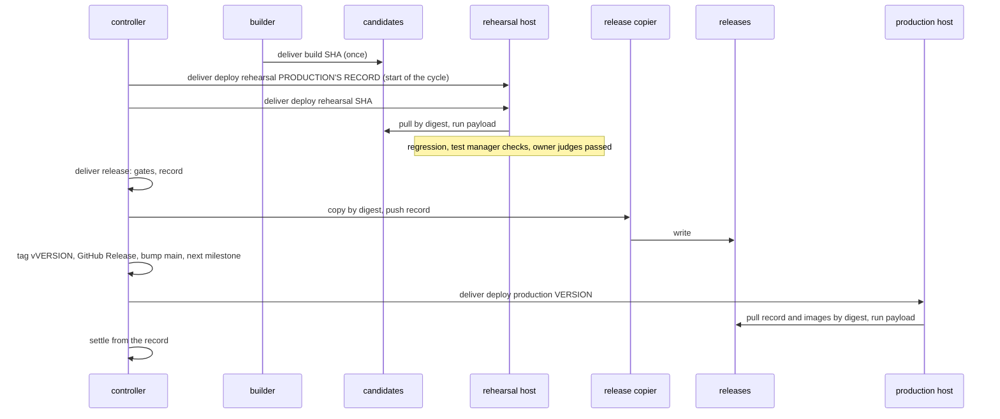

<!-- markdownlint-disable-file MD013 -->
# The deliver tool: design

Design for delphside/programme#117, the build, release and deploy tool every
application in the programme uses. Its customers are
delphside/tile-lite-elite#545 (work packages delphside/tile-lite-elite#555 and
delphside/tile-lite-elite#556) and delphside/dark-portal#11
(delphside/dark-portal#15). The generic rule it implements is
[docs/1.2 *Making a release, then deploying it*](../../../../docs/1.2-change-lifecycle.md#making-a-release-then-deploying-it).
Its decisions are in #117's body.

## 1. As-is

| | Tile Lite Elite | Dark Portal |
| --- | --- | --- |
| build | `scripts/deliver/deploy.sh` builds each commit once on the owner's laptop into a local tarball, `artifacts/SHA.tar.gz`, shared by every environment | none yet |
| store | none: the tarball is copied to each host with `scp` | registry repositories `dark-portal/candidates` and `dark-portal/releases` exist (delphside/dark-portal#14), nothing pushed |
| release | until 0.10.0, inside `deploy.sh` after the production deploy: tag `prod-X.Y.Z`, GitHub Release, bump `main`, settle the milestone. 0.10.1 was released by hand at rehearsal pass, as the annotated tag `v0.10.1` (2026-10-27) | none yet |
| deploy | `deploy.sh` from the operator's working tree, over ssh. Its gates count themselves and refuse if one did not run: on the remote, CI green with e2e, pull request, schema, version, milestone, preview and rehearsal `/health` short SHA | none yet |
| configuration | Caddyfile baked into the web image; compose file copied from the commit; secrets in each host's `.env`; preview uses its own compose file and `Caddyfile.preview` from the working tree | designed in delphside/dark-portal#11 |
| rollback | retags `:previous` and restores a snapshot; the earlier compose file is not restored | designed in delphside/dark-portal#11 |

## 2. Components

*deliver* is the programme's generic tool. It is started by a command,
`deliver`, run by a person or a timer. It invokes another command,
`deliver-host`, in the other environments involved. This section describes them.

**Environments.** An *application environment* is one running copy of the
application. Each has an *environment role*. [Gates](#6-gates-and-checks) are
defined for particular environment roles. *Candidates* and *releases* are the
application's two registry repositories ([§10](#10-oci-integration)):

| Environment role | Reads | Gates that key on it |
| --- | --- | --- |
| `preview` | candidates | none beyond every deploy's |
| `test` | candidates | none beyond every deploy's |
| `rehearsal` | candidates | the release step reads what it runs; a rehearsal starts from production's level |
| `production` | releases only | a [record](#7-the-release-and-its-record) is needed; [settle](#8-settling) follows |

*Tool environments* run a *component* of the tool: the controller, the builder
or the release copier. A *host* is a machine that runs one or more environments.

**Components.** For each application, its profile (`app-profile.toml`,
[§5](#5-profile-and-hooks)) maps each component to a tool environment. A host's
`.env` holds only what differs per environment: addresses, keys, limits. The
*controller* is the environment a run is started from.

| Component | Purpose | Runs | Holds | Does |
| --- | --- | --- | --- | --- |
| *controller* | Decides what ships and keeps the record of it. The only component that changes `main`, tags or the board, so a release is made in one place and the board follows production. | `deliver release`, `deploy`, `settle`, `rollback`, `status`, `list`, `prune`, `host-install` | <ul><li>git with push rights to `main`</li><li>a GitHub credential</li></ul> | <ul><li>runs the release step's gates</li><li>tags the version and bumps `main`</li><li>starts deploys</li><li>settles the board from the record</li></ul> |
| *builder* | Builds each commit once, from a clean checkout, so every environment runs the same images and none is rebuilt on the way to production. | `deliver build` | <ul><li>the repository</li><li>the candidates write credential</li></ul> | <ul><li>makes one image set per commit</li><li>pushes it to candidates</li></ul> |
| *release copier* | Holds the only credential that writes releases, so no other component can put an image there. | `deliver-host copy`, started by `deliver release` | <ul><li>the release credential: the registry login of the Oracle user allowed to read candidates and write releases</li></ul> | <ul><li>copies a rehearsed image set by digest from candidates to releases</li><li>pushes the record</li></ul> |
| *deployer* | Changes an environment by one locked, logged path on its host, which can restore the previous deploy if a step fails. | `deliver-host deploy` and `rollback`, started by `deliver`; `deliver env create` and `destroy` | <ul><li>its own registry identity</li><li>its `.env`</li><li>its [state folder](#9-on-the-host)</li></ul> | <ul><li>holds the environment's lock throughout</li><li>pulls by digest</li><li>takes the payload out of the image</li><li>runs the deploy steps</li></ul> |

| Component | Tile Lite Elite | Dark Portal |
| --- | --- | --- |
| controller | the owner's laptop (WSL) | the owner's machine |
| builder | the owner's laptop (WSL): production's 1 GB host cannot compile | the non-production VM's builder (E2), on a timer |
| release copier | the controller, logged in as Oracle user `tle-releaser` with an auth token (`docker-config`) | the non-production VM, as its Linux user `dp-release`, holding the API key of Oracle user `dp-releaser` (`oci-api-key`), which never leaves it |
| deployer | each environment's host: the owner's laptop for `preview`, the rehearsal VM, the production VM | the non-production VM for E3 to E6; the production VM |
| environments | `preview` (role preview) on the owner's laptop, `rehearsal` on the rehearsal VM, `production` on the production VM | E3 to E5 (role test), E6 (role rehearsal) on the non-production VM; production VM |

The terms and the views in this section are C4's
([views](https://github.com/delphside/tile-lite-elite/blob/main/docs/diagrams/README.md#which-view-a-diagram-takes-and-saying-so)):
`deliver` and `deliver-host` are its *containers*, the four components are parts
of them, and environments are its *deployment nodes*.

**Container view**: the tool's containers, their components, and what each arrow
carries.



**Component view, command flow**: who starts each command, and which
`deliver-host` command it runs.



**Deployment view, Tile Lite Elite**: which environments each host runs.



**Deployment view, Dark Portal**: which environments each host runs.



The *payload* ([§9](#9-on-the-host)) is not a component but what the hosts run:
the deploy steps, the application's hooks, the files joined at deploy and the
host files. It holds nothing secret. `deliver build` assembles it into
`<worktree>/.deliver-payload/` and exports `DELIVER_PAYLOAD_DIR`; the
application's Dockerfile copies it to `/deliver/` in the image the profile names
(`payload_image`). The steps and libraries come from the `programme` submodule
at the commit the built commit pins, read with `git archive` (the running tool's
own where the application has no `programme` entry), with the application's
hooks and files from its repository. That programme commit is recorded as
`tool.programme`. A host needs the registry and never GitHub. The files joined
at deploy come from the payload too, never from a working tree. Most
environments join the same files; an environment may name its own (Tile Lite
Elite's preview joins `docker-compose.preview.yml` and `Caddyfile.preview`), and
they are still the commit's.

**Technologies.**

| Technology | Used for | Where |
| --- | --- | --- |
| bash, with `lib/toml.sh` for the profile | the tool itself: every command, the payload's steps and the hooks | every component and host |
| `jq` | the release record, deploy requests, host state | every component and host |
| `skopeo` | registry reads, the release copy and the record image (§10); needs no Docker daemon | controller, builder, release copier |
| `docker` and `docker compose` | pulling by digest; running an environment as a Compose project; the builder's build; a `--local` build from the controller; the login of any `oci-*` adapter | hosts, builder, controller, any component using an `oci-*` login |
| `docker buildx` | the default `build` hook | builder |
| `git` | clean worktrees, `git archive` of the payload, the tag and the bump (§11) | controller, builder |
| `ssh` | the controller's calls to `deliver-host` on another host, `deliver build` forwarded to a remote build host and `host-install` | controller |
| `flock` | the environment's lock | hosts |
| `sudo` and `systemd` | `root-ops` and the units of host files (§9) | hosts |
| `gh` CLI | every GitHub call (§11) | controller |
| OCI CLI (`oci`) | a registry token, for the `oci-*` login adapters only (§10) | any component using an `oci-*` login: hosts, the release copier and Dark Portal's builder (`oci-instance-principal`) |
| `curl` | production's `/health`, where it has no `deliver` state (§6) | controller |
| `bats` | the tool's tests | development and CI |

**Layout.** In the programme repository:

| Path | What |
| --- | --- |
| `scripts/deliver/deliver` | the controller and builder commands |
| `scripts/deliver/deliver-host` | the host command, installed by `deliver host-install` |
| `scripts/deliver/payload/` | the deploy and rollback steps copied into the payload image |
| `scripts/deliver/lib/` | profile reading, run log, gate list, registry and login adapters, GitHub calls |
| `scripts/tests/deliver-*.bats` | the tool's tests, against a dummy application, stub hooks and a local registry |
| `scripts/board/` | reading `tag_prefix` as released and `history_prefixes` as history |
| docs/1.1 | the tool's row |
| docs/1.2 | *Making a release, then deploying it* names the tool; §1.0 says a release is "a commit on `main`", since `main` may move on after rehearsal (delphside/tile-lite-elite#545 R5) |

## 3. The route

The stages run in this order, and each links to the section that holds its
rules.



1. **Build.** The builder builds a commit on the remote once, from a clean
   worktree, and pushes the image set to candidates as `SHA-IMAGE`, the payload
   inside. Nothing is rebuilt later.
2. **Rehearse.** A cycle starts by deploying production's current record to the
   rehearsal environment, so rehearsal tests the upgrade production will take.
   Then the commit is deployed: the host pulls by digest from candidates and
   runs the payload's steps ([§9](#9-on-the-host)). Regression runs, the test
   manager checks the results, and the owner judges rehearsal passed. Preview
   and test environments take candidates the same way, with no cycle.
3. **Release.** `deliver release` runs the release gates
   ([§6](#6-gates-and-checks)), asks the owner to confirm the version, and makes
   the release in the order of [§7](#7-the-release-and-its-record): the release
   copier copies to releases and pushes the record; the controller tags, makes
   the GitHub Release, bumps `main` and opens the next milestone.
4. **Deploy.** `deliver deploy production VERSION` pulls the record and images
   from releases by digest and runs the same steps. Production deploys a version
   that has a record.
5. **Settle.** After a production deploy the controller settles the board from
   the record ([§8](#8-settling)). A failure here leaves the deploy standing and
   exits 3. After any deploy that finishes, and after settle, the controller
   runs the application's `post-deploy` hook, a check: its result is reported
   only ([§6](#6-gates-and-checks)).

The flags that leave the route (`--emergency`, `--skip-rehearsal`,
`--unrecorded`) are in [§4](#4-commands).

## 4. Commands

Every command writes a run log in the environment it runs in, naming each gate
it ran. A command that ends without every gate in its list having run refuses,
as Tile Lite Elite's `deploy.sh` does today.

**Exit codes.**

| Exit | Meaning |
| --- | --- |
| 0 | done |
| 1 | refused or failed, with the previous deploy restored where there is one |
| 3 | live, but a later step (settle, GitHub Release, milestone) failed and is named |

**The `deliver` commands.** `deliver` is the public interface. `ENV` is an
environment of the application's profile, `REF` a commit or a version, `GATE` a
gate named as in [§6](#6-gates-and-checks).

| Command | Component | What |
| --- | --- | --- |
| `deliver build [REF] [--local]` | builder | builds REF (default `HEAD`) once and pushes it to candidates. Non-interactive. Uses the `build` hook (default `docker buildx bake`), labels each image `org.opencontainers.image.revision` (the SHA) and `.version` (from the version file), and prints the digests (an index digest for a multi-arch build). `--local` (preview role only) builds an unpushed commit into the local Docker and pushes nothing; such a build can reach no other environment, and a preview deploy of it is identified by local image id and revision label instead of `RepoDigests` |
| `deliver deploy ENV REF [--wait[=MIN]] [--check] [--set-aside GATE REASON] [--unrecorded REASON] [--off-level REASON]` | controller | role preview, test or rehearsal: REF is a full or short SHA, or a version, resolved to digests in candidates; a short SHA matching more than one candidate refuses. Role production: REF is a version with a record |
| `deliver release [--expect VERSION] [--commit REF] [--emergency REASON] [--skip-rehearsal REASON] [--set-aside GATE REASON] [--check]` | controller; the copy on the release copier | makes the release of the commit the rehearsal environment runs (`--commit REF` replaces it, as `--skip-rehearsal` needs). Shows version (from the version file at that commit), commit, digests and the last passing rehearsal deploy, and asks the owner to confirm by typing the version (`--expect` for a non-interactive run). [§6](#6-gates-and-checks) has its gates and [§7](#7-the-release-and-its-record) its steps |
| `deliver settle VERSION` | controller | moves the board to what the record says shipped ([§8](#8-settling)); safe to rerun |
| `deliver rollback ENV` | controller | `deliver-host rollback`: the environment's previous deploy ([§9](#9-on-the-host)) |
| `deliver status ENV` | controller | the digests ENV runs, matched by `RepoDigests`, the record they match, the deploy state and whether the host files equal the payload's (a check) |
| `deliver list ENV` | controller | records beside what ENV runs |
| `deliver prune [--dry-run]` | controller | removes candidates not needed any more (rule after the tables); releases are never removed. Hosts keep their current and previous images |
| `deliver env create\|destroy NAME` | deployer, run on the environment's host | an ephemeral environment from the profile's template: user, state folder, `.env` (secrets at a hidden prompt), Compose project, `env-create` and `env-destroy` hooks |
| `deliver host-install ENV\|COPIER` | controller | installs or updates `deliver-host` and its libraries on ENV's host, or on the release copier; installs `jq` where it is missing, and refuses when `flock` or the login adapter's tools (`oci`) are absent. A copier that hosts no environment gets `deliver-host` and its libraries, including `registry.sh`, and no allowlist or sudo rule. Refuses two environments that would remove each other's host files ([§6](#6-gates-and-checks)) |

`deliver prune` removes a candidate only when it was built before the newest
release was made, is not released, and is not run by any environment's current
or previous deploy. "Built" is the image's `org.opencontainers.image.created`
label, the time the build started: skopeo exposes only that, not the registry's
push time. The worst case, a build that began before a release and pushed after
it, costs a rebuild.

**The `deliver-host` commands.** `deliver-host` is called only by `deliver`,
over `ssh`, or directly where the host is the controller's own. Requests are
JSON on standard input, built by `deliver`.

| Command | Called by | What |
| --- | --- | --- |
| `deliver-host deploy APP ENV < request` | `deliver deploy` | pulls by digest, takes the payload out of the image, runs its steps ([§9](#9-on-the-host)) |
| `deliver-host rollback APP ENV < request` | `deliver rollback` | the same switch to `previous` ([§9](#9-on-the-host)) |
| `deliver-host status APP ENV --json` | `deliver status`, `list` and `prune`, the release step, the rehearsal-level gate and production's version read | what the host runs, its record and its state |
| `deliver-host copy APP < request` | `deliver release`, on the release copier named by `[deliver.release].copy_on`, with `copy_login` | copies the image set from candidates to releases by digest and pushes the record image; the controller only reads |
| `deliver-host allowlist APP < lines` | `deliver host-install`, as root | writes the root-owned allowlist ([§9](#9-on-the-host)) |
| `deliver-host env create\|destroy NAME` | `deliver env` | creates or removes an ephemeral environment |
| `deliver-host root-ops ...` | the payload's steps and `env`, through one `sudo` rule | the only operations the deploy user may run as root ([§9](#9-on-the-host)) |

**Flags that set a gate aside.** Each takes a reason, which goes into the record
where there is one and always into the run log:

| Flag | Sets aside |
| --- | --- |
| `--emergency REASON` (release) | the commit being on `main`; requires instead that it descends from the release production runs ([§6](#6-gates-and-checks)) |
| `--skip-rehearsal REASON` (release) | rehearsal having passed this commit; raises the retrospective issue ([§7](#7-the-release-and-its-record)) |
| `--unrecorded REASON` (deploy, production) | the need for a record: REF is a full SHA, whose image set the release copier copies to releases as `SHA-IMAGE` (a no-op where the same digests are there already) with no record; no version is spent, and settle has nothing to move |
| `--off-level REASON` (deploy, rehearsal) | a rehearsal cycle starting from production's level |
| `--set-aside GATE REASON` | a gate the profile lists in `[release].overridable`, named as in [§6](#6-gates-and-checks): a hook's name, or `milestone` |

**Checking and waiting.** `--check` runs every gate and stops before anything
changes (what Tile Lite Elite's `verify.sh` uses). `deploy --wait[=MIN]` waits
for the lock and for a hook that answers *not yet*, checking each minute, for at
most 60 minutes by default: Dark Portal's longest wait outside its window is
50. At the limit it refuses, exit 1, naming what it waited for.

## 5. Profile and hooks

**Profile.** The application's `app-profile.toml` keeps its existing sections
and gains keys in them; nothing is said twice. The registry address is never in
it ([§10](#10-oci-integration)). The example is Tile Lite Elite's, with Dark
Portal's values in comments (`dp:`).

```toml
[release]
tag_prefix = "v"
history_prefixes = ["prod-"]               # earlier tags, read for history and release notes
announcement = "Released in v"             # starts settle's comment; the board matches it, and the same text with each history prefix
deploy_marker = "[deliver]"
required_checks = ["e2e"]                  # CI checks that must be green on the commit
required_hooks = ["pre-deploy", "save-state", "migrate", "smoke", "restore-state", "release-check"]
overridable = ["milestone"]               # gates --set-aside may name: hooks by name, or the tool's own milestone gate

[deliver]
candidates = "tile-lite-elite/candidates"  # dp: "dark-portal/candidates"
releases   = "tile-lite-elite/releases"    # dp: "dark-portal/releases"
images     = ["server", "web"]             # dp: ["dp"]; tag is SHA-IMAGE
payload_image = "server"
join = ["docker-compose.yml", "Caddyfile"]

[deliver.build]
on    = "controller"                     # dp: ssh alias of the non-production VM
login = "docker-config"                    # dp: "oci-instance-principal"

[deliver.release]
copy_on    = "controller"                # dp: the non-production VM, user dp-release
copy_login = "docker-config"               # dp: "oci-api-key"

[[deliver.host_files]]
src  = "scripts/operate/backup-to-oci.sh"
dest = "/opt/tile-lite-elite/backup-to-oci.sh"
mode = "0755"
# a systemd unit adds: enable = true

[environments.preview]                     # existing keys stay
role  = "preview"
host  = "controller"
join  = ["docker-compose.preview.yml", "Caddyfile.preview"]

[environments.rehearsal]
role  = "rehearsal"
ssh   = "tile-lite-elite-rehearsal"
login = "oci-instance-principal"

[environments.production]
role  = "production"
ssh   = "tile-lite-elite"
login = "oci-instance-principal"
host_files = true                          # default: true for roles rehearsal and production
# lock = "/var/lib/deliver/APP/vm.lock"    # dp: one lock for E3 to E6 and its heavy runs; default per environment
pull_timeout = 300                         # set from delphside/tile-lite-elite#554's measured pull
```

Also in the profile: `[deliver].fallback`, the sentence a failed first deploy
prints; `[deliver.ephemeral]` (`user_prefix`, `home`, `secrets`), the template
for `deliver env`; per environment `project` (the Compose project name) and
`url`; and `[versions].deployed` (`path` and `field`), where production's
`/health` reports its version ([§6](#6-gates-and-checks)). `on` and `copy_on`
take `"controller"` or an `ssh` alias, and an environment's `host` takes
`"controller"`; `"control-node"`, an older name for the controller in profiles,
is still accepted.

The gates read the commit's profile (required checks and hooks, what may be set
aside, images, payload image), as the hooks are read. Which host runs an
environment, and its role, stay the controller's working-tree profile.

**Hooks.** Executables in the application's `deliver/hooks/`, carried in the
payload. A hook in `required_hooks` that is missing or not executable refuses,
so a renamed hook cannot pass silently; any other missing hook is a no-op. The
`build` hook alone has a default.

| Exit | Meaning |
| --- | --- |
| 0 | passed |
| 75 | not yet (with `--wait`, try again; otherwise refuse) |
| any other | refused, or the step failed |

Each hook gets `DELIVER_APP`, `DELIVER_ENV`, `DELIVER_ROLE` (the environment's
role, `controller` for the release step, `ephemeral` for an environment's create
and destroy), `DELIVER_SHA`, `DELIVER_VERSION`, `DELIVER_STATE` (the state
folder) and `DELIVER_IMAGE_<NAME>` (each image by digest). A hook that cannot
judge answers refused: it does not pass for want of an answer.

| Hook | Kind | Component | Tile Lite Elite | Dark Portal |
| --- | --- | --- | --- | --- |
| `build` | step | builder | `docker compose build` with the build id | `docker buildx`, arm64 and amd64 |
| `release-check` | gate | controller | refuses a patch carrying a `functional` change | none |
| `bump` | step | controller | none | none |
| `pre-deploy` | gate | deployer | the database is not ahead of the build's schema | the window :40 to :10 (75 outside it) |
| `save-state` | step | deployer | stop the server, snapshot the database, keep five | copy the DuckLake catalog aside |
| `migrate` | step | deployer | `server --migrate-only` | catalog migrations |
| `smoke` | gate | deployer | `/health` reports `VERSION+SHA` within 60 s | the release's own checks |
| `restore-state` | step | deployer | restore the snapshot | restore the catalog copy; bronze is append-only and untouched |
| `post-deploy` | check | controller | list open `Release Check` issues | the next collection, about :36, lands |
| `env-create`, `env-destroy` | step | deployer | the preview slot's volume | the user and `/srv/dp/NAME` |

The optional `bump` hook runs in the worktree that bumps `main`, with
`DELIVER_VERSION` set, for a lockfile refresh the version file's pattern cannot
do. A check's non-zero exit is reported, changes nothing else, and leaves the
exit code as it was.

## 6. Gates and checks

A gate refuses and the work stops; a check reports and a person decides. Each
row says what it is for before what it compares.

| Where | For | Criterion | Kind | Set aside by |
| --- | --- | --- | --- | --- |
| build | a build is what the commit says, nothing local | built from a clean worktree of a commit on the remote | gate | `--local` (preview only; nothing is pushed) |
| build | the store is never overwritten | an image whose `SHA-IMAGE` is present is not rebuilt; a failed registry query refuses; a tag in releases is never overwritten (releases is immutable where the registry offers it) | gate | nothing |
| every deploy | the host runs exactly the bytes named | each image pulled by digest; its revision label is the SHA; the running containers' `RepoDigests` match (for a `--local` preview build, the local image id and its revision label) | gate | nothing |
| every deploy | two deploys, or a deploy and the application's own heavy run, never overlap | the environment's lock is free, and held to the end | gate | `--wait` waits |
| every deploy | an interrupted deploy is not built upon (the *state gate*) | the state folder shows the last deploy finished, restored or `failed, no previous deploy`; otherwise it refuses, names the step reached and points to `deliver rollback ENV`. A failed restore leaves the state interrupted | gate | nothing: `deliver rollback` |
| deploy, release | a renamed or missing hook cannot pass silently | every hook in `required_hooks` is present and executable | gate | nothing |
| every deploy | the application's deploy-time conditions | the `pre-deploy` hook | gate | `--set-aside`, where overridable |
| every deploy | a host file the host does not allow is never installed | a payload whose `host_files` add a destination not on the host's allowlist refuses, saying to rerun `deliver host-install` ([§9](#9-on-the-host)) | gate | nothing: rerun `deliver host-install` |
| deploy, host-install | environments never remove each other's host files | two environments of one application on one host that both install host files refuse ([§9](#9-on-the-host)) | gate | `host_files = false` on all but one |
| every deploy | a failed deploy leaves the previous deploy running | `migrate` fails or `smoke` refuses: `restore-state`, then the previous deploy's digests and joined files | gate | nothing |
| rehearsal deploy | rehearsal starts from production's level | the first deploy of a cycle (the deploys to a rehearsal-role environment since the last release was made: a deploy whose `deployed` time in the host's `meta.json` is at or after, to the second, the newest release tag's creation date) is production's current record, read as in [Which release production runs](#which-release-production-runs) and pulled from candidates by the same digests. Production running a build with no record refuses: a production deployed before the tool, as at the first cycle ([§13](#13-moving-tile-lite-elite-to-it)) | gate | `--off-level` |
| release | the release is what rehearsal passed | the rehearsal-role environment runs this commit's digests, its last deploy finished and its `smoke` passed, and the owner confirms the version | gate | `--skip-rehearsal`, which raises the retrospective issue ([§7](#7-the-release-and-its-record)) |
| release | a normal release ships what `main` holds | the commit is on `origin/main` | gate | `--emergency` |
| release | an emergency ships nothing unreleased | with `--emergency`, the commit descends from the tag of the release production runs (read as in [Which release production runs](#which-release-production-runs)) and none of its commits after that tag is on `main` | gate | nothing |
| release | CI has passed the commit | every check in `required_checks` is green on the commit | gate | nothing |
| release | the version is spent once, and moves forward | the version has no tag; a `VERSION-record` already in releases is this commit's with the same digests, and is reused (a record left by an earlier failed run); and the version is higher than the newest release tag of any prefix | gate | nothing |
| release | the milestone is a shipping list | every open issue in milestone VERSION is evidenced by a commit in the release, and every Production Release work package the commits name is in the milestone or in an undeployed release's: [The milestone gate](#the-milestone-gate) has the conditions | gate | `--set-aside milestone REASON` |
| release | the application's own release rules | the `release-check` hook | gate | `--set-aside`, where overridable |
| release | a dropped item is never silent | for each item an earlier release in the range carried and this one drops, the tool says `#N is in X but not carried by Y` ([§7](#7-the-release-and-its-record)) | check | — |
| production deploy | production deploys releases that were made | a record exists for VERSION; its digests are pulled from releases | gate | `--unrecorded` |
| after a production deploy | the board says what shipped | `settle` ([§8](#8-settling)) | check: a failure is reported, exit 3, the deploy stands | — |
| after a deploy | the application's own view of the result | the `post-deploy` hook, run on the controller from the commit's hooks after the deploy finishes and after settle, never under `--check` | check: a non-zero exit is reported and changes nothing, and the exit code stays | — |
| any time | a host's installed files are the release's | `deliver status` compares the host files with the payload | check | — |

### The milestone gate

- Parents are left aside.
- Every open issue in milestone VERSION is evidenced by a commit in the release:
  a `Refs #N` since the release production runs, which is where the carried
  range starts ([§7](#7-the-release-and-its-record)).
  - A commit that a later commit in the range reverts, and that revert, name
    nothing.
  - A parent's `Refs` counts for its work package where the parent has exactly
    one in the milestone.
- Every work package the commits name whose `Route` is Production Release is in
  the milestone, or in the milestone of a release made but not deployed whose
  tag lies in the range.
- Work packages of other routes are left out, because they deliver on their own
  date milestones (docs/1.2 §2.15).
- With `--emergency`, open issues evidenced only by commits on `main` are left
  out of the check and moved to the next milestone by step 7 of
  [§7](#7-the-release-and-its-record).

### Which release production runs

For rehearsal's level and the emergency gate, it comes from the record in
production's host state, read over ssh. Only where the host has no `current` at
all, as for a production deployed before the tool, is it read from `/health`
through `[versions].deployed` and the environment's `url`, and the release's tag
is the version's. A `current` with no record (a deploy made with `--unrecorded`)
makes the gate refuse, saying it cannot tell which release production runs.

## 7. The release and its record

The release step ([§3](#3-the-route), stage 3) runs in this order, so that what
cannot be undone comes last and a rerun resumes rather than repeats:

1. every release gate ([§6](#6-gates-and-checks)), then the owner's
   confirmation;
2. copy each image by digest to releases as `VERSION-IMAGE` (`skopeo copy --all
   --preserve-digests`, on the release copier); a copy already present with the
   same digest is a no-op;
3. push the record as a scratch image `VERSION-record`;
4. push the annotated tag `vVERSION`, whose message is the record. **The version
   is spent here**: from now on a rerun finds the tag, checks its record
   matches, and resumes at step 5;
5. the GitHub Release, with notes from the previous release tag of any prefix
   ([§11](#11-github-integration));
6. bump the version on `main` to the next patch after the released one, unless
   `main` already holds that or a higher one, with the version-only change
   `[versions.bump]` allows (and the `bump` hook, if any) and a subject built
   from `versions.stamp_form` and `versions.api`, and push. An emergency's
   release leaves `main` at a version above it, so `main` moves on: if `main`
   already held the emergency's number, it moves to the next patch;
7. open the next milestone, and after an emergency move into it the open issues
   the milestone gate left out.

The record is made once, at step 1, and kept in the controller's state for the
release. A failure before step 4 leaves nothing spent: a rerun reads the images
and any `VERSION-record` already in releases and reuses them when their commit
and digests match the record, and refuses when they do not. A failure after it
is reported (exit 3) and resumed by rerunning `deliver release`. A rerun that
finds the tag carrying a different record refuses; one that finds every step
done says so and exits 0.

**The retrospective issue.** A release made with `--skip-rehearsal` raises, once
the tag is pushed, an issue titled `Retrospective: VERSION released with
rehearsal skipped`, naming the reason and what was skipped (rehearsal of the
commit and the smoke test the release gate reads). A rerun that finds an issue
with that title raises no second, and a failure to read or raise it is reported
(exit 3). `--emergency` raises none.

**The record.** JSON, version 1. A reader refuses a record version it does not
know. Tags without a JSON message (`v0.10.1`, every `prod-*`) are releases made
before the tool and are read as history only.

```json
{
  "record": 1,
  "application": "tile-lite-elite",
  "version": "0.10.2",
  "commit": "full SHA of the application's commit, whose payload is the deploy steps",
  "images": {"server": "sha256:...", "web": "sha256:..."},
  "made": "2026-11-02T19:04:00Z",
  "rehearsal": {"environment": "rehearsal", "deployed": "2026-11-02T18:40:00Z", "smoke": "passed"},
  "emergency": null,
  "rehearsal_skipped": null,
  "set_aside": [{"gate": "milestone", "reason": "..."}],
  "tool": {"programme": "the programme commit the application pins"},
  "carries": {"work_packages": [555, 556], "issues": [560],
              "releases": [{"version": "0.10.1", "work_packages": [555], "issues": [], "dropped": []}]}
}
```

`carries` lists everything production gains with this release: the milestone's
open items once the gate has passed or has been set aside, less any issue an
emergency left out (its work packages, and its open issues that are not
projects, parents aside), and the items of `releases`. The commits' `Refs` are
the gate's evidence, never the list itself, so an issue that is only referenced,
such as an application's notes issue, is never carried. The carried range works
as follows:

- It starts at the release production runs (read as in
  [Which release production runs](#which-release-production-runs)), not at the
  nearest release tag, so a release made while an earlier one was never deployed
  carries both.
- Where production's release cannot be read, or has no tag, the release is
  refused at the milestone gate; the first release of an application, which has
  no tag at all, takes the whole history.
- `releases` has one entry per release tag in the range other than this one: the
  items its own record carried, less any named only by a commit that a later
  commit in the range reverts (`This reverts commit <sha>.`, a short sha too;
  the reverted commit and the revert are both left out). `dropped` lists the
  items so left out.
  - Reverts count by parity: a revert of a revert keeps the change, a third
    revert leaves it out.
  - A revert of a commit outside the range has no effect.
  - A cherry-picked revert, which names the original's sha, is not matched: that
    is a stated limit.
- A release in the range with no record (made before the tool) has its
  milestone's open items stand for its record: those an unreverted commit in the
  range names, or whose parent it names, are carried and the rest are `dropped`.
- At release the tool says, as a check and not a gate, `#N is in 0.10.2 but not
  carried by 0.10.3` for each dropped item.

`set_aside` lists each gate `--set-aside` named, with its reason, and is empty
where none was. The record replaces Tile Lite Elite's `deploy.sh` build
manifest.

`rehearsal.deployed` is the time of the last finished rehearsal deploy of these
digests, read from the rehearsal host's state. The owner's judgement that
rehearsal passed is the confirmation at step 1; the test manager's report is the
owner's input to it and is not read by the tool.

## 8. Settling

`deliver settle VERSION` reads the record and acts on exactly what it lists, as
docs/1.2 §2.5 says, parents aside:

| Item | Becomes |
| --- | --- |
| a carried work package, which a release milestone holds only for the Production Release route (docs/1.2 §2.5: a project advances) | `Project State` Post-deployment, with a comment that starts with the profile's `[release].announcement` and the version, so the board recognises it |
| a carried issue that is not a project | closed as completed, with the same comment |
| the milestone VERSION | closed |
| an item of a release in `carries.releases` | as above, but the comment is `<announcement><its version>, deployed with v<VERSION>` (still starting with the announcement and a version), unless it already has that release's own comment |
| a `dropped` item still in its release's milestone | a comment `<announcement><VERSION> without this (not shipped): ...`, which starts with the announcement so the board reads it as the tool's and not the owner's, then removed from that milestone; its state and openness are left alone |
| the milestone of each release in `carries.releases` | closed |

**Worked example.** Production runs 0.10.1. 0.10.2 is made with #1 #2 #3 and
never deployed. #2 is reverted on `main`. 0.10.3 is made with #1 #3 #4: its gate
passes because #1 #3 are in the milestone of 0.10.2, which is in the range, and
because #4 is in 0.10.3. Its record carries #1 #3 #4 with `releases` holding
0.10.2 (`issues` [1, 3], `dropped` [2]); the release says `#2 is in 0.10.2 but
not carried by 0.10.3`. Deploying 0.10.3 settles #4 normally, #1 and #3 with
`Released in v0.10.2, deployed with v0.10.3`, comments on #2 that it did not
ship and removes it from 0.10.2, and closes both milestones. 0.10.2's own tag
and record are not changed.

Each action checks first and does nothing if it is already done, so a rerun is
harmless. A failure is reported with the items left, and the deploy's exit is 3.

## 9. On the host

```text
/var/lib/deliver/APP/ENV/
  lock                  flock, held for the whole deploy or rollback; the profile's `lock` may name one path shared by several environments
  state                 the step reached, written at each step; "finished" at the end
  deploys/<n>/          one folder per deploy: deliver.env (images by digest), the joined files, the record if any
  current -> deploys/<n>
  previous -> deploys/<n-1>
```

The state folder is on disk, so a step reached survives a reboot. Compose runs
with a fixed project name (the volumes persist across deploys),
`--project-directory` set to the deploy's own folder `deploys/<n>`, `--env-file`
for the host's `.env` and then the deploy folder's `deliver.env`, and
`--no-build`. Tile Lite Elite's compose file names each image as
`${DELIVER_IMAGE_SERVER:-tile-lite-elite-server}` and so on, the default keeping
a developer's and CI's local builds working, with `pull_policy: never`: the
images are pulled by digest before the switch, so compose never pulls by tag or
builds. The builder uses the same compose file with its `build:` blocks.

**A deploy's steps**, from `deliver-host deploy` (the gates are
[§6](#6-gates-and-checks)'s):

1. take the lock;
2. check the state: the state gate. `failed, no previous deploy` does not
   refuse, because the next deploy is the way forward;
3. pull every image by digest, within `pull_timeout`;
4. take the payload out of `payload_image`;
5. run `pre-deploy`;
6. write the new deploy folder;
7. run `save-state`, then `migrate`;
8. install the host files, where the environment has `host_files` true (by
   default only the rehearsal and production roles, so environments sharing a
   host never overwrite each other's; two environments of one application on one
   host that both install host files refuse at `deliver deploy` and `deliver
   host-install`, since each would remove the other's; an application whose test
   environments need a schedule keeps it inside its Compose project, not as a
   host unit): copy them with their modes, `systemctl daemon-reload`, enable and
   restart the units marked `enable`, as root through `root-ops`. A host file
   the previous deploy installed and this one does not carry is removed;
9. switch `current`, run `compose up`, then `smoke`;
10. mark the state `finished`, and prune: host images other than current and
    previous, and `deploys/<n>` folders other than current and previous. Only
    images under the registry address are considered, so an application's local
    images, such as a fallback's, are never touched and need no profile key.

A failure after `save-state` runs `restore-state`, switches back to `previous`,
reinstalls its host files, and exits 1. On a host's first `deliver` deploy there
is no `previous`: the failure runs `restore-state`, stops the new containers,
removes `current`, marks the state `failed, no previous deploy`, and exits 1
naming the application's fallback (`[deliver].fallback`).

**Rollback** is the same switch to `previous`, with `restore-state` and the host
files restored the same way, run on demand. It removes `previous` afterwards, so
a second rollback refuses. With no previous deploy it refuses and names the
application's fallback (`[deliver].fallback`, [§5](#5-profile-and-hooks)).

**Root-ops and the allowlist.** The deploy user is root-equivalent through
Docker. The checks in this section guard against mistakes, not against a hostile
deploy user. A non-production host may run any branch's build, which is safe
only because no builder builds a fork.

`deliver host-install`, run by the owner with sudo, writes root-owned files in
`/etc/deliver/APP/` (directory 0755, files 0644) and the one `sudo` rule that
lets the deploy user run `deliver-host root-ops` as root:

| File | Holds |
| --- | --- |
| `host_files.allow` | per host file: destination, source within the payload, mode, whether a unit is enabled |
| `ephemeral.prefix` | the `user_prefix` of the application's ephemeral users |
| `installed` | written by root-ops: what it has installed |

root-ops reads only those files. It does not trust the state folder, which the
deploy user writes. What each operation allows:

| Operation | Allowed |
| --- | --- |
| `install` | a regular file, not a link, resolving under the application's own deploy folders, that is the one source its destination lists, with the allowlist's mode and the caller naming the same mode; setuid, setgid, sticky and world-writable modes are refused |
| `rm` | a file in `installed` |
| `systemctl` | `daemon-reload`, or `enable`, `disable`, `restart` or `stop` of one unit named by an enabled destination's basename, with no other argument |
| `useradd`, `userdel` | a name with the prefix recorded for the calling application |

A payload whose `host_files` add a destination not on the allowlist refuses,
saying to rerun `deliver host-install`.

**The allowlist is merged, never replaced.** Rerunning `host-install` writes the
profile's lines, and:

- keeps an old line the profile lacks while the current or previous deploy of an
  environment that installs host files still lists it, so a rollback across a
  moved or dropped host file, and the stop of a dropped unit, find their
  entries;
- keys lines by destination, source and mode, so a source or mode change on one
  destination keeps the old line for a rollback;
- drops an old line nothing uses: if root-ops installed its file and the profile
  no longer lists the destination, `host-install` removes the file and stops and
  disables its unit. That removal belongs to `host-install` alone: an
  environment switched to `host_files = false` never runs it, so its files go at
  the next `host-install` once no deploy lists them;
- runs as root and reads the current and previous deploys' `profile.json` and
  `meta.json` in the state folder, so those two files are trusted for one
  decision: which existing lines to keep. They can never add a line, so a forged
  file only keeps a line longer.

## 10. OCI integration

The images and the release record live in Oracle Cloud Infrastructure's
Container Registry (OCIR). This section says how the tool reaches it and who may
do what. Setup is the registry runbook, delphside/tile-lite-elite#554's
artefact.

**Repositories.** Each application has two private repositories,
`APP/candidates` and `APP/releases`. Releases is created with immutable
artifacts where the console offers it, so a tag there cannot be overwritten.
Candidates hold `SHA-IMAGE`. Releases hold `VERSION-IMAGE` and the record image
`VERSION-record`; an `--unrecorded` copy is `SHA-IMAGE`. The registry address
carries the tenancy's namespace, so it is never in a repository or a profile:
each component reads `DELIVER_REGISTRY` from its own local configuration, which
is `~/.config/deliver/APP.env` for the controller, the builder and the release
copier, and a host's `.env` (`<state>/APP/ENV/.env`) for a deployer. A `skopeo`
failure is summarised (`reg_summarise`) to *refused*, *not found*, *unreachable*
or *failed*, so the address and repository do not reach the screen or the run
log from it; the `build` hook prints image references, which is the
application's own output.

**APIs.** The tool has no registry client of its own. It speaks the Docker
Registry HTTP API v2 (the OCI distribution API) through `skopeo` and `docker`:

| Operation | Through | Used for |
| --- | --- | --- |
| inspect an image | `skopeo inspect` | its digest and labels; *absent* is told from *unreachable*, and only absent allows a build |
| list tags | `skopeo list-tags` | resolving a short SHA, and finding the candidates `prune` considers (`list` reads git tags) |
| copy an image set | `skopeo copy --all --preserve-digests` | the release copy: every architecture, by digest, so releases holds the same bytes rehearsal ran |
| push the record | `skopeo copy` from an OCI layout | `VERSION-record`: a one-layer scratch image holding `record.json`; the controller reads it back the same way |
| delete a candidate | `skopeo delete` | `prune` |
| pull on a host | `docker pull` by digest | every deploy ([§9](#9-on-the-host)) |
| push from the builder | the `build` hook (`docker`, `buildx`) | `SHA-IMAGE` to candidates |

**Identities.** Each component has its own, with the least access its job needs.
Open: how the controller, and two components sharing one environment, each get
their own registry login (#117, decision pending).

| Component | Tile Lite Elite | Dark Portal |
| --- | --- | --- |
| builder | Oracle user `tle-builder`, group `tle-builders`, auth token; `docker-config` | the non-production VM, by instance principal |
| release copier | Oracle user `tle-releaser`, group `tle-releasers`, auth token; `docker-config` | Linux user `dp-release` on the non-production VM, holding the API key of Oracle user `dp-releaser`; `oci-api-key`. The key never leaves that VM |
| rehearsal host | instance principal, dynamic group `tle-nonprod` | instance principal |
| production host | instance principal, dynamic group `tle-prod` | instance principal |

The Oracle users have no console password.

**Policy.** One policy per application, in statements of this shape (Tile Lite
Elite's):

```text
Allow group tle-builders to manage repos in tenancy where target.repo.name = 'tile-lite-elite/candidates'
Allow group tle-releasers to read repos in tenancy where target.repo.name = 'tile-lite-elite/candidates'
Allow group tle-releasers to manage repos in tenancy where target.repo.name = 'tile-lite-elite/releases'
Allow dynamic-group tle-nonprod to read repos in tenancy where target.repo.name = 'tile-lite-elite/candidates'
Allow dynamic-group tle-prod to read repos in tenancy where target.repo.name = 'tile-lite-elite/releases'
```

The build credential cannot write releases, and production reads releases only,
so it runs a release that was made. Two flags set that aside, each keeping its
reason ([§4](#4-commands)): `--unrecorded` deploys a SHA copied to releases with
no record, and `--skip-rehearsal` releases a commit that rehearsal has not
passed.

Dark Portal's policy has a different shape. Its statements are written `in
compartment COMPARTMENT`, where the placeholder stands for its compartment's
name, and the non-production dynamic group manages candidates, as the builder
that runs on that VM.

**Login adapters.** They are named for the vendor; another registry adds an
adapter and nothing else changes. The tool keeps no credential of its own:
`docker-config` uses a login already in Docker's credential store, and the
`oci-*` adapters run `docker login` with a short-lived token, which Docker then
stores.

| Adapter | How the login is made |
| --- | --- |
| `docker-config` | uses a login already made with `docker login`; the auth token is pasted once, at a hidden prompt |
| `oci-instance-principal` | runs the host's `DELIVER_OCI_TOKEN_CMD`, an `oci` CLI call (such as `oci raw-request` to the registry's token endpoint with `--auth instance_principal`) that prints a short-lived registry token, then `docker login -u $DELIVER_REGISTRY_USER --password-stdin` |
| `oci-api-key` | the same, with the API key: needs `OCI_CLI_KEY_FILE` or `OCI_CLI_CONFIG_FILE`, or `~/.oci/config` |

A host's `.env` is read as text for `DELIVER_REGISTRY`, `DELIVER_OCI_TOKEN_CMD`,
`DELIVER_REGISTRY_USER`, `OCI_CLI_AUTH`, `OCI_CLI_KEY_FILE` and
`OCI_CLI_CONFIG_FILE`, never sourced, which is how `oci-instance-principal`
works over a non-interactive `ssh`, which carries no environment. The
controller's and the release copier's `~/.config/deliver/APP.env` is sourced as
shell.

## 11. GitHub integration

Only the controller calls GitHub: the builder, the release copier and the hosts
hold no GitHub credential. Every call is in `lib/github.sh`, through `gh api`
(and `gh release create`), so a test stubs one command. The repository is
`DELIVER_GH_REPO`, or the origin URL's.

**REST calls.**

| Call | Used for |
| --- | --- |
| `GET repos/R/commits/SHA/check-runs` | the `required_checks` gate |
| `GET`, `POST repos/R/milestones`; `PATCH repos/R/milestones/N` | find the release's milestone, open the next, close one |
| `PATCH repos/R/issues/N` | set or clear an issue's milestone; close it as completed |
| `GET`, `POST repos/R/issues/N/comments` | settle's comments, and the check that one is already there |
| `GET repos/R/issues?state=all` (paginated), `POST repos/R/issues` | find the retrospective issue by title; raise it |
| `GET repos/R/releases/tags/TAG`, `gh release create TAG --verify-tag --generate-notes --notes-start-tag PREV` | the GitHub Release |

**GraphQL.** The queries `MilestoneItems` (a milestone's open issues, with issue
type, parent, sub-issue count and `Route`), `IssueInfo` and `ProjectState`; and
the mutation `updateProjectV2ItemFieldValue`, which sets `Project State` to
Post-deployment.

**git, not the API.** The annotated tag `vVERSION` is pushed to `refs/tags`, and
the version bump to `main`, with the controller's git credential, which bypasses
`main`'s ruleset (repository admin bypass).

**Credential.** The controller's `gh` login. What the tool needs of it, in
fine-grained token terms:

- repository Contents read and write (the Release; the tag and the bump go by
  git);
- Issues read and write (milestones, comments, close);
- Checks read;
- Metadata read;
- organisation Projects read and write, for `Project State`.

The tool keeps none of it.

**The board.** The release and settle steps assume the programme's board: issue
types (projects, with sub-issues as work packages), the `Route` and `Project
State` fields, and `Refs #N` in commit messages. The field names are in
`lib/github.sh`. Build, deploy and rollback use no board. An application without
that board sets the milestone gate aside through `[release].overridable`, and
settle reports its board steps as not done (exit 3). A profile switch that turns
the board steps off, taking its field names from a programme file, is built when
an application first needs it.

## 12. Non-functional design

- **Capacity.** The on-host part is bash, `jq` and an image pull. On Tile Lite
  Elite's 1 GB production host the instance-principal login needs the OCI CLI
  (delphside/tile-lite-elite#554 installs it and measures the peak). Each host
  keeps two image sets (current and previous). The registry keeps every release
  and the candidates `deliver prune` leaves.
- **Failure.** Every gate refuses before a host changes, a failed deploy
  restores the previous one ([§6](#6-gates-and-checks), [§9](#9-on-the-host)),
  and the release step resumes from its last finished step
  ([§7](#7-the-release-and-its-record)).
- **Limits and timeouts.** `pull_timeout` per environment, from a measured pull
  on its host (delphside/tile-lite-elite#554's check for Tile Lite Elite); each
  hook's own limit is the application's, such as Tile Lite Elite's 60-second
  smoke test.
- **Secrets and access.** The tool holds no credential of its own; identities
  are in [§10](#10-oci-integration) and the GitHub credential in
  [§11](#11-github-integration). Nothing secret is written to a profile, record,
  tag or log. Reading production's host state, or its `/health`, for rehearsal's
  level and the emergency gate is a scripted check, bounded and read-only, which
  each application's CLAUDE.md names beside its other checks.

## 13. Moving Tile Lite Elite to it

Production runs 0.10.0, built the old way. 0.10.1 is released (`v0.10.1`, a text
tag, no record) and has never run in production. 0.10.2 is the first release
made with `deliver` (owner, 2026-10-28), and the first with a record.

- **The first rehearsal cycle** has no production record to start from. It
  starts from production's commit deployed by `deploy.sh`, as today, and the
  first `deliver deploy` to rehearsal takes `--off-level "first deliver
  deploy"`.
- **The fallback.** Until 0.10.2 has run in production, the way back is to
  0.10.0, the only earlier version production has run. It is a written
  procedure, delphside/tile-lite-elite#555's artefact, tried on rehearsal before
  0.10.2's production deploy: stop the `deliver` project; restore the snapshot
  `save-state` took (Tile Lite Elite's hook keeps it in
  `~/tile-lite-elite/snapshots`, where `rollback.sh --db-only` reads it); then
  `deploy.sh` at 0.10.0's commit with `DEPLOY_EMERGENCY` and a reason, which
  copies that commit's compose file and so its image names. `deploy.sh` and
  `rollback.sh` are retired in 0.10.3.
- **The board** reads the `v` prefix for releases and keeps `prod-*` as history
  (`history_prefixes`); "running in production" comes from settle and `/health`,
  not from the tag.
- **What changes in Tile Lite Elite** is delphside/tile-lite-elite#555's and
  delphside/tile-lite-elite#556's: the profile keys above; the hooks, which wrap
  today's schema, snapshot, migrate and smoke steps and refuse where today's
  pass for want of an answer; the compose files' `image:` lines; the payload in
  the server image; `Caddyfile` mounted, not copied; `[ships].non_shipping` no
  longer listing what the payload carries; `verify.sh` using `deliver status`
  and `--check`; the `sa` alias as an `/etc/profile.d` host file naming the
  Compose project, not a compose file; CLAUDE.md's dev bump moving to the
  release step.
